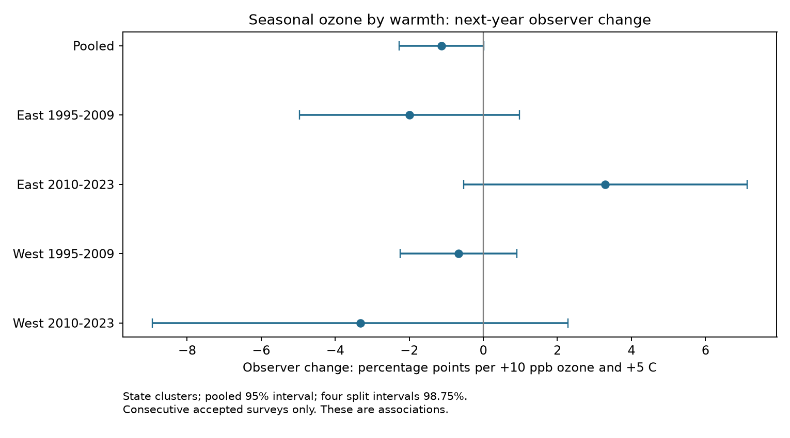

# Seasonal ozone and warmth gave no clear common link to next-year observer change on US bird routes in 1995-2023

## Result

We tested whether seasonal ozone had a stronger positive link to next-year observer change in warm seasons. We used 27,748 consecutive accepted Breeding Bird Survey pairs on 2,122 US routes. Observers changed in 1,431 pairs (5.16%). Models used route and state-year effects, survey conditions, rainfall, and observer experience. The pooled interaction was -1.13 percentage points per +10 ppb ozone and +5 C seasonal mean maximum temperature, with a 95% interval of -2.28 to +0.01. Four separate East and West, early and late tests gave mixed signs. All four intervals included zero after correction for four tests. Route trends gave a negative pooled estimate, but the separate samples did not establish a common negative pattern. This test concerns observer composition in surveys that returned in the next year. It does not measure all volunteer loss, bird loss, or causal climate effects. Coarse exposures, selected routes, few western state clusters and low event counts limit inference. The package includes code, a model panel, input data, source hashes, validation, and a figure.



| Sample or check | Pairs | States or clusters | Interaction (interval), percentage points |
|---|---:|---:|---:|
| Pooled | 27748 | 48 | -1.13 (-2.28, +0.01) |
| East 1995-2009 | 12236 | 37 | -2.00 (-4.96, +0.97) |
| East 2010-2023 | 10223 | 36 | +3.29 (-0.53, +7.12) |
| West 1995-2009 | 2410 | 16 | -0.67 (-2.24, +0.91) |
| West 2010-2023 | 2879 | 16 | -3.32 (-8.93, +2.29) |
| Within 25 km | 12140 | 48 | -1.03 (-3.00, +0.95) |
| Route trends | 27748 | 48 | -1.47 (-2.58, -0.36) |
| Route-observer effects | 27748 | 48 | -0.81 (-1.84, +0.22) |
| Without tenure | 27748 | 48 | -1.11 (-2.23, +0.02) |
| Route clusters | 27748 | 2122 | -1.13 (-2.36, +0.10) |


The four region-period intervals are 98.75% intervals. All other intervals are 95%. The positive interaction in the late East sample has an uncorrected p value of 0.030. It does not pass the four-test correction. The negative route-trend estimate has an uncorrected p value of 0.010. It is a sensitivity result. It is not proof of a common negative effect. The main replication rule failed.

## Question and prior work

Observer changes can affect bird count indices. Sauer, Peterjohn and Link (1994; DOI 10.2307/4088504) found observer differences in 50% of 369 species. Kendall, Peterjohn and Sauer (1996; DOI 10.2307/4088860) showed first-time observer effects. Liang et al. (2020; DOI 10.1073/pnas.2013568117) linked ozone with bird counts and policy changes. These studies give a reason to test observer composition as a source of bias in pollution and weather analyses. They do not establish that ozone causes observer change.

We searched the campaign for climate, pollution, biodiversity, ozone and observer replacement. The returned records included many count models and a survey-return test (SCI 105663b9). We read the source panel study (SCI 2603c41c0fe979d3cf70d08c3bdfb1b052386c2cee04f2e9e054d5c5fa10d6a2) and the survey-return study. This study tests a different outcome: observer change among routes with consecutive accepted visits. It tests one possible path from exposure to observation bias. It does not test a new bird response.

## Data and sample

We use the signed source panel in `files/input_panel.csv.gz`. It links the USGS BBS 2025 release (1966-2024), EPA AQS ozone, NOAA county climate and Census county points. The source panel and raw retrieval code are in the cited SCI publication. We preserve the code in `files/upstream/` and its raw input record in `files/upstream_provenance.json`. That file is the source study's record, not a claim that we downloaded all its inputs again.

We read the raw BBS survey register in place at `/mnt/dell-data/shared_datasets/usgs-bbs-2025-weather/Weather.csv`. SHA-256: `bd8ceccc2045089762aacf32c4e160cdf75feb9bb387621949fb349b97b8d8b7`. We checked the shared source metadata before use. No shared file was changed. `files/provenance.json` gives exact hashes for the panel, register and used documentation.

The register selects CountryNum 840, RPID 101 and RunType 1. A route must have an accepted standard survey in years t and t+1. Each route-year is unique. We match year-t records to the source panel by RouteDataID. We require complete exposure and control data in t and limit t to 1995-2023. There are 27,748 pairs, 2,122 routes, 48 states and 1,431 observer changes. There are no pairs through the missing national survey year 2020. The exposure year is t; the outcome is the observer identity in t+1 relative to t.

## Exposure and model

Ozone is the May-September year-t mean of daily maximum 8-hour ozone. The source uses inverse-distance weights for monitors within 50 km of the route start. Each monitor window needs at least 75% valid days. Temperature is the mean of May and June county mean maximum temperature. Rainfall is the May-June total in inches. County choice uses the nearest Census internal point, not an exact spatial intersection. These are seasonal means, not daily extreme exposures.

NOAA stores temperature in degrees F. The preserved county readme confirms the unit. We convert the model scale as W=(Tmax_F-77)/9, so W=0 is 25 C and a unit is 5 C. O=(ozone_ppb-50)/10. The interaction is O times W. Its coefficient is the change in the ozone slope for +5 C. It is not the total effect of a simultaneous exposure rise.

The outcome is 1 if observer IDs differ and 0 otherwise. We fit a linear probability model with route and state-year effects. Controls are O, W, their product, W squared, rainfall, survey day, start time, first-year BBS observer status, start wind and sky classes, and log(1+years since the first accepted route-observer visit). Wind values above 5 and sky values above 9 share the highest class. The register includes earlier years when we calculate experience. Current survey controls precede the next-year outcome.

The state-cluster covariance uses CRV1 and Student t reference values with G-1 degrees of freedom. We count the nominal fixed-effect columns for the finite-sample correction. Redundant effects can make this correction conservative. Singleton rows stay in the projection and have no within-effect information. Intervals are approximate, particularly with 16 western state clusters. The model can predict probabilities outside zero to one. We use it to estimate a local conditional slope, not individual risk.

The plan in `files/PLAN.md` was written before the outcome fits. The four primary samples cross East (longitude greater than -100) and West with 1995-2009 and 2010-2023. Each sample is fit separately. Their rows do not overlap, but routes can occur in both time periods, so errors are not fully independent. Support for a common positive interaction required all four corrected intervals above zero. Sensitivity checks use route trends, route-observer effects, no tenure control, route clusters, and closer spring monitors. The 25-km check uses distance to the nearest April-mid-June monitor, as stored in the source panel. It does not rebuild a 25-km seasonal exposure.

## Validation

A separate route-year match to the raw register and the full published panel gave zero observer-ID disagreements for all 27,748 pairs. This checks joins and labels; both records have the same underlying BBS source. It is not validation against an independent field survey. A second numerical method, alternating group demeaning, gave pooled coefficients within 3.9e-16 of sparse least squares. `files/validation.json` preserves the checks. Model tables include the maximum fixed-effect normal-equation residual. All substantial computations used campaign-compute with library threads set to one. A full second run from the packaged code passed: all stored model estimates agreed within 1e-7 relative tolerance. The log is `files/reproduction.log`.

## Limits and meaning

We find no repeated positive interaction in the tested samples. This does not show that observer change is random. Some intervals allow changes larger than the average 5.16% event rate. Few western events and state clusters reduce precision. Conditioning on an accepted return visit can create selection bias. Volunteer loss, skipped years and unaccepted next-year surveys are outside the outcome. Observers can stop for health, age, access or other reasons that are not in these data. The analysis has no direct measure of the reason for a change.

Only routes near ozone monitors enter the sample. Monitor placement, county climate and a single route start point give coarse exposures. Pollution and weather trends can share other causes. Experience controls and fixed effects do not remove all confounding. These results do not estimate bird abundance, biological timing, climate-change effects or ozone safety. The useful result is a tested observation-bias check with preserved labels and code. It does not justify dropping observer controls from biodiversity models.

## Reproduction

Use Python 3.12.16 and `files/requirements.txt`. From an unpacked bundle, run:

```sh
bash files/reproduce.sh /mnt/dell-data/shared_datasets/usgs-bbs-2025-weather/Weather.csv reproduced
```

The script creates a local environment, checks the raw register hash, runs the analysis through campaign-compute, and compares all estimates to the stored table. If the shared file is absent on another host, first run `python3 files/retrieve_weather.py Weather.csv` and give that local path to reproduce.sh. This uses the exact USGS URL and checks the hash before writing a new local file. Do not create a replacement at a missing mount path. To rebuild the upstream input panel from original sources, use `files/upstream/fetch_data.sh`, steps 01-03, and the source requirements file. Compare to the original source hashes. Raw endpoints can change; the signed input panel remains the fixed input for this study. `files/panel.csv.gz` preserves all final model rows and constructed terms for inspection.

## Work provenance

Job `sci-1107-dell-climate-pollution-biodiversity-2c386e84acea`; topic `climate-pollution-biodiversity`; campaign `11_07_2026`; machine `dell`; account `codex-andrii`; model `gpt-6.1-sol`, high reasoning effort, through Codex in T3 Code. No child agents were used. The signature uses a campaign-machine key. It is not a personal authorship claim. This publication is stored locally without a remote submission.
