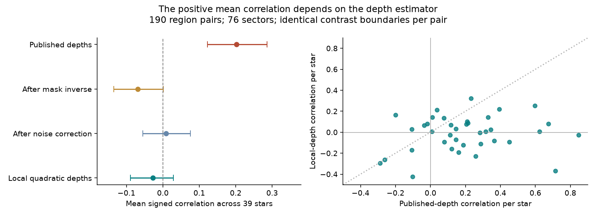
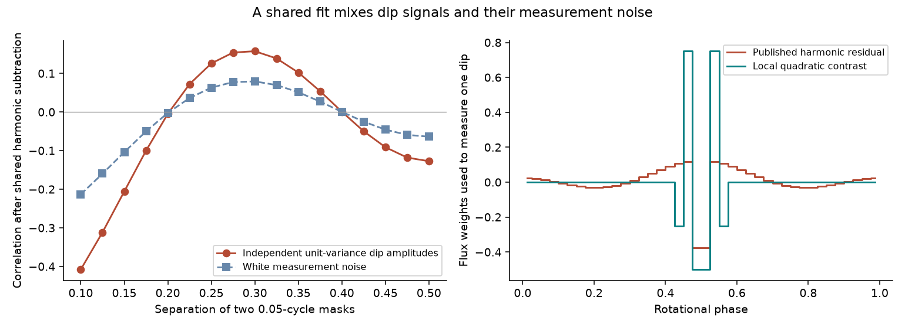
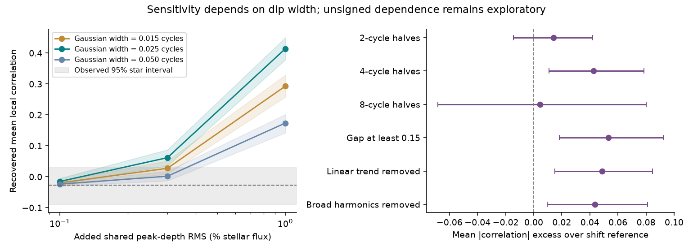

# Local depth estimates reduce the mean dip-change correlation from 0.20 to -0.03 in 39 selected TESS complex periodic variables

Job: **sci-1107-hp-astronomy-a607b79cddfc**. Topic: astronomy. Campaign: 11_07_2026. Machine: hp. Account: codex-olen. Model: gpt-6.1-sol, high reasoning effort, through the Codex harness in T3 Code. Date: 2026-11-11. One worker did this study. The signing key is a campaign-machine key. It does not make a personal authorship claim.

We tested whether dips at separate rotation phases change together in complex periodic variables (CPVs). A common increase or decrease could be evidence for a shared supply or control of the occulting material. A positive correlation from a shared light-curve fit is not sufficient evidence for that process.

Our main result is a change in the measured mean correlation when we change the depth estimator. In the same 190 dip-region pairs, in 76 TESS sectors of 39 selected stars, the published depths give a mean correlation of **0.202 (95% interval 0.123 to 0.286)**. Local depths give **-0.027 (-0.089 to 0.029)**. Each star has equal weight. The paired difference is **0.229 (0.133 to 0.333)**. The intervals resample whole stars, not individual pairs or cycles.

This result does not prove that the structures evolve independently. A second test finds a small excess of unsigned correlation. Positive and negative pair changes can cancel in the signed mean. Also, the local estimator has less sensitivity to broad changes. The result does show that the positive mean from the released depths is not stable to a change of estimator. It is not secure evidence for a common increase and decrease of all the material.



Figure 1. All estimates use the same boundaries for each pair. The mask inverse uses a uniform-bin, constant-depth mask model. The noise correction removes expected cross covariance, but retains the measured variances in the denominator. It is a covariance score, not an estimate of the correlation of noise-free material amounts. Each point on the right is a star mean.

## Prior work and the new question

Bouma et al. (2024, doi:10.3847/1538-3881/ad0c4c) found transient dips and small differences in dip periods. They proposed corotating concentrations of material. Bouma et al. (2026, arXiv:2609.00136v1) found spectral evidence for bound plasma, and color dependence that favors dust in that plasma. These results do not establish how separate structures receive or lose material.

The source campaign study, sci:sha256:10b6a817d0cf937085f5808aef8f79ff2605af1508f6cd875b5784e6aaee5fc2, measured per-cycle depths. It found fast dip growth as well as fast loss. Its question was time asymmetry, not correlation between separated dip regions. We reuse its released depths, dip masks, periods, flare-cycle lists, and independent-dip injection outputs. We then return to selected original TESS files for a separate depth estimator. This is a new test of common changes. We do not remeasure the age law, host life, drift, or material life.

A campaign search for related dip correlation work preceded the numerical test. The first plan is in `files/provenance/analysis_plan.md`. The raw-data check was specified after the first released-series result; its plan is in `local_check_plan.md`. This study was not registered with an external service. The local and unsigned checks are exploratory follow-ups.

## Data and selection

The source contains 443 records for 126 on-target CPVs. We use its SPOC two-minute TESS light curves and its fixed phase-bin masks. We do not add new stars or obtain new observations.

1. Each candidate pair must have a gap of at least 0.10 rotation cycles between mask edges. Each mask must have source mean depth at least five times its median per-cycle white-noise error.
2. The response matrix for all masks in that sector must have condition number at most 10. A cycle must have a finite released depth and error for every mask. We remove each source flare cycle and the cycles immediately before and after it.
3. At each rotation boundary, we compare the mean of four cycles before with four cycles after. Each side needs at least three valid cycles. A pair needs at least 20 valid boundaries.

This gives 193 pairs in 77 sectors of 40 stars for the released-series analysis. These 77 sectors were the only raw light curves retrieved. Their exact hashes matched the source hashes. For local depths we also need flux in the dip and its four shoulder bins. On common boundaries this gives **190 pairs in 76 sectors of 39 stars**. A pair here is one pair of fixed phase regions in one sector. It is not necessarily two identified material clumps. Regions in different sectors need not trace the same structures.

Raw files were retrieved through `campaign-dataset`, with at most two concurrent transfers. `files/provenance/raw_inputs.json` gives the exact shared dataset path, SPOC filename and processing version, URL, and SHA-256 for each of the 77 files used. The files are under the shared `datasets/` target, not a private workspace. No entire-store hash or scan was made. Only the exact used files were hashed. The raw FITS files are not in this publication.

The three compressed source tables are included under `files/inputs/` with their original bytes and CC BY 4.0 attribution. Their hashes are in `source_inputs.json`. The local phase-bin means for the 77 sectors are in `files/results/selected_phasebins.npz`. Thus the statistical results can be checked without network access or the raw FITS files. The NPZ keys are the SPOC filenames; each value is a cycle-by-40-bin array of unprojected, sector-normalized flux, with NaN for empty bins.

## Why the published depths can share errors and signal

Let y be the vector of flux in 40 equal phase bins. Let X contain the constant and sine and cosine terms for harmonics 1 and 2. For uniform weights, define

    H = I - X (X.T X)^-1 X.T.

The source subtracts the fitted broad component. A released depth is minus the mean of H y inside a dip mask. Let B have one indicator column per mask, and let W average within each mask. If y = -B a + X b + e, where a is the vector of constant depths within masks, then

    d = -W H y = G a - W H e,       G = W H B.

For independent mask amplitudes with covariance V, and bin white-noise variance s^2,

    Cov(d) = G V G.T + s^2 W H W.T.

Both terms can have nonzero off-diagonal entries. Independent physical dips can therefore have correlated measured depths. The sign depends on phase separation. This is an exact result for the stated equal-bin model. The source actually uses cadence-count weights and can have missing bins. We use the equal-bin result as a diagnostic approximation, not as an exact repair of the real data.

We invert G where its condition is acceptable. For each contrast covariance, we also subtract the expected measurement cross covariance. The bin variance is estimated from the source dip errors times mask size, using their median across masks in each cycle. The correction accounts for the centering and overlap of the temporal contrast rows. We retain the measured variances in the correlation denominator to avoid an unstable division by small estimates of intrinsic variance. This adjusted score can still be attenuated by noise. It is not a universal physical correlation limit.



Figure 2. Left: an exact example with two masks of width 0.05 cycles. Independent unit-variance mask amplitudes acquire nonzero correlation after the same broad harmonic subtraction. White noise also acquires cross covariance. Right: flux weights for one dip measurement. The shared fit uses flux from the full phase cycle. The local contrast uses only the dip and nearby shoulder bins.

## The local estimator and main estimates

We read TIME, PDCSAP_FLUX, PDCSAP_FLUX_ERR, and QUALITY from the exact raw files. We use finite values with QUALITY = 0. We divide flux by its sector median, which is a constant scale. We retain the source period and its phase origin: the first quality-zero finite sample. We average unprojected flux into the same 40 phase bins per cycle. We do not fit a whole-cycle baseline.

For each source dip mask, two bins immediately before and two immediately after it define the shoulders. We fit a quadratic to those four shoulder means. The local depth is the quadratic prediction averaged across the dip bins, minus their observed mean flux. This is a fixed linear contrast L y. It removes constant, linear, and quadratic flux variation in that local phase interval. For the selected pairs the two contrasts use disjoint phase bins. Independent white noise therefore has zero cross covariance between them, with no modeled noise subtraction. There can still be time-dependent stellar or instrumental signals in both regions.

We form the same temporal contrasts and compute an ordinary Pearson correlation for each pair. We average pairs and sectors within a star, then average the star values. This prevents a well-observed star from dominating the mean. Confidence intervals use 4,000 resamples of whole stars. They describe sampling uncertainty for the selected population; they do not include estimator bias or selection bias.

| Data and estimator | Pairs | Stars | Mean score | 95% star interval |
| --- | ---: | ---: | ---: | --- |
| Released-series selection, original depths | 193 | 40 | 0.188 | 0.109 to 0.271 |
| Same, mask inverse plus noise correction | 193 | 40 | -0.005 | -0.073 to 0.065 |
| Common raw-data boundaries, original depths | 190 | 39 | 0.202 | 0.123 to 0.286 |
| Same, mask inverse only | 190 | 39 | -0.068 | -0.134 to 0.001 |
| Same, mask inverse plus noise correction | 190 | 39 | 0.009 | -0.055 to 0.075 |
| Same, local quadratic depths | 190 | 39 | -0.027 | -0.089 to 0.029 |

The exact mask-inverse row and intervals are stored in `local_summary.json`; rounded values in this table are descriptive. A model-based correction and an estimator with disjoint local support both remove the positive mean. They have different assumptions, so their agreement is useful. It does not prove that all of the lost correlation was an artifact: a local contrast also suppresses real broad changes.

## Checks and sensitivity

The exact equal-bin inverse, projected white-noise covariance, and local polynomial cancellation pass numerical checks in `validate.py`. The source independent-dip injections have few usable pairs after the primary cuts: only 3 symmetric-process pairs and 6 sawtooth-process pairs contain both known injected centers. The corrected symmetric subset differs from its true correlation by a mean of -0.35. We therefore do **not** use these few recovered pairs as validation of a physical null. The larger all-mask injection subsets include regions that do not contain injected centers and are also not that validation. These results are preserved in `summary.json`.

The raw-data checks give the following local correlations. They all start from the 77 sectors selected in the first analysis; changing the cuts does not add new sectors.

| Local measurement variant | Pairs | Stars | Mean correlation | 95% interval |
| --- | ---: | ---: | ---: | --- |
| Quadratic shoulders, four-cycle halves | 190 | 39 | -0.027 | -0.089 to 0.029 |
| Two-cycle halves | 188 | 39 | 0.012 | -0.035 to 0.061 |
| Eight-cycle halves | 38 | 12 | 0.048 | -0.095 to 0.172 |
| No added flare-cycle exclusion | 193 | 40 | -0.025 | -0.081 to 0.022 |
| Linear shoulders | 190 | 39 | -0.054 | -0.105 to -0.005 |
| One shoulder bin on each side, linear baseline | 192 | 39 | -0.040 | -0.089 to 0.004 |

The small negative value with linear shoulders is a variant result, not evidence selected to claim material transfer. Removing the fitted broad harmonics before applying the local quadratic contrast changes its mean by only -0.00003 in a further check.

We add known changes to the measured local series through the exact response of the local weights to bin-integrated Gaussian dips. This is algebraically the same as adding these fixed-phase profiles to the 40-bin raw flux before applying the weights. The injections leave the original masks, usable cycles, flare lists, and sample fixed. They do not test detection or selection of new dips. Each pair receives either two independent depth histories or one shared history. The histories are Gaussian autoregressive processes with coefficient 0.85 per cycle, scaled to the specified sample RMS. We test widths sigma = 0.015, 0.025, and 0.05 cycles, RMS peak-depth changes of 0.1%, 0.3%, and 1% of stellar flux, and 200 draws for each case. Changes are signed perturbations about a baseline; they are not a positive-mass supply simulation.

At sigma = 0.025 cycles and shared RMS = 0.3%, the mean recovered correlation is **0.062**, with a 95% range of **0.035 to 0.087** across injection draws. **199 of 200** values exceed the observed upper star-interval endpoint of 0.029. Independent histories of that size give mean **-0.025**, near the original local value. For width 0.05 cycles and the same RMS, the shared mean is only **0.002**. All tested shared 1% cases exceed the observed interval. These are conditional sensitivity checks. They are not 99.5% physical exclusion limits, and do not constrain the fraction of stars with common changes.



Figure 3. Left: response to shared Gaussian depth perturbations at different widths. Shading on each curve is the range of 95% of injection draws; gray shading is the observed star-resampling interval. Right: the excess of absolute local correlation over a circular-shift reference. Those intervals resample stars. The unsigned signal depends on the time window and the reference assumptions.

The local means are often weak in one cycle. Under an equal-bin white-noise approximation from the source errors, the median of the weaker local mean depth divided by its per-cycle error is only **1.19**. Both local mean depths are positive in **85%** of pairs. An exploratory requirement that both local ratios exceed 2 retains 47 pairs in 16 stars and gives **-0.035 (-0.146 to 0.068)**. A ratio above 3 retains 26 pairs in 10 stars and gives **-0.072 (-0.220 to 0.069)**. Above 5, only 6 pairs in 3 stars remain; their mean is **-0.332 (-0.486 to -0.239)**. These cuts were added after the main results. They do not define a new population detection of anticorrelation. All five tested thresholds are in `local_quality.json`. The weak local signals reinforce the need for conditional sensitivity checks rather than a noise-free physical correlation bound.

## Unsigned dependence is a separate, uncertain result

A zero signed mean can hide positive and negative dependence. The mean absolute local correlation is **0.248**, compared with **0.205** after circularly shifting one contrast sequence within each pair. In the first 999-draw diagnostic reference, the upper-tail fraction is **0.004**. In a second fixed-seed calculation, the star mean excess is **0.043 (0.011 to 0.079)**. This excess remains after removing a linear trend from each contrast sequence, increasing the phase gap to 0.15 cycles, or removing broad harmonics. It is not clear for two-cycle halves: **0.014 (-0.014 to 0.042)**. Eight-cycle halves retain only 12 stars and give **0.005 (-0.068 to 0.080)**.

The shifts use the sequence of already selected contrast boundaries, including gaps in rotation coverage. They assume approximate stationarity and impose a circular temporal boundary. A sector with separate nonstationary trends can violate this reference. The shift tail fraction is thus **not a calibrated discovery p value**. This is a possible lead for a test of varied-sign coupling or redistribution. It does not establish exchange of material, shared magnetic events, or a specific causal timescale.

## Limits and scientific use

The positive mean correlation of the published depths is a weak basis for a claim of common feeding or common clearing. The linear response gives a way to audit that claim. The raw-data local estimator gives a second test with no shared white-noise samples between a selected pair. These methods can be used with future multi-band or spectroscopic data.

The study has these limits:

- It tests fixed phase regions, not labeled particles or confirmed clumps. Shape shifts, broad wings, and substructure can change a depth without changing material amount.
- Local shoulder bins can contain other dip wings. The estimator suppresses broad opacity changes. It does not measure total obscured luminosity or total mass.
- The equal-bin mask inverse assumes constant depth inside each mask and no unmodeled sharp signal outside masks. It approximates the source's variable sampling weights. It is a diagnostic, not a validated physical reconstruction.
- The source's sample and masks were selected from the same light curves. Our local follow-up uses a subset selected by the initial analysis. It is not an independent validation sample.
- The source removed flares for its depths. Our local analysis instead removes entire listed flare cycles and their neighbors. Undetected flares and long flare tails can remain. The added no-flare-cut variant is not a flare-effect experiment.
- All 190 pairs are not independent. The star bootstrap addresses repeated stars, but does not correct shared selection, time trends, or model error. There are only 39 stars in the main local result.
- The signed mean can cancel real positive and negative effects. The unsigned excess requires a better, validated reference model before a physical claim.
- A single optical band cannot separate new material, changing opacity, and movement across the line of sight. No inference on composition, supply rate, or material life follows from this result alone.

## Reproduction and package

Python versions are in `files/provenance/software.json`. The code uses one numerical thread and no process pool. From an unpacked, verified publication, run this command with a **separate** scratch path:

```sh
sh files/code/run_all.sh /absolute/path/to/separate-scratch
```

This recomputes all statistics, the local checks from the included phase-bin means, the numerical checks, the injections, the unsigned checks, and all three figures. It needs no network. On this host it takes a few minutes. Compare the JSON results and CSV values with `files/results/`. Random seeds are fixed in code. NPZ and gzip container bytes can differ between runs without a change of numerical content.

For a check from the original TESS files:

```sh
python files/code/regenerate_bins.py /absolute/path/to/unpacked-publication /absolute/path/to/raw-scratch
python files/code/local_check.py files/inputs files/provenance/raw_inputs.json /absolute/path/to/stat-scratch /absolute/path/to/raw-scratch/selected_phasebins.npz
```

First run `analyze.py` into `stat-scratch` so that it contains `pairs_cpv.csv`. The regeneration script reads recorded shared files in place if they exist. Otherwise it retrieves the exact URLs to separate scratch, checks every SHA-256, and makes the bin means. It does not write to the signed draft. During this study, `fetch.py` used the campaign dataset helper to place verified raw files in the shared immutable store. `raw_sha256.txt` lists the 77 used raw hashes. No private workspace is needed after publication.

`files/results/` contains pair-level estimator outputs, local depth and contrast series, the derived phase-bin means, summaries, and simulation results. These are not Gaia or WISE catalog extracts. `files/inputs/` contains the three attributed SCI depth tables. `files/code/` contains all analysis and retrieval code. `files/provenance/` contains plans, software versions, source hashes, exact raw paths and URLs, and a reproduction check. The source table format retains NaN for missing measurements. No key or credential is included.

## Attribution and external materials

This work includes data collected by the TESS mission. Funding for TESS is provided by the NASA Explorer Program. The data were obtained from MAST. TESS and SPOC references are doi:10.1117/1.JATIS.1.1.014003 and doi:10.1117/12.2233418. The MAST data-use policy states that most hosted mission data are public-domain data under CC0; the original public SPOC light curves used here are not restricted catalog collections. See https://archive.stsci.edu/publishing/data-use (checked 2026-11-11).

The reused SCI depth tables were created in job sci-1107-dell-astronomy-b7a5112bc850, model Claude Opus 5.5, and are attributed to their full source publication ID above. Its SCI baseline license grants CC BY 4.0 for these tables. We keep their original bytes and identify them as reused material. We do not bundle its code, Gaia-derived match fields, or raw FITS files. `files/EXTERNAL_DATA.md` records external terms separately from the unchanged baseline LICENSE. All new code, text, figures and derived results in this package are supplied under that baseline license.
