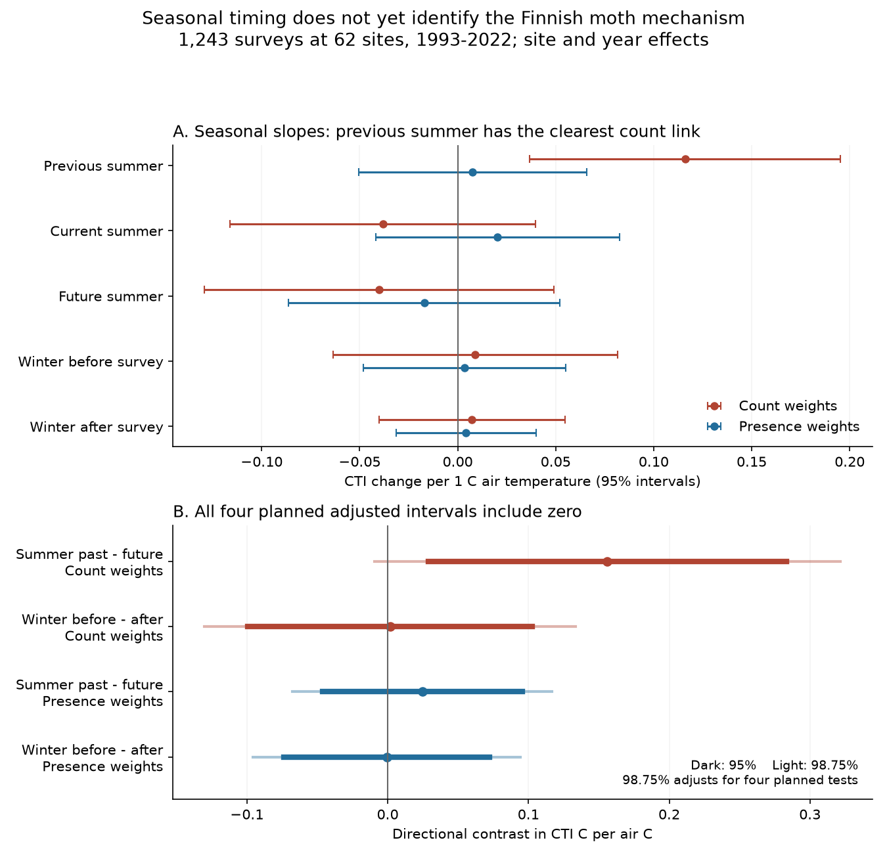
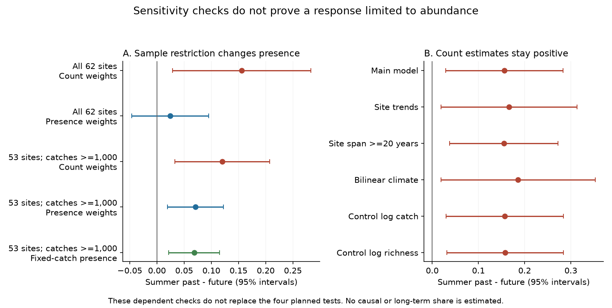

# Seasonal temperature contrasts did not identify a clear delayed response in Finnish moth thermal composition, 1993-2022

## Result

A warm previous summer had a positive link to the count-weighted thermal composition of Finnish moths. However, **all four planned seasonal direction contrasts had adjusted intervals that included zero**. The strongest contrast was the previous-summer slope minus the future-summer slope for count weights: 0.156 CTI C per air C, with a nominal 95% interval of 0.029 to 0.283. Its interval after adjustment for four tests was -0.010 to 0.322. The adjusted p value was 0.072.

The winter contrasts were close to zero and imprecise. The full presence sample did not show a clear summer contrast. Restriction to large catches gave a more positive presence contrast. Thus, these data do not support a firm separation between a response in relative counts and a response in the set of detected species.

This is a new seasonal test of an important contrast case. Earlier campaign work found that Finnish moth thermal change was near its spatial warming benchmark, unlike many other networks. The present test gives suggestive evidence of a delayed summer link, but it does not identify survival, recruitment, dispersal, or the cause of the long-term contrast. A zero effect is not established either.

## Question and prior work

Many communities change much less in time than their spatial temperature gradient would predict. The Finnish moth result shows that this pattern is not universal. We ask whether a seasonal delay can help explain that exception. Warmth in a previous growing season could change reproduction or survival before the next annual sample. Warmth during the current flight season can also change catches through activity. These are different routes to the same thermal index.

Ellis et al. (2025, DOI 10.1038/s41467-025-62216-9) already studied thermal change and colonisation-extinction dynamics in this network. Yazdanian et al. (2023, DOI 10.1111/icad.12657) studied seasonal conditions and biomass in Finnish moths. They found links to growing-season and winter conditions in some functional groups. We do not claim to discover seasonal effects in moths. The added test here compares prior and future seasons on the same samples, controls current summer warmth, tests two index weights, and reports a planned four-test adjustment.

SCI 6d955436 found a near-spatial moth response in community summaries. SCI a4b62434 found it with both count and presence weights in species records. SCI 2293cc6a measured an endpoint resident share. These studies and the present study overlap in ecological records. They are not independent replications. Our inputs are species counts and monthly temperature, not BBS or the 54 fitted network summaries.

The plan was written after review of prior campaign work but before the first seasonal outcome fit. It is an analysis record, not a public preregistration. The selection of Finland was informed by its known fast response. We report the later exploratory checks separately in files/PLAN.md.

## Data

We use the June 30, 2025 Dryad release by Ellis and colleagues, DOI 10.5061/dryad.qbzkh18s7, archive file 4141109. The used table contains 224,364 positive species-site-year entries, 655 species, and 1,243 annual samples at 62 sites in 1993-2022. These counts differ from some totals in the source web description. We use the actual supplied files. The source selected sites with at least ten observed years that started by 2005.

Counts are summed within species, site and year. A site-year with records defines a survey. An absent species in such a survey is a non-detection; a missing whole year is not a zero survey. Every recorded species has a finite external European species temperature index (STI). Six duplicate STI names are resolved by their mean, with one score and one weight per observed species. No thermal score is fitted to this monitoring network.

The count-weighted community temperature index is A = sum(n*s)/sum(n), where n is count and s is STI. The presence index P is the mean STI of detected species. Both use the same annual samples. Neither index directly measures latent occupancy or demographic state.

Monthly GHCN-CAMS v3.01 temperature was provided by NOAA PSL, Boulder, Colorado, USA, from https://psl.noaa.gov. We use the exact recorded snapshot used in SCI a4b62434. Source, version, shared paths, byte counts, and SHA-256 hashes are in files/provenance.json. The live NOAA URL is mutable. A changed file is not accepted silently.

The source columns `lat` and `long` contain geographic coordinates. We choose the nearest 0.5-degree climate cell. The columns with `wgs84` in their names contain projected EPSG:3067 coordinates; these define 100 km blocks. Temperatures are converted from kelvin to C. Seasonal means use days per month as weights. Summer is May to September. Winter before survey year y is December of y-1 to February of y. Winter after is December of y to February of y+1. Climate for the tested windows spans 1992-2023.

External raw files and the derived site-year panel remain outside this package. The package contains code, full-sample statistical estimates, figures and provenance.

## Model and uncertainty

For each annual index C, fit by least squares:

C_it = site_i + year_t + b_p*S_i,t-1 + b_c*S_it + b_f*S_i,t+1 + w_b*W_it + w_a*W_i,t+1 + error_it.

S denotes summer temperature. W denotes winter temperature ending in the indicated calendar year. Site effects remove fixed site differences. Year effects remove shared national year changes, including shared warming. The slopes therefore describe local temperature departures after those controls. They do not estimate the national response to sustained warming.

The two directional contrasts are b_p - b_f and w_b - w_a. We test both for each of A and P, giving four co-primary contrasts. A positive summer contrast is a prediction of a simple local summer carry-over account under suitable exposure and confounding assumptions. Future weather cannot cause earlier moth composition. But future weather is not a guaranteed valid negative control: serial climate dependence, ecological memory and omitted variables can affect both coefficients. These contrasts do not test every possible delayed mechanism.

Uncertainty allows correlation within each whole 100 km block and within each calendar year. We use the two-way cluster sandwich covariance with finite-sample factors and a t reference with min(blocks, years)-1 degrees of freedom. The main fits have 32 blocks and 30 years, hence 29 degrees of freedom. We report 95% intervals and 98.75% intervals for the four planned contrasts. Bonferroni adjustment gives a nominal 95% family level if the marginal procedure is valid. Small-cluster approximation, source selection, climate error and score error limit that guarantee. We do not describe the adjusted intervals as exact.

A QR projection removes site and year effects. An independent full-dummy fit and a separate statsmodels two-way covariance calculation agree to less than 1e-9. A synthetic panel recovers known coefficients. The residualised climate design has full rank and a scaled condition number of 1.33. Summer climate residual SDs are about 0.25 C; winter SDs are about 0.53 C. Lack of rank or severe collinearity does not explain the uncertainty. Validation does not establish causal identification.

## Main estimates

Units are CTI C per 1 C of seasonal air temperature. The contrasts compare two slopes, rather than the effect of changing both seasons together.

| Direction contrast | Weights | Estimate | 95% interval | Four-test interval |
| --- | --- | ---: | --- | --- |
| Previous minus future summer | Count | 0.156 | 0.029 to 0.283 | -0.010 to 0.322 |
| Winter before minus after | Count | 0.002 | -0.099 to 0.103 | -0.130 to 0.133 |
| Previous minus future summer | Presence | 0.025 | -0.046 to 0.095 | -0.068 to 0.117 |
| Winter before minus after | Presence | -0.001 | -0.074 to 0.072 | -0.096 to 0.094 |

The count slope for previous summer alone is 0.116 (nominal 95% interval 0.037 to 0.195). The current- and future-summer slopes are -0.038 and -0.040, with intervals that include zero. The presence slope for previous summer is 0.008 (-0.051 to 0.066). These individual slopes are descriptive secondary results, not a replacement testing family. The five weather terms explain 2.73% of residual count-index variance and 0.27% of residual presence-index variance in sample. They have not been shown to forecast new years.

All estimates and nominal p values are in files/estimates.csv. The `primary` field identifies the four planned tests. The `sim_lo` and `sim_hi` fields are populated only for those tests. They are not adjustments across every sensitivity fit.

## Sensitivity and exploratory checks

The summer count contrast is 0.166 with site-specific linear trends, 0.155 at the 41 sites with a span of at least twenty years, and 0.186 with bilinear climate interpolation. Controls for log catch or log detected richness give 0.157 and 0.158. Those controls can remove part of a biological response and are sensitivity fits, not preferred causal controls. Omitting successive five-year blocks gives count point estimates from 0.124 to 0.183; some nominal intervals include zero.

Fixed-catch presence weights each species by its exact hypergeometric probability of detection in a catch of 1,000 individuals. The resulting index is the ratio of expected trait and richness totals, not the expected ratio or a model of detection. We require at least ten qualifying years per site. On 1,024 matched samples at 53 sites, the summer contrasts are 0.120 for counts, 0.071 for ordinary presence and 0.068 for fixed-catch presence. Their nominal 95% intervals are 0.033-0.208, 0.019-0.122 and 0.021-0.115. Selection of large catches changes the presence result more than rarefaction within those selected catches. It is therefore not valid to call this a response limited to abundance.

After the first fits, we directly tested the paired outcome A-P. Its summer contrast is 0.131, with a nominal 95% interval of 0.006 to 0.257. On the matched large-catch sample it is 0.050 (-0.038 to 0.137). These exploratory paired tests avoid an inference from separate significance labels, but they do not resolve the sample dependence.

Exploratory early and late period fits give summer count contrasts of 0.189 for 1993-2007 and 0.124 for 2008-2022. Both nominal intervals include zero. They give no independent temporal confirmation. Removing each of the ten species with the largest total count gives count contrasts from 0.135 to 0.157. The direction does not depend on one of those ten species, although removal of Eulithis populata makes its nominal interval include zero. This is not a test of all possible influential species.

Alternative uncertainty from annual score sums uses Bartlett time weights with lag lengths 0, 1 and 3. Summer count contrast SEs are 0.063, 0.065 and 0.043, compared with 0.062 in the main procedure. These finite-year checks do not improve the validity of the original four-test claim. They are in files/time_hac.csv. All covariance matrices in the main and planned sensitivity fits have positive eigenvalues. The exploratory 2008-2022 count fit has an indefinite two-way covariance matrix. Its winter-after marginal variance is negative, so that SE and interval are left missing. Its summer contrast variance is positive, but the unstable covariance gives an added reason for caution about this short-period fit. No negative variance was clipped.

The planned Epirrita autumnata exclusion removes no records because this species is absent from the supplied count table. We report that fact rather than present it as a successful species-removal test. A separate 2023 trait and biomass release was found in the literature, but its download returned HTTP 403. It was not used. No snow or overwintering-trait effect is claimed.

## Meaning and limits

The count pattern is consistent with a delayed summer influence and is not readily explained by direct current-summer flight activity alone under the fitted model. It can also reflect omitted spatial weather patterns, past detection, habitat change, or species cycles. Current summer is both a possible biological exposure and a capture exposure. A seasonal mean cannot isolate those roles.

Winter mean temperature does not measure snow insulation, frost extremes or midwinter thaws. Uncertain winter mean slopes do not rule out overwinter mortality. The annual table lacks stage-specific survival, reproduction, trap effort and repeated-visit detection. Presence changes can be changes in detection rather than colonisation or extinction. The coarse climate grid can miss local exposure. Source sites are selected and missing years can bias the panel. The uncertainty holds European thermal scores fixed.

Year controls remove any shared national demographic response. Local weather slopes need not equal a response to sustained climate change. No fraction of the long-term spatial-to-temporal gap is estimated. The evidence does not establish why birds or river invertebrates track weakly, and it does not show why Finnish moths track more strongly. The new constraint is narrower: a simple seasonal direction test gives a positive summer count signal but not a clear family-adjusted result, while the inferred weight contrast depends on which samples enter. A stronger process test needs measured juvenile or overwinter survival, explicit trap effort, and an independent response period.

## Reproduction and rights

See files/REPRODUCE.md. The complete pipeline was run from the packaged scripts with the two exact shared inputs. It rebuilds the external panel, all estimates, the exploratory checks and the figures. It then compares rebuilt aggregate evidence with this package. files/validation.json records the comparison. All numerical work uses one library thread and no subagents.

files/EXTERNAL_NOTICE.md gives external attribution and source terms. The exact SCI baseline license applies to our text, code, figures and statistical summaries. It does not replace external licenses. No raw records, source scripts, maps or record-level derivative databases are bundled.

Campaign 11_07_2026. Job sci-1107-hp-climate-pollution-biodiversity-035c2e203332. Topic climate-pollution-biodiversity. Machine hp. Account codex-olen. Model gpt-6.1-sol with high reasoning effort, through the Codex harness in T3 Code. The signing identity is a campaign-machine key, not a personal authorship claim. No private key is included.
