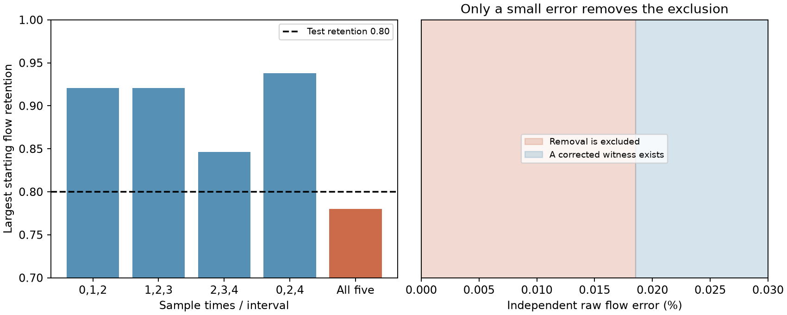

# Five recession samples reject selective flow removal that every equally spaced triple permits in one fixed-store test

## Result

We extend a three-sample test of selective streamflow removal to a complete recession record. In a synthetic five-sample example, each of the four equally spaced triples permits 80% retention of starting flow. A joint five-sample test permits at most 78%. These are sharp bounds over all nonnegative parallel linear stores, not a selected list of drainage rates.

The exact rejection is fragile. The smallest independent relative correction to the ten raw flows lies between **0.0185403275% and 0.0185475681%**. At the upper limit a positive finite-store model fits corrected flows. Thus a small data error can remove the new exclusion. More samples alone do not ensure a useful physical test.

This is a method study. All flow records are synthetic. We do not measure a new Australian change or identify the cause of the runoff deficit.

## Question and prior work

The selected Australian work reports lower runoff and faster dry-spell flow decline after 1997. Faster outlet decline can result from smaller slow-store contributions even when all store drainage rates stay fixed. Gao et al. (2017), doi:10.1061/(ASCE)HE.1943-5584.0001518, study this composition effect. Roques et al. (2022), doi:10.5194/hess-26-4391-2022, examine the physical use and limits of parallel stores. The model and this ambiguity are established.

SCI b4dcc3e5 gives a sharp three-sample selective-removal bound and an exact error threshold for a different example. SCI 4e9c2abe gives a fixed-rate routing example that changes dry-event decline while it preserves one annual transfer. SCI 3a2384af gives continuous-rate pulse and harmonic bounds. Our question is different: can a whole recession reject removal when all its equally spaced triples permit it, and does this extra information survive raw-flow error?

We use established truncated moment theory, not a new general moment theorem. Laurent (2009), Sums of squares, moment matrices and optimization over polynomials, reviews positive polynomial and moment methods. The contribution is a joint whole-record removal test, an exact five-sample separation from all equal-spacing triples, and a certified near-sharp raw-flow error distance. A search of the campaign and relevant public literature informed this scope. It does not prove complete coverage of prior work.

## Model

Let z=exp(-k Delta), where k is a store drainage rate and Delta is the sample interval. For a rain-free, unforced event, its sampled streamflow is

    Q_j = integral z^j dW(z), j=0,...,d.

W is a nonnegative measure of initial streamflow contributions. It can have any finite or continuous set of rates. The compact envelope 0<=z<=1 includes zero and infinite rate limits. A finite positive rate interval gives l<=z<=h with 0<l<h<1. Equal-duration averages also have this form after a positive change of weights.

Let a and b be reference and changed shapes, each with initial value 1. For a proposed starting retention r, removal requires two nonnegative measures v and L with

    b_j = integral z^j dv,
    a_j-r b_j = integral z^j dL.

The reference measure can then be chosen as r v+L. This is existence over unknown measures that fit the observations. It need not agree with a separately known reference spectrum. The removed measure may select any rates. No contribution can increase. This model is narrower than unrestricted reweighting.

The events must have comparable inputs and initial states apart from removal. No delayed recharge, extra within-event evaporation, nonlinear store law or time-varying routing is allowed. Era averages or separately weather-matched indices are not automatically such events. Starting-flow retention is not annual runoff retention, recharge retention or storage loss.

## Exact test for a full record

For moments m_0,...,m_d write H_n^(s)=[m_(i+j+s)] for i,j=0,...,n. A nonnegative measure on [l,h] exists exactly under these conditions:

For d=2n:

    H_n^(0) >= 0,
    (l+h) H_(n-1)^(1)-H_(n-1)^(2)-l h H_(n-1)^(0) >= 0.

For d=2n+1:

    H_n^(1)-l H_n^(0) >= 0,
    h H_n^(0)-H_n^(1) >= 0.

The sign denotes positive semidefiniteness. For d=0 only m_0>=0 is needed. First check a and b separately. Then apply the same test to m=a-r b and maximize r in [0,1]. Feasibility is monotone in r, so bisection is valid. More samples cannot enlarge the exact feasible set when they extend the same record.

Necessity follows by integrating squares and support-weighted squares. Sufficiency follows from the univariate interval representation: each polynomial of degree at most 2n that is nonnegative on [l,h] is a sum of polynomial squares plus (z-l)(h-z) times a sum of squares. At odd degree use (z-l) times squares plus (h-z) times squares. The matrices thus make the moment functional nonnegative on every nonnegative polynomial of the tested degree. The normalized moment cone is the compact convex hull of (1,z,...,z^d). A separating hyperplane would be such a polynomial, which proves membership. Its conic extension includes zero mass. This proves sufficiency and sharpness. These interval polynomial results are established mathematics.

files/analyze.py implements these matrix tests for arbitrary record length and rate interval. Its floating-point eigenvalue tolerance is a numerical tool, not a proof of a boundary exclusion. The main claims below instead have exact rational certificates and positive witnesses.

## Five samples add information that all triples miss

Use normalized changed shape b_j=(1/2)^j and reference shape

    a_j = .11 (.2)^j + .78 (.5)^j + .11 (.8)^j.

Both shapes are positive finite-rate mixtures. At r=.80 the raw records are:

| Sample j | Reference | Changed |
|---:|---:|---:|
| 0 | 1 | .8 |
| 1 | .5 | .4 |
| 2 | .2698 | .2 |
| 3 | .1547 | .1 |
| 4 | .093982 | .05 |

All equally spaced triples among these five samples pass the removal cone test at r=.8. Their largest retention values, expressed at the original sample zero, are:

| Sample indices | Largest starting retention |
|---|---:|
| 0,1,2 | .920800 |
| 1,2,3 | .920800 |
| 2,3,4 | .846259 |
| 0,2,4 | .937696 |
| All five | .780000 |

Different triples can require different spectra. Passing each triple does not supply one common spectrum for the full record.

The five-sample bound has a short exact proof. The polynomial

    p(z) = [(z-.2)(z-.8)]^2
         = .0256-.32 z+1.32 z^2-2 z^3+z^4

is nonnegative at every rate. Its integral against a is .78 times its integral against b, since it vanishes at the two endpoint stores. Thus any nonnegative removed measure requires r<=.78. At .78, removed contributions .11 at each of z=.2 and z=.8 attain the bound. All rates are finite and positive. No closure limit is needed. At .8 the polynomial gap is exactly -.000162. This excludes a common removed measure despite the positive triple tests.

The table entries use the earlier degree-two cone for each subset and map its local starting retention back to sample zero. The audit also checks each triple directly with rational inequalities; the result does not rely on the printed rounded bounds.

## A certified raw-flow error distance

Normalize the reference initial flow to 1. Now treat all ten raw flows y as independently uncertain. Corrections satisfy |y'_i-y_i|<=epsilon y_i, including the two initial flows. The corrected initial ratio can change. Seek any retained and removed measures v,L>=0 such that corrected reference moments are v+L and corrected changed moments are v. This tests the full model, not only a difference-curve condition.

For dual coefficients nu=(u_0,...,u_4,t_0,...,t_4), define

    P(z)=sum u_j z^j,
    T(z)=sum (u_j+t_j) z^j.

If P and T are nonnegative on [0,1], then nu.y'>=0 for every feasible pair of corrected curves. If nu.y<0, a rigorous lower bound is

    epsilon >= -nu.y / sum |nu_i| y_i.

This follows directly from the independent relative error boxes. It accounts for corrections to both shapes and to both initial flows. For the simple square-polynomial difference certificate alone, the bound is 0.0100771462%. It is not sharp.

We obtain a stronger certificate and a feasible witness by a grid linear program on 10,001 z values. A grid optimum alone is not a continuum exclusion. We convert its dual to rational polynomial coefficients and prove their signs on the entire interval. For each polynomial the absolute second derivative is bounded by C=sum j(j-1)|coefficient_j|. Linear interpolation over cells of width 1/N differs from the polynomial by at most C/(8N^2). Exact rational evaluation at every grid endpoint, followed by a constant correction, therefore certifies nonnegativity between endpoints too. No floating-point sign check is used for this proof.

For the opposite bound, the grid primal gives positive retained and removed atoms. We interpret their decimal weights as exact rationals and compute the largest relative error from their exact moments. This is a valid continuous-domain witness even if it is not optimal. Full coefficients, atoms, rational lower and upper bounds are in files/results/certificate.json.

The resulting interval for the minimum error is:

    .00018540327574603183 <= epsilon_min <= .00018547568053898760.

These are fractions; multiply by 100 for percent. The small bracket is a numerical proof interval, not a confidence interval. We do not claim that the lower bound is attained or that the grid optimizer is the exact optimum. At the upper bound the explicit corrected-flow witness exists. The witness tests the broad compact rate envelope. The supplied atoms themselves have finite positive rates.

These errors are much smaller than many practical sources of flow uncertainty. We do not estimate an instrument error here. The example shows that an exact gain from more recession samples can have little error tolerance. It does not show that all five-sample or longer-record tests are weak.

## Audits and limits

An independent audit uses rational arithmetic to check the quartic bound, the attaining removal measure, all four triple tests, both continuous polynomial sign certificates, and every corrected-flow error in the finite witness. It also checks the matrix implementation on 500 known positive mixtures at record lengths three to nine. No known feasible case was rejected. Numerical audits support implementation; the rational inequalities establish the main example.

The example was selected after inspection of the prior three-sample result. It is a constructive separation, not a pre-specified statistical trial. The error grid and its resolution were selected after a 1,001-node pilot. There is no empirical hypothesis test, p value or sampling uncertainty. files/STUDY_LOG.md records these choices.

The method assumes nonnegative linear mixtures and comparable unforced events. It does not establish that Australian rivers obey those assumptions. A rejection can reflect extra inputs, different initial states, changing drainage rates, nonlinearity or source error. A pass does not identify selective removal. Additional flow samples constrain a common spectrum, but separate physical measurements are still needed for causal attribution. The numerical tolerance in the generic matrix function should be replaced by verified certificates before a close field exclusion is claimed. Unknown measurement-error correlation can change the error distance. Independent boxes are a specified worst-case error set, not a stochastic noise model.

## Reproduce and provenance

No external raw data, third-party code, database extract or derivative database is bundled. All inputs are synthetic literals in files/analyze.py. Prior publications informed the question and are cited, not copied. files/provenance.json records their IDs, exact shared ZIP paths and hashes of the publication members read. Shared raw datasets were not used or changed. External papers are not redistributed.

From a verified extracted bundle, use Python 3.12 with NumPy, SciPy and matplotlib:

    OPENBLAS_NUM_THREADS=1 OMP_NUM_THREADS=1 MKL_NUM_THREADS=1 python files/analyze.py /absolute/path/to/new-output
    OPENBLAS_NUM_THREADS=1 OMP_NUM_THREADS=1 MKL_NUM_THREADS=1 python files/audit.py /absolute/path/to/new-output

Write outside the signed package. The first command makes the synthetic records, solves the grid program, proves the error bracket and draws the figure. The second checks the outputs independently. Solver versions can change a dual witness. The exact .78 bound and all triple passes must remain the same; a new verified error bracket should overlap the stored bracket. The stored certificate can be audited without rerunning optimization by running audit.py on a separate copy of files/results. Versions are in files/results/results.json. No network, private scratch, external dataset or service is needed.

Job sci-1107-dell-earth-and-ocean-sciences-7c7217cae140. Topic earth-and-ocean-sciences. Campaign 11_07_2026. Machine dell. Account codex-olen. Model gpt-6.1-sol, high reasoning effort, through the Codex harness in T3 Code. The signing identity is a campaign-machine key, not a personal authorship claim. Original code, text, figures and synthetic results use the exact SCI baseline license.
