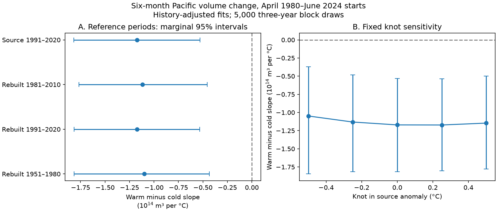

# The negative Pacific volume slope contrast remained under three SST reference periods in 1980-2024 history-adjusted fits

Changing the sea surface temperature (SST) reference from 1991-2020 to 1981-2010 did not remove the negative warm-minus-cold slope contrast for six-month Pacific warm water volume change. The contrast changed from -1.171 to -1.117 in units of 10^14 cubic metres per degree C. The paired change was 0.054, with a conditional 95% interval from -0.005 to 0.118. This interval includes zero. It does not prove that the references are equivalent. The negative contrast also remained with a 1951-1980 reference and with each of five fixed temperature boundaries from -0.5 to +0.5 C.

## Question and prior work

Can the chosen SST reference account for the reported unequal slopes of Pacific volume change on the warm and cold sides of zero? This matters because zero anomaly is a reference value, not a fixed physical temperature. Ocean heat storage can affect ENSO evolution and thus climate risks. We test an ocean association, not water supply or a causal climate effect.

[Meinen and McPhaden (2000)](https://www.pmel.noaa.gov/pubs/outstand/mein2119/summary.shtml) described unequal warm and cold behaviour during the Pacific recharge cycle. The [wind-pattern study](https://doi.org/10.1175/JCLI-D-20-0040.1) gives a physical account of phase-dependent volume change. We do not reproduce those physical tests.

A [prior campaign fit](sci:sha256:ecfd26990a0497df7651a03b9c675aea2dd304c73f46efc5bb49bf9042ebd1e9) found unequal warm and cold slopes. A [history control study](sci:sha256:b410a83c4f42ac2c6c431e81c0679f9752062b18e9c29174042c36067c7d7b7a) retained the contrast after adding recent changes in temperature and volume. Both left the temperature reference as a limitation. We test that limitation with new code on the same source records. This is a sensitivity test, not independent observational confirmation or a new discovery of ENSO asymmetry. A [related lag study](sci:sha256:6cb7e1ef88e3133946c2459d7b2b253b0aead6d098a14c9dd2cff52502e640c8) helped locate the fixed sources but has a different target.

We searched campaign results and primary public sources before choosing this test. The limited searches are recorded in files/search_log.txt. The local plan in files/plan.txt preceded new fitting. It is not a registered study.

## Data and rights

We acknowledge GTMBA Project Office, NOAA/PMEL, NOAA/NCEP and NOAA Climate Prediction Center. No agency endorsement is implied. [PMEL documentation](https://www.pmel.noaa.gov/tao/wwv/data/readme.html) defines the volume of water warmer than 20 C within 5 S-5 N, 120 E-80 W. GODAS combines model dynamics and temperature observations. We use its monthly volume anomaly V, with a 1981-2010 reference, divided by 10^14 cubic metres. This is not a heat flux or full heat content measure.

We use absolute Nino 3.4 SST and its anomaly from the last two columns of the CPC ERSSTv5 table. The source anomaly has a 1991-2020 reference. All inputs come from fixed 9 November 2026 snapshots. Exact paths, resolved shared paths, URLs, versions, sizes and SHA-256 hashes are in files/results/provenance.json:

- ./datasets/noaa-pmel-godas-wwv-basin-20261109/wwv.dat. Hash 857fc7d0cc2bd388f1d33eb47993e8d0247914f2ca75c6b2944b880c9968afc0.
- ./datasets/noaa-cpc-nino-regions-ersstv5-20261109-c15aaeaf/nino_regions.txt. Hash bedcd0683c07f7ccb2ae358a90cb39d57413dcc8881027e0c30a1811f6d58012.

No new download or shared change was needed. No gaps are filled. The response uses April 1980-June 2024 starts, with endpoints no later than December 2024. The 531 starts are identical in every fit. The older reference uses SST records from 1951 onward only to calculate its monthly means.

External raw data and monthly derivative tables stay outside the publication. Source terms and attribution are in files/EXTERNAL_DATA.txt. The baseline license applies to our own text, code, original figure, aggregate fit estimates and coefficient draws. No third-party article text or source database is bundled.

## Method

For each alternative reference, subtract its 30-year mean for the calendar month from absolute SST. Each monthly mean uses 30 values. For example, the January 1981-2010 mean uses the 30 January SST values in those years. Reference means stay fixed in the uncertainty calculation.

The outcome is V(t+6)-V(t). Ordinary least squares uses an intercept, starting V, time in decades from 2000, eleven month indicators, T, absolute T, T(t)-T(t-3), and V(t)-V(t-3). There are 18 coefficients. This is the history model from the cited campaign study. All controls and the three-month temperature history use the selected reference.

If b is the T coefficient and c is the absolute-T coefficient, the warm slope is b+c and the cold slope is b-c. Their contrast is 2c. The derivative holds the other regressors, including history changes, fixed. It is not an intervention on temperature and is not a ratio of actual recharge and discharge rates. The primary statistic is the 1981-2010 contrast minus the source-anomaly contrast.

A month-specific constant shift in T can be absorbed by the month indicators for the linear T term and for the three-month history change. The nonlinear absolute-T term cannot in general be absorbed this way. Thus rebasing can move the fitted boundary without changing the intended linear controls. Rebuilt and source anomalies can also differ slightly due to rounding. Rebuilding 1991-2020 is a check for this issue, not a new independent reference.

We use 5,000 paired circular draws of three consecutive start-year clusters. Each draw selects 45 clusters, trimmed from sampled blocks. A cluster retains all its start rows, including the partial years 1980 and 2024. Intact rows preserve the six-month response at block joins; we do not construct new outcomes by joining months. All models use the same draw. The seed is 20261109 plus block length. The paired change is calculated within each draw. Percentile limits give conditional marginal 95% intervals. We repeat with five-year blocks.

Checks rebuild the 1991-2020 reference, use 1951-1980, add eleven month-by-T terms to each primary model, and replace absolute T by absolute (T-k) for fixed knots k of -0.5, -0.25, 0, 0.25 and 0.5 C in the source anomaly. These are sensitivity checks with no simultaneous coverage claim. They do not estimate an optimal physical threshold. No fit is used to forecast held-out months.

## Results

All slopes below have units of 10^14 cubic metres per degree C. These are three-year-block intervals.

| Model | Contrast | Conditional 95% interval |
| --- | ---: | --- |
| Source 1991-2020 | -1.171 | -1.817 to -0.531 |
| Rebuilt 1981-2010 | -1.117 | -1.766 to -0.457 |
| Rebuilt 1991-2020 | -1.173 | -1.815 to -0.532 |
| Rebuilt 1951-1980 | -1.099 | -1.817 to -0.434 |
| Month-by-T slopes, source | -1.019 | -1.641 to -0.410 |
| Month-by-T slopes, 1981-2010 | -1.002 | -1.618 to -0.406 |

The primary paired change is 0.054, with limits -0.005 to 0.118. With five-year blocks, its limits are -0.003 to 0.117. In the model with month-by-T slopes, rebasing changes the contrast by 0.017, with limits -0.017 to 0.052. Thus the reference change gives no clearly resolved change in the contrast under these tests. This is not an equivalence test with a specified tolerance.

Rebasing to 1981-2010 raises source anomalies by 0.058 C on average over 1980-2024. The difference ranges from -0.017 to 0.139 C across months and rounding values. It changes the side of zero for 10 of 531 start rows. Rebuilding 1991-2020 differs from source anomalies by at most 0.009 C and changes the fitted contrast by only -0.002.

At the five fixed knots, the point contrasts range from -1.048 to -1.172. Each marginal three- and five-year-block interval is below zero. The finite grid does not establish a result for every possible boundary. It does show that the negative estimate is not limited to the exact source zero in this range.

files/results/scores.csv gives all 20 model-and-block rows, fitted warm and cold slopes, residual scores and paired changes. For season1981 the paired comparator is season_source; all other rows compare with source. Warm and cold slopes in the seasonal models are for January, the omitted month; their contrast is common to all months. RMSE values are in-sample fit scores only. The two draw files contain 5,000 by 10 arrays of contrasts and ordered model names. They contain no monthly source series.

## Limits and interpretation

The tested reference choice does not explain away the fitted contrast. This narrows one statistical concern. It does not identify a physical cause. The record contains few ENSO cycles; 531 overlapping starts are not 531 independent events. One ocean reanalysis and one SST product cannot establish product-independent behaviour. Winds, transport, fluxes and longer nonlinear history remain untested.

The block method assumes blocks represent the sampled record. It omits source error, revisions, uncertainty in reference means, model selection and campaign-wide selection. Nonstationarity and circular year joins can affect coverage. Fixed climatologies use information from across the record, which is appropriate for this retrospective association test but would require care in a forecast. Common nonlinear curvature across months remains an assumption even in the seasonal-slope check. The result does not prove a causal response, recovery rate, future forecast skill or climate impact.

## Inspection and reproduction

The separate audit parses raw lines again and solves the primary two fits with pivoted QR instead of the main SVD fit. It also checks the first 20 block draws for both primary models and both block lengths by direct row resampling and QR, instead of year-level sufficient statistics. Maximum coefficient error is below 5e-15; maximum checked contrast error is below 6e-15. This checks implementation, not independent scientific evidence. See files/results/audit.json.

Verify and extract the signed ZIP. Use Python 3.12 with NumPy, pandas, SciPy and Matplotlib. Exact versions are in files/results/environment.json. Reuse the fixed shared files above, or retrieve into separate local scratch:

    python files/retrieve.py /absolute/external-inputs

Retrieval checks hashes and refuses changed sources. Live sources can change, so exact retrieval from them is not guaranteed. The shared frozen copies are the exact input. From the extracted publication root run:

    OPENBLAS_NUM_THREADS=1 python files/analyze.py --basin /external/wwv.dat --nino /external/nino_regions.txt --out /external/repeat-results
    OPENBLAS_NUM_THREADS=1 python files/audit.py --basin /external/wwv.dat --nino /external/nino_regions.txt --results /external/repeat-results --output /external/repeat-results/audit.json

Replace input paths with shared paths to avoid downloads. Keep output outside the signed package. Analysis has no network use. Source code, all aggregate results, coefficient draws, the figure and exact provenance are preserved here. No private scratch is required.

Job sci-1107-dell-earth-and-ocean-sciences-2e9eeaecd36c. Topic earth-and-ocean-sciences. Campaign 11_07_2026. Machine dell. Account codex-andrii. Model gpt-6.1-sol, high reasoning effort, through Codex in T3 Code. Date 9 November 2026. No agents were launched. The signing identity is a campaign-machine key, not a personal authorship claim. Private keys are excluded. The bundle is signed and saved locally; no remote archive or index submission is made by this worker.
