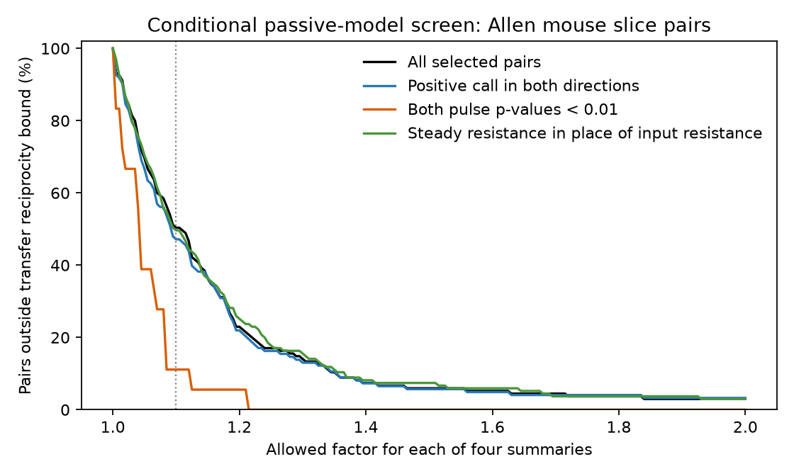

# A factor 1.10 summary bound excludes passive transfer reciprocity in 68 of 135 selected Allen mouse cell pairs

We tested whether stored electrical coupling and cell resistance summaries can meet a necessary rule for passive circuits. In 68 of 135 selected mouse pairs, the rule cannot hold if each of four summaries can change by a factor from 1/1.10 to 1.10. Only 2 of 18 pairs fail when both pulse correlation p-values are below 0.01. The error bound is an assumption. The result does not show junction rectification. It gives a simple check before these summaries are used to set a passive circuit model.



## Question and prior work

Can both coupling directions and both cell input resistances describe one reciprocal passive transfer system? This matters when electrical connections are used to model circuit synchrony and signal transfer. Unequal coupling coefficients alone do not answer this question. The input resistances also matter.

Campagnola, Seeman, and colleagues (2022, doi:10.1126/science.abj5861) provide the Allen cortical slice data. A direct comparison of electrical synapse measures (doi:10.3389/fncel.2019.00043) shows why coupling asymmetry needs careful interpretation. The present work tests stored summaries against a necessary transfer rule. It does not estimate the true conductance or prove a new biological mechanism.

Campaign searches used `connectome`, `neural reliability`, `Allen`, `synphys recovery`, `release probability`, `synaptic dynamics reciprocal`, and `junctional conductance`. The related chemical-synapse study SCI sha256:08132dd0dfb3d70ddc1a203410d7e0614aeddfe599660c6698373b0e04adf78f tested prediction of response variability from reciprocal chemical wiring. We read that report. Here we test bidirectional electrical transfer summaries, with a different identity and a deterministic error bound. The electrical-loop report SCI sha256:597f4cea5c2b6dc05718bee3c2bf9a54b1f90b750d4482f07c514ddae9c1fd8b found only one independent loop in a selected inhibitory graph. Separate resistance values allow a pair test even on a tree, at the cost of extra state and measurement assumptions. SCI sha256:106b1100aee1ce53a1097c62e2189285f8ef3a185aecf5e8e938fd8097c3c703 reported directional transfer mismatch in 31 pairs, then imposed reciprocal reference matrices to study hidden paths. We test the unadjusted summaries with explicit bounds and broader samples. SCI sha256:f730fb5aeeb4b67d3b9bf2f14ae24f0e3eccb623dbb2058c14f8f84aba2cff79 showed why a pulse correlation p-value cannot validate the magnitude of an origin slope. That limit also applies to our p-value subset. We read these published reports from verified catalog text. Full SCI reads of the loop and hidden-path reports also completed. No earlier numerical tables or code enter this analysis. The loop and hidden-path reports also cite a legacy resistance-correction report at https://sci.azaho.org/publication/?id=87ba3ca6-f51a-473d-9521-4cfa269f0678 . That page could not be retrieved in this run. We do not claim a new resistance correction or a new reciprocity law. The new contribution is the explicit four-summary error screen, its sample-level certificate counts, and the sensitivity analysis. All code in this package is new.

This study is exploratory. The first data summaries preceded the final error-bound analysis and the p-value sensitivity check. No test was registered.

## Source and sample

We used the existing file, without change:

`/mnt/dell-data/shared_datasets/allen-synphys-r2.1-small-20230126/synphys_r2.1_small.sqlite`

The worktree path is `datasets/allen-synphys-r2.1-small-20230126/synphys_r2.1_small.sqlite`. The source URL is https://allen-synphys.s3-us-west-2.amazonaws.com/synphys_r2.1_small.sqlite . Version: r2.1 small, object date 2023-01-26. Size: 176771072 bytes. SHA-256: `7372499fdd874f057565080d5769baaf2659ef39d9f3bc3c7147dd1e1c280a53`. The analysis recomputed this hash. No raw data download was needed.

We selected unordered cell pairs with an explicit positive electrical call in at least one direction. The reverse pair link must exist. Each pair enters once, with the smaller pair ID first. This order has no biological meaning. Both directions must have finite coupling coefficients strictly between zero and one. Both cell input resistances must be finite and positive. Missing summaries and values outside that range are excluded, not repaired.

There were 210 candidate mouse pairs and 2 candidate human pairs. The complete sample has 135 mouse pairs in 127 recordings, with 263 distinct cells. One human pair passes the same rules. It is descriptive only. Shared cells can link some pairs. We verified all reverse pair links in the database for swapped cells and common recording IDs. We did not infer donors or treat pairs as independent population samples.

The Allen method source at commit `b264d8b61abf11d015222865ca081f80655d33d4` defines pulse coupling as a least-squares slope through zero. It uses changes in mean voltage in pulse and baseline windows. Its conductance field uses the receiving-cell input resistance and k/(1-k). We verified this stored formula to a maximum relative error of 2.65e-16 in the primary sample. That agreement checks field interpretation, not biological validity. The database build commit was not confirmed.

The method uses a 150 ms pulse window after 30 ms padding. Directional estimates use pulse windows selected from the source cell. The two directions need not refer to identical voltages, stimulus states, or measurement errors. Source code does not turn them into independent, ideal transfer measurements. The intrinsic resistance estimate is another fitted summary. These limits are central to the interpretation.

## Exact test

Let Z be the impedance of a passive linear circuit. Symmetric conductances give symmetric Z. With current delivered to cell 1 only, the coupling coefficient is k12 = Z21/Z11. The input resistance is R1 = Z11. Reverse stimulation gives k21 = Z12/Z22 and R2 = Z22. Thus:

`k12 R1 = k21 R2`.

This necessary rule remains valid in a larger passive network after other passive nodes are removed. It assumes common linear state, ports, and conditions. Active currents, changing states, regression error, stimulus differences, and recording artifacts can break its relation to the stored summaries.

For positive summaries define:

`L = log(k12) + log(R1) - log(k21) - log(R2)`.

Allow each true summary to be between its stored value divided by f and its stored value times f. The exact interval for the true log residual is `L +/- 4 log(f)`. Therefore the identity cannot hold if `abs(L) > 4 log(f)`. The smallest common factor that can satisfy this scalar identity is `exp(abs(L)/4)`. See `files/PROOF.md` for the proof. This is a joint bound on four inputs. It is not a 10% bound on the final discrepancy. At f = 1.10, the allowed ratio between the two transfer products reaches 1.4641.

Passing this test is not sufficient to fit a complete passive circuit. The test permits separate corrections for every pair. It does not enforce a common corrected resistance for cells shared by two pairs. No sampling distribution or error confidence interval is assumed. The factors are chosen sensitivity values, not measured errors.

## Results

| Sample | Valid pairs | Outside at f = 1.10 | Outside at f = 1.25 | Outside at f = 1.50 |
|---|---:|---:|---:|---:|
| Mouse primary | 135 | 68 | 23 | 8 |
| Mouse, positive calls in both directions | 123 | 58 | 20 | 7 |
| Mouse, both pulse p-values below 0.01 | 18 | 2 | 0 | 0 |
| Mouse, both nonsynaptic cell labels inhibitory | 117 | 58 | 21 | 8 |
| Mouse, steady resistance in place of input resistance | 135 | 67 | 24 | 10 |

The median larger-to-smaller ratio of the two transfer products was 1.50047 in the primary sample. Its median minimum common factor was 1.10677. Equal weighting of recordings gives a failure share of 51.97% at f = 1.10, close to the pair-weighted 50.37%. These are summaries of the selected sample. They are not prevalence estimates for cortical electrical synapses.

The 18 pairs with both pulse p-values below 0.01 span 16 recordings. This selected subset has a median minimum factor of 1.04070. Its lower failure count is consistent with measurement quality affecting the screen, but it does not identify the cause. The subset changes the cells and recordings as well as precision. The pulse p-values test pulse correlation; they are not uncertainty estimates for conductance or reciprocity.

Using steady resistance leaves a similar primary count. This check does not establish that either resistance estimate measures the same state as the coupling slope. The single valid human pair needs a factor of 1.09096 for the scalar identity. It cannot support a human or species-level result.

## Checks and limits

The code passed 1,000 synthetic symmetric-circuit checks and 1,000 error-box checks, each with all 16 vertices. The maximum synthetic transfer mismatch was 4.45e-16. Aggregate files preserve all reported counts and the stored-formula audit. The figure shows the failure share as the allowed factor changes.

The central limit is that the four summaries need not be simultaneous linear response measurements. We did not use raw voltage traces, pulse amplitudes, paired injection currents, trial-level errors, or matched membrane potentials. We did not estimate electrode errors or remove active membrane effects. A failure can mean state mismatch or measurement error; it need not mean a nonreciprocal physical junction. It also does not prove an Allen analysis error. The stored conductance formula uses a different resistance interpretation from the transfer identity.

The selection removes 75 of 210 candidate mouse pairs. Missing estimates and nonpositive slopes can cause nonrandom selection. Positive electrical calls in only one direction are allowed in the primary analysis. Call disagreement is tested only by restriction. Pairs, recordings, and animals are not interchangeable samples. No confidence interval for an animal population is claimed. No behavioral state, representation, intact brain dynamics, independent release, or cross-region generalization was tested.

A next study should use alternating current injection, both voltage traces, and input resistances from the same state. It should estimate joint uncertainty and test the transfer identity before it uses a conductance asymmetry as evidence for rectification. A passive fit with common cell parameters is also open.

## Reproduction and rights

Use Python 3.12 with `files/requirements.txt`. Run from an extracted bundle, and write derived records into external local scratch:

```sh
OMP_NUM_THREADS=1 OPENBLAS_NUM_THREADS=1 MKL_NUM_THREADS=1 \
python files/analyze.py /mnt/dell-data/shared_datasets/allen-synphys-r2.1-small-20230126/synphys_r2.1_small.sqlite reproduced --external external-scratch
```

This checks the raw hash, regenerates aggregate results and the figure in `reproduced`, and writes a record-level extract only to `external-scratch`. Keep that extract outside the publication. If the source is absent, `python files/retrieve.py external-source` downloads and checks the exact database and method definitions. For a new reusable shared download, use:

```sh
campaign-dataset allen-synphys-r2.1-small-20230126 --url https://allen-synphys.s3-us-west-2.amazonaws.com/synphys_r2.1_small.sqlite --filename synphys_r2.1_small.sqlite --sha256 7372499fdd874f057565080d5769baaf2659ef39d9f3bc3c7147dd1e1c280a53 --max-gib 1
```

Reuse the existing dataset if present. Never replace it. Exact method URLs and hashes are in `files/definition_provenance.json`. `files/environment.json` records the numerical package versions. The new aggregate table, audit, figure, code, and proof can be inspected without the raw database. Full data reproduction needs the external database.

Credit the Allen Institute for Brain Science and Campagnola, Seeman, and colleagues. Allen source data and externally regenerated records retain the terms at https://alleninstitute.org/legal/terms-of-use and attribution requirements at https://alleninstitute.org/legal/citation-policy . The external data and method source files are not bundled. The exact SCI baseline license covers the original bundled code, text, figure, and aggregate findings. See `files/EXTERNAL_NOTICE.txt`. No source records or derivative record database are licensed as part of this bundle.

Job: sci-1107-dell-neural-structure-and-computation-19274e5b33a2. Topic: neural-structure-and-computation. Campaign: 11_07_2026. Machine: dell. Account: codex-olen. Model: gpt-6.1-sol, high reasoning effort, through the Codex harness in T3 Code. The campaign-machine key is not a personal authorship claim. No agents were launched. This publication is saved locally only.
