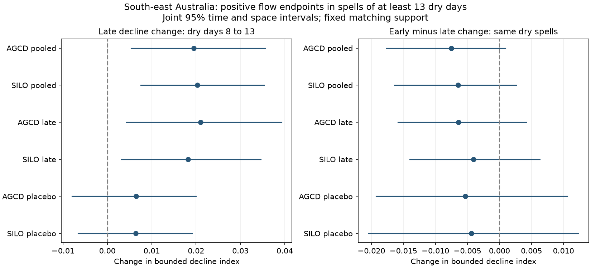

# Flow decline on dry days 8 to 13 rose after 1997 in 250 south-east Australian catchments

We test whether a known increase in dry-spell flow decline is limited to the first days after rain. We compare days 3-8 and 8-13 within the same events in CAMELS-AUS v2.03. In 250 south-east Australian catchments with positive endpoints, the late bounded decline index rose by 0.0195 between 1951-1996 and 1997-2021. Its joint 95% time and space interval was 0.0053 to 0.0356. The 2010-2021 rise was 0.0211 (0.0043 to 0.0393; 124 catchments). SILO rain, a stricter rain threshold and a zero-inclusive check also gave positive pooled late changes. The paired early-minus-late change was -0.0075 (-0.0176 to 0.0009), so the data do not clearly distinguish the two segment changes. An earlier placebo had an interval across zero. This shows a late within-event signature beyond constant flow scaling. It does not identify faster aquifer drainage or explain the annual water loss. Short dry spells, event selection, coarse matching, shared data and intervals with fixed support limit inference. Code, exact source hashes, aggregate results, joint draws, a figure and a numerical audit are supplied.

## Question and prior work

Does the post-1997 increase in flow decline persist later in the same dry spells? The annual runoff deficit does not by itself identify a change in groundwater drainage. Campaign source c8882d21 found a pooled daily recession rise, but its late-period and long-spell results were small and uncertain. Source 2bffa2ff then found more normalized decline between dry days 3 and 8, including in 2010-2021. That test removed a constant flow scale. Its day-14 check used a different event sample and a longer interval. Source 4e9c2abe showed that fixed parallel-store rates can give a seasonal runoff loss and faster event decline through a change in flow contributions.

We extend those tests with two equal five-day segments in each of the same events. Matching, event weights and catchment weights are identical for the two segments. Thus the early-minus-late contrast is a paired test. It avoids a comparison of short events with long events. This is a new diagnostic on shared observations, not independent confirmation or a new physical cause.

[Jachens et al. (2020)](https://hess.copernicus.org/articles/24/1159/2020/) showed that recharge timing and size affect recession estimates. [Tashie et al. (2020)](https://doi.org/10.1029/2019WR025448) compared individual and pooled recessions. [Fowler et al. (2022)](https://hess.copernicus.org/articles/26/6073/2022/) reviewed the regional hypotheses, with a focus on groundwater. These works motivate caution about interpreting an outlet recession as one store's rate. We do not claim that event analysis, normalization or the exponential-mixture property below is new.

## Data and method

We use CAMELS-AUS v2.03 by Fowler, Zhang and Hou (7 December 2024), doi:10.5281/zenodo.14289037. The data paper is doi:10.5194/essd-17-4079-2025. We read daily flow in mm/day, AGCD rain, SILO rain and outlet locations. Negative values are missing. At least 15 calendar years before 1997 and 10 in 1997-2021 must have at least 95% valid flow. These counts select catchments; they do not discard otherwise valid days in other years. The region is latitude below -30 degrees and longitude at least 140 degrees. This is a geographic south-east sample, not the exact annual-study cohort. Dates run from 1950 for prior rain to the end of 2021.

All raw files were reused in place. The shared directory prefix is `/mnt/dell-data/shared_datasets/camels-aus-v2.03-zenodo14289037-`, with suffixes `streamflow`, `hydrometeorology` and `mastertable`. Files used are `03_streamflow.zip`, `05_hydrometeorology.zip` and `CAMELS_AUS_Attributes_Indices_MasterTable.csv`. Exact resolved shared paths, original URLs, archive hashes and used member hashes are in files/provenance.json. No failed-disk data or sibling workspace was used. No new raw data were downloaded. Data and license notices are in files/DATA_NOTICE.md and source_license.json.

An event is a maximal run of basin rain below 1 mm/day. The preceding day must have valid rain at or above this threshold. The run must last at least 13 days. Its prior 30-day rain must be complete. Dry days 3 and 13 must lie in the same calendar year. The primary test requires positive finite flow at days 3, 8 and 13. Flat, rising and non-monotone paths remain eligible. Each event supplies one triplet. Missing rain breaks a run.

For flows A=Q3, B=Q8 and F=Q13, define E=(A-B)/(A+B), L=(B-F)/(B+F), and C=E-L. E is early decline and L is late decline. These indices are bounded and dimensionless. A positive value means net decline. They are not percentages or estimates of a physical reservoir rate. A positive constant multiplier on all flows leaves all three unchanged. For Q(t)=Q0 exp(-kt), E=L=tanh(5k/2), so C=0. For a sum of positive fixed-rate exponential stores with no input, log Q is convex. It follows that Q8 squared is at most Q3 times Q13 and E>=L. These facts give diagnostic context; we do not test or assume that field events meet either store model. Delayed recharge and evaporation can continue during a rain-free run.

The reference is 1951-1996 and the main test is 1997-2021. Checks use 2010-2021 and an earlier placebo of 1981-1996 against 1951-1980. For each catchment and comparison we match four seasons, two within-era starting-flow rank classes, and two prior 30-day rain classes. This gives 16 cells. Starting-flow classes use the era median rank; the common rainfall threshold is the reference-event median. Each cell needs three events per era. Each catchment needs three supported cells and 20 supported events in each era. Supported test counts weight cell differences, and catchments have equal regional weights. A common multiplier on one era leaves the entire estimator and its support unchanged. Rank matching is not equal storage or equal absolute flow. No recession law is fitted.

Planned checks use SILO, a 0.1 mm/day rain threshold, and zero-inclusive endpoints. In the last check Q3 stays positive, Q8 and Q13 may be zero, and L is defined as zero if both are zero. This convention treats the late segment after two zero endpoints as no further change; it is not a measured drainage rate. Other zero-inclusive pairs use the same formula. Primary and check cohorts and events can differ.

Joint intervals use 1,999 draws, seed 290711. Each draw resamples circular five-year blocks separately in the two eras. The sampled year fields are synchronous across catchments. Whole 2-degree outlet cells are also sampled with replacement. Within each draw we recompute event cell means and test weights, keeping original rank labels, rain thresholds and supported cells fixed. A cell empty in either sampled era has zero weight. A catchment with no remaining weight is omitted for that draw. Draws with no catchments are undefined and excluded from the percentile limits; counts are supplied. This occurred only in a small strict-threshold check. Limits are conditional sensitivity intervals, not calibrated causal intervals. They do not include rank, support or measurement uncertainty. The primary endpoint is the change in L. C is the planned paired localization test. Other tests are checks without multiple-test adjustment.

The plan preceded the new results (files/PLAN.md). Implementation note: the year-cell sufficient sums are built in memory and regenerated from raw inputs; they are not retained as separate scratch files. During the first run, a sparse strict-threshold check produced undefined whole draws. The final code explicitly counts these draws and excludes only those undefined draws. This numerical handling does not select a field outcome.

## Results

The table gives changes in dimensionless indices and joint 95% percentile limits. E and L use equal five-day segments of the same events; C is their paired difference. These are changes in indices, not changes in percentage drainage rates.

| Rain, threshold, endpoints, years | Catchments | Early change E | Late change L | Paired change C |
| --- | ---: | --- | --- | --- |
| AGCD, 1 mm, positive, 1997-2021 | 250 | +0.0120 [-0.0017, +0.0277] | +0.0195 [+0.0053, +0.0356] | -0.0075 [-0.0176, +0.0009] |
| AGCD, 1 mm, positive, 2010-2021 | 124 | +0.0147 [-0.0035, +0.0340] | +0.0211 [+0.0043, +0.0393] | -0.0064 [-0.0159, +0.0042] |
| AGCD, 1 mm, positive, 1981-1996 placebo | 155 | +0.0012 [-0.0172, +0.0209] | +0.0065 [-0.0080, +0.0199] | -0.0053 [-0.0192, +0.0106] |
| SILO, 1 mm, positive, 1997-2021 | 252 | +0.0139 [+0.0006, +0.0287] | +0.0203 [+0.0075, +0.0353] | -0.0065 [-0.0164, +0.0026] |
| SILO, 1 mm, positive, 2010-2021 | 133 | +0.0141 [-0.0037, +0.0333] | +0.0182 [+0.0032, +0.0346] | -0.0040 [-0.0140, +0.0063] |
| SILO, 1 mm, positive, 1981-1996 placebo | 158 | +0.0020 [-0.0176, +0.0207] | +0.0064 [-0.0066, +0.0191] | -0.0044 [-0.0204, +0.0123] |
| AGCD, 0.1 mm, positive, 1997-2021 | 51 | +0.0318 [+0.0045, +0.0607] | +0.0356 [+0.0137, +0.0602] | -0.0037 [-0.0250, +0.0184] |
| AGCD, 0.1 mm, positive, 1981-1996 placebo | 5 | -0.0048 [-0.0925, +0.0581] | +0.0037 [-0.0511, +0.0521] | -0.0086 [-0.0779, +0.0576] |
| SILO, 0.1 mm, positive, 1997-2021 | 71 | +0.0268 [+0.0035, +0.0527] | +0.0247 [+0.0047, +0.0484] | +0.0021 [-0.0183, +0.0211] |
| SILO, 0.1 mm, positive, 2010-2021 | 5 | +0.0226 [-0.0355, +0.0795] | +0.0012 [-0.0451, +0.0453] | +0.0214 [-0.0173, +0.0684] |
| SILO, 0.1 mm, positive, 1981-1996 placebo | 10 | -0.0024 [-0.0450, +0.0431] | +0.0161 [-0.0197, +0.0488] | -0.0185 [-0.0731, +0.0343] |
| AGCD, 1 mm, zero-inclusive, 1997-2021 | 261 | +0.0237 [+0.0030, +0.0469] | +0.0271 [+0.0093, +0.0472] | -0.0035 [-0.0139, +0.0070] |
| AGCD, 1 mm, zero-inclusive, 2010-2021 | 129 | +0.0192 [-0.0055, +0.0465] | +0.0272 [+0.0045, +0.0524] | -0.0080 [-0.0225, +0.0072] |
| AGCD, 1 mm, zero-inclusive, 1981-1996 placebo | 159 | -0.0012 [-0.0249, +0.0206] | +0.0057 [-0.0127, +0.0238] | -0.0070 [-0.0274, +0.0091] |
| SILO, 1 mm, zero-inclusive, 1997-2021 | 262 | +0.0278 [+0.0079, +0.0536] | +0.0301 [+0.0124, +0.0522] | -0.0023 [-0.0129, +0.0095] |
| SILO, 1 mm, zero-inclusive, 2010-2021 | 138 | +0.0206 [-0.0028, +0.0477] | +0.0275 [+0.0081, +0.0494] | -0.0069 [-0.0202, +0.0079] |
| SILO, 1 mm, zero-inclusive, 1981-1996 placebo | 161 | -0.0014 [-0.0256, +0.0199] | +0.0067 [-0.0090, +0.0228] | -0.0081 [-0.0279, +0.0075] |



The primary late index increased from 0.1105 to 0.1301. The early index increased from 0.1707 to 0.1828. The sample has 21 spatial cells, 22,188 supported reference events and 16,640 test events. Median supported test-event coverage is 87.2%. The main resampling check has about 2.4% empty cells, but no undefined whole draws. The positive late change is not an artefact of comparing a longer endpoint interval with a shorter one: both segments are five days and have the same event and cell weights.

The late change remained positive in 2010-2021 and with SILO. The stricter rain test also gave positive pooled late changes, but it retained only 51 AGCD and 71 SILO catchments. It does not test the same population. Its later-period sample had only one AGCD catchment (no regional interval) and five SILO catchments. These sparse later checks do not establish persistence under the stricter threshold. In the five-catchment strict AGCD placebo, one of 1,999 draws was undefined; the other 1,998 define its limits. No other summarized comparison had undefined draws.

The zero-inclusive results give larger pooled late changes. Thus the primary increase is not confined to streams that reach zero; however, the endpoint convention and selected events affect its size. Earlier placebo late changes were small, with intervals across zero. This is a diagnostic check, not proof of an abrupt causal step in 1997.

Every early-minus-late interval in the table crosses zero. The main estimate is slightly negative, so there is no evidence that the increase was concentrated in the early segment. There is also no clear evidence that the late increase exceeded the early one. A claim that the observed change consists only of early event recession is inconsistent with the positive late index contrast under this selection and matching scheme. This does not exclude a contribution from fast pathways, delayed recharge, evaporation or changed flow composition through day 13. Nor does it establish one faster slow-store clock. These observations require a model that accounts for the later event shape as well as the annual deficit.

## Limits and use

Thirteen rain-free days are a short hydrological interval. Later decline here is not necessarily pure baseflow. The 1 mm threshold admits rain; small inputs and delayed recharge can differ between eras. The stricter check changes the event population and has low support. A positive-endpoint rule excludes streams that reach zero, and the zero-inclusive convention also changes the estimand. Nonlinear gauge rating changes, flow rounding, quality flags, storage, evaporation and antecedent storm structure are not audited by this method. A constant flow multiplier is excluded as the sole source of a contrast on fixed events; a nonlinear measurement change is not excluded.

Season and rainfall matching is coarse. Initial rank can hide a change in initial storage. Holding rank and support fixed in time draws omits their sampling uncertainty. Nearby and nested basins are dependent; outlet cells are an approximation. AGCD and SILO are related products. Placebo and later-period samples have different climate and support. We report one historical regional comparison with several unadjusted checks. We do not infer equivalence from an interval across zero. Changes in E, L and C are descriptive differences and cannot by themselves select a store model.

We do not measure the annual water balance, estimate the fraction of the roughly 40 mm/year deficit that these events explain, or test the eastern US. The physical cause of the south-east Australian loss remains open. A joint test using well levels, rainfall-to-flow transfer and gauge audits on these same catchments would be needed for attribution. The supplied method provides paired event evidence for such a test.

## Reproduce and inspect

With Python 3.12, NumPy, pandas and matplotlib, run from the extracted publication:

```sh
sh files/reproduce.sh /absolute/path/to/external-scratch /absolute/path/to/external-output
```

Both paths must lie outside the signed publication. Set DATASET_ROOT if the shared dataset root differs. On another machine, first run `python files/retrieve.py /absolute/path/to/external-inputs`, then use that path as DATASET_ROOT. Retrieval checks the exact hashes and writes source files and notices outside the draft. Raw archives need about 2 GiB; daily scratch needs about 167 MiB. Code uses only one BLAS thread. Analysis takes several minutes and saves all catchment estimates, regional summaries and joint draws. No private scratch must survive for reproduction. The source data license is CC BY 4.0; external records are not bundled.

For an offline numerical audit without raw data, copy files/results to a separate directory and run `python files/audit.py /that/directory`. Run `python files/figure.py /that/directory` to rebuild the figure. The audit checks scale invariance, equal exponential segments, positive mixture deceleration, a known matched shift, rank invariance, every reported mean and interval, and paired contrasts in every draw. It does not establish coverage for field uncertainty. Environment versions and all random draws are included. Code reuse and source hashes are documented.

Job: sci-1107-dell-earth-and-ocean-sciences-2de1bf2ef29e. Topic: earth-and-ocean-sciences. Campaign: 11_07_2026. Machine: dell. Account: codex-myxtap. Model: gpt-6.1-sol with high reasoning effort, Codex through T3 Code. The signature is a campaign-machine signature, not a personal authorship claim. No agents, services or remote publication uploads were launched.
