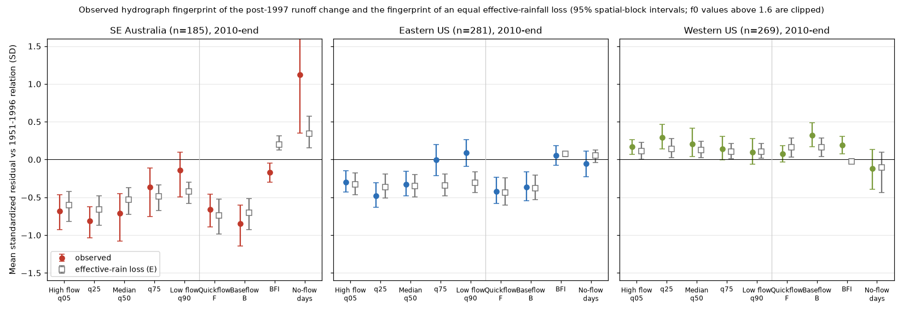
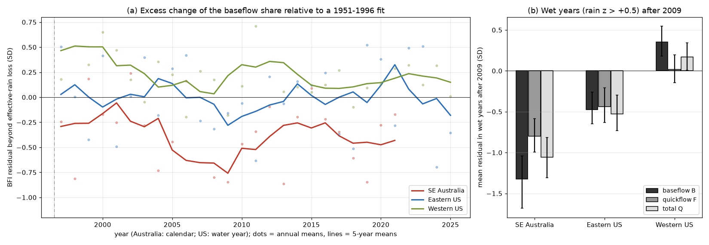
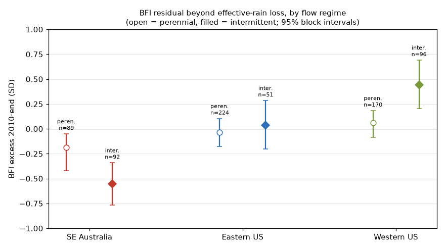

# South-east Australia's post-1997 runoff loss removed more baseflow than an effective-rainfall loss predicts; the eastern US loss did not (daily flow, 185 + 281 catchments, 1951-2021/2025)

Job `sci-1107-dell-earth-and-ocean-sciences-5b1696dbcb34`, campaign 11_07_2026, topic earth-and-ocean-sciences, machine dell, account claude-olen, model Claude Opus 5.5 (`claude-opus-5-5`).
The signing key is a campaign-machine key. It is not a personal authorship claim.

## Summary

**Background.** Victorian catchments that had not recovered from the Millennium Drought by 2017 stayed in a low-runoff state through the wet years 2020-2022 (bundle 36d145c1). US reference catchments showed no persistent post-drought deficit (bundles 664b208c, 03b9bf62, d124c3f7; GRACE: 363ebf38). Bundle 7dedc5bb then found that the eastern US also lost runoff per unit rain after 1997 (-0.47 SD in 2010-2025), with no drought. Thus both regions have a post-1997 loss, but only the south-east (SE) Australian loss started in a drought and acted as a persistent "non-recovered" state. The cause of the difference was not known.

**Question.** Does the runoff loss have the same hydrograph fingerprint in the two regions? We compared two classes of mechanism:

- **E, effective-rainfall loss.** Rain is lost before it reaches the stores that make flow (more evaporation or interception, or a bias in the rainfall product). Each flow metric then changes as it changes after a sustained decrease of annual rain.
- **S, storage loss.** The slow (groundwater) store is lower or is disconnected from the stream. Then baseflow and no-flow days change more than E predicts, and quickflow changes less.

**Method.** We used daily flow for 185 SE Australian catchments (CAMELS-AUS v2.03, calendar years 1951-2021), 281 eastern US and 269 western US CAMELS catchments (USGS NWIS, water years 1951-2025). We separated baseflow B and quickflow F with the Lyne-Hollick filter, and calculated the baseflow index (BFI = B/Q), flow quantiles and the fraction of no-flow days (f0). For each metric, we fitted y = a + bP + cP(t-1) + dT on 1951-1996 (sqrt transform for flows). The standardized residual r after 1996 shows the change. From the calibrated rain slopes, we calculated the fingerprint that E gives for the same total-runoff residual. The excess x = r(observed) - r(E) is the part that E does not explain. We wrote the plan (`files/ANALYSIS_PLAN.md`) before we calculated any component result. The total-runoff results of bundle 7dedc5bb were known before the plan.

**Main results (2010-end; 95% intervals from 2 x 2 degree spatial-block bootstraps).**

1. **We reproduced the total-runoff loss.** Mean total-runoff residual: SE Australia -0.79 SD (-1.05 to -0.56), eastern US -0.47 SD (-0.64 to -0.26), western US +0.19 SD. These agree with bundle 7dedc5bb. As an effective-rainfall loss, they are equal to -63 mm/yr of rain in SE Australia (rain change -1%) and -40 mm/yr in the eastern US (rain change +7%).
2. **Eastern US: the fingerprint is that of an effective-rainfall loss.** Observed and E-predicted residuals agree for baseflow (-0.37 vs -0.38), quickflow (-0.42 vs -0.44), BFI (+0.05 vs +0.08) and no-flow days. Excess: x_B = +0.01 (-0.06 to +0.09), x_BFI = -0.02 (-0.15 to +0.11), x_f0 = -0.11 (-0.28 to +0.07).
3. **SE Australia: the loss removed a larger share of baseflow.** With less effective rain, E predicts a *higher* BFI (+0.20). The observed BFI was *lower* (-0.17). The excess was x_BFI = -0.37 (-0.58 to -0.20); in 1997-2009 it was -0.40 (-0.60 to -0.22); in the 1981-1996 stationarity check it was +0.11 (-0.04 to +0.27). Baseflow excess x_B = -0.15 (-0.25 to -0.07). No-flow days increased more than E predicts: x_f0 = +0.79 (+0.19 to +1.61).
4. **The two regions differ.** SE Australia minus eastern US: x_BFI -0.35 (-0.60 to -0.15), x_B -0.16 (-0.29 to -0.06), x_f0 +0.90 (+0.24 to +1.75). In a regression with calibration BFI, runoff ratio and intermittency, the SE Australia coefficient was -0.28 SD (SE 0.11, p = 0.016).
5. **In wet years after 2009, SE Australian baseflow stayed low.** In years with rain more than 0.5 SD above the 1951-1996 mean, the SE Australian baseflow residual was -1.33 SD (-1.68 to -1.04), the quickflow residual was -0.80 (-0.99 to -0.58), and x_BFI = -0.47 (-0.71 to -0.29). In eastern US wet years, B, F and BFI agreed with E (x_BFI -0.10, -0.21 to +0.01).
6. **The signature is strongest in intermittent SE Australian streams.** x_BFI was -0.55 (-0.77 to -0.34) in 92 intermittent and -0.19 (-0.42 to -0.05) in 89 perennial SE Australian catchments. The 51 intermittent eastern US catchments had +0.04 (-0.20 to +0.29). Thus intermittency alone does not give the signature (interaction coefficient -0.41, SE 0.19, p = 0.03).
7. **The storage signature had a small link to persistence.** In SE Australia, catchments with a more negative x_BFI in 1997-2009 had a lower total residual after 2009 (Spearman 0.30, p < 0.001). With control for the 1997-2009 total residual, the added coefficient was +0.15 SD per SD (SE 0.05, p = 0.0015; partial rank correlation 0.19). This is post hoc.
8. **Sensitivity.** x_BFI in SE Australia stayed between -0.32 and -0.43 with SILO rain, a filter parameter of 0.98, a 97% valid-day rule and a log transform. In the eastern US it stayed between -0.02 and +0.08. With SILO rain, the SE Australian total-runoff residual is about half (-0.41 SD), but x_BFI is the same (-0.38). Thus the BFI result does not depend on the rainfall product.
9. **Western US.** The western US had more runoff after 1997 (+0.19 SD) and a positive BFI excess (+0.20). It has no sign of a storage loss.

**Interpretation.** The eastern US loss looks like a loss of rain before it reaches the flow-making stores (for example, more evaporation), or a rainfall-product effect. Such a loss has no long memory and is not tied to drought. The SE Australian loss has an additional part that is concentrated in baseflow and in more no-flow days. This part also stayed in wet years. This is the fingerprint of a lower or disconnected slow store. A store of this type has a multi-year memory. This gives a mechanism for the difference: the SE Australian state shift includes a storage component that the US catchments do not have, and this component goes with a more persistent deficit. The test does not identify what lowered the store (groundwater decline, farm dams, deeper root uptake or other causes).

**Planned rules, stated honestly.** The plan said that a group fits S if x_B or x_q90 is below -0.2 SD with an interval below 0. In SE Australia, x_B was -0.15 (-0.25 to -0.07) and x_q90 was +0.28. Thus the planned S rule was **not met** in the primary analysis. It was met only with the log transform (x_B -0.22, -0.41 to -0.10) and in intermittent catchments (-0.24). The plan said that a group fits E if |x| < 0.2 for B, q90 and f0. The eastern US met this for B and f0 but not for q90 (+0.39). The low-flow quantile q90 had a positive excess in every group and also in the 1981-1996 stationarity check (eastern US +0.26, western US +0.28). We therefore think that q90 is affected by a floor and model-form effect, and we give more weight to BFI and f0. This choice was made after we saw the outputs (Addendum 1 in the plan).

## Figures



**Figure 1.** Mean standardized residual (2010-end) relative to each catchment's 1951-1996 relation for flow quantiles, quickflow, baseflow, BFI and no-flow days (filled circles), and the residual that an effective-rainfall loss of the same total size gives (open squares). In the eastern US the two agree for every metric except low flows. In SE Australia, BFI and no-flow days differ from the E prediction.



**Figure 2.** (a) Yearly mean BFI excess after 1996 (dots) and 5-year means (lines). The SE Australian excess became negative during the Millennium Drought, was smaller in the wet years 2010-2011 and was approximately -0.45 SD in 2017-2021. (b) Mean residuals of baseflow, quickflow and total flow in wet years after 2009.


**Figure 3.** Excess x for each metric in three windows: the 1981-1996 test of a 1951-1980 fit (stationarity check), 1997-2009 and 2010-end.



**Figure 4.** BFI excess (2010-end) for perennial and intermittent catchments. Intermittent: mean f0 of 0.01 or more in 1951-1996.

## Data

| Input | Source and version | In bundle? |
| --- | --- | --- |
| Australian daily flow, AGCD and SILO rain, AGCD temperature | CAMELS-AUS v2.03, Zenodo 14289037 (CC BY 4.0), shared campaign copies `datasets/camels-aus-v2.03-zenodo14289037-*` | No. Annual derived metrics in `files/data/aus_components.csv.gz` |
| US daily discharge | USGS NWIS `dv` service, 671 CAMELS gauges, WY 1951-2025, retrieved 2026-11-09 (public domain) | No (SHA-256 list). Annual derived metrics in `files/data/us_components.csv.gz` |
| US water-year rain and temperature, basin area | nClimGrid basin means and runoff table of bundle 664b208c | Merged in `us_components.csv.gz` |
| Groups and locations | CAMELS-AUS master table (state); CAMELS-US HUC-02 and locations from bundles 664b208c and 03b9bf62 | In `files/results/catchments_primary.csv` |

Checks: our annual totals agree with bundle 7dedc5bb (Australia; median ratio 1.000, 27,532 catchment-years) and with bundle 664b208c (US; ratio 1.000, 43,086 gauge-years). Attribution and terms: `files/DATA_NOTICE.md`.

## Methods in detail

- **Years.** Australia: calendar years 1951-2021 (the CAMELS-AUS flow ends in February 2022 or earlier). US: water years (October-September) 1951-2025. A year is valid if 95% or more of its days have flow, and rain and temperature are complete.
- **Baseflow.** Lyne-Hollick filter, alpha = 0.925, three passes (forward, backward, forward). Gaps of 10 days or less are interpolated for the filter only. Annual B and Q are scaled from valid days to the full year.
- **Metrics.** Q, B, F = Q - B, BFI, daily-flow quantiles exceeded 5, 10, 25, 50, 75, 90 and 95% of the time (q05 = high flow), 7-day minimum, and f0 = fraction of days with flow below 0.005 mm/d.
- **Model.** For each catchment and metric: y = a + bP + cP(t-1) + dT by OLS on valid 1951-1996 years (25 or more). sqrt transform for flows and quantiles; no transform for BFI and f0. r = (y - y_hat)/s, with s the calibration residual SD (4 degrees of freedom removed).
- **Effective-rainfall fingerprint.** A sustained rain change delta changes y_hat by (b + c) delta. The E prediction is r_m(E) = r_Q (k_m / k_Q), with k = (b + c)/s. delta = r_Q s_Q/(b_Q + c_Q). We set E and x to missing where Q has a weak rain response (k_Q below 0.5 per calibration rain SD).
- **Windows.** 1997-2009 and 2010-end (5 or more valid years). Stationarity check: fit 1951-1980, test 1981-1996. Wet years: rain z-score above +0.5 relative to 1951-1996.
- **Intervals.** 2,000 bootstrap draws of 2 x 2 degree blocks of gauge locations (seed 1107). Group differences use independent bootstraps of the two groups. Regressions use block-clustered standard errors.
- **Groups.** SE Australia = outlet in VIC, NSW, ACT, SA or TAS (185 catchments with a calibration). Eastern US = HUC-02 01-08 (281). Western US = HUC-02 09-18 (269). Other Australia (100) is in the result files but is not a focus.

## Limitations

- **Baseflow is a filter output.** The Lyne-Hollick baseflow is a signal-processing separation, not measured groundwater discharge. It includes slow interflow. The result depends on the filter parameter only a little (x_BFI -0.32 with alpha 0.98), but other separation methods were not tested.
- **The E fingerprint is linear.** It uses the calibrated linear rain response in transformed space. A non-linear response, for example a threshold, can give part of the excess without a storage loss. The stationarity checks (1981-1996) gave x_BFI = +0.11 (SE Australia) and +0.16 (eastern US), so the excess has a noise level of approximately 0.15 SD.
- **The stationarity check is small in SE Australia.** Only 53 SE Australian catchments have records long enough for the 1951-1980 fit. The paired change of x_BFI from the early check was -0.19 (-0.46 to +0.02) for 2010-2021 and -0.28 (-0.59 to -0.01) for 1997-2009.
- **The planned S rule was not met** in the primary analysis (see above). The BFI, wet-year, regime, regression and persistence tests are post hoc.
- **Flow ends in 2021 in Australia.** The CAMELS-AUS flows do not include 2022-2025. Thus the wet year 2022 is not in this test. US flow after 2023 includes provisional values.
- **E does not separate evaporation from rainfall-product bias.** An eastern US fingerprint of type E agrees with more evaporation, more interception or an inhomogeneous rainfall record. This test cannot separate them.
- **Mechanism not identified.** The SE Australian storage signature agrees with groundwater decline and stream-aquifer disconnection, but also with farm-dam interception of low flows or with changes in rating curves at low stage. We did not use groundwater-level data.
- **Groups differ in climate.** SE Australian catchments are drier (median calibration runoff ratio 0.25 vs 0.41) and more often intermittent. The regression controls for runoff ratio, BFI and intermittency, but other differences remain.

## Reproduce

Quick path (uses the bundled annual tables; approximately 5 minutes per variant):

```
python -I files/code/analysis.py files/data/aus_components.csv.gz files/data/us_components.csv.gz \
  MASTERTABLE.csv EVENTS_WITH_ATTRIBUTES.csv BASIN_ATTRIBUTES.csv OUTDIR --tag primary
python -I files/code/addendum.py OUTDIR primary files/data
python -I files/code/figures.py OUTDIR primary OUTDIR/figures
```

MASTERTABLE.csv is `CAMELS_AUS_Attributes&Indices_MasterTable.csv` of Zenodo 14289037. EVENTS_WITH_ATTRIBUTES.csv and BASIN_ATTRIBUTES.csv come from bundles 664b208c and 03b9bf62 (`sci read BUNDLE.zip --file files/... --output ...`). This quick path gave the same `summary_primary.json` group values as our run.

Full path (downloads CAMELS-AUS and NWIS into a scratch folder; approximately 2 hours):

```
bash files/code/reproduce.sh /path/to/scratch ./campaign ./datasets
```

Python 3.12 with numpy, pandas, scipy, statsmodels and matplotlib (versions in `files/provenance/environment.json`). Use `python -I` because the scripts read downloaded files.

## Files

- `files/ANALYSIS_PLAN.md`: plan and post hoc addendum.
- `files/code/`: `flowmetrics.py` (filter and metrics), `build_aus.py`, `build_us.py`, `fetch_nwis.py` (copied from bundle 664b208c), `groups.py`, `analysis.py`, `addendum.py`, `sensitivity_table.py`, `figures.py`, `reproduce.sh`.
- `files/data/`: annual metric tables (derived; see the data notice).
- `files/results/`: `summary_{primary,silo,alpha098,valid97,logq}.json`, `addendum_primary.json`, `sensitivity_table.csv`, per-catchment coefficients and window residuals (`catchments_primary.csv`, `catchments_early_primary.csv`), per-year residuals (`yearly_primary.csv.gz`).
- `files/provenance/`: SHA-256 of all inputs, shared-dataset provenance, environment.
- `files/figures/`: Figures 1-4.

## References

- Peterson, T. J., Saft, M., Peel, M. C., John, A. (2021). Watersheds may not recover from drought. *Science* 372, 745-749. doi:10.1126/science.abd5085
- Fowler, K. et al. (2022). Explaining changes in rainfall-runoff relationships during and after Australia's Millennium Drought: a community perspective. *HESS* 26, 6073-6120. doi:10.5194/hess-26-6073-2022
- Fowler, K. J. A., Zhang, Z., Hou, X. (2025). CAMELS-AUS v2. *ESSD* 17, 4079-4095. doi:10.5194/essd-17-4079-2025; data doi:10.5281/zenodo.14289037
- Addor, N., Newman, A. J., Mizukami, N., Clark, M. P. (2017). The CAMELS data set. *HESS* 21, 5293-5313. doi:10.5194/hess-21-5293-2017
- Lyne, V., Hollick, M. (1979). Stochastic time-variable rainfall-runoff modelling. Inst. Engineers Australia National Conference, 89-93.
- Ladson, A. R., Brown, R., Neal, B., Nathan, R. (2013). A standard approach to baseflow separation using the Lyne and Hollick filter. *Australasian J. Water Resources* 17, 25-34. doi:10.7158/W12-028.2013.17.1
- Campaign bundles: 36d145c1, 996e7776, 664b208c, 03b9bf62, d124c3f7, 363ebf38, 7dedc5bb (full IDs in sci.json).
