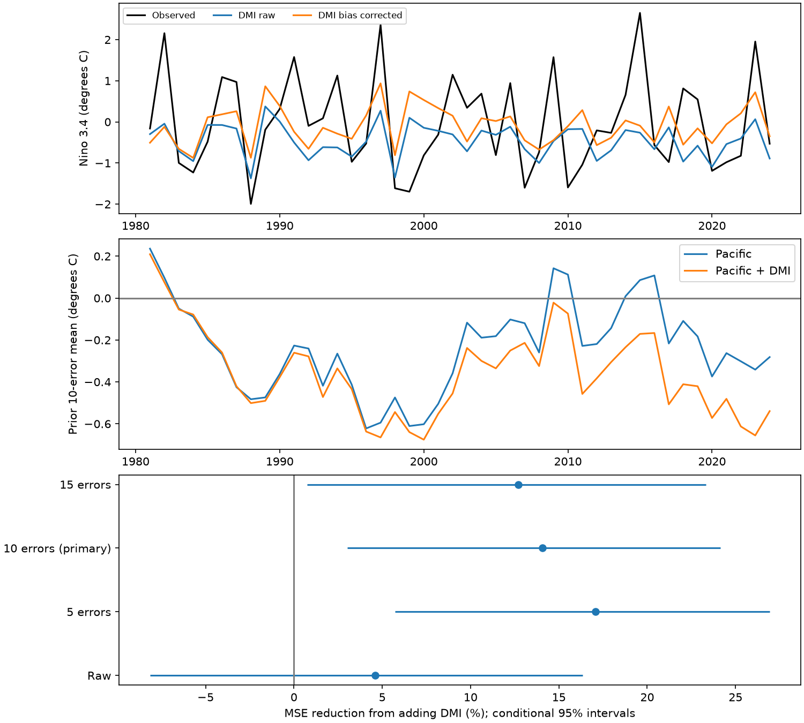

# Past-error correction reduced cold bias but gave no clear accuracy gain for a DMI forecast of ENSO in 1981-2024

A correction based on ten completed forecast errors reduced the mean cold error of a next-year ENSO forecast from 0.424 to 0.067 degrees C. The mean squared error (MSE) fell by 3.42%. Its conditional 95% interval was -18.56% to 19.61%. Thus the test gives no clear accuracy gain from this correction. The result separates reduced mean error from improved accuracy.

## Question and prior evidence

Can past forecast errors correct a cold bias in a long-lead forecast that uses the Indian Ocean Dipole Mode Index (DMI)? ENSO changes can affect rain and water supply. This study tests ocean indices. It does not test local water impacts.

Izumo et al. (2010), doi:10.1038/ngeo760, proposed use of Indian Ocean conditions to predict next-year ENSO. Fan and Meng (2023), doi:10.1029/2023GL105525, report unequal prediction links for the two DMI signs and propose an Atlantic path. Their public full text and NOAA source descriptions were consulted. We do not test their physical mechanisms.

We searched the campaign before fixing this question. The search is in files/search.json. We read the signed publication SCI sha256:2ab3cdc3dbb0292b6bdbf4fec0668a97b48eb58c993c91b48696c626057660ec. It found no clear added next-year ENSO accuracy from DMI. It reported a cold mean error that offset a rise in correlation. It did not test a correction based on earlier forecast errors. We use the same source snapshots and seasonal model for a direct extension. No code or forecast tables were copied. Our raw 2000-2024 scores reproduce its point results. These data overlap prior tests. This is not independent confirmation of a new physical link.

The added method is a correction with an explicit target delay. All errors used to correct a forecast must be observable at its issue time. The package also shows how the choice of baseline can change the apparent value of DMI.

## Data

The analysis uses NOAA PSL HadISST1.1 monthly DMI and CPC ERSSTv5 monthly Nino 3.4 anomalies. Units are degrees C. DMI is the western equatorial Indian Ocean anomaly (50-70 E, 10 S-10 N) minus the southeast anomaly (90-110 E, 10 S-0). Nino 3.4 is the Pacific anomaly for 5 S-5 N and 170-120 W. The CPC file uses the 1991-2020 reference period. These are fixed revised snapshots, not vintage observations. The DMI source states that it is preliminary and was created on 25 July 2026. Current CPC products include newer versions; this test retains v5 to match the prior benchmark.

Only these shared raw files were read and hashed. They were reused in place and were not changed:

- ./datasets/psl-hadisst-dmi-monthly-20261109-d977/dmi.had.long.data; SHA-256 42c1000e221addacac4451b8b9ddfbc5ee732b99ee69b0be5105e69ebe881e05
- ./datasets/noaa-cpc-nino-regions-ersstv5-20261109-c15aaeaf/nino_regions.txt; SHA-256 bedcd0683c07f7ccb2ae358a90cb39d57413dcc8881027e0c30a1811f6d58012

files/provenance.json gives exact absolute and resolved shared paths, source URLs, byte counts and stored retrieval metadata. The full shared sources are not copied. files/monthly.csv preserves all 912 monthly pairs from January 1950 to December 2025. Only seasons with predictor years 1950-2023 and targets through January 2025 are used. Each used seasonal mean has three finite months. No missing values are filled. Source updates can prevent a new download from matching the hashes; the included monthly table fixes the evidence used here.

## Method

files/plan.txt was written before the new fits. It is a local plan, not an external registration. The earlier publication and its results were already known. The 44 test winters were selected to extend its short test and to allow a 15-error check. No forecast model or correction length was selected from the new scores.

For origin year y, the target is the average Nino 3.4 for November and December of y+1 and January of y+2 (NDJ). A winter is named by its November year. Predictors are the June-August (JJA) and September-November (SON) Nino 3.4 means. The DMI model also uses SON DMI. The issue is after November of y. The target midpoints are 14 months apart. Actual release dates are not modeled.

Both models use ordinary least squares with an intercept. At origin y, training uses predictor years 1950 through y-2. The last training target ends in January y. Predictor year y-1 is excluded because its target is not complete. Forecasts are first saved for origins 1963-2023. The test uses origins 1980-2023, or winters 1981-2024. Training has 29 rows at the first scored origin and 72 at the last.

The primary correction subtracts the average raw forecast-minus-target error of the last ten available forecasts of that same model. Only origins at or before y-2 enter that average. Thus the correction for origin 1980 uses forecast origins 1969-1978. It never uses the target of origin 1979 or the current target. Corrections are computed separately for the Pacific and DMI models. Corrected forecasts are not used recursively as calibration errors. Checks use five and fifteen errors with the same delay. All windows are fixed.

The planned added-value comparison uses corrected DMI versus corrected Pacific. We also compare corrected versus raw for each model to test the actual effect of correction. MSE reduction is 100 times (1 - candidate MSE / baseline MSE). Positive values mean lower error. Error intervals resample paired annual squared errors in circular three-year blocks, with 19,999 draws and seed 77117. One- and five-year blocks check the primary comparison. Each sample is trimmed to the original length. Bootstrap arrays are saved. Intervals condition on fitted forecasts; they do not include refitting, data revisions, question choice or source uncertainty. Dependence and changes over time can affect coverage. Intervals for sensitivity tests are not adjusted for multiple comparisons.

## Results

| Forecast, 44 winters | RMSE, degrees C | MAE, degrees C | Mean forecast minus target, degrees C | Correlation |
| --- | ---: | ---: | ---: | ---: |
| Pacific, raw | 1.173 | 0.963 | -0.266 | 0.220 |
| Pacific, ten-error correction | 1.214 | 1.040 | -0.027 | 0.072 |
| Pacific plus DMI, raw | 1.145 | 0.909 | -0.424 | 0.418 |
| Pacific plus DMI, ten-error correction | 1.126 | 0.935 | -0.067 | 0.292 |

Correction removes much of the mean error but reduces correlation for both models. It increases the Pacific model's MSE by 7.23% and reduces the DMI model's MSE by 3.42%. Neither change has a three-year interval that excludes zero. DMI model MAE rises after correction. Reducing mean error alone does not ensure lower squared or absolute error.

| Comparison, 1981-2024 | MSE reduction, % | Conditional 95% three-year interval, % |
| --- | ---: | ---: |
| Corrected DMI versus corrected Pacific, primary | 14.07 | 3.03 to 24.15 |
| Raw DMI versus raw Pacific | 4.60 | -8.15 to 16.35 |
| Corrected DMI versus its own raw forecast | 3.42 | -18.56 to 19.61 |
| Corrected Pacific versus its own raw forecast | -7.23 | -27.08 to 7.82 |
| DMI versus Pacific, five-error correction in both | 17.06 | 5.72 to 26.93 |
| DMI versus Pacific, fifteen-error correction in both | 12.70 | 0.75 to 23.32 |

The primary interval excludes zero under this conditional resampling model. It is evidence of relative performance against this corrected baseline. It does not establish that correction improves forecasts. The primary interval is 3.79 to 25.21% for one-year blocks and 3.97 to 23.12% for five-year blocks. A family of correlated checks is not independent evidence.

In the earlier publication's 25 winters (2000-2024), the primary added-value gain is 12.50%, with an interval of -5.47 to 29.47%. Correction reduces the DMI model MSE by 5.37%, with an interval of -16.53 to 21.41%. The shorter test gives no clear added-value gain.

After the main fits, we checked two further baselines to assess the weak corrected Pacific model. Corrected DMI has 7.86% lower MSE than raw Pacific in 1981-2024, with an interval of -12.20 to 25.58%. Against a mean of training targets, it has 10.04% lower MSE, with an interval of -14.97 to 29.89%. In 2000-2024 it has 0.50% higher MSE than that mean, with an interval for reduction of -29.72 to 20.98%. These checks were added after inspection and are exploratory. They do not support a firm general forecast advantage. Their seed is 87117. All scores are in files/comparisons.csv, files/scores.csv and files/audit.json.

## Interpretation and limits

Past errors can track a mean offset, but can also remove useful low-frequency forecast changes and add noise. The lower mean errors, lower correlations and weak accuracy changes are consistent with that statistical explanation. This analysis cannot determine which physical process caused the initial bias. It cannot show a change in ocean coupling or establish a causal Indian Ocean effect.

The record has only 44 scored winters and includes large ENSO events. Training, calibration errors and scored winters overlap in time. No data vintage or exact publication delay is used. A forecast issued on an actual date might have different inputs. We omit Pacific heat content, winds, Atlantic conditions, nonlinear dynamics and alternative SST products. We do not tune the correction length or test probabilistic forecasts. Stronger or operational baselines can alter the result. The contribution is a reproducible check of a proposed bias explanation, with a useful warning about a weakened comparison baseline.

## Reproduction and identity

See files/REPRODUCE.txt. Code, all monthly inputs, seasonal rows, 122 raw forecasts and their corrections, bootstrap samples, scores, a figure and source hashes are included. A QR calculation checks all raw forecasts to within 1.1e-14 degrees C. A separate audit checks target construction and correction time order. The raw 2000-2024 MSEs match the prior publication: 1.282038 for Pacific and 1.315227 for DMI. A full offline repeat agreed with all numeric columns in the seasonal, forecast, comparison and score tables within 1e-10. These checks test arithmetic, not physical validity.

Job: sci-1107-dell-earth-and-ocean-sciences-771c17e1f059. Topic: earth-and-ocean-sciences. Campaign: 11_07_2026. Machine: dell. Account: codex-andrii. Model: gpt-6.1-sol with high reasoning effort, through Codex in T3 Code. One worker ran the analysis without child agents. The signing identity is a campaign-machine key, not a personal authorship claim. No private keys are included. This publication is saved locally only.
