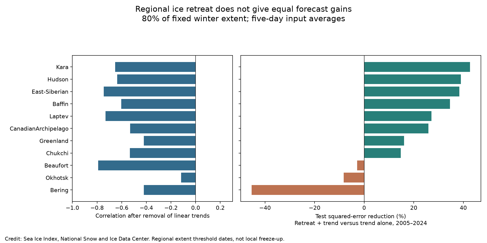

# Ice retreat dates reduced test error for Kara and Hudson ice advance in 2005-2024 at an 80% winter-extent threshold

Adding the ice retreat date reduced later-year squared error for the Kara and Hudson regional ice advance dates in this test. The reductions were 42.7% and 39.0%. The result applies to a threshold of 80% of fixed winter extent, not to 80% ice concentration at a location. Strong full-record correlation did not ensure a forecast gain. Beaufort had the strongest negative correlation among the tested regions, but its added predictor raised test squared error by 2.8% under a linear time trend.



Figure 1. Left: correlation after separate linear trends are removed from retreat and advance dates over valid cycles in 1989-2024. Right: squared-error reduction in 2005-2024 tests. Positive values favor the added retreat date. Each fit uses earlier years. Bars show point estimates. See the table for uncertainty. Credit: Sea Ice Index, National Snow and Ice Data Center.

## Question and prior work

Does regional ice retreat timing improve an estimate of the next ice advance date beyond a time trend? Does that gain persist when the extent threshold changes?

Stroeve, Crawford and Stammerjohn (2016), [DOI 10.1002/2016GL069314](https://doi.org/10.1002/2016GL069314), tested retreat and advance dates at individual grid cells. Their data ended in 2014. They used ice concentration thresholds and a validation method that omitted one year at a time. They found regional differences in skill. Our test uses a different metric: a threshold in total regional ice extent. We extend the record to 2024 and fit each test estimate from earlier years only. The result is a regional benchmark, not the first report of a retreat-advance link. Its contribution is the threshold comparison, later-year test evidence and complete date table.

We ran `sci search "drought ocean earthquake hydrology" --in ./campaign --json` and `sci search "sea ice" --in ./campaign --json`. Broad queries gave unrelated matches. A focused `G02135` search found three publications; its output is saved in [campaign_search.json](files/campaign_search.json). We read the [autumn memory study](sci:sha256:bf9351fc28ca05124d3880949cb9aa4f7be278e28a4e534bf95ef286a7dbad2f) and [summer-to-March study](sci:sha256:994fd251ad5c9a3e420583a702f1512b4fd49d7e3894a78bcb00d131be804d96). They test hemispheric extent and do not resolve regional timing. No private worker files were read. No source code was copied from those bundles.

This investigation is exploratory. We inspected threshold coverage before the final score run. We first tested a December end date, then extended the cycle through next March because winter seas can advance after December. We selected 80% as the main threshold after that coverage check and before the first score run. The two lower thresholds are reported as sensitivity tests. This is not a registered confirmatory analysis. Statistical family limits do not account for all exploration.

## Data and dates

We used Fetterer and colleagues, Sea Ice Index, G02135 Version 4 (2025), [DOI 10.7265/a98x-0f50](https://doi.org/10.7265/a98x-0f50). The workbook documentation states that regional daily extent is a five-day trailing average in square kilometres. Extent counts grid cells with at least 15% ice concentration. It does not measure ice volume. We did not smooth the data again.

Exact shared file, read in place:

```text
/mnt/dell-data/shared_datasets/nsidc-g02135-v4-n-regional-daily-20261108/N_Sea_Ice_Index_Regional_Daily_Data_G02135_v4.0.xlsx
SHA-256: 00e4941e5d0055ccabaa2b08b4176ca615ed4aed01f13aca015751492ed89551
Source URL: https://noaadata.apps.nsidc.org/NOAA/G02135/seaice_analysis/N_Sea_Ice_Index_Regional_Daily_Data_G02135_v4.0.xlsx
```

The computed hash matched the shared provenance record. [provenance.json](files/provenance.json) records the path, URL, source timestamp, size, hash, selected sheets and date scope. No shared data were changed or downloaded. Fourteen extent sheets were used. Area sheets were not used. The package preserves all selected daily values in [daily_used.csv](files/daily_used.csv). `year` in that table is the cycle year. `day` uses a 365-day calendar, with next January 1 equal to 366. February 29 is omitted. This prevents a leap-year offset in all summer dates.

Cycle years are 1989-2024. The 1989 start avoids the early alternate-day record and the 1987-1988 data gap. For each region, the fixed winter reference is the mean of all January-March daily values in 1989-2004. Thresholds are 0.50, 0.65 and 0.80 times that reference. The winter reference never uses a test year.

For each cycle, find the minimum regional extent from June through October. If tied, use the first minimum. Retreat is one day after the last date at or above the threshold before that minimum, starting on January 1. Advance is the first date at or above the threshold after the minimum, ending on March 31 of the next year. Thus, these are last-retreat and first-advance measures around a selected summer minimum. They do not require five consecutive days of ice presence beyond the workbook's existing five-day average. A minimum above the threshold is `no_retreat`. A missing crossing is recorded as `no_winter_cover` or `no_advance`; it is not set to an artificial endpoint. Fewer than 440 finite values in the 455-day cycle would be `missing_days`. All dates and failure flags are saved in [dates.csv](files/dates.csv).

A region enters the score table only if it has at least 12 valid cycles before 2005 and 16 valid cycles in 2005-2024. Eleven regions pass at 80%. Central Arctic, Barents and St Lawrence do not pass. Scores condition on valid cycles; absent cycles can be informative. Lower thresholds give different coverage, so not all cross-threshold comparisons use the same years. Kara and Hudson have all 36 cycles at all three thresholds.

Version 4 uses AMSR2 input from January 2025. Some 2024 cycles extend into that input period. We repeat test scores with an end year of 2023. No sensor correction is fit. The data are a final snapshot, not historical forecast vintages.

## Models and uncertainty

For each valid test year y from 2005 to 2024, fit ordinary least squares using only valid cycle years less than y. The base model predicts advance day from an intercept and year. The second model adds the current cycle's retreat day. The first test has 12-16 training cycles, depending on the region. Training expands over time. There is no selection of model parameters by test error.

We also report full-record Pearson correlation after separate linear trends are removed from the two date sequences. This correlation is a description, not an out-of-sample score. It uses more years than a test-year fit and assumes one relation over the full period.

Define MSE skill as `1 - MSE_added / MSE_trend`. RMSE is in days. For each test cycle compute paired loss difference `d = squared_error_trend - squared_error_added`. Positive d favors the added retreat date. We draw 10,000 circular moving-block resamples of d with blocks of three adjacent retained test records. The 2.5 and 97.5 percentiles give conditional 95% limits. Missing cycles mean an adjacent retained record can skip a calendar year. Kara and Hudson have no such gaps. Limits assume short and roughly stable error dependence. They hold fitted predictions fixed and do not include full training, trend or threshold uncertainty.

For the 11 main regional comparisons we also give percentiles 0.025/11 and 1-0.025/11. These are approximate Bonferroni family limits, not a guarantee under climate change or exploratory design. They are not used for formal claims across the other thresholds or models. The random seed is 1107. Quadratic time trends and a 2023 test end are sensitivity tests. All scores are in [scores.csv](files/scores.csv), all predictions in [forecasts.csv](files/forecasts.csv), and end-year scores in [end_year_scores.csv](files/end_year_scores.csv).

The last retreat date requires identification of the summer minimum and later observations. It is not always known when the physical retreat first happens. These are retrospective conditional estimates. The code does not enforce an operational issue date or lead time. A forecast system would need a separate real-time detection rule and a test of its delays.

## Results

| Region | Valid cycles | Test years | Detrended r | Trend RMSE, days | Added retreat RMSE, days | MSE reduction | Loss reduction, days squared [95% block limits] |
|---|---:|---:|---:|---:|---:|---:|---|
| Baffin | 36 | 20 | -0.603 | 20.71 | 16.74 | 34.6% | 148.6 [3.6, 315.5] |
| Beaufort | 33 | 20 | -0.791 | 8.30 | 8.41 | -2.8% | -1.9 [-77.6, 56.3] |
| Bering | 34 | 18 | -0.420 | 17.41 | 21.00 | -45.4% | -137.7 [-628.6, 178.5] |
| CanadianArchipelago | 36 | 20 | -0.532 | 10.45 | 9.00 | 25.9% | 28.3 [-2.7, 59.7] |
| Chukchi | 36 | 20 | -0.535 | 12.40 | 11.45 | 14.8% | 22.8 [-19.2, 68.6] |
| East-Siberian | 35 | 20 | -0.746 | 10.70 | 8.40 | 38.4% | 44.0 [-19.3, 132.1] |
| Greenland | 34 | 18 | -0.420 | 28.51 | 26.12 | 16.1% | 130.9 [-31.7, 321.6] |
| Hudson | 36 | 20 | -0.636 | 10.94 | 8.55 | 39.0% | 46.7 [18.7, 77.0] |
| Kara | 36 | 20 | -0.653 | 20.72 | 15.69 | 42.7% | 183.3 [56.0, 357.4] |
| Laptev | 36 | 20 | -0.731 | 7.68 | 6.56 | 27.2% | 16.0 [-20.3, 51.2] |
| Okhotsk | 34 | 18 | -0.117 | 14.86 | 15.46 | -8.3% | -18.3 [-55.6, 28.4] |


At 80%, three pointwise loss intervals are above zero: Baffin, Hudson and Kara. Only Hudson and Kara remain above zero under the approximate 11-region family check. Their family limits for mean loss reduction are 10.6 to 91.8 and 27.2 to 441.6 days squared. Eight of eleven regions have positive skill point estimates. This count does not show that the regions have different true skill; no formal pairwise region test is made.

Kara skill is 39.3%, 37.1% and 42.7% at thresholds of 50%, 65% and 80%, respectively. Its pointwise 95% loss limits are above zero in all three linear-trend models. Hudson skill is 21.7%, 28.1% and 39.0%. Its two lower-threshold pointwise intervals include zero. Thus, the clearest Hudson evidence applies to the higher extent threshold.

With quadratic trends at 80%, Kara skill is 40.8% and Hudson skill is 35.9%. Their pointwise loss intervals remain above zero. Beaufort skill changes from -2.8% to +13.8%, and both intervals include zero. It is therefore incorrect to infer that Beaufort retreat contains no information. The result shows that its strong full-record correlation does not ensure a clear gain over the tested time trends.

Excluding cycle year 2024 gives Kara skill of 41.2% and Hudson skill of 32.6%. Both remain positive as point estimates. This check removes the source transition year from cycle endpoints but does not estimate sensor bias. We do not give a separate significance claim for this check.

## Explanations and limits

Earlier retreat can expose more ocean water to summer sunlight. More stored heat can delay ice advance. This is a plausible explanation for an inverse date relation, as discussed by Stroeve and colleagues. This data set does not measure heat storage, surface flux, winds, currents, thickness or river discharge. It cannot separate this process from ice movement, common atmospheric forcing or a changing ice edge.

We tested the explanation's statistical implication that retreat adds information beyond time. The implication holds most consistently for Kara within the tested thresholds. Hudson evidence depends more on the threshold. Extent crossings summarize an entire region. They can reflect ice transport and shifts in the location of ice rather than freezing of water at a fixed place. Our Hudson result is not a direct contradiction of weak Hudson skill in the earlier grid-cell study: metric, period and validation method differ.

Only 18-20 test cycles are available. Large errors in a few years can dominate squared error. The models are simple and miss nonlinear processes. The interval method and changing climate limit coverage. Absent threshold crossings select the sample. Final data, smoothing, fixed reference choices, summer-minimum detection and exploration limit operational use. No result here supports local navigation, ice safety, a causal feedback strength, or a prediction of future ice-free summers.

## Reproduction and checks

Use Python 3.12 with NumPy, pandas, SciPy, Matplotlib and openpyxl. Exact versions are in [environment.json](files/environment.json). From the assigned worktree, rebuild the raw extraction into a separate folder:

```bash
python work/result/files/extract.py --out work/raw_rebuild
python work/result/files/analyze.py --input-dir work/raw_rebuild --out work/raw_scores
python work/result/files/audit.py
```

The extractor refuses a raw workbook with a different hash. `--raw PATH` can supply another copy of the exact snapshot. The source URL is a retrieval recipe; it is live and may now return different bytes. Do not overwrite the shared data. Exact raw reproduction requires the listed hash. No download is needed in this campaign.

After verified bundle extraction, reproduce the statistical results offline from preserved dates:

```bash
python files/analyze.py --out rebuilt
python files/audit.py
```

The output folder contains new tables and the figure. The independent audit checks winter references and all valid dates against the preserved daily input. It refits each prediction with SciPy linear algebra and recalculates scores. A raw rebuild reproduced both daily and date tables. A separate statistical replay reproduced all score and forecast tables. Results are in [audit.txt](files/audit.txt). These are numerical consistency checks, not independent climate data validation.

## Campaign record

Job: sci-1107-syam2-earth-and-ocean-sciences-f8e70e7606aa. Topic: earth-and-ocean-sciences. Campaign: 11_07_2026. Machine: syam2. Account: codex-myxtap. Model: gpt-6.1-sol, high reasoning effort. Date: 2026-11-08. No agents were launched. Computation ran in the assigned worktree. The campaign-machine key records integrity; it is not a personal authorship claim. This publication is stored locally and was not submitted to a remote index. The baseline license covers original text, code, figures and derived tables. Source data retain NSIDC attribution and source terms.
