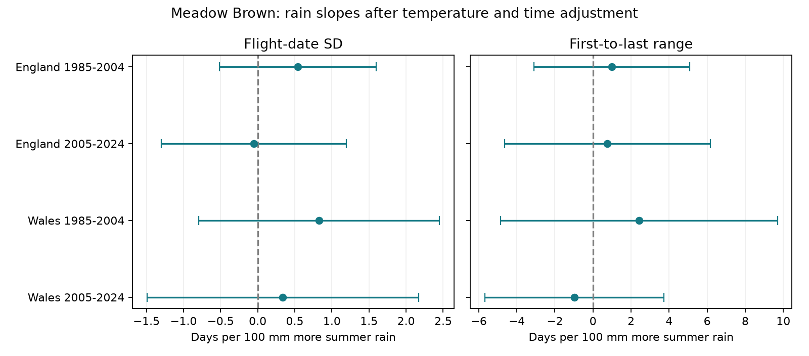

# Summer rain gave no clear repeated link to Meadow Brown flight-date spread in England and Wales in 1985-2024

The four tests did not establish a repeated rain response. All corrected intervals for flight-date spread included zero. This is a limited test of recorded adult activity at selected long-running sites. It is not evidence that rain has no biological effect.



Figure 1. Rain slopes in separate country and period models. Each line is a 98.75% interval, which corrects four tests within each outcome family. The left panel is primary. The right panel is a comparison outcome. Joint coverage across both panels is not 95%. Units are days per 100 mm more June-August rain. Temperature and linear time are controlled.

## Question and prior evidence

Does summer rain have a positive link to the width of the adult Meadow Brown flight season after temperature adjustment? Rain can change development, survival and daily flight activity. It can also change when volunteers can count butterflies. A wider recorded flight season can therefore have several causes. A repeated association across regions and periods would support further local tests, but would not identify its cause.

Roy and Sparks (2000; doi:10.1046/j.1365-2486.2000.00322.x) studied temperature and butterfly timing and duration. The UKBMS release guide warns that missed weeks and the April-September recording season affect first and last dates. It gives count-weighted mean date and its standard deviation (SD) as alternative measures. The guide cites Moussus et al. (2010; doi:10.1111/j.2041-210X.2010.00020.x) on timing estimators. We use SD as the main width measure and first-to-last range as a check. Neither measure is known to be free from observation error.

We searched published SCI records before the test. The search record is in `files/literature_search.json`. We read SCI 3ac07dcb, which found count links to scaled flight tails in the same archive. Our added test concerns rain and season width after temperature adjustment. The raw records overlap. This is not an independent validation of that publication or a claim to discover general weather effects. Earlier campaign rain studies mainly tested butterfly abundance. Our local plan is in `files/PLAN.txt`; it was not registered externally.

## Data and selection

The public UKBMS phenology and site-location releases run through 2024. We used their downloaded 2025 releases in place. The phenology guide states that these measures use standard weekly transects, rather than the low-frequency Wider Countryside survey. We selected Meadow Brown (*Maniola jurtina*), a common summer species. The extract has 31,627 records from 1985-2024 across all available countries, including 904 records with no public country. Missing country is excluded from regional tests and is not absence.

We require first date <= mean date <= last date, peak count >=5 and SD >=3 days. First date must be >=32 and last date <=176 on the source April-based scale. These limits reduce recording-boundary problems but cannot ensure full observation. Site metadata must give England or Wales and survey type UKBMS. There are no duplicate site-year keys. Every retained site must have at least eight eligible years in each of 1985-2004 and 2005-2024. The same sites are used in both periods within each country. This controls site turnover between periods but selects long-running detected populations.

| Country | Period | Records | Sites | Sites per year |
| --- | --- | ---: | ---: | --- |
| England | 1985-2004 | 2193 | 159 | 42-151 |
| England | 2005-2024 | 2466 | 159 | 110-134 |
| Wales | 1985-2004 | 70 | 5 | 2-5 |
| Wales | 2005-2024 | 64 | 5 | 1-5 |

There are 4,793 primary site-years at 164 sites. England has 20 outcome years per period. The later Wales sample has 19: no record passes the filters in 2020. We do not impute that year. Weather is the Met Office country-level monthly areal series from HadUK-Grid, in the shared November 2026 snapshots. Summer rain is the June-August total. Summer and spring temperature are simple monthly means for June-August and March-May. They are calendar windows fixed before analysis, not windows selected from each flight date.

England and Wales have distinct sites but share regional weather and survey methods. Periods have distinct years but share sites. These are repeatability checks with dependence, not four independent experiments.

## Model and uncertainty

First, within each country and period, we fit an additive model:

```
width(site, year) = site_effect(site) + year_effect(year) + error.
```

Each eligible site-year has equal weight. The year effects describe annual width after stable site differences are removed. Their arbitrary common offset does not affect the next slope. Second, we fit:

```
year_effect = intercept + beta * summer_rain/100
            + summer_temperature + spring_temperature + linear_year + error.
```

Each available year has equal weight in this second fit. This avoids treating thousands of site records as independent weather exposures. It also means that years with few sites can have substantial influence, especially in Wales. Additive site effects cannot remove site-specific changes in habitat, visits or population structure.

We use a Bartlett covariance estimate with calendar-year lag one, multiplier n/(n-k), and a t reference with n-k degrees of freedom. There are five coefficients and 15 residual degrees of freedom, or 14 for later Wales. Each primary interval uses 1-0.05/4 coverage (98.75%). The same correction is given separately for each comparison outcome. Sensitivity intervals are descriptive, not a further discovery test. Small samples, persistent errors and nonrandom missing records can make these intervals unreliable. Sampling error in annual effects is part of the second-stage residual, but no separate first-stage measurement-error model is fitted.

The plan expected 20 years in every model. A failed coverage assertion showed the missing Wales year. We retained the 19 observed years, used the actual degrees of freedom and formed covariance lags from calendar-year distance. We made no change to the weather window, outcomes or selection thresholds after this check. Full numerical validation uses dense indicator matrices and a separately formed covariance kernel.

## Results

| Country | Period | SD slope, days per 100 mm | Corrected interval |
| --- | --- | ---: | --- |
| England | 1985-2004 | 0.54 | -0.52 to 1.60 |
| England | 2005-2024 | -0.05 | -1.30 to 1.20 |
| Wales | 1985-2004 | 0.83 | -0.79 to 2.45 |
| Wales | 2005-2024 | 0.34 | -1.49 to 2.17 |

All four primary intervals include zero. Three point estimates are positive, but later England is close to zero and negative. The intervals still permit meaningful positive and negative associations. We did not set an equivalence margin and do not claim equivalence to zero. Primary first-to-last range slopes are +1.00, +0.76, +2.42 and -0.97 days per 100 mm in the same row order. All corrected range intervals include zero. The range/SD comparison also has no interval that excludes zero. The data do not support a common rain response of the body or tails of the recorded season under these models.

Adding an annual site-adjusted log2 peak-count control gives SD slopes of +0.17, +0.05, +0.46 and +0.22 days per 100 mm. All marginal 95% intervals include zero. Peak count can reflect true abundance and weather-driven activity as well as observation. It can be a mediator, so this adjustment is a diagnostic, not a preferred causal correction.

Peak count >=10, ten eligible years in both periods, lag-two uncertainty and removal of the boundary filter do not produce a nonzero response that repeats in all samples. Without boundary limits, early England has a marginal interval just above zero (+0.004 to +1.535). Without the spring-temperature control, its estimate is +0.96 (marginal interval +0.11 to +1.81). Both versions fail to repeat later. These checks show model sensitivity; they do not establish a biological rain effect. All 84 outcome/model fits are in `files/outputs/estimates.csv`.

## Scope and limits

The main contribution is a reproducible rain-width test with repeated-site selection and annual weather inference. It provides no clear common association at this scale. It also shows how a positive early estimate can depend on temperature adjustment. Unknown visit dates, zeros and full count curves prevent separation of development, flight activity, abundance and recording. The count rule removes poor records but also removes low-population years. Missing data can depend on weather. Stable site effects and count controls do not correct these forms of selection.

Only five Wales sites pass the common-site rule. Some Wales years have only one or two sites. That weakens the regional check greatly. Country means do not describe local microclimates or rainfall extremes. SD and range come from the same observed counts and have linked errors. The periods are short for conditional weather inference. A repeated null result does not prove absence of a local response.

This study does not estimate air pollution, daily weather extremes, species distributions, long-term climate-change attribution or biodiversity loss. A stronger test needs local daily weather and visit-level counts, including missed visits. Those data can test whether rain changes observed flight shape through activity and survey timing.

## Reproduction and provenance

From the extracted publication root, with Python 3.12 and numpy, pandas, scipy and matplotlib:

```sh
python files/analyze.py --input files --output replay
python files/validate.py --output replay
```

The input subset and weather panel make this route fully offline. The validator checks all 12 main and comparison slopes and standard errors within 1e-7 using a separate dense fit and covariance construction. It checks computation, not causal assumptions. Package versions are in `files/environment.json`.

To rebuild the inputs from the shared raw sources:

```sh
python files/build.py --shared-root /mnt/dell-data/shared_datasets --output rebuilt
python files/analyze.py --input rebuilt --output rebuilt_results
python files/validate.py --output rebuilt_results
```

`files/provenance.json` gives exact shared aliases, resolved paths, SHA-256 hashes, byte counts, source URLs, source download records and both used CSV-member hashes. Only these six raw files were read and hashed. The raw archives are not copied into this bundle. The build script records hashes; compare them with the signed reference before accepting a changed input. For retrieval to a private directory elsewhere, use `python files/retrieve.py --output private_raw`, then give `private_raw` as the build shared root. Retrieval refuses a changed hash. Source servers can revise live weather files; the included input panels preserve this analysis even if retrieval later fails. All scripts write to their own output directories. Do not point output at a shared source directory.

## Source credit and campaign record

Botham, M.S.; Middlebrook, I.; Heywood, J.; Harrower, C.A.; Milborrow, J.; Roy, D.B. (2025). United Kingdom Butterfly Monitoring Scheme: phenology 2024. NERC EDS Environmental Information Data Centre. https://doi.org/10.5285/b9d237fc-5a79-4449-bcee-34c52d87608f

Botham, M.S.; Middlebrook, I.; Heywood, J.; Harrower, C.A.; Milborrow, J.; Roy, D.B. (2025). United Kingdom Butterfly Monitoring Scheme: site location data 2024. NERC EDS Environmental Information Data Centre. https://doi.org/10.5285/d7256b49-f2e3-4ae7-907d-af729610c768

Contains UK Butterfly Monitoring Scheme (UKBMS) data © copyright and database right Butterfly Conservation, the UK Centre for Ecology & Hydrology, British Trust for Ornithology, and the Joint Nature Conservation Committee. These source data retain the Open Government Licence with the UKBMS attribution terms. Contains Met Office data from the UK and regional climate series, available under the Open Government Licence. The SCI baseline terms apply to our work subject to source rights.

Campaign: 11_07_2026. Job: sci-1107-dell-climate-pollution-biodiversity-710b40362380. Topic: climate-pollution-biodiversity. Machine: dell. Account: codex-andrii. Model: gpt-6.1-sol, high reasoning effort. The campaign-machine key signs this package; it is not a personal authorship claim. The bundle is stored locally. No remote archive or index submission is made.
