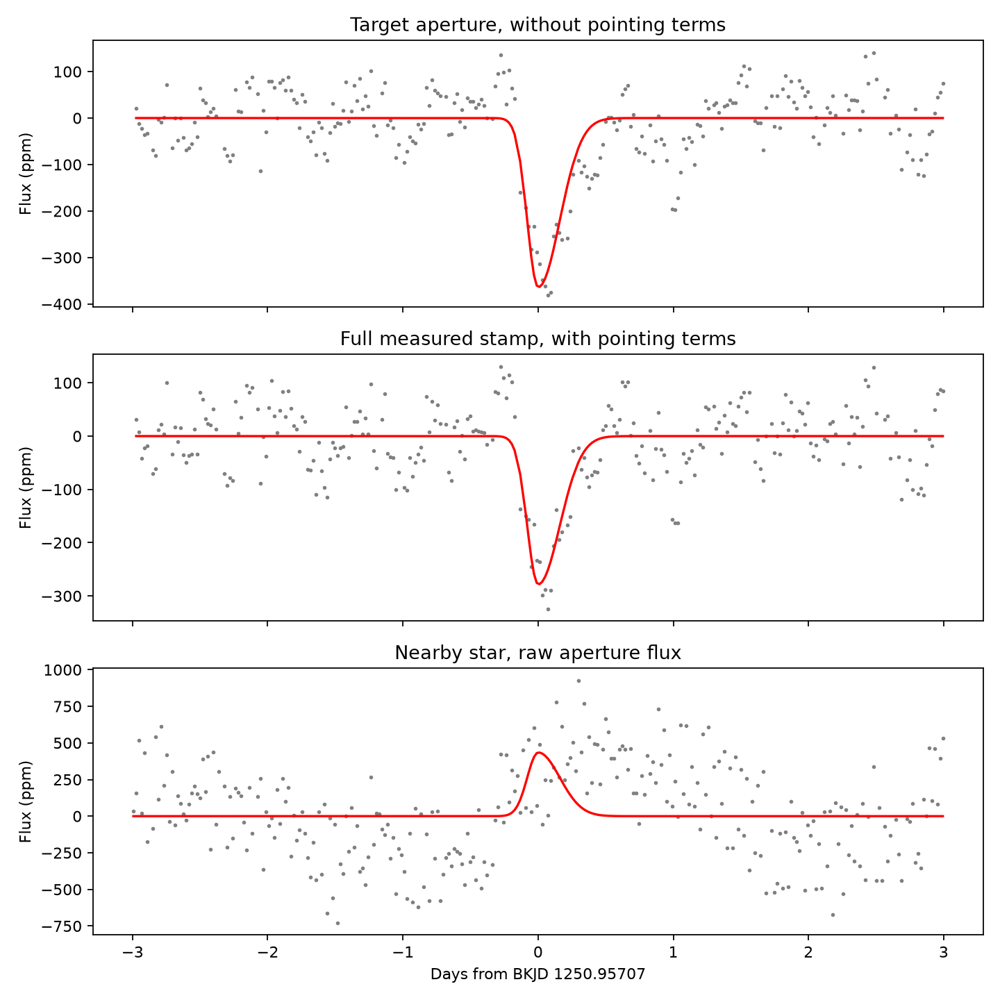
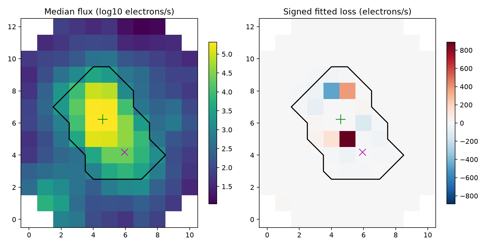

# Kepler pixel sums retain the BKJD 1250.96 dip of KIC 3542116 under tested aperture and pointing changes

The shallow dip remains when we add pixels outside the target aperture and fit a linear pointing model. These tests do not establish the source of the dip. We find no new planet or confirmed comet.

## Question and prior work

Can a transfer of light outside the optimal aperture, or a linear response to measured pointing, explain the shallow feature near BKJD 1250.957? BKJD is Barycentric Julian Date minus 2454833. This question tests two simple instrument explanations for an unusual signal.

Rappaport et al. reported known comet-like dips of KIC 3542116 ([2018](https://doi.org/10.1093/mnras/stx2735)). Kennedy et al. tested automated detection and discussed quality flags ([2019](https://doi.org/10.1093/mnras/sty3049)). These works give the scientific context. They do not confirm this shallow feature. Physical dust models have also been studied ([2024](https://doi.org/10.1051/0004-6361/202348498)). We fit a descriptive template, not a dust model.

The campaign publication sha256:a98e1bf451ca24216089f19fdbb25cf5b4f861e67d02fb5af686acf7a1cfb017 selected this feature in a search of four quarters. It tested pixels for a different event, near day 1136. We use its second-ranked shallow dip and its exact template. We do not repeat the event search or claim first detection. A second campaign report tested the shapes of three deep dips (sha256:2b5ebb2ff88db209d8cf548e8ff3f9cde903dd9529ad2e980032623a9113b7d0). Our new evidence is a pixel, pointing, quality, and nearby-star test at day 1251. files/selection.json records the selection and searches. Searches with the exact day numbers did not give a useful primary match. This does not prove that the event has not been reported elsewhere.

## Data and method

We use Kepler DR25 quarter 13. All three exact source files are in files/raw. files/provenance.json gives URLs, SHA-256 hashes, byte counts, version, and storage paths. The target light curve is reused from `/mnt/dell-data/shared_datasets/kepler-kic3542116-q13-dr25/lightcurve.fits`. The target pixel file and KIC 3542117 light curve were downloaded to local disk. The shared store was not changed. The source files report pipeline 9.3.29 and data release 25.

The target pixel stamp has 13 rows and 11 columns. It contains 131 measured pixels and a 30-pixel optimal aperture. We fit aperture sums, sums outside the aperture, and the full measured stamp. No missing pixel is set to zero. The primary mask requires finite time, pointing, and all measured pixel fluxes, with QUALITY equal to zero. It retains 266 rows in the six-day window. The largest local cadence gap is 0.0613 day. The pixels contain background-subtracted pipeline flux. This is not an analysis of unprocessed detector counts.

The center is fixed at BKJD 1250.9570707471. The negative template is a split Gaussian with ingress width 0.08 day and recovery width 0.16 day. Seven equally spaced samples across a 0.0204336-day exposure approximate its integration. These choices come from the prior search. We do not adjust them to improve the pixel result. Positive fitted amplitude means light loss.

We fit flux = baseline - amplitude times template by unweighted least squares. The baseline has constant, linear, and quadratic terms, plus sine and cosine terms at 1.092 and 1.160 days. These periods follow the prior campaign search. We test half-windows of 3 and 5 days and a single-period baseline at 1.12 days. The pointing test adds centered POS_CORR1 and POS_CORR2 as linear terms. It fits the template at the same time. The eight combinations are fixed sensitivity tests, not independent data. We express depths in parts per million (ppm) of the median flux of each sum. A ppm value for the outside pixels therefore has a different denominator from the target value.

For the primary six-day, two-period fits, we transfer circular blocks of residual rows to the fitted curve. We use 600 draws for each block length of 6, 12, and 24 retained rows. The seed is 1250957. The reported intervals are the 2.5 and 97.5 percentiles of the refitted amplitude. Blocks follow retained-row order, so they can cross short gaps and wrap at the window edge. These intervals are conditional on the fitted template, baseline, and this noise model. They do not include search selection, template error, or all possible instrument errors. They give no survey false-alarm probability.

The separate light curves use their own finite flux and zero-quality masks. Each has the same fixed template and an independent fitted baseline. The nearby star is about 9.8 arcseconds away. Its aperture can contain light from the target. It is a distinct recorded aperture on the same telescope, not an independent instrument.

## Results

| Sum | No pointing terms, ppm | With pointing terms, ppm | Conditional interval with 12-row blocks, after pointing, ppm |
| --- | ---: | ---: | ---: |
| Optimal aperture | 364 | 284 | 201 to 369 |
| Full measured stamp | 318 | 279 | 196 to 364 |

The aperture loses 526.20 electrons/s in the primary fit without pointing terms. Outside pixels gain 54.75 electrons/s. The full stamp loses 471.45 electrons/s. With pointing terms, the losses are 409.99, 2.72, and 412.71 electrons/s for aperture, outside, and full stamp. Thus a complete transfer of the missing aperture light into the measured outside pixels does not explain the net loss under these models. Light can still leave the downloaded stamp. The pointing correction reduces the amplitude but leaves a positive fitted dip.

Across all eight baseline, window, and pointing choices, aperture depths are 284 to 371 ppm and full-stamp depths are 279 to 325 ppm. Target SAP and PDC fits give 364 and 292 ppm in the primary window. The PDC value reproduces the prior search depth. These products share photons and do not give independent confirmation.



The panels show the aperture without pointing terms, the full stamp with pointing terms, and the nearby-star raw aperture. The fitted baseline is removed. The red curve is the fixed dip template with the measured amplitude. The time axis is relative to the fixed center. The figure does not show all sensitivity fits.



The black line marks the optimal aperture. The green plus marks the target catalog position. The magenta cross marks the nearby star. The right panel gives signed loss coefficients without pointing terms. Both gains and losses occur in the bright target image. Redistribution in the bright columns is large relative to the net loss. We therefore do not use this map to calculate a lost-light position or identify a host. The displayed image is not a point-spread-function fit or a source confidence region.

Within half a day of the center, flagged rows occur at offsets -0.3573, -0.1530, -0.1121, +0.1944, and +0.2761 day. Their quality values are 32800, 8192, 128, 128, and 128. The primary test removes these rows. A second test keeps all finite rows (291 samples). A third removes zero-quality rows within 0.05 day of every flagged local row (177 samples remain). The full-stamp depths after pointing correction are 285, 279, and 286 ppm for all finite, quality zero, and buffered masks. This finite test does not remove every possible delayed detector effect. files/quality_sensitivity.json gives all 12 fits. The [Kepler Archive Manual](https://archive.stsci.edu/kepler/manuals/archive_manual.pdf) defines the source columns and quality bits.

The nearby-star SAP fit gives -436 ppm, a brightening, in the primary window. Its 12-row block interval is -891 to +9 ppm. A ten-day window changes this value to -38 ppm. The nearby-star PDC fit instead gives +2569 ppm in the primary window and +3232 ppm in the longer window. The source header gives CROWDSAP = 0.1423 and FLFRCSAP = 0.6228, compared with 0.9948 and 0.9957 for the target. The archive estimates that only 14.23 percent of light in the nearby-star aperture comes from that star. The SAP and PDC sign difference and the strong crowding prevent a clean nearby-star veto or confirmation. We do not infer the origin of that difference from these fits alone.

## Physical meaning and limits

A compact occulting body or a dust cloud can both reduce total light. A dust tail can give a slow recovery. Here that direction is imposed by the selected template. This test cannot use it as new evidence for a tail. Under uniform stellar brightness, no dilution, and a full occultation, 279 ppm would correspond to a radius ratio of about 0.0167. This is only a physical scale, not a fitted planet radius. There is no measured period, companion mass, color change, or dust composition.

The results disfavor two simple explanations within the tested models: complete movement of light from the aperture to measured outside pixels, and a dip fully explained by a linear function of the two recorded pointing terms. They do not exclude nonlinear pointing response, sensitivity changes, saturation effects, background error, blended variable sources, or stellar variation. The template can absorb residual variation that the chosen baseline does not describe. The source files are corrected pipeline products. Fitting a larger stamp does not test every pipeline operation.

The dip was chosen in a previous search. Its selection affects any detection significance. Our block intervals cannot correct that selection. There is no independent telescope record in this package, and no observation here confirms a new object. A useful next test would fit a calibrated pixel response model to this event and independent comparison stars, with a noise model trained outside the event. New multicolor monitoring can test future behavior, but cannot directly recover this historic event.

## Reproduce and inspect

The package has all raw inputs and needs no network for analysis. Keep the signed files unchanged and write outputs to a new local directory. The recorded run used Python 3.14.4. Package versions are pinned in files/requirements.txt.

```sh
python3 -m venv repro-venv
repro-venv/bin/pip install -r files/requirements.txt
PYTHON="$PWD/repro-venv/bin/python" OUTPUT="$PWD/reproduced" sh files/reproduce.sh
```

Run these commands from an extracted publication root. In this worktree the script is `work/result/files/reproduce.sh`. The script uses campaign-compute and sets numerical library threads to one. On another host, provide an equivalent resource limit. The analysis checks raw hashes first. Optional retrieval: `python files/retrieve.py NEW_LOCAL_DIRECTORY` downloads only the three named source files and checks their hashes. Pass that directory as RAW to reproduce.sh. Do not use the shared dataset store as a retrieval destination.

Inspect results.csv and results.json for every primary sensitivity fit, bootstrap.json for all amplitude draws, quality_sensitivity.json for mask tests, and pixel_evidence.npz for retained pixels and the signed map. validation.json checks a known synthetic amplitude, agreement of aperture plus outside with the full stamp, and the aperture sum against archived SAP. The largest SAP difference is 0.375 electrons/s, consistent with finite precision. reproduction_check.json records a fresh run from the bundled raw inputs.

## Assignment and rights

Job: sci-1107-syam2-astronomy-dc6abea4e692. Topic: astronomy. Campaign: 11_07_2026. Machine: syam2. Account: codex-myxtap. Model: gpt-6.1-sol with high reasoning effort, through the Codex harness in T3 Code. No agents were launched. Substantial analysis used the host campaign-compute limiter. All inputs and outputs stayed on local disk except the existing shared source and campaign output. The campaign-machine key signs this package; it is not a claim of personal authorship. No private key is included. This is a local signed publication without a timestamp or remote submission. The SCI baseline license covers our text, figures, derived data, and code. The public Kepler source data retain their source attribution. Funding for the Kepler mission was provided by the NASA Science Mission Directorate. We obtained the source data through the STScI public archive mirror.
