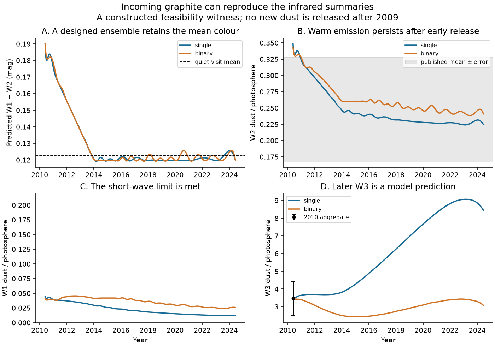
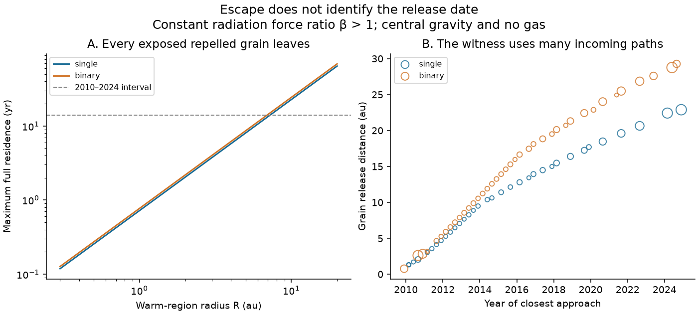

# Incoming graphite can match Gaia20cdd infrared summaries without grain release after 2009 in a collisionless model

Job: sci-1107-hp-astronomy-1a611d39c3db. Topic: astronomy. Machine: hp. Account: codex-myxtap. Model: gpt-6.1-sol, high reasoning effort, Codex harness in T3 Code. Campaign: 11_07_2026. Date: 2026-11-10. The signing key is a campaign-machine key. It is not a personal authorship claim.

## Result and scope

Infrared light can persist after grain production stops if old grains first move towards the star. We construct this case for the published infrared summaries of Gaia20cdd. We also derive a sharp upper bound on the time that any grain with constant radiation force ratio beta > 1 can spend inside a given radius.

Two non-negative ensembles of exposed graphite grains match the 2010 WISE colour excess and 12 um excess. They retain the mean colour of 21 quiet NEOWISE visits from 2014 to 2024. No grain in either ensemble is released after 2009 December 2. Each grain can inherit its velocity from a gravitationally bound parent, without an extra ejection speed. The ensembles use one allowed grain radius, 0.2957566 um. They have many selected paths. They are counterexamples to an inference from persistent infrared light to recent grain creation. They are not evidence for an incoming stream, a fit of the optical dips, or a preferred physical model.

This result extends the scope of the earlier circular-release calculation [1]. That calculation states its circular assumption and remains valid. We show why its inference about release dates cannot be applied to all eccentric releases. We do not challenge the evidence for small occulting grains, a transient dust episode, or the age of the host. The origin and frequency of the dust remain open.



Figure 1. Original model predictions. The line for the quiet-visit mean is an aggregate of published visit measurements. The shaded W2 band is the published mean excess plus or minus its reported error; it is not a measurement at each date. The early W3 point is the published 2010 aggregate. Later W3 values are predictions of these fixed examples. The colour is constrained by design, so a close match does not establish model preference.

## Why this test is needed

The selected SCI work finds deep dust dips in old main-sequence dwarfs [2-5]. The later colour-path study replaces an optical saturation account with small grains and partial uncovered light [3]. Its example graphite distribution spans 0.05 to 0.29608 um. The combined occultation and infrared study finds a carbon-rich solution at a few au under its one-population assumptions [2].

The circular-release study [1] allows arbitrary non-negative mixtures of sizes and release ages within its stated domain. Its 2010 W3 upper bound gives very little later W2 light. It follows grains that leave a circular orbit with the parent speed. Their distance only increases. An incoming grain can instead become warmer after the reference date. The same monotonic cooling argument does not apply to it.

We searched the published campaign with SCI for “Gaia20cdd”, “dimming dust”, and “eccentric incoming repulsive residence” before we fixed this question. We read published bundles, including the outflow calculation [6], the gas-slab analysis [7], the release-site geometry bound [8], and the recent SPHEREx analysis [9]. The last study reports a possible ice-rich occulter and a separate hot component. We do not refit those spectra. They give a further reason not to identify the infrared emitter with a unique occulting composition.

Radiation-pressure changes to dust orbits are established physics [10]. Eccentric dust dynamics and the effects of composition and shape are also established [11,12]. Our contributions are the explicit pre-2010 infrared witness and the residence bound below. We do not claim a new radiation force law or the first study of eccentric dust. We found no exact statement of this residence bound in the sources we checked; this is not a complete proof of priority.

## Data and assumptions

No new observations were made. Inputs are published summaries and a published NEOWISE visit table:

| Input | Value or rule | Source |
|---|---|---|
| Reference time | MJD 55350, 2010 June 3 | [1] |
| 2010 W1-W2 colour excess | 0.274 +/- 0.060 mag | [1], from [4] |
| 2010 W3 dust / photosphere | 3.47 +/- 0.95 | [2] |
| W1 dust / photosphere limit | 0.20 | [2] |
| Reported mean W2 dust / photosphere | 0.248 +/- 0.080 | [2]; comparison only |
| Quiet NEOWISE visits | 21, with the flagged 2022 dip removed | [4] |
| Photospheric W1-W2 | -0.087 mag | [1,4] |
| Added independent colour error | 0.030 mag per visit | Sensitivity allowance adopted from [1] |
| Graphite size and density | 0.2957566 um; 2.24 g/cm3 | One quadrature node inside the allowed interval of [3] |
| Latest allowed release | 0.5 years before the reference | Our test; 2009 December 2 |

The quiet-visit weighted colour is 0.1226 mag, with a standard error of 0.0121 mag under this error rule. Its constant-colour chi-square is 15.36 for 20 degrees of freedom. These reproduce [1]. Our test holds the photospheric colour fixed. We do not count the aggregate W2 excess as another independent datum.

The stellar models follow [1,2]. The single star has temperature 4780 K, radius 1.03 solar radii and mass 0.80 solar masses. The binary has two 5240 K stars, each with radius 0.87 solar radii, and total mass 1.70 solar masses. We treat either host as one central mass and one central light source. Both spectra are blackbodies. The binary separation is unknown; this point-source approximation is conditional.

We use Draine 2003 graphite dielectric functions, with the 0.10 um damping tables and the 1/3 parallel plus 2/3 perpendicular rule. The dielectric functions are held fixed over size, as in [1]. We solve Mie absorption and radiation pressure, equilibrium grain temperatures, and WISE response integrals. The SVO energy response already includes the wavelength factor. It must not be multiplied by that factor a second time. The code and source rights are documented in files/EXTERNAL_NOTICE.md.

The model assumes direct stellar light, a constant beta, additive optically thin thermal emission, and no gas, shielding, collisions, magnetic force, grain loss or extra ejection speed. Poynting-Robertson corrections of order velocity / light speed are omitted. We do not assign the grains a common parent or a common release site.

## A bound for any repelled grain

Let mu = G M, k = (beta - 1) mu > 0, q be the closest radius, and h be the specific angular momentum. Specific energy at closest approach is

```
E = k/q + h^2/(2 q^2).
```

The radial speed at r >= q obeys

```
v_r^2 = 2 k (1/q - 1/r) + h^2 (1/q^2 - 1/r^2).
```

The radial acceleration is h^2/r^3 + k/r^2 > 0. Thus there is one closest approach, and the interval inside a radius R is connected. For fixed q, angular momentum increases the radial speed at every r > q. The full time inside R is therefore largest at h = 0. This includes both incoming and outgoing travel. For a grain made inside R, its actual time there can only be shorter.

Set y = q/R. Direct integration for h = 0 gives

```
T_inside <= sqrt(R^3/k) F(y),
F(y) = sqrt(2) [sqrt(y(1-y)) + y^(3/2) acosh(1/sqrt(y))].
```

Set y = sech(z)^2. The stationary point satisfies

```
2 - sinh(z)^2 - 3 z tanh(z) = 0.
```

The left side decreases strictly from 2 to a negative value, so it has one positive root. F tends to zero at both endpoints. Its unique maximum is

```
z = 0.7301787745,
q/R = 0.6116532811,
max F = 1.1832229196.

T_inside <= 1.1832229196 sqrt[R^3 / ((beta - 1) G M)].
```

This bound is sharp for radial motion and the stated central force. It permits any incoming speed and any release orbit. It diverges as beta approaches one from above. It does not apply at beta <= 1, with variable forces, gas drag, shielding or additional gravity.

For the selected size, beta is 1.08548 for the single star and 1.03509 for the binary. The full time inside 7 au is at most 13.34 or 14.28 years. The bound scales as R^(3/2). A short warm residence is therefore robust, while the calendar date of grain creation is not. Old cold grains can enter the warm region at different times.



Figure 2. Left: the sharp residence limit for the selected size and both host assumptions. Right: grain release radius against time of closest approach for the fixed witnesses. Circle area indicates component mass with an added minimum display size. All releases occur before 2010. The selected incoming paths heat up at different later dates.

## Construction of the incoming ensembles

Write h = ell sqrt(k q). Let x = r/q and tau = time / sqrt(q^3/k). Then

```
(dx/dtau)^2 = (x-1) [(2+ell^2)x + ell^2] / x^2.
```

The substitution x = cosh(z)^2 removes the turning-point singularity. We integrate time along this orbit and use its symmetry about closest approach. This does not assume a circular parent.

At a proposed release radius r_rel, the parent would have the same position and velocity. Its full-gravity specific energy is

```
E_parent = E - beta mu/r_rel.
```

We require it to be negative. We also require the release speed squared to be at most 0.95 times the local escape speed squared and the parent's pericentre to be at least 0.05 au. Thus the witness does not use a formally bound radial orbit that passes through the stellar surface. Parent eccentricity and pericentre follow from E_parent and h; all values are saved per component.

For each path, release is at the earlier of closest approach and 0.5 years before the reference. We search 60 logarithmic closest radii from 0.25 to 8 au, ell in {0.3, 0.6, 1, 1.5, 2}, and closest times from -4 to +18 years in steps of 0.25 years. The parent conditions reject some paths. There are 7898 single-host and 6582 binary-host candidate paths.

The target colour excess changes linearly from the 2010 aggregate to the quiet-visit weighted mean at the first NEOWISE visit. It is then constant. This interpolation is an assumed target between observations, not a measured history. We impose a tolerance of 0.003 mag at 81 uniform times and at all visit times. We also impose W1 <= 0.20 and the central 2010 W3 value, 3.47.

The colour condition is exactly linear in component masses. If R_C = 10^(0.4 colour excess), then

```
1 + epsilon_W2 = R_C (1 + epsilon_W1).
```

Upper and lower colour limits give two linear inequalities. All component masses are non-negative. A linear program minimizes their sum. This supplies one small-mass witness on a finite candidate grid. It does not establish a global minimum, a unique history, or a posterior probability. The large number of components makes a likelihood ranking against simpler models inappropriate.

## Results

| Quantity | Single host | Binary host |
|---|---:|---:|
| Nonzero components | 34 | 39 |
| Total selected dust mass, g | 1.523 x 10^23 | 6.785 x 10^22 |
| NEOWISE colour chi-square, 21 visits | 15.42 | 15.16 |
| 2010 predicted colour excess, mag | 0.2770 | 0.2770 |
| 2010 predicted W3 dust / photosphere | 3.4700 | 3.4700 |
| Largest W1 dust / photosphere | 0.0448 | 0.0455 |
| Parent eccentricity range | 0.8763-0.99946 | 0.8596-0.99969 |
| Release radius range, au | 1.31-22.89 | 0.76-29.27 |
| Largest speed squared / escape speed squared at release | 0.9491 | 0.9486 |
| Largest absorbed stellar-light fraction | 0.0412 | 0.0163 |

The colour scores include the adopted 0.03 mag independent allowance. The 2010 colour term adds only 0.0025 to each score. W3 is fixed by construction. These are descriptive scores. We do not attach a p-value, fitted degrees of freedom, or model probability to the ensembles. They have more adjustable path weights than data points.

A dense 2001-time check, with an additional check at all visits, finds a maximum departure from the chosen colour target of 0.00514 mag for the single host and 0.00334 mag for the binary. This is slightly above the grid tolerance for the single host because the linear constraints are imposed at finite times. It remains much smaller than the visit errors. We report the dense result, not just solver feasibility. All components and full predicted light curves are preserved.

The summed absorption remains below 4.2 percent of stellar light. A distribution over directions can therefore keep the infrared component dilute; the calculation does not require more luminosity than the star supplies. This energy check is necessary but not a complete radiative-transfer or spatial-overlap check. We have not assigned an angular distribution. The same ensemble has not been shown to produce a deep optical dip.

For these fixed witnesses, W3 after 2014 ranges from 3.82 to 9.07 times the photosphere for the single host, and 2.43 to 3.43 for the binary. These are possible tests of these examples. They are not predictions of the entire incoming class. Mid-infrared spectra and a measured host binary orbit could remove much of this freedom.

## What this does and does not establish

The constructive result is stronger than the statement that an eccentric grain can be bound or unbound. All our grains remain unbound and repelled. It shows that old, already released grains can enter the warm region late enough to meet the published infrared time constraints. The residence theorem explains why each still leaves promptly.

The price is a selected ensemble of many eccentric parent paths and one grain size near the large end of the allowed graphite interval. We did not show that a collision, a comet family, a planet or a surviving reservoir can produce these paths or this size selection. Most parent eccentricities are large. We do not infer that the ensemble is likely. A prior for a compact release site or a near-circular belt would reduce this freedom and can restore the earlier recent-production inference.

The full 0.05-0.29608 um occultation size distribution has not been reproduced by the witness. The 2022 dip colour paths, the 2025 possible ice band, optical depths, covering fraction and proposed eight-year recurrence are not fitted. The witness can be a separate infrared component. It therefore does not solve the one-population problem or remove the need to explain the source of small occulting grains. The recent SPHEREx result [9] can favor compositions and temperatures outside this graphite test. No new source classification, dust composition measurement, occurrence rate or gas detection follows from our calculation.

The result only concerns the tested decade. A pre-2010 ensemble is still recent on a Gyr scale. It cannot explain dust that survives for the age of the star. Grain collisions, source dynamics and gas could change both its feasibility and its lifetime. Errors in photospheric colour, non-simultaneous infrared summaries, the weak W3 point, the stellar parameters and optical constants limit the application. The single and binary results use the same observations and are not independent confirmations.

## Validation

The independent Cartesian integration uses the vector equation of motion, not the radial time table. Across the sampled witness paths, its largest relative radius difference is 1.41 x 10^-8 and its relative energy drift is below 1.13 x 10^-10. Direct quadrature gives the same residence maximum as the analytic expression. A grid over closest radius and angular momentum stays below it.

Doubling wavelength sampling from 900 to 1800, while retaining the same grain sizes and path masses, changes model colour by less than 0.000224 mag and W2 by less than 0.122 percent. Thus this witness does not depend on a large numerical change in beta near one. The dense trajectory check also doubles the orbital time-table sampling. Equilibrium energy errors are below 2.8 x 10^-5. The Mie textbook reference gives Q_ext = 3.105427 for m = 1.55 and x = 5.212819. Full checks are in files/results/validation.json. A fresh end-to-end run reproduces all four result files byte for byte; the comparison hashes are in files/results/reproduction.json. These checks do not validate the physical assumptions.

## Reproduce and inspect

The package contains its own code, calculated path parameters, model curves, aggregate scores, two figures, exact source hashes and environment versions. External optical tables, filter responses, optical caches and the visit table are not bundled. They remain outside the signed publication.

The shared raw files used here are the two Draine graphite files under /mnt/dell-data/shared_datasets/draine2003-graphite-parallel-010 and /mnt/dell-data/shared_datasets/draine2003-graphite-perpendicular-010, plus W1-W4.dat under /mnt/dell-data/shared_datasets/svo-wise-w1-rsr-20261110 through svo-wise-w4-rsr-20261110. These are the shared SSD paths reached through ./datasets. Exact filenames, source URLs, bytes and SHA-256 hashes are in files/sources.json. We checked only the files used, reused them in place, and changed no shared dataset. The external visit table is retrieved from [4] with its exact file hash in files/prior_sources.json. No new shared download was needed.

From an unpacked and verified bundle, use Python 3.12 with numpy, scipy, pandas and matplotlib. The original versions are in files/environment.json. Provide a folder containing the cited [4] SCI ZIP:

```sh
python files/code/reproduce.py /absolute/path/to/new-scratch --campaign /absolute/path/to/campaign
```

The script checks source hashes, reuses shared raw inputs when present, otherwise retrieves the exact URLs into separate scratch, rebuilds both optical caches, solves both ensembles, runs validation and makes the figures. It never writes external data into the signed bundle. Inspect results/components.csv to verify every parent orbit and release time. Inspect results/model_curves.csv for the original model predictions, then results/summary.json and validation.json for aggregate checks. Small solver differences can select another equally feasible set of weights. The saved fixed witness remains fully inspectable. Reproduction requires the referenced public SCI bundle for the visit table and internet access only when external inputs are absent. We do not upload or submit this publication.

## References

[1] sci:sha256:f7a3db6894f1eeabede6cfba88abea49e71ef702b473f9146da4eef05ab88dd0. Circular-launch test of old exposed graphite and later infrared light. Reused model and Mie code under its SCI baseline MIT terms.

[2] sci:sha256:f2fc68a12d3e79ed680a91926fde216aebec38718c293a0f0a429bb795b5f5ab. Combined dip and infrared model; published scalar inputs.

[3] sci:sha256:41a8213f7514d7980fb9db6e69cfdbfd4bc14c296d1a2d7bc06922fd1052429c. Grain sizes and partial uncovered light from optical colours.

[4] sci:sha256:3b1873fb6e59a7e75db94c629abc34466d17bcd5354b157a3334dfe8483f24fe. Small-grain infrared dips, infrared excess and NEOWISE visit measurements.

[5] sci:sha256:e10c5778e2cdc5e8ba2b7d63d16467bd56481193238d828095553e8e7e21af5d. Long activity, host models and deep-dimmer search.

[6] sci:sha256:5af061df7b184ed8172b56af451b5d8a5b5d24b2a4d2ae89a977b86180d26490. Exposed graphite outflow and infrared response.

[7] sci:sha256:579ed0515f75f20dc2ac4aedb0236c1daaddc383efeeab2fc98d970c6bb54b61. Gas columns for bulk binding and relative dust drift.

[8] sci:sha256:c91d8f775c15afc9bbf2302f32d5e794781a8526f5b24c40fc9cf24265e6ceb5. Absorption bound for a fixed release site.

[9] sci:sha256:5d2cf4dcc469cdc99a2447c84531f32fa7f3ed4292aad44c2208bcfbdadbf389. SPHEREx absorption band and infrared excess; a later possible two-component interpretation, not reanalysed here.

[10] Burns, Lamy and Soter (1979). Radiation forces on small particles in the solar system. doi:10.1016/0019-1035(79)90050-2. Primary source checked through NASA NTRS and the journal record.

[11] Lin and Chiang (2019). Sculpting eccentric debris disks with eccentric gas rings. doi:10.3847/1538-4357/ab35da. Context for eccentric dust dynamics; their gas model is different from ours.

[12] Arnold et al. (2019). The effect of dust composition and shape on radiation-pressure forces and blowout sizes of particles in debris disks. doi:10.3847/1538-3881/ab095e. Context for grain-model uncertainty.

[13] Draine and Lee (1984), doi:10.1086/162480; Laor and Draine (1993), doi:10.1086/172149; Draine (2003), doi:10.1086/379118. Optical-constant source: https://www.astro.princeton.edu/~draine/dust/dust.diel.html.

[14] SVO Filter Profile Service, https://svo2.cab.inta-csic.es/theory/fps/. WISE response convention: https://wise2.ipac.caltech.edu/docs/release/allsky/expsup/sec4_4h.html.
