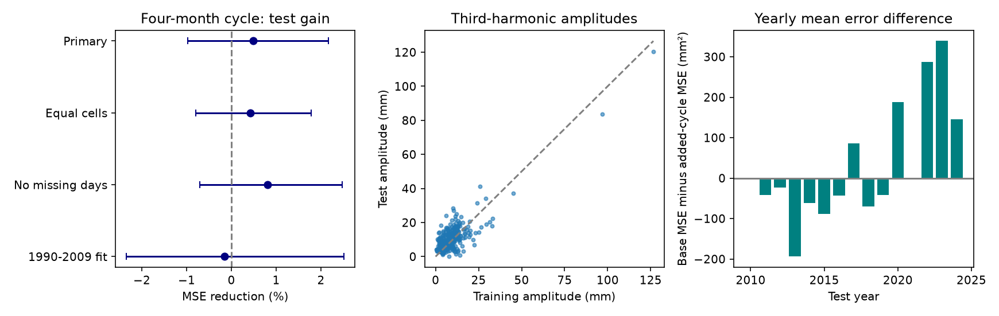

# A four-month cycle gave no clear seasonal sea-level error gain at 257 gauges in 2010-2024

The added cycle reduced mean squared error (MSE) by 0.48%. The conditional 95% three-year block interval was -0.97% to +2.17%. This test does not establish a reliable gain. It does not show that the four-month component is absent.



## Question and prior work

Can a small four-month part of the seasonal cycle improve later monthly sea-level estimates beyond the annual and six-month parts? A useful seasonal correction must retain its size and timing in later data. A good fit to past data alone does not show this.

Ponte and Schindelegger (2024, [DOI 10.1029/2024EA003978](https://doi.org/10.1029/2024EA003978)) included a third harmonic in coastal sea-level fits. Its median amplitude was 7.8 mm. They did not study it further because it was small. We do not claim its discovery. Barroso et al. (2024, [DOI 10.1029/2023JC020300](https://doi.org/10.1029/2023JC020300)) studied changes in annual sea-level cycles. That work also gives a reason to check transfer across time.

The prior campaign benchmark [SCI e29f5ad0](sci:sha256:e29f5ad02c828376ffd8421d160ead7d4ac96106292c735284c8cfa2a2280a67) found a gain for six-month terms beyond an annual cycle. All twelve monthly means gave no clear further gain. This report separates the next pair of Fourier terms from that combined higher-order test. It tests one specified extension, with stricter station and interpolation rules. The raw data overlap. This is an incremental method benchmark, not independent confirmation, a new physical mechanism, or a correction of that report. No prior code was reused.

## Data and sample

We read the shared archive in place at:

`/home/andrii/.t3/worktrees/11_07_2026-codex-andrii/campaign-sci-1107-dell--9d84ced85ce224a1/datasets/psmsl-rlr-monthly-20261019/rlr_monthly.zip`

The resolved path and source URL are in [provenance.json](files/provenance.json). The archive internal date is 19 October 2026. The dataset directory name is not an immutable provider release. The exact archive SHA-256 is:

`b22f65f5fcbc5021809f1d4eef279269f5e78a08bdc8d28aabd22adfe4dcf57e`

No download was needed. No shared file was changed. We hashed only the archive used here and the 515 used archive members. The package includes all selected monthly input rows, the station list, and 257 station notes. Hashes and byte counts of the station data and notes are recorded. [source_audit.json](files/source_audit.json) reports exact agreement of all 137,701 bundled monthly rows with that archive.

We use stations with station-list flag N. We reject monthly level -99999, every nonzero final flag, and missing-day count 99, which marks interpolation. Other missing-day counts are retained in the primary test. The [PSMSL format notes](https://psmsl.org/data/obtaining/notes.php) define the fields. A year needs 12 distinct accepted months. Each station needs at least 24 complete years in 1980-2009 and 12 in 2010-2024. No gap is filled. These rules retain 257 gauges and 3,664 test station-years, or 43,968 monthly targets. The full support table includes all station-list N sites considered. The source archive has records dated after 2024; these rows are not used.

The source uses station-specific Revised Local Reference datums. Annual centering removes a constant station-year offset. It cannot remove changes within a year. The station notes were saved, but were not used for manual site exclusions. An N flag is not proof that a record has no local change. The sample includes harbors and can include river influence. It is not a random or area-representative coastal sample.

## Test

The exploratory plan was saved before scores in [plan.txt](files/plan.txt). It was not externally registered. No model, period, eligibility rule, or primary score was changed after scores. The first uncertainty computation was stopped and replaced with batched arithmetic for speed. This changed implementation only.

For each complete station-year, subtract the equal mean of its twelve monthly levels. At each station, average centered training years by calendar month. Fit cosine and sine columns at k=1,2,3 to that mean pattern, with phase 2*pi*m/12 for m=0,...,11. The baseline retains k=1 and k=2. The alternative adds k=3, with period four months. Complete years make the columns orthogonal. Fitted patterns remain fixed through testing. No test value enters a fitted coefficient.

The observed test annual mean is needed for target centering. Thus this is seasonal-shape reconstruction, not an operational absolute sea-level forecast. Errors are averaged across months within a station-year, then across accepted test years at each station, then equally across stations. Reduction is 100*(1 - alternative MSE / baseline MSE). Positive values mean improvement. Equal station weights do not stop high-error sites from having more influence on the pooled ratio.

Uncertainty uses 19,999 circular block samples of the 15 test calendar years, with seed 110707. All stations use the same sampled years. Missing station-years stay missing. Each draw first averages sampled years within stations and then averages stations. Main blocks span three years. Percentile limits keep the training patterns fixed. They do not include training-fit, station-selection, data-revision, or measurement uncertainty. Fifteen years give few independent long blocks. The circular join and a changing climate can limit interval coverage. These are conditional descriptive limits.

## Results and checks

| Check | Gauges | MSE reduction (%) | Conditional 95% limits (%) |
|---|---:|---:|---:|
| Primary | 257 | 0.48 | -0.97 to 2.17 |
| One-year blocks | 257 | 0.48 | -0.63 to 1.73 |
| Five-year blocks | 257 | 0.48 | -1.05 to 2.36 |
| Equal geographic cells | 257 | 0.42 | -0.80 to 1.78 |
| Zero missing days only | 169 | 0.81 | -0.71 to 2.48 |
| 1990-2009 training | 243 | -0.15 | -2.34 to 2.52 |

The primary RMSE changed from 75.24 to 75.05 mm. Errors fell at 127 of 257 sites. No site significance tests or adaptive site selection were used. Equal geographic weights first average sites in occupied 10-degree latitude-longitude cells. This limits network density effects, but does not make a global estimate. The strict missing-day check has 169 sites. Shorter training has 243 sites and needs at least 16 complete training years. These are selected subsets, not independent replications or a fair ranking of training windows.

The point reduction was -1.02% in 2010-2016 and +2.00% in 2017-2024. These descriptive subsets share training fits and do not prove a regime change. The median training third-harmonic amplitude was 8.45 mm; the median test amplitude was 10.05 mm. These values describe this monthly product, not the hourly product used in the prior paper.

A Fourier identity tests the proposed account of transfer. Let b be the two training third-harmonic coefficients and c the two coefficients of the mean test pattern. Baseline MSE minus added-cycle MSE equals b dot c minus (b dot b)/2. The first term measures transfer of size and phase together. The second is the cost of applying the training amplitude. A positive dot product alone need not give lower error. It was positive at 165 sites, but only 127 improved. Thus 38 sites had positive alignment that did not offset this cost. The identity held at all sites with maximum discrepancy 9.3e-12 square millimetres. This is an algebraic account, not a physical cause.

The independent standard-library audit calculates Fourier coefficients directly from bundled monthly rows. It checks every station-year MSE and the pooled score. It does not reuse the least-squares implementation. Outputs are in [audit.json](files/results/audit.json). The maximum independent MSE difference was 1.17e-10 square millimetres. A separate bootstrap audit checked the first 100 draws against direct indexed resampling; the maximum difference was 4.45e-14 percentage points. Predictions, coefficients, station scores, errors, summary checks, and all primary bootstrap draws are included.

## Limits and use

This test does not support a reliable added gain for the fixed four-month cycle in the stated sample. It does not establish that the two-cycle baseline is optimal, or that a small stable component cannot help particular sites. The four-month term can contain seasonal forcing, within-year mean trend, sampling effects, local changes, and other processes. Pressure, winds, currents, temperature, freshwater input, and long-period tides were not separated. No physical cause was tested.

One final revised product, historical training, uneven geography, future-availability selection, and short testing limit transfer. Monthly values do not resolve storm surge, high tides, flood counts, or damage. There is no test of recovery or extremes. Later data can be used to test this benchmark with a separate fixed protocol; this report does not treat its sensitivity checks as new confirmations.

## Reproduce

Verify the signed bundle before extraction with `sci verify BUNDLE.zip --json`. In an extracted working copy, run:

```sh
python files/analyze.py /absolute/path/to/new_output
python files/audit.py /absolute/path/to/new_output
python files/bootstrap_audit.py /absolute/path/to/new_output
```

These commands need only bundled inputs and no network. They use Python 3.12.16, NumPy 2.5.4, pandas 3.1.1, and Matplotlib 3.11.2. The audit uses only the Python standard library. The analysis writes a new output directory. Do not write into the signed source. To rebuild the inputs, follow [retrieve.txt](files/retrieve.txt). The optional source audit needs the reference archive. Later provider changes can fail its hash; the bundled rows preserve this test.

## Campaign record and rights

Job: sci-1107-dell-earth-and-ocean-sciences-7bd1229cf59c. Topic: earth-and-ocean-sciences. Campaign: 11_07_2026. Machine: dell. Account: codex-andrii. Model: gpt-6.1-sol, high reasoning effort, in T3 Code through the Codex harness. Computations ran directly in this assigned isolated worktree. No child agents were used.

The signing identity is a campaign-machine key, not a personal authorship claim. No private key is included. This publication is stored locally with no remote submission. The baseline license covers our code, text, figures, and derived tables. Source observations and notes remain attributed to PSMSL and its data suppliers.
