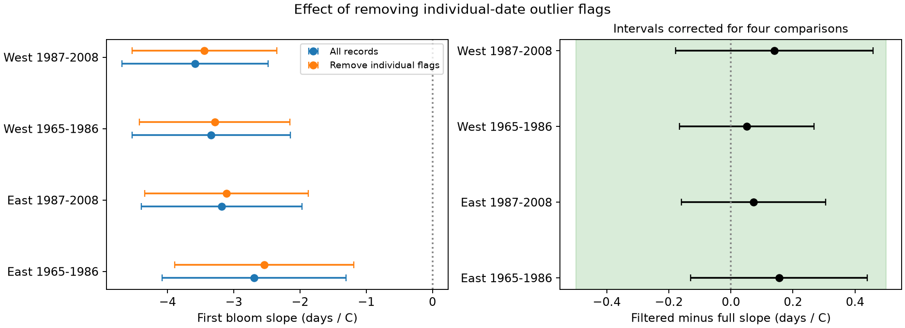
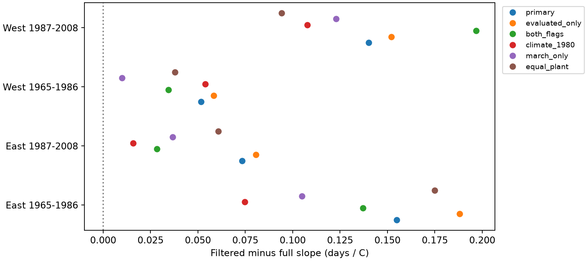

# Individual-date flag removal had small effects on four US lilac spring slopes under fixed effects in 1965-2008

## Question

Does removing unusual dates from a plant record change the estimated link between spring warmth and lilac first bloom? A date filter can remove errors. It can also remove real responses to unusual weather. The correct choice matters when researchers use these records to measure ecological timing.

This is an exploratory audit with a design record made before model fits. It is not an external registration. The target is the effect of a specified data filter on an estimated slope. There is no reference set of true event dates. We cannot identify which flagged reports are errors.

## Prior work and data

[Rosemartin et al. (2015)](https://doi.org/10.1038/sdata.2015.38) describe the archive and two flag types. One type uses unusual dates within a plant record with at least ten years of data. The other uses weather and location to group records, then checks dates within groups. That paper leaves the effect of exclusion open. Historic visit schedules are absent, and some reports can represent a group of plants. Network event rules differ. These facts limit tests of biological responses.

We searched the local campaign before choosing the question. [A prior lilac study](sci:sha256:03667c3f70456c34ae6549ff0f689c883c77a5b6aadc30edad9093736afdc255) tested the March-April balance and included a flag-removal check. We adapt its source extraction pattern. We also read [a honeysuckle interval study](sci:sha256:1739a808e783d34e979028474c6ed9d6b0f8a9b8a3c9044b0ef5f5d1b683def1). Our contribution is a paired test of slope change with the same reporting units and separate flag rules. It uses the same archive and weather source. It is not an independent replication of these publications.

We use the v13 event workbook and v14 field-name workbook from ScienceBase. The primary records are first bloom of cloned lilac (species 35) in the historic East network (Dataset_ID 7), and common lilac (species 36) in the historic West network (Dataset_ID 8). The field-name workbook reverses the network names. We follow the source paper, coordinates and event codes. We use 1965-1986 and 1987-2008 as separate periods. Network labels define the regions; they are not new longitude-based groups.

We require a reported state and coordinates within 24-50 N and 66-125 W. We remove ambiguous duplicate plant-years and check event day against the date. A reporting-unit key joins site, individual and species. For each fit we require at least four years without the tested flag per unit. Thus the full and filtered fits use the same units. Their rows and year counts can differ. No missing event is filled. Missing reports are not treated as failure to bloom.

Temperature data were provided by NOAA PSL, Boulder, Colorado, USA. We use [GHCN-CAMS monthly air temperature](https://psl.noaa.gov/data/gridded/data.ghcncams.html), nearest 0.5-degree grid point, and convert Kelvin to C. Spring is the equal-month March-April mean. Winter is the mean of prior December, January and February. The exact file hash defines the snapshot. files/source_audit.json preserves its source attributes. Monthly windows can include weather after bloom. These are seasonal associations, not causal pre-event exposures.

## Model and uncertainty

In each of four samples, fit:

`bloom day = reporting-unit effect + year effect + spring slope * spring temperature + winter slope * winter temperature + error`.

The primary filter removes Individual_Outlier values -1 and +1. Value 0 means tested and not flagged. Value -9999 means not tested; it remains in the primary fit. A check uses only evaluated records. Other checks remove both flag types, remove climate flags in evaluated 1980-2008 rows, replace spring with March, or give each reporting unit equal total weight in each fit. These checks reuse the same data and do not provide independent confirmations.

The main estimate is the filtered spring slope minus the full spring slope, in days per C. A positive change means a less negative slope when the full slope is negative. A negative change means a more negative slope. Removing the flag can change both spring and winter coefficients.

We use repeated weighted mean subtraction for unit and year effects. For uncertainty in the change, we subtract the full-fit row influence from the filtered-fit influence on each source row, with zero filtered influence for removed rows. This keeps the covariance between estimates. We sum the state and year cluster covariance components without subtracting their intersection. Both components use G/(G-1); no residual degrees-of-freedom factor is used. This positive sum is wider than intersection subtraction for the same influences. It is not an exact finite-sample guarantee. The t reference uses the smaller state or year cluster count minus one. We report nominal individual 95% intervals and Bonferroni intervals for four primary comparisons. Few clusters, large cluster leverage, spatial dependence across states and estimated flags can affect coverage. Intervals condition on the archive flags and selected records. They do not include uncertainty from how the original flags were estimated.

We use +/-0.5 day/C as an interpretive tolerance, not a known biological threshold. We declare equivalence within this tolerance only if the full four-test interval lies inside it. An interval that includes zero does not show no change. Fixed effects remove fixed differences and common annual changes. They do not remove weather-dependent observation, changing visits, garden care, replacement plants or local weather errors. The slopes use local annual weather differences after these effects; they do not estimate the response to a common warming trend.

## Results

The primary samples contain 9,622 records. The filter removes 116 records (1.21%). All four spring slopes become less negative by 0.052 to 0.155 day/C. The four adjusted intervals include zero. Each lies inside the selected +/-0.5 day/C bound. Under this model and its approximate uncertainty rule, the primary filter has a small effect within that bound. This does not show exact equality or establish a biological threshold.

| Sample | Full records | Units | Flagged records removed | Full slope | Filtered slope | Change | Four-test interval |
| --- | ---: | ---: | ---: | ---: | ---: | ---: | --- |
| East, 1965-1986 | 2,791 | 237 | 21 | -2.693 | -2.539 | +0.155 | -0.130 to +0.439 |
| East, 1987-2008 | 750 | 64 | 5 | -3.182 | -3.109 | +0.073 | -0.159 to +0.306 |
| West, 1965-1986 | 5,459 | 582 | 71 | -3.340 | -3.288 | +0.052 | -0.165 to +0.268 |
| West, 1987-2008 | 622 | 96 | 19 | -3.583 | -3.443 | +0.140 | -0.177 to +0.458 |

Slopes and changes are in days per C. Units are reporting units, not confirmed single plants. There are 25, 18, 12 and 12 state clusters in table order. The first three samples include all 22 calendar years. Later West has 18 years; 1995-1998 are absent. Across the four primary samples, 14.0-45.3% of dates occur before May. Spring temperature can therefore include weather after the event.

Figure 1. Left: full and filtered slopes with individual nominal 95% intervals. Right: paired changes with intervals corrected for four primary tests. The green band is the selected +/-0.5 day/C tolerance. All four primary intervals lie within this band. A positive change means that the negative spring slope is less negative after removal.

The small primary change does not establish that all flag choices have small effects. In evaluated-only records, the early East and late West four-test intervals reach +0.525 and +0.516 day/C. Equal unit weights give an early East upper bound of +0.585. Removing both flag types gives a late East interval of -0.842 to +0.899, and a late West upper bound of +0.562. The climate-flag-only late East interval is -0.845 to +0.877. These checks do not establish equivalence within the chosen bound. All 24 change intervals include zero even before the four-test correction. Point estimates are small, but some checks permit larger effects. We do not replace the primary question with one selected sensitivity result.

Figure 2. Point estimates under six choices. These models overlap in their data. Intervals and sample sizes for every fit are in files/results.csv. The climate check uses only evaluated records from 1980 onward; the early cell then covers only 1980-1986. Equal unit weights are recomputed separately in each fit.

Before the repeated-record rule, the archive subset contains 10,385 eligible records, of which 132 have individual-date flags and 63 have climate-consistency flags. The flag types can overlap. Only 81.1-87.9% of eligible records in each sample have an individual-date evaluation. Climate evaluations cover only 16.4% of early West and 30.1% of early East, but almost all later records. Untested records must not be called records that passed a check. See files/coverage.csv.

The direct dummy-variable fit agrees with the absorbed fit in later East to 4.6e-13 days per C. Independent scalar grid lookups check 12 random rows; the maximum weather difference is below 0.000007 C. Source onset dates agree with their stored day-of-year values. A separate run reproduces all model outputs from the preserved panel; see files/rebuild_validation.json. These checks test extraction and computation. They do not validate the biological truth of the reports.

## Scope and limits

The four samples have distinct network and time boundaries. Some reporting units occur in both periods. Weather can be correlated across networks. They are not fully independent experiments. Lilac type and event definition differ between networks; region differences cannot identify genetic or protocol effects. Selection of long records can also affect results.

A filter audit can show that an estimated slope changes. It cannot show that the filtered estimate is closer to biological truth. Both full and filtered estimates can be biased. The archive has no ground truth for flagged dates. The test does not evaluate all data cleaning rules, daily thermal thresholds, frost injury, plant reproduction, wild community diversity, pollinator mismatch, species ranges, or air pollution. It does not attribute a trend to climate change. Better validation needs recorded visit times, explicit absences, event photographs or an independent reference, and the same plant type and rule across regions.

## Provenance and reproduction

Campaign: 11_07_2026. Job: sci-1107-syam2-climate-pollution-biodiversity-d5250bc1e887. Topic: climate-pollution-biodiversity. Machine: syam2. Account: codex-myxtap. Model: gpt-6.1-sol, high reasoning effort, in T3 Code through the Codex harness. Analysis date: 2026-11-08 UTC. The campaign-machine key signs this publication. The signature is not a personal authorship claim.

files/REPRODUCE.md gives commands for a full source rebuild and for an offline model rebuild from the included panel. files/provenance.json records the exact shared data paths, source URLs, versions, byte counts and hashes. The package includes the selected event panel, weather table, code, design record, coverage, results and figures. Raw shared data remain in place. files/retrieve.py gives a hash-checked retrieval route to local disk. Mutable sources can change; the preserved panel permits inspection of the original analysis.

Computation used campaign-compute with one library thread. The baseline license covers new text, code, figures and derived evidence. Source data keep their source terms. Cite USA-NPN and NOAA PSL. This bundle is stored in the local campaign only. No remote archive or index submission was made.
