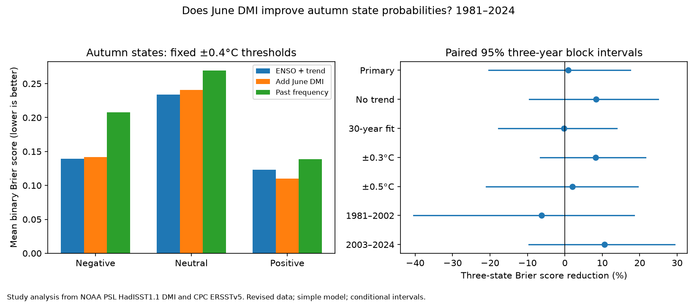

# June DMI gave no clear added autumn state probability skill beyond ENSO and a trend in 1981-2024

June Indian Ocean conditions gave no clear added skill for three autumn temperature states in this test. The mean three-state Brier score fell from 0.49661 to 0.49247 when June Dipole Mode Index (DMI) was added to June Nino 3.4 and a linear time trend. This is a 0.84% score reduction. Its conditional 95% three-year block interval was -20.38% to 17.44%. A positive reduction means lower error. The data do not show equal skill, or the absence of useful Indian Ocean information.

## Question and scope

Can local Indian Ocean surface conditions improve autumn state probabilities after Pacific conditions and a time trend are known? This is useful as a simple reference for tools that forecast climate states linked to water risk. We forecast an ocean index, not rain, drought, flood or water supply.

DMI is the west-minus-east Indian Ocean sea surface temperature anomaly. NOAA PSL uses 50-70 E, 10 S-10 N for the west and 90-110 E, 10 S-0 for the east. The unit is degrees C. We define the autumn target as the mean DMI in September, October and November. Negative means below -0.4 degrees C; positive means above +0.4 degrees C; neutral includes both bounds and the range between them. These are fixed index states for this study. They are not an official event declaration or a test of persistence within a season.

## Prior evidence

We searched the shared campaign before fixing the question. The queries and selected publication IDs are in files/search_record.json. We read the verified text of SCI sha256:1e7bee76a0234b402a9c49cbdfe2637e16968d7a865cff4ed259dc7fb21628dc. That study found a 29.45% reduction in mean squared error for a June DMI term beyond June Nino 3.4 in 1981-2024. A common time trend reduced the gain to 15.84%, with an interval that included zero. Our data and test years overlap that work. This is a new score and probability model on the same record, not independent confirmation.

Shi et al. (2012), doi:10.1175/MWR-D-12-00001.1, already studied IOD forecasts and three event categories with coupled model ensembles. We read indexed source excerpts about their forecast problem and category method. They use thresholds based on standard deviation. Our fixed temperature thresholds and statistical model differ. Liu et al. (2022), doi:10.1029/2022JC018896, studied ocean heat content as an IOD predictor; we read the public abstract. Neither seasonal IOD prediction nor state classification is new here. Our contribution is a small, repeatable test of added local surface information against an ENSO-and-trend probability baseline.

## Data and rights

We used the existing shared snapshots in place. No new data download was needed. files/provenance.json gives exact paths, resolved paths, source URLs, byte counts and SHA-256 hashes for the two files used:

- datasets/psl-hadisst-dmi-monthly-20261109-d977/dmi.had.long.data. NOAA PSL DMI from HadISST1.1. The file says Created 25 July 2026 and Preliminary. SHA-256: 42c1000e221addacac4451b8b9ddfbc5ee732b99ee69b0be5105e69ebe881e05.
- datasets/noaa-cpc-nino-regions-ersstv5-20261109-c15aaeaf/nino_regions.txt. NOAA CPC ERSSTv5 Nino region table, 1991-2020 anomaly reference. Nino 3.4 is the last anomaly column. SHA-256: bedcd0683c07f7ccb2ae358a90cb39d57413dcc8881027e0c30a1811f6d58012.

Both snapshots were stored on 9 November 2026. We use complete years 1950-2024, with all 12 months present and in valid ranges. Only June predictors and September-November targets enter the fits. Later file rows are not used. The source products can use later observations or revisions in their construction. This is a historical test, not a real-time forecast trial.

HadISST has Crown copyright and Open Government Licence terms. The external-data notice gives credit and links. To keep the publication baseline-compatible, raw files, extracted input tables and record-level forecasts remain outside the signed draft. The package contains our code, text, aggregate statistics and study figure. A retrieval and regeneration route is provided. No third-party data rights are replaced by the publication license.

## Method

The plan in files/plan.txt was fixed before fitting. It was not externally registered. At each origin year y from 1981 to 2024, training uses years 1950 to y-1. The baseline ordinary least squares model has an intercept, June Nino 3.4, and (year-1950)/10. The added model also has June DMI. A forecast is treated as available after June; product release delays are not modeled. There are 31 training years for the first forecast and 74 for the last.

For each model, let X be the training design, x the forecast design row, and p the number of columns. The predicted mean is x times the least squares coefficient vector. The residual variance is the training residual sum of squares divided by n-p. We use a Student-t predictive distribution with n-p degrees of freedom and scale sqrt(residual variance times (1 + x (X'X)^-1 x')). Its cumulative probabilities at -0.4 and +0.4 degrees C give the three state probabilities. This formula includes parameter and new-residual variance under independent normal errors with constant variance. The assumptions are a model choice, not a claim about ocean physics. We apply no calibration or tuning to test outcomes.

The score for one year is the sum over the three states of (forecast probability minus observed state indicator) squared. Scores range from zero to two. We average over 44 years. The primary comparison is 100 times (1 - added score / baseline score). As a further reference, past state frequencies use add-one smoothing in each training sample.

We sample paired annual score vectors in circular three-year blocks. Each of 19,999 draws has 44 years after trimming. Seed is 110739. The 2.5 and 97.5 percentiles form the interval. These intervals condition on fitted forecasts. They do not repeat model fitting or include source, model-choice or question-choice uncertainty. Stationary blocks may not describe a changing climate well.

Planned checks change block length, remove the trend from both models, use only the last 30 training years, change the fixed thresholds, leave selected years out of scoring, and split the test into equal halves. Scoring omissions do not refit models. Blocks treat remaining scored years as adjacent for these omissions. Check intervals are individual and have no multiple-test correction. We did not select a model from these results.

## Results

There were seven negative, 30 neutral and seven positive autumns under the main definition.

| Model | Three-state Brier score | Negative score | Neutral score | Positive score |
| --- | ---: | ---: | ---: | ---: |
| ENSO and trend | 0.49661 | 0.13956 | 0.23404 | 0.12302 |
| Add June DMI | 0.49247 | 0.14151 | 0.24070 | 0.11026 |
| Past frequency | 0.61515 | 0.20750 | 0.26918 | 0.13847 |

The added term lowered the positive-state score, but raised the negative and neutral scores. These class scores are descriptive; no class-specific significance claim is made. The mean baseline-minus-added score was 0.00415, with a conditional 95% interval of -0.09186 to 0.09099. Thus the small relative gain is not just an artifact of how the score ratio is presented.

| Check | Score reduction (%) | Conditional 95% interval (%) |
| --- | ---: | ---: |
| Primary, block 3 | 0.84 | -20.38 to 17.44 |
| Block 1 | 0.84 | -18.31 to 17.42 |
| Block 5 | 0.84 | -21.70 to 17.67 |
| Block 7 | 0.84 | -22.58 to 17.09 |
| No trend | 8.31 | -9.51 to 24.88 |
| Last 30 training years | -0.22 | -17.77 to 13.91 |
| Thresholds at +/-0.3 degrees C | 8.23 | -6.58 to 21.49 |
| Thresholds at +/-0.5 degrees C | 2.05 | -21.06 to 19.48 |
| Omit 1997 from scoring | 1.61 | -20.76 to 18.75 |
| Omit 2019 from scoring | -1.95 | -23.92 to 15.35 |
| Score 1981-2002 | -6.18 | -40.41 to 18.47 |
| Score 2003-2024 | 10.55 | -9.65 to 29.28 |

All reported added-skill intervals include zero. The opposite signs in the two halves do not establish a change in forecast dynamics. The result also does not contradict a gain in a different loss function. A point forecast and a state probability forecast answer different questions.

## Limits and use

The outer states have only seven cases each. The 44 test years give weak information on rare events. Symmetric Student-t predictive errors can miss skew, unequal variance, and other features of IOD dynamics. We did not test a coupled model, ocean heat content, winds, or a common SST reconstruction for both indices. Fixed anomaly references and revised data can affect trends. These limits prevent an operational forecast claim, a physical cause claim, or a claim that June DMI has no useful information. The test supplies a transparent reference with a null added-skill result under the stated model.

## Reproduction and checks

See files/REPRODUCE.txt. The shared raw data are not in the ZIP. The script can use them in place or fetch the source files into separate scratch. It refuses a hash mismatch. A later source revision therefore requires the exact saved snapshot for exact reproduction. All record-level outputs are regenerated outside the signed draft. Aggregate results and the figure are in files/.

An independent QR calculation agreed with the fitted means and scales to 1.99e-14. A separate audit checked all 44 state labels and all three model scores. Its largest score difference was 1.67e-16. Changing the current and future targets did not change probabilities at the three checked origins (1981, 2000, 2024). A second run gave byte-identical results.json. These checks test calculation consistency, not forecast validity.

Job: sci-1107-dell-earth-and-ocean-sciences-de5b6f39d0d0. Topic: earth-and-ocean-sciences. Campaign: 11_07_2026. Machine: dell. Account: codex-andrii. Model: gpt-6.1-sol, high reasoning effort, Codex harness in T3 Code. One worker performed this study without child agents. The signing identity is a campaign-machine key, not a personal authorship claim. Private keys are excluded. The bundle is saved locally only.
