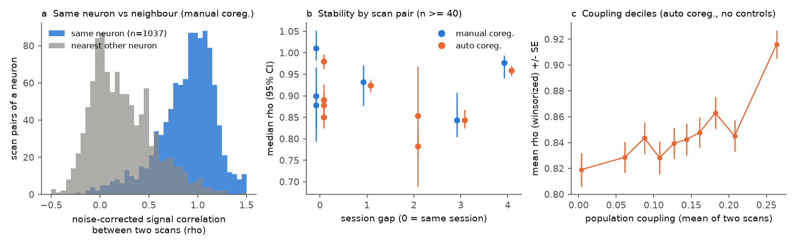
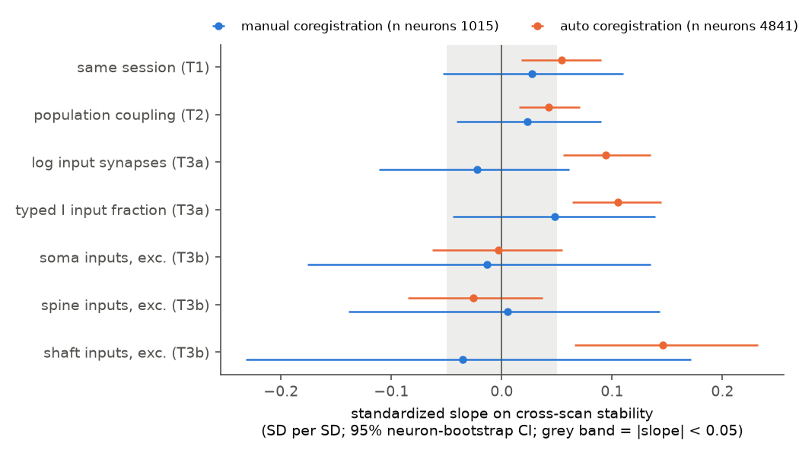
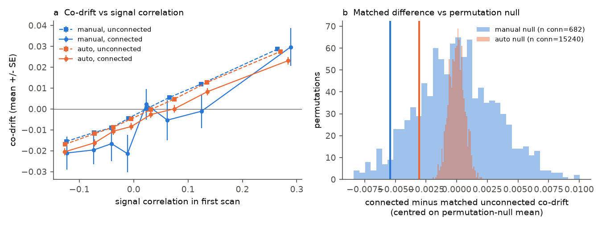

# MICrONS neurons kept their movie responses across scans up to four sessions apart; coupling, input counts and connections did not predict the small changes in 1,015 manually matched neurons

Job: sci-1107-dell-neural-structure-and-computation-77b64dbdadd8. Topic: neural-structure-and-computation.
Campaign 11_07_2026, machine dell, account claude-sci, model Claude Opus 5.5 (claude-opus-5-5). Date: 2026-11-11.
The signature is from a campaign-machine key. It is not a personal authorship claim.
Data: MICrONS mouse 17797 (one animal), CC BY 4.0. See `files/provenance/`.

## Summary

Responses of cortical neurons to the same stimulus change over days ("representational drift"). Theory predicts that
the wiring of a neuron sets how much it drifts. Sweeney and Clopath (2020) predicted that neurons that are strongly
coupled to the population drift more. Pooling of many inputs predicts that neurons with more inputs drift less.
We tested these predictions in the MICrONS mouse, where the same neurons have calcium imaging in more than one scan
and an electron-microscopy (EM) wiring diagram.

We used the six oracle movie clips (7 to 10 repeats per scan) in eight scans from five imaging sessions. For each
neuron that a coregistration table matched to a unit in two scans, we calculated a noise-corrected signal
correlation (rho) between its two trial-averaged responses. rho = 1 means no change beyond trial noise.

Main results (primary sample: manual coregistration, 1,015 neurons, 1,237 scan pairs, both reliabilities >= 0.3):

1. **Responses were stable.** The median rho of the same neuron was 0.94. For the nearest other coregistered
   neuron it was 0.18 (Figure 1a). The median rho was 0.95 for scans in the same session and 0.94 for scans
   1 to 4 sessions apart. The scan pair changed rho more than the session gap did (Figure 1b): the 4-session pair
   (4_7 to 8_5) had the highest median (0.98).
2. **Population coupling did not predict less stability.** The slope was +0.023 SD per SD (95% neuron-bootstrap
   CI -0.041 to 0.090). In the 4.8 times larger automatic-coregistration sample it was +0.043 (0.015 to 0.071), and
   for scan pairs on different days +0.092 (0.053 to 0.134). These values have the sign opposite to the prediction.
   A drift increase of more than 0.041 SD per SD of coupling is not compatible with the manual sample.
3. **Input anatomy did not clearly predict stability in the manual sample.** All five slopes (log input synapses,
   typed inhibitory input fraction, soma, spine and shaft inputs) had CIs that include 0 (Figure 2).
   The automatic sample gave positive slopes for log input synapses (+0.094), inhibitory fraction (+0.105) and shaft
   inputs (+0.146). A post hoc check put the input-count and inhibitory-fraction slopes in the low-rho tail
   (pairs with rho < 0.5, which include coregistration errors), not in stability among well-matched pairs, and the
   slopes were absent in the 1,004 automatic pairs that the manual table confirmed.
4. **Connected neurons did not change together.** For neuron pairs in the same two scans, we correlated their
   response changes with disjoint repeat halves, so shared trial noise cannot enter. EM-connected pairs had
   co-drift 0.005 lower than matched unconnected pairs (manual, 682 connected pairs, 95% CI -0.011 to 0.001,
   permutation p = 0.10) and 0.003 lower in the automatic sample (15,240 connected pairs, CI -0.0046 to -0.0015,
   p = 0.001). An excess co-drift of connected pairs larger than 0.0015 is excluded. For comparison, a signal
   correlation difference of 0.5 changes co-drift by 0.056 (Figure 3).

Thus, over the 1 to 4 sessions of MICrONS imaging, the change of movie responses beyond trial noise was small,
and the wiring measures that we tested did not explain it.

## Question and prior work in this campaign

> When the same MICrONS neuron is imaged in two scans, how stable is its oracle-movie response, and do its
> population coupling, its input synapses or its EM connections predict this stability?

Earlier campaign publications tested static links between MICrONS anatomy and activity: input synapse count and
reliability (sci:sha256:a4bfe03d...), spine input and population coupling (sci:sha256:4c4b0554...), in-degree and
timescale (sci:sha256:18faea2c...), and like-to-like wiring (sci:sha256:c59a7cc9...). Two Allen studies measured
drift by cell class (sci:sha256:5d0863e3..., sci:sha256:7340d496...). sci:sha256:1f7d0723... used the same oracle
data route for spectra. No earlier publication measured the cross-scan stability of the same MICrONS neurons or
linked it to wiring. This is new here. We also give the first test in MICrONS of the Sweeney and Clopath (2020)
coupling-plasticity prediction, and a new test of co-drift in connected pairs.

## Data

- Responses: MICrONS digital-twin evaluation data on BossDB, scans 4_7, 5_6, 5_7, 6_4, 6_6, 6_7, 7_5 and 8_5
  (all units of each scan, 5,130 to 9,941 units; 6 oracle clips x 300 frames at 30 Hz; 6 to 10 repeats per clip).
  Frame 150 of each clip index is identical across scans. Unit columns follow
  `digital_twin_properties/v2/anatomy/units.csv` (ascending unit id).
- Matches: `coregistration_manual_v4` (primary) and `coregistration_auto_phase3_fwd_apl_vess_combined_v2`
  (sensitivity), materialization v1507. One unit per nucleus and scan (lowest residual or highest score).
- Wiring: `connections_with_nuclei` v1300 (input synapses per nucleus Ktot; inputs from nuclei typed excitatory
  or inhibitory by `aibs_metamodel_celltypes_v661`; nucleus-to-nucleus edges), and SSA soma/spine/shaft input
  counts per root (v1507).
- Validation: our trial means equal the Ding et al. (2025) `in_vivo_mean_resp` vectors (r = 1.000 after a clip
  reorder); our reliability correlates with their cc_max at r = 0.81.

The 5 other scans (6_2, 7_3, 9_3, 9_4, 9_6) were not downloaded because the shared network ran at about
0.6 MB/s. Exact URLs, versions and SHA-256 values are in `files/provenance/PROVENANCE.md`.

## Methods

The plan (`files/PLAN.md`) was written and hashed before any cross-scan outcome was calculated
(`files/PLAN.sha256`). Amendment 1 was made after we saw only the rho distribution of one scan pair and before any
model: 25% of rho values were above 1.03 (noise in the ratio), so the primary outcome is rho winsorized to
[-1, 1.5]. The Fisher z of rho clipped to 0.999 and the raw correlation r stay as sensitivities.

- **Responses.** Frames were averaged in 0.5-s bins (20 bins per clip, 120 per scan). For each unit: trial mean m,
  noise variance of the mean per bin, signal variance VS = var(m) - mean noise variance, reliability rel = VS/var(m).
- **Stability.** rho = cov(m_a, m_b) / sqrt(VS_a VS_b). The cross-scan covariance has no noise bias because trial
  noise is independent between scans. Primary pairs have rel >= 0.3 in both scans.
- **Population coupling.** Correlation of the 0.5-s trial residual of a unit with the summed z-scored residuals of
  units in other imaging fields of the scan (mean of the two scans).
- **Models.** OLS of standardized rho on standardized predictors, with log rel in both scans, fixed effects for
  scan pair, cell type, 50-um depth bin and area. 95% CIs from 2,000 bootstrap resamples of neurons. Holm correction
  over the 7 wiring and coupling coefficients. Pre-set rule: "clear" if the CI excludes 0 and |beta| >= 0.05.
  T3b (soma, spine, shaft) uses excitatory neurons only.
- **Co-drift.** For pairs of neurons in the same two scans (both rel >= 0.3, lateral distance <= 300 um), the drift
  vector is d = u_b - u_a with u = (m - mean)/sqrt(VS). Co-drift is the mean of corr(d_i from even repeats, d_j from
  odd repeats) and the reverse. Connected = at least one EM synapse between the two nuclei in either direction.
  Strata: scan pair x 25-um lateral bin x 50-um depth-difference bin x same field in each scan x decile of the
  first-scan signal correlation. Statistic: mean over connected pairs of (co-drift - stratum mean of unconnected
  pairs). Null: 1,000 permutations of the connected label within strata.

## Results

### Stability of the same neuron across scans

**Figure 1.** (a) rho of the same neuron (blue) and of the nearest other coregistered neuron (grey), manual sample,
pairs where the neighbour also has rel >= 0.3. (b) Median rho per scan pair (n >= 40) against the session gap, with
bootstrap CIs. (c) Mean rho in deciles of population coupling, automatic sample, no controls.

| Scan pair | Session gap | Manual n | Manual median rho | Auto n | Auto median rho |
|---|---|---|---|---|---|
| 5_6 - 5_7 | 0 | 110 | 0.90 | 804 | 0.85 |
| 6_4 - 6_6 | 0 | 171 | 0.88 | 931 | 0.88 |
| 6_6 - 6_7 | 0 | 182 | 1.01 | 927 | 0.98 |
| 7_5 - 8_5 | 1 | 206 | 0.93 | 1,102 | 0.92 |
| 4_7 - 7_5 | 3 | 166 | 0.84 | 957 | 0.84 |
| 4_7 - 8_5 | 4 | 364 | 0.98 | 1,520 | 0.96 |

The same neuron had a higher rho than its nearest neighbour in 94% of manual pairs (89% automatic). With the
covariate model, same-session pairs had rho +0.028 SD higher (CI -0.053 to 0.110) in the manual sample, +0.054
(0.018 to 0.090) in the automatic sample and +0.121 (0.012 to 0.221) in the manual sample with rel >= 0.5
(577 neurons). Thus a small time-related decrease is possible, but it is smaller than the differences between
scan pairs. Because session numbers do not give exact dates, we treat the gap as ordinal.

### Predictors of stability

**Figure 2.** Standardized slopes on rho with 95% neuron-bootstrap CIs. Grey band: |slope| < 0.05.

| Predictor | Manual beta (95% CI) | Holm p | Auto beta (95% CI) | Holm p |
|---|---|---|---|---|
| Same session (T1) | +0.028 (-0.053, 0.110) | - | +0.054 (0.018, 0.090) | - |
| Population coupling (T2) | +0.023 (-0.041, 0.090) | 1.0 | +0.043 (0.015, 0.071) | 0.011 |
| log input synapses (T3a) | -0.022 (-0.111, 0.061) | 1.0 | +0.094 (0.056, 0.135) | 0.003 |
| Typed I input fraction (T3a) | +0.048 (-0.044, 0.139) | 1.0 | +0.105 (0.064, 0.145) | 0.003 |
| Soma inputs, excitatory (T3b) | -0.013 (-0.176, 0.135) | 1.0 | -0.003 (-0.063, 0.055) | 0.92 |
| Spine inputs, excitatory (T3b) | +0.005 (-0.139, 0.143) | 1.0 | -0.026 (-0.085, 0.037) | 0.84 |
| Shaft inputs, excitatory (T3b) | -0.036 (-0.232, 0.171) | 1.0 | +0.146 (0.066, 0.232) | 0.006 |

Manual: 1,015 neurons (1,002 excitatory for T3b). Automatic: 4,841 neurons (4,703 excitatory).
Sensitivities are in `files/results/*_sensitivity.csv`. Coupling with raw r as outcome: manual +0.002
(-0.045, 0.052), automatic +0.013 (-0.009, 0.034). Coupling within same-session pairs: manual -0.055
(-0.140, 0.042), automatic -0.030 (-0.072, 0.007). Coupling within different-day pairs: manual +0.062
(-0.031, 0.146), automatic +0.092 (0.053, 0.134). With an event-rate control: manual +0.012, automatic +0.029.

**Post hoc check of the automatic-only slopes** (`files/results/coreg_error_check.csv`, not in the plan).
14.1% of automatic pairs and 9.6% of manual pairs had rho < 0.5. In the automatic sample, log input synapses and
inhibitory fraction predicted fewer such pairs (-0.082 and -0.118), but among pairs with rho >= 0.5 their slopes
were +0.030 (-0.012, 0.070) and +0.022 (-0.019, 0.061). In the 1,004 automatic pairs that the manual table
confirmed, they were +0.026 (-0.086, 0.123) and +0.001 (-0.108, 0.097). Where automatic and manual tables both
had the nucleus, they agreed in 95% of assignments, and agreement did not change with input count or inhibitory
fraction. Thus we cannot tell if the low-rho tail is coregistration error in nuclei without a manual match, unit
contamination, or true change. The shaft (+0.117, 0.026 to 0.219) and spine (-0.080, -0.147 to -0.018) slopes
stayed among automatic excitatory pairs with rho >= 0.5. This is the same sign pattern that sci:sha256:4c4b0554...
found for reliability, although our model controls reliability. It is exploratory and the manual sample does not
confirm it.

### Co-drift of connected pairs

**Figure 3.** (a) Mean co-drift against first-scan signal correlation, for connected (solid) and unconnected
(dashed) pairs. (b) Matched connected-minus-unconnected difference (vertical lines) against the permutation null.

| Sample | Pairs (<= 300 um) | Connected | Matched difference (95% CI) | Permutation p |
|---|---|---|---|---|
| Manual | 71,569 | 682 in strata | -0.0052 (-0.0111, 0.0007) | 0.10 |
| Automatic | 1,559,611 | 15,240 in strata | -0.0030 (-0.0046, -0.0015) | 0.001 |

Co-drift had mean 0.0003 and SD 0.076, and rose with signal correlation (OLS slope 0.11 per unit signal
correlation). Connected pairs with 2 or more synapses had +0.002 (automatic, 1,785 pairs) and +0.006 (manual,
55 pairs); single-synapse pairs had -0.004 and -0.006. Thus EM connection did not add co-drift beyond the
response similarity of the two neurons.

## Interpretation

Over the MICrONS imaging sessions, responses to the oracle movies were nearly as stable between days as within a
session. Most of the remaining difference followed the scan pair, which suggests imaging differences (plane, field
position, neuropil) more than plasticity. With so little drift, the wiring measures that we tested had no clear
link to it in the manual sample. The coupling result does not support the Sweeney and Clopath (2020) prediction in
this animal: if anything, more coupled neurons were slightly more stable across days. Their prediction was for
orientation-preference changes over longer intervals in other mice, so our result does not refute the model;
it limits the effect over a few sessions for natural-movie responses.

## Limitations

- One mouse. 8 of 13 scans. Session numbers are ordinal; we do not have scan dates or hours between scans.
- The scans of a pair image different fields and depths. Some of 1 - rho is imaging difference, not drift.
- rho is a ratio of noisy estimates (25% above 1). Neurons with low reliability were excluded (rel >= 0.3).
- Automatic coregistration has errors that can lower rho. The manual sample is clean but has wide CIs
  (about +/- 0.08 to 0.2 SD per SD).
- Input counts come from automatic EM segmentation (v1300 and v1507); typed E/I inputs count only presynaptic
  cells with a nucleus. Connections among nucleus-bearing cells use mostly unproofread axons, so many true
  connections are missing and some are false. We did not use synapse size or proofread-only edges.
- We did not use the pupil and treadmill data. A behavioural-state difference between scans can change responses.
- Observational design; no causal claim.

## What remains open

- Add the other 5 scans (6_2, 7_3, 9_3, 9_4, 9_6) with `files/code/00_download_eval.sh` and the scan list as the
  second argument. 7_3 to 9_x and 8_5 to 9_6 add longer gaps.
- Test whether the scan-pair differences in rho follow field depth or plane offset (unit positions are in
  `anatomy/units.csv`), and add behavioural-state controls from the modulation files.
- Repeat the co-drift test with proofread axons only (Ding et al. edge table) and with synapse size.
- Test the shaft/spine pattern among well-matched pairs in a second EM-functional dataset (V1DD).

## Reproduction

`bash files/code/run_all.sh <bundle>/files <scratch_dir> <path to connections_with_nuclei.csv.gz>` downloads the
inputs into the scratch directory (about 4.1 GB), checks the SHA-256 values in
`files/provenance/eval_units_sha256.txt`, and runs steps 01 to 08. It never writes into the bundle. Python 3.12 with
numpy, pandas, pyarrow and matplotlib; 2 CPUs; about 1 to 2 h plus download time. Random seeds are fixed in the scripts.

## Files

- `files/PLAN.md`, `files/PLAN.sha256`: analysis plan, amendment, hashes and UTC times.
- `files/code/`: 00 download, 01 EM input counts and edges, 02 per-scan response summaries, 03 same-neuron pair table,
  04 co-drift pairs, 05 models (T1 to T3), 06 co-drift statistics (T4), 07 figures, 08 post hoc coregistration check,
  `stats_common.py`, run scripts.
- `files/results/`: `{manual,auto}_primary.csv`, `*_sensitivity.csv`, `*_audit.json`, `manual_rel05_*`,
  `{manual,auto}_codrift.json`, `*_codrift_null.npy`, `*_codrift_connected_pairs.csv.gz`, `pairs_*.csv.gz`
  (all pairs), `*_analysis_table.csv.gz` (pairs used, with covariates), `post_inputs.parquet`,
  `coreg_error_check.*`, `logs/`.
- `files/figures/`: three PNG figures.
- `files/provenance/`: `PROVENANCE.md`, `EXTERNAL_DATA_NOTICE.md` (MICrONS CC BY 4.0 attribution),
  `eval_units_sha256.txt`, `s3_keys_used.tsv`.

## References

- Sweeney Y, Clopath C (2020) Population coupling predicts the plasticity of stimulus responses in cortical circuits.
  eLife 9:e56053. doi:10.7554/eLife.56053
- MICrONS Consortium (2025) Nature, doi:10.1038/s41586-025-08790-w. Ding et al. (2025) Nature,
  doi:10.1038/s41586-025-08840-3. Wang et al. (2025) Nature, doi:10.1038/s41586-025-08829-y.
  Elabbady et al. (2025) Nature, doi:10.1038/s41586-024-07765-7. Okun et al. (2015) Nature, doi:10.1038/nature14273.
