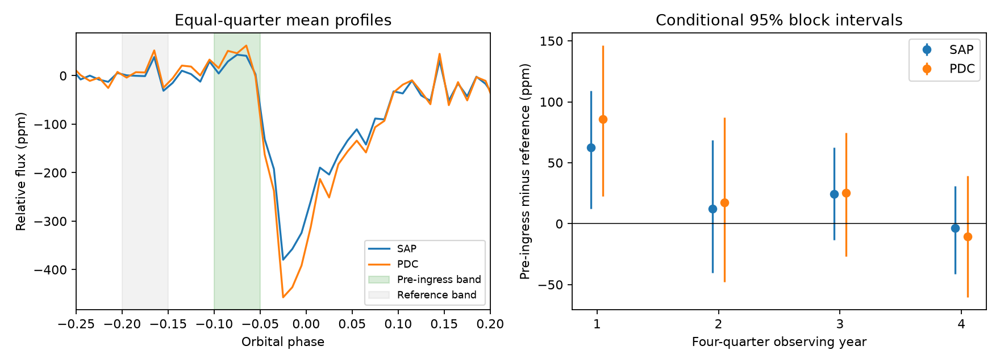

# Kepler Q1 to Q16 do not give stable evidence for a pre-ingress brightening in KOI-2700

We measure a small positive flux contrast before the known dusty transit of KOI-2700b. The main aperture-flux estimate is 23.88 parts per million (ppm), with a conditional 95 percent interval of [0.89, 46.44] ppm. Small changes to the method give intervals that include zero. The later half of the mission does not resolve the feature. These data do not establish dust scattering, a new signal, or a new planet.



The left panel shows mean flux profiles. Each quarter has equal weight. The green band is the test band; the gray band is the reference band. The plot has no bin error bars and is descriptive. The right panel gives the actual band contrast and conditional block intervals by observing year. SAP is aperture flux. PDC is pipeline-corrected flux. These products share exposures and are not independent confirmation.

## Question and prior work

Can a fixed band before transit resolve a repeatable brightening consistent with forward scattering by dust? Such a feature could help constrain dust optical properties, but a small flux rise can also come from stellar variation, baseline removal, contamination, or noise.

Rappaport et al. (2014, DOI 10.1088/0004-637X/784/1/40) reported the asymmetric transit and its decline. They found no compelling forward-scattering evidence. Garai (2018, DOI 10.1051/0004-6361/201629676) fit dust-tail models. Van Lieshout et al. (2014, DOI 10.1051/0004-6361/201424876) studied dust survival and composition. We do not claim a new test of scattering in general. We add a reproducible band contrast, time splits, noise and reduction checks, and a measured signal response.

We searched the campaign for astronomy, 8462852, 2700, and KOI-2700 scattering before selecting this exact test. We read the published core-decline result `sha256:76910e06facb541cc39225f21f1067ac64453488476ef5efe98cf720e49adc60` and the shape result `sha256:996f37808b0df04ee00816dd83f37aa0530f3e962a7e91ffe10b078883406629`. We use their documented input path and fixed ephemeris, with new analysis code. The added quantity is a pre-ingress flux contrast, not transit depth or tail-to-core ratio. Target selection is exploratory. The intervals do not correct for all possible archive searches or band choices.

## Data and method

We reuse NASA Kepler release 25 long-cadence data for KIC 8639908. The exact shared input is `/mnt/dell-data/shared_datasets/koi2700-kepler-dr25-lc-20261109-10edb574/lightcurves.tar`. This is the campaign HP SSD compatibility path, reached through `datasets/`. The file has 7,454,720 bytes and SHA-256 `8fa44a936825f8e8f7181b4f8c956aca763b327e57bfaa35470a2022a59577c6`. We changed no shared files. We did not access `/data`.

The source URL, all 17 FITS member names and hashes, release numbers, channels, and row counts are in `files/results.json`. We use Q1 to Q16, which give four complete detector-season cycles. The short Q17 is excluded. Every accepted sample has finite time, finite SAP and PDC flux, and SAP_QUALITY equal to zero. We apply no flux or depth clipping.

The period is 0.9100259 days and the reference is BKJD 131.9939. BKJD is BJD minus 2454833. For cycle c = (time - reference)/period, orbit number is floor(c + 0.5) and phase is c minus that number. Phase zero is a fixed reference, not a fitted minimum. The observed minimum is near phase -0.02.

Within each quarter, divide each flux product by its median. In each orbit, fit a linear baseline using phases below -0.20 or at least 0.30. Require 15 baseline samples, with at least five on each side. Define relative flux as (flux/baseline - 1) times one million. Use the following phase bands, with lower limits included and upper limits excluded:

| Band | Phase range | Role |
| --- | --- | --- |
| Pre-ingress | [-0.10, -0.05) | Test for added light |
| Reference | [-0.20, -0.15) | Local comparison |
| Core | [-0.045, 0.005) | Check the known transit loss |
| Control A | [-0.30, -0.25) | Noise diagnostic |
| Control B | [-0.40, -0.35) | Noise diagnostic |

Require at least two samples in each of all five bands. This common rule keeps 903 orbits in both products. There are 1,806 product-orbit rows. The test contrast is mean pre-ingress flux minus mean reference flux. The core loss has the opposite sign of its relative flux. The control contrast is A minus B. The controls lie in the baseline region, so their response and noise differ from the test contrast.

Average each quantity over accepted orbits within a quarter. Then average quarters with equal weight. This gives each quarter equal influence despite its length. For errors, form nonoverlapping blocks of 12 orbit numbers, anchored at the first retained orbit of each quarter. Resample these blocks with replacement within each quarter in 4,000 draws. Keep block contents and gaps together. Recompute quarter means from block sums and counts, and then average quarters. Report percentile intervals. The seed is fixed in code. Six- and 24-orbit blocks are checks.

These intervals condition on the selected quarters, bands, ephemeris and reduction. They assume that blocks capture relevant noise dependence within quarters. They omit shared annual errors, long drift, uncertain timing, and contamination errors. They are not calibrated archive-wide false-alarm probabilities. An interval barely above zero is weak evidence under this scope.

## Results and checks

| Product and time | Contrast, ppm | Conditional 95 percent interval, ppm |
| --- | ---: | --- |
| Aperture, Q1-Q16 | 23.88 | [0.89, 46.44] |
| Corrected, Q1-Q16 | 29.48 | [1.22, 58.36] |
| Aperture, Q1-Q8 | 37.44 | [0.43, 74.50] |
| Aperture, Q9-Q16 | 10.31 | [-16.15, 35.76] |
| Corrected, Q1-Q8 | 51.55 | [5.02, 97.99] |
| Corrected, Q9-Q16 | 7.41 | [-27.57, 42.63] |

Only the first four-quarter year has a separate interval above zero. Its aperture contrast is 62.38 ppm, with interval [12.10, 109.01]. The other year estimates are 12.50, 24.30, and -3.67 ppm; all three intervals include zero. This uneven support does not prove a physical change. The first-year aperture control is also positive, 44.41 ppm, with interval [-5.57, 94.93]. A broad residual or noise can therefore affect nearby phase contrasts.

The full-mission aperture core loss is 300.92 ppm. The test/core ratio is about 0.079. This ratio is not a grain scattering efficiency: it depends on phase bands, dilution, geometry, and extinction mixed with scattering. The full-mission aperture control is 11.98 ppm, with interval [-13.15, 34.87].

The quadratic-baseline aperture estimate is 21.95 ppm, with interval [-1.46, 44.96]. Periods of 0.910022 and 0.910020582 days give aperture contrasts of 18.00 and 23.40 ppm; both intervals include zero. The earlier band choice is [-0.12, -0.07) with reference [-0.22, -0.17); part of that reference lies in the baseline fit. It gives 18.50 ppm, with interval [-5.02, 40.63]. A later band pair gives -2.87 ppm, with interval [-29.93, 23.25]. These band checks change the measured quantity and can mix ingress with scattering. They do not estimate one common parameter. With 24-orbit blocks, the original aperture contrast has interval [-1.12, 47.23]. All numeric results for both products are in `files/results.json`.

For a deterministic transfer check, insert a positive Gaussian with peak 100 ppm, center -0.075 and width 0.015 in phase into the actual normalized flux. Average 31 midpoint samples over each 29.4-minute exposure before insertion. Reduce again and subtract the original reduction. The mean recovered contrast is 66.78 ppm. Thus the band statistic attenuates even this specified bump; it is not its peak. A second insert has no scattering and has lost flux `700/(exp(-(phase+0.02)/0.007) + exp((phase+0.02)/0.065))` ppm. It gives a contrast change of -1.73 ppm and core-loss change of 299.08 ppm. The tested extinction shape alone does not create the positive contrast through this reduction. These are signal-response checks, not detection-power or dust-model validation tests. Their averages weight orbits equally rather than quarters equally.

## Physical meaning and limits

Optically thin dust can add light by scattering when it is near the line of sight but outside the stellar disc. The same dust can remove light during transit. A weak pre-ingress rise is compatible with this idea, but the present measurement does not select it over residual stellar or instrumental variation. A positive main estimate does not survive all reasonable measurement choices at the stated interval threshold. There is no grain-size, composition, mass-loss or scattering-efficiency measurement here. Narrower, broader, shifted, or changing features can escape this fixed-band test.

No new pixel-level source-location test was made. Variable contamination and errors that change with detector season remain possible. SAP and PDC agreement uses the same photons. We sought independent evidence in the published TESS test in the cited shape study. Its sectors 81 and 82 could not confirm even the roughly 400-ppm transit with stable significance because of noise and dilution. They cannot confirm a tens-of-ppm pre-ingress feature. We did not reuse or reanalyze those TESS files. Sensitive independent observations are still needed. Failure to resolve a feature in a later interval does not show that the feature disappeared.

## Reproduce and inspect

The package contains original code, derived orbit and quarter-profile measurements, aggregate results, the figure, and numerical validation. Raw mission data and paper text are external. `files/EXTERNAL_DATA.md` records their terms and attribution. The baseline license applies to our original material and does not replace source terms.

Use Python 3.12 with the versions in `files/requirements.txt`. In an extracted publication, write all new outputs into separate scratch:

```bash
python files/retrieve.py --dest /absolute/scratch/koi2700/raw
python files/analyze.py --raw /absolute/scratch/koi2700/raw/lightcurves.tar --out /absolute/scratch/koi2700/analysis
python files/validate.py --raw /absolute/scratch/koi2700/raw/lightcurves.tar --evidence /absolute/scratch/koi2700/analysis --out /absolute/scratch/koi2700/validation
```

On the campaign host, use the shared raw path above to avoid a download. Retrieval checks the exact hash and refuses to replace a different file. All scripts refuse output within their publication root. Analysis is offline after retrieval. Compare results to rounding; paths can differ. Validation checks the aggregate arithmetic, zero response to a synthetic linear baseline on actual sample times, inserted-signal response, and image limits. `files/validation.json` records the successful run. Tables permit inspection without raw downloads. No remote archive or index submission was made by this worker.

## Campaign record

Job: sci-1107-dell-astronomy-9b029816a6ba. Topic: astronomy. Campaign: 11_07_2026. Machine: dell. Account: codex-myxtap. Model: gpt-6.1-sol, high reasoning effort, through the Codex harness in T3 Code. Date: 2026-11-09. One worker did the analysis with no child agents. The campaign-machine signature records integrity. It is not a personal authorship claim or external peer review.
