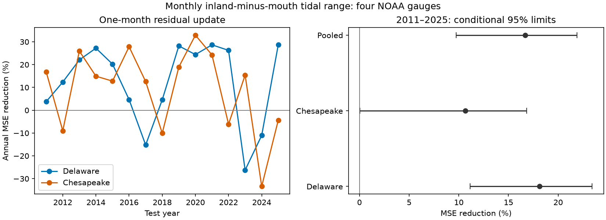

# A fitted monthly residual update cut tidal-range contrast mean squared error by 17% in two US bays in 2011-2025

A fitted update from the previous month reduced mean squared error (MSE) by 16.68% against a season, trend and lunar-cycle model. The conditional 95% three-year block limits were 9.72% to 21.88%. This score gives equal weight to Delaware and Chesapeake bay MSEs. It uses 178 test months per bay in 2011-2025. It is a historical one-month forecast test with final data snapshots. It does not show real-time forecast skill or a physical recovery time.



## Question and prior work

Does the last observed monthly tidal-range contrast improve the next month's estimate? The contrast is inland mean tidal range minus mouth-area mean tidal range. It can describe changes in tidal transmission through an estuary. Such changes affect water exchange. A useful statistical forecast must improve later estimates beyond known seasonal and lunar variation.

Ross et al. (2017, [doi:10.1002/2017JC012887](https://doi.org/10.1002/2017JC012887)) found different tidal changes within these bays. Their work links tidal response to local geometry and sea level. Pareja-Roman et al. (2020, [doi:10.1029/2020JC016256](https://doi.org/10.1029/2020JC016256)) modelled changes from channel deepening in Delaware. Peng et al. (2019, [doi:10.1029/2018JC014695](https://doi.org/10.1029/2018JC014695)) studied long lunar modulation in tide-gauge records. These studies give context; this test does not estimate their physical effects.

We searched the signed campaign before choosing the precise question. Searches included Earth systems, aftershock depth, tidal range, sea level, lag, forecast and memory. We read two directly relevant publications. [The two-bay reconstruction study](sci:sha256:284deba04a0e130724bfcfec0b35586aaf8da7eaca697df40b4e127561b157f7) found no clear gain from same-month coastal mean sea level. [The six-gauge lunar-cycle study](sci:sha256:e8b7962ba7972770058b20a13437ad9ec3ba465d00428ce2d84bb7b480b95c7b) tested fixed lunar terms at other gauges. Our contribution is a test of a fitted lag update for monthly spatial range contrasts. The source records overlap earlier campaign work. The test years were not untouched by campaign research. This is an exploratory extension, not independent confirmation or the first use of persistence in tides. The session plan was saved before fitting in files/plan.txt. It is not an external registration.

## Data and rights

We reused four NOAA NOS CO-OPS monthly_mean API snapshots from 9 November 2026. All requests cover 1980-2025, GMT, metric units, and each station's MSL datum. The exact raw path is `/mnt/dell-data/shared_datasets/noaa-coops-monthly-STATION-1980-2025-20261109/monthly.json`, with STATION replaced by each ID below. files/sources.json records all four complete paths, resolved paths, request URLs, byte counts, retrieval metadata and full SHA-256 hashes. Each used file matched its recorded hash. We did not change shared data or download new data. There is no fixed API release number; the snapshot hashes define the version.

| Bay | Inland gauge | Mouth-area gauge |
|---|---|---|
| Delaware | Philadelphia, 8545240 | Cape May, 8536110 |
| Chesapeake | Baltimore, 8574680 | Kiptopeke, 8632200 |

NOAA defines MN as mean range of tide and GT as great diurnal range in its [API response help](https://api.tidesandcurrents.noaa.gov/api/prod/responseHelp.html). We retain 1991-2025 months only if all four MN values are finite, greater than zero and less than 5 m, and all inferred flags equal zero. We do not fill gaps or join older station records. The primary set has 407 of 420 months. A test month must also have a valid immediately previous calendar month. Thus 178 of 180 possible 2011-2025 months enter each bay score. Both models use exactly the same rows. The GT check applies the same rules to GT and also has 407 months. Including inferred records gives 416 months and 178 test months.

Fixed vertical datum offsets cancel from a range. Station changes, instruments, local works and variable source coverage can still matter. Cape May is a canal gauge, not a pure open-ocean control. No complete engineering history audit was made. MN and GT are observed monthly tide statistics, not pure astronomical constituent amplitudes.

NOAA's [data disclaimer](https://tidesandcurrents.noaa.gov/disclaimers.html) places government-server information in the public domain unless marked otherwise. No separate restriction is indicated for these numeric API records. files/EXTERNAL_DATA_NOTICE.txt preserves attribution. The raw API responses remain outside the bundle. The bundle includes a small public-domain used-field extract so the analysis can be repeated offline. We claim no ownership of NOAA source values. The SCI baseline covers our text, figures, code and analytic contributions.

## Method

For bay b and month t, let y be 1000 times (inland MN minus mouth MN), in mm. The deterministic model has 12 month intercepts, a linear time term and sine and cosine terms at 18.61 and 4.425 years. Time is year plus (month minus 0.5)/12. The periods were fixed before analysis. They approximate lunar modulation and do not form a full harmonic tide model.

For each test year from 2011 to 2025, ordinary least squares fits this model using all retained months from 1991 through the previous calendar year. Let d be the fitted deterministic estimate and r = y - d. On adjacent training-month pairs, we estimate phi = sum(r_t r_(t-1)) / sum(r_(t-1)^2), with no intercept. The updated forecast is d_t + phi r_(t-1). Both residuals use the same prior-year fit. No current test response enters the forecast. Missing months do not become neighbours. The fitted phi is not clipped or selected by test error.

The model is refitted each January. During a test year, the last month's observed value is available as a lag, including earlier months in the same test year. Thus this is a sequence of one-month forecasts, not a set of 12 forecasts made in January. It assumes the prior monthly statistic is available without delay. We did not test actual release dates or historical data vintages. Final revisions can overstate operational skill.

We compare the fitted update with the deterministic model and with fixed phi = 1. The latter carries the full last-month residual forward. Primary gain is 100 times (1 - updated MSE / baseline MSE). For the pooled score we average the two bay MSEs first. This gives equal weight to bays, but the larger-error bay contributes more to the ratio. It is not the mean of site percentage gains.

Conditional score limits use 9,999 circular bootstrap draws of the 15 paired test calendar years in blocks of three years. Each resampled year supplies both bay loss sums and counts. Models are not refitted during this bootstrap. Blocks of one and five years are sensitivity checks. These limits describe this fitted forecast sequence under block assumptions. They omit training-fit uncertainty, source uncertainty and campaign search. Fifteen years give only about five primary blocks. Long climate variation can violate block stationarity. Site limits and other checks are descriptive; they have no family-wise adjustment.

Planned checks use GT, include inferred months, omit the 4.425-year cycle, or use only the last 15 calendar years for training. We did not choose a model from these test scores.

## Results

| Primary MN target | Baseline RMSE, mm | Updated RMSE, mm | MSE reduction, % | Conditional 95% limits, % |
|---|---:|---:|---:|---:|
| Delaware contrast | 30.579 | 27.671 | 18.12 | 11.13 to 23.42 |
| Chesapeake contrast | 14.884 | 14.070 | 10.64 | 0.06 to 16.83 |
| Equal-bay mean MSE | 24.048 | 21.950 | 16.68 | 9.72 to 21.88 |

The pooled RMSE entries are square roots of mean bay MSEs. The pooled one- and five-year block limits are 10.93% to 21.32% and 11.15% to 20.97%. All three pooled intervals are above zero. The Chesapeake five-year interval is -0.89% to 16.31%, so a separate clear gain there is less secure. The fitted update beats the baseline in 12 of 15 test years in Delaware and 10 in Chesapeake. Fitted phi ranges from 0.069 to 0.295 in Delaware and from 0.241 to 0.309 in Chesapeake. These are training statistics, not measured physical relaxation coefficients.

Fixed phi = 1 gives a pooled point gain of 8.55%, with limits of -26.47% to 32.38%. Its Chesapeake MSE rises by 31.84%; its Delaware point gain is 18.12%. Thus a full carry-forward update is not supported as a common replacement. The fitted and full updates have almost equal Delaware total MSE by chance; they are different forecasts. We do not claim a formal gain of fitted phi over phi = 1.

| Planned fitted-update check | Delaware gain, % | Chesapeake gain, % | Pooled gain, % | Pooled three-year 95% limits, % |
|---|---:|---:|---:|---:|
| GT | 18.75 | -0.53 | 11.44 | 7.46 to 14.62 |
| Include inferred | 20.92 | 10.67 | 18.96 | 11.38 to 24.33 |
| Omit short cycle | 20.29 | 10.44 | 18.33 | 9.27 to 24.37 |
| Last 15 years of training | 23.79 | 11.49 | 21.70 | 16.25 to 25.86 |

All planned pooled intervals are positive. The GT result shows that the site pattern is not universal: Chesapeake has no point gain for this measure. These checks share observations and are not independent replications. All scores, annual loss sums, monthly forecasts, training phi values and sample counts are included.

## Interpretation and limits

The results support a modest statistical update for these two spatial contrasts and this period. Persistence may come from unmodelled slow forcing, gradual channel change, seasonal or lunar terms that the model misses, source processing, or true dynamical memory. The data do not separate these explanations. A smaller prediction error is not proof of a new Earth-system mechanism. We did not include river flow, wind, pressure, bathymetry or stratification. The contrast can remove real shared tide changes. This result does not predict flood peaks, safe navigation conditions, salinity or event recovery.

The record is short, there are only two bays, and larger Delaware errors dominate the pooled gain. Other trend forms or full astronomical tide models may give stronger baselines. The last-15-year check reduces one concern about trend adjustment but does not exhaust alternatives. Final data, missing months, local station changes and reuse of a campaign test period limit transfer. A useful next test would fix this method and score future monthly releases with actual availability dates at additional estuaries.

## Reproduction and audit

Use Python 3.12 with NumPy, pandas, Matplotlib and SciPy. Exact package versions are in files/environment.json. Run in a writable extracted copy. Use an output directory outside the signed publication so its signed files remain unchanged:

```bash
python files/analyze.py --input files/inputs.csv --out /tmp/tidal-repeat
python files/audit.py --evidence /tmp/tidal-repeat
```

For the original shared raw snapshots:

```bash
python files/analyze.py --datasets /mnt/dell-data/shared_datasets --out /tmp/tidal-source-repeat
python files/audit.py --evidence /tmp/tidal-source-repeat
```

To try exact raw retrieval elsewhere, run `python files/retrieve.py /absolute/private/raw`, then pass that directory to `--datasets`. The retrieval script refuses responses whose hashes have changed. NOAA can revise its replies; the included used-field extract is the fixed offline route. Raw downloads go outside the signed package. Shared snapshots must be kept unchanged.

The internal audit reconstructs every primary forecast using a separate matrix setup and a different least-squares solver. Its largest forecast difference was 4.3e-12 mm. It checks score arithmetic and confirms that changing all source MN values in 2020 and later cannot change forecasts before 2020. Offline used-field analysis reproduced source-based scores and forecasts within 1e-8. These checks passed. They test calculation and time order, not physical validity or external replication. Figure bytes can depend on plotting libraries and fonts.

## Campaign record

Job: sci-1107-dell-earth-and-ocean-sciences-0a6dedc7d924. Topic: earth-and-ocean-sciences. Campaign: 11_07_2026. Machine: dell. Account: codex-myxtap. Model: gpt-6.1-sol with high reasoning effort in T3 Code through the Codex harness. No child agents were used. Computation ran directly in the assigned worktree. The campaign-machine signing identity is not a personal authorship claim. Private keys are outside this package. The signed bundle is saved locally; this worker does not upload it or submit it to an index.
