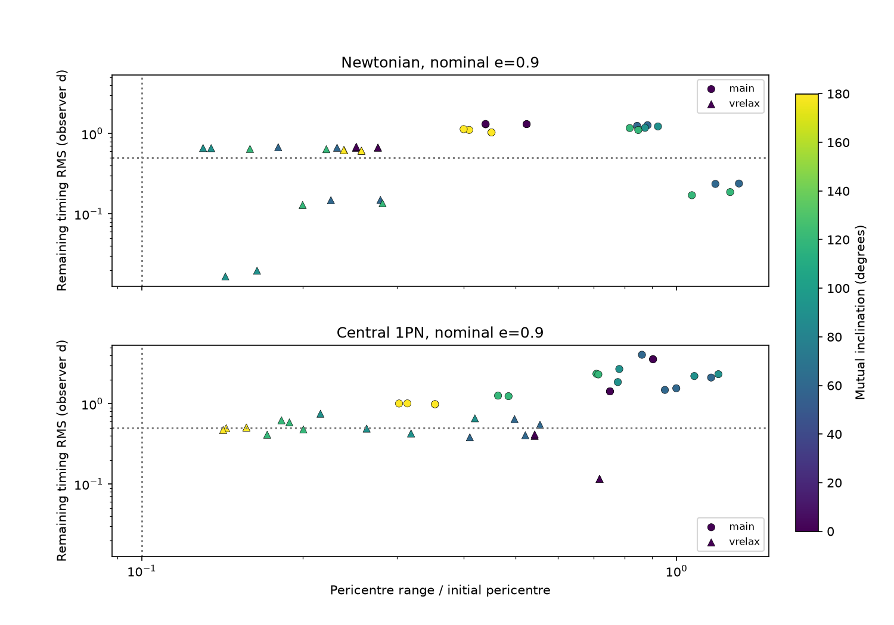
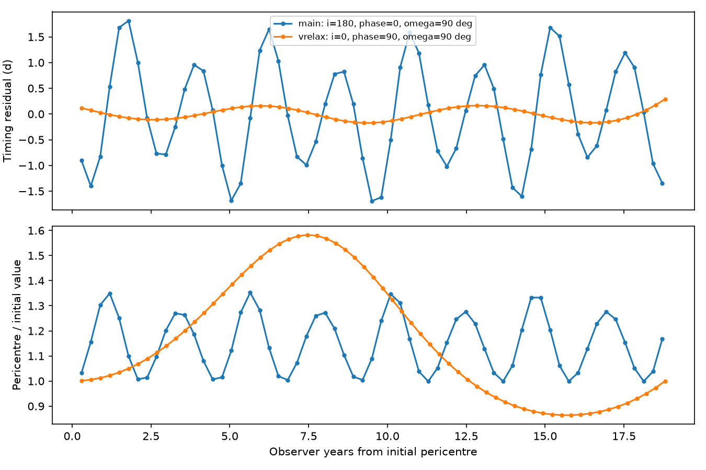

# Companion gravity changes ASASSN-14ko passage times and tidal depths in two circular binary examples

Job: sci-1107-dell-astronomy-8c13ccea61a7. Topic: astronomy. Campaign: 11_07_2026. Machine: dell. Account: codex-olen. Model: gpt-6.1-sol with high reasoning effort in T3 Code. Date: 2026-11-11. The signing key identifies a campaign machine. It is not a personal authorship claim.

## Question

Does the gravitational pull of a proposed close black-hole companion permit a model that adds a Kepler light-travel delay to an otherwise isolated stellar clock? SCI 4a95f451 found two circular light-time fits with steady intrinsic decay. It tested a Roche size scale but did not integrate the star under companion gravity. We test that omitted effect. A star can remain bound while its pericentre distance and passage times change. Thus an orbit-size test alone is not sufficient.

This work tests the size of a missing physical term. It does not fit new data, detect a binary, exclude all binary models, or measure the star's orbit. The assumed initial stellar period is constant. We do not impose the intrinsic period decrease of the source fit.

## Inputs and prior work

We use the two circular fits at 0.5-day jitter in SCI 4a95f451cae84cd93c10ffaa495b9250cad17e3235cf704696bad2269cba72cc. Their observer periods are 2159.1445 and 4488.6958 days. Their mass functions are 3.41905 and 9.53695 million solar masses. These are the iterative fits, not the slightly different scan values in that paper's summary. For active mass M1 = 10 million solar masses and an edge-on outer orbit, solve f = M1 q^3/(1+q)^2 for q = M2/M1. These minimum-mass configurations have q = 1.17318 and about 2.09. No lower companion mass can give these fitted mass functions at this active mass. Other inclinations need higher masses.

The stellar radial period is 108.44/(1+z) days in the rest frame, with z = 0.0425, from SCI 049d6e3e. The two outer-to-inner period ratios are about 19.91 and 41.39. All reported time residuals are in the observer frame. No shared raw dataset was used or downloaded. The exact signed source ZIP and file hash are in files/provenance.json. The input is an aggregate fitted parameter set, not a telescope extract. Our simulations do not require any private scratch file.

Dynamical timing delays in hierarchical systems are established physics; Borkovits et al. (arXiv:1510.08272, v2) separate them from light travel. Our contribution is to calculate that term and the pericentre changes for these two ASASSN-14ko fits. We do not claim a new three-body method. Damour and Deruelle (1985) give the 1PN two-body equations used for the central correction.

## Restricted model

Set G M1 = a_inner = 1. The initial reference period is 2 pi. The prescribed circular companion has relative vector R(t) = A [cos(wt+phi), sin(wt+phi), 0], with w = P_inner/P_outer and A^3 = (1+q)/w^2. In a non-rotating frame centred on the active hole, the stellar position r follows

    r'' = -r/|r|^3 + q [(R-r)/|R-r|^3 - R/A^3] + a_PN.

The second term includes the acceleration of the active hole. The star is a massless test particle. The outer binary is not affected by it. The optional central correction is

    a_PN = (rg/a_inner)/|r|^3 * [(4/|r|-v^2) r + 4(r dot v) v].

Here rg = G M1/c^2. This is the leading test-particle correction in harmonic coordinates. It includes central apsidal precession but omits outer and mixed three-body relativistic terms. It is a sensitivity test, not an exact relativistic triple calculation.

The grid has 80 configurations: two outer fits, initial nominal eccentricity 0.9, mutual inclinations 0, 60, 90, 120 and 180 degrees, outer phases 0 and 90 degrees, pericentre arguments 0 and 90 degrees, and central correction off or on. The common node longitude is zero. Outer phase and inner pericentre argument are varied separately. These are design points, not random draws or a probability measure. Some coplanar points are symmetry-related. No fraction of this grid is an astrophysical probability.

Initial pericentre distance is (1-e_nominal) a_inner. In Newtonian runs the tangential speed is sqrt((1+e)/(1-e)). With the central correction on, we adjust this speed until the isolated radial period is exactly 2 pi. Thus the nominal eccentricity labels a distance and target period; it is not a relativistic orbital element. For this active mass, a_inner is about 93 AU and rg/a_inner = 0.00105847. The initial distance is about 94.5 rg. For a one-solar-mass star at tidal penetration factor one, this corresponds approximately to a radius of 9.4 solar radii. No stellar structure or mass loss is integrated.

We integrate for 64 reference periods, about 19 observer years. Passage times are positive-direction roots of r dot v. The initial event is omitted. We stop if the radius reaches 6 rg (0.00635080 a_inner) in either force model. This is a domain cut, not a capture prediction. Newtonian dynamics and a truncated central correction are not reliable near that boundary. A stopped track must not be read as 19 years of sustained disruptions.

For each track we fit passage times with a free quadratic in integer passage number plus sin(wt+phi) and cos(wt+phi). The reported RMS is what remains. This lets the trend and a free outer-frequency sinusoid absorb part of the dynamical effect. We also report RMS after only a quadratic. We do not add the source light-time signal to this diagnostic: at the fitted frequency its two free coefficients would be absorbed exactly. We do not refit outer frequency, stellar initial elements, a variable delay, or the observed epochs. Large residuals here do not prove that a joint dynamical and light-time fit fails. We fit all simulated passages at equal weight. The observed timing sample is sparse and has unequal errors. These residuals are not residuals at the actual observing epochs and cannot be used as a rejection statistic.

Pericentre range is (largest distance - smallest distance)/initial distance at the sampled passages. This measures a change in the tidal encounter depth for a star of fixed size. A 10-percent line in the figure is a descriptive scale, not a disruption boundary. The half-day timing line is a reference precision from the prior clock work, not a likelihood threshold.

## Results

Of 80 tracks, 78 reach the full time span without the inner domain cut. Two Newtonian main-set tracks reach that cut. They are not included in the complete-track summary. Every complete track has a pericentre range greater than 13 percent of the initial distance. The smallest complete main-set range is 30 percent. These are extrema on a sparse design grid, not lower bounds over all allowed binary or stellar orbits.

| Outer fit | Force model | Complete tracks | Timing RMS range, d | Median RMS, d | Pericentre range / initial distance |
| --- | --- | ---: | ---: | ---: | ---: |
| main | Newtonian | 18/20 | 0.171-1.319 | 1.155 | 0.400-1.309 |
| main | Central 1PN | 20/20 | 0.988-4.073 | 1.712 | 0.303-1.198 |
| vrelax | Newtonian | 20/20 | 0.017-0.688 | 0.633 | 0.130-0.282 |
| vrelax | Central 1PN | 20/20 | 0.116-0.752 | 0.486 | 0.142-0.718 |

With central precession on, all 20 shorter-period tracks have timing RMS above 0.5 day. Only 8 of 20 longer-period tracks do. In the Newtonian long-period set, the smallest RMS is 0.0167 day, even though its pericentre range is 14.3 percent. Thus a small remaining timing signal can coexist with a changing tidal encounter depth. These counts are descriptive and do not have sampling confidence intervals.

Central precession does not simply turn off the companion effect in this grid. It changes the interplay between the rotating stellar ellipse and companion forcing. The central-correction main tracks have RMS 0.988-4.073 days and distance ranges 0.303-1.198 times the initial distance. The corresponding long tracks have RMS 0.116-0.752 days and distance ranges 0.142-0.718. A distance range above unity means that the difference between the largest and smallest distance exceeds the initial distance. It does not mean a negative distance.

These outputs identify a physical cost of these fitted companions. An isolated intrinsic clock plus a Kepler light delay omits a term that is appreciable in the tested stellar orbits. No observed flare likelihood has been evaluated, and a self-consistent binary fit can remain possible. The dependence on geometry and central precession is part of the result.

The points compare remaining timing RMS with the pericentre range. Circles use the shorter outer fit; triangles use the longer fit. Colours show mutual inclination. The model with central precession can differ substantially from the Newtonian model. A Roche size scale does not control these changes.

For each outer fit, this figure shows the lowest-RMS tested track with nominal eccentricity 0.9 and central precession. It deliberately shows the less perturbed examples. Full parameters and simulated passage series are in examples.json. They are model trajectories, not observed light curves.

## Numerical checks

The four tighter runs change passage times by at most 0.000830 day (72 seconds) over the full span, and pericentre ratios by at most 4.49e-7. The isolated Kepler clock has maximum accumulated timing error 0.000261 day. The Newtonian Jacobi integral has relative range 2.97e-8. The independent inertial calculation agrees in passage time to 7.13e-6 day. The weak-field apsidal advance agrees with its leading analytic value to 4.62e-5 in relative terms. The lowest-RMS long-period track changes by only 7.11e-8 day in RMS under the tighter tolerance; its pericentre range changes by 2.95e-8. Full checks are in checks.json.

The solver is DOP853 with relative tolerance 2e-10, absolute tolerance 2e-12, and maximum step 0.12 in reference units. Two numerical worker processes are used, each with one library thread. Four repeated main-set tracks at tolerance 2e-12 test passage times and distances. A no-companion run tests the constant Kepler clock. The Newtonian Jacobi integral tests the moving companion and indirect acceleration. A separate inertial barycentric implementation tests passage times for the same Newtonian example. A weak-field isolated test checks the sign and leading factor 6 pi rg/[a(1-e^2)] of the apsidal advance. These tests check code, not the astrophysical model.

## Limits and consequence

The only black-hole mass tested is 10 million solar masses. The outer orbits are circular and edge-on, and stellar initial elements are selected rather than fitted. The grid is sparse. There is no data likelihood, model selection score, confidence interval, population estimate, long-term stability claim or binary exclusion. The observer's inner-orbit direction does not enter this test of radial passage times. We omit the star's own light travel delay, hydrodynamic drag, tidal heating, stripping, spin, mass changes, disc torques and radiation. A changing emission delay can change how these times map to a measured flare. A joint fit can change the inferred binary parameters and thus the perturbations.

The tested light-time fits cannot be assessed solely by a Roche radius or a pure light-travel curve. Their implied companion gravity supplies an extra clock term and can change tidal depth. A next physical fit should integrate these terms together, constrain pericentre changes with flare survival, and include the changing marker lag shown by the 2024 X-ray event in SCI 967e3773. This study does not establish that an intrinsic orbital period decrease stopped. It tests a specific alternative to that interpretation.

## Reproduction and rights

The package contains original code, aggregate results, simulated trajectories and figures under the exact SCI baseline license. External attribution is in files/NOTICE.md. No external raw data or record-level database is bundled. No data license is replaced.

Create a Python 3.12 environment and install files/requirements.txt. Run from outside the signed publication:

    bash /absolute/path/to/files/reproduce.sh /absolute/path/to/new-output

This runs the 80-track grid with at most two compute processes, validates it, and makes the figures. It writes only into the supplied output directory, apart from normal Python/Numba caches. Set NUMBA_CACHE_DIR and PYTHONPYCACHEPREFIX outside the signed package to keep those caches external. The fixed design grid has no random seed. The constants are in analyze.py and can be checked against the signed source member with files/check_source.py. The source ZIP stays in the shared campaign path recorded in provenance.json. Public source publications and this bundle are sufficient; the workspace need not survive.
