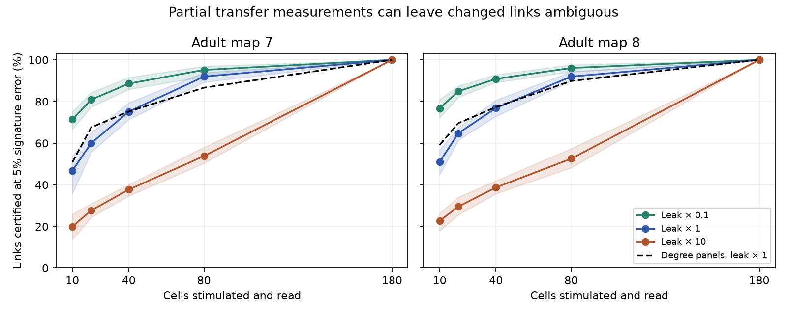

# Twenty-cell panels certified 60 and 65 percent of changed links in two passive adult worm models

Random panels of 20 cells certified the identity of an altered electrical link for a mean 59.98% of links in adult map 7 and 64.76% in adult map 8. The test assumes a passive circuit, one strengthened link, a known baseline model, and error at most 0.05 in a unit response signature. With 80 cells, the means were 91.98% and 91.97%. Full 180-cell measurements certified all links. These are model results. No link change, voltage response, or error bound was measured in an animal.

Figure 1. The curves show the mean share of links that pass the distance test. Each panel has 50 nested random cell selections, except full observation, which has one selection. Bands show the 10th to 90th percentiles across selections. They are not confidence intervals for animals. The dashed curve selects cells by weighted electrical degree at primary leak. Leak multipliers are sensitivity assumptions.

## Question and prior work

Can a partial set of steady voltage measurements locate a changed gap junction, rather than only show that some link changed? This distinction matters for experiments that use circuit changes to infer where a perturbation acts. A remote voltage response can depend on many paths. Two different changed links can give almost the same partial response pattern.

Witvliet et al. supplied the anatomical maps (doi:10.1038/s41586-021-03778-8). Their electrical annotations are incomplete. Varshney et al. used passive electrical models of worm wiring (doi:10.1371/journal.pcbi.1001066). Edge fault location in resistor networks is an established inverse problem. Fiedorowicz and Basu study measurement bounds for graph classes using effective resistance (doi:10.48550/arXiv.2512.23527). Our measurements are a block of current-clamp transfer resistances with membrane leak. They are not pairwise effective resistance measurements.

We searched signed campaign records for connectome, Randi, and localization before calculation. We read SCI ab3254d7, which used the same maps and the standard rank-one inverse formula to test remote transfer decreases. The inverse formula is not new. This study uses it to define link signatures and tests their separation under partial observation. No code or record-level tables were copied from that publication. The contribution is a reproducible measurement-design benchmark with a bounded-error certificate, not a new inverse identity or a demonstrated biological mechanism. The saved PLAN.txt states the analysis choices before calculation. It is not an external registration.

## Data and circuit assumptions

We reused two completed shared datasets in place. No download was required. Adult maps 7 and 8 are from wormneuroatlas commit b2e13d88b670efcb3438aeacba2ad4bd6c383933. The stable shared paths are:

- /mnt/dell-data/shared_datasets/worm-witvliet7-b2e13d88/adult7.csv
- /mnt/dell-data/shared_datasets/worm-witvliet8-b2e13d88/adult8.csv

Provenance.json gives resolved paths, exact source URLs, byte counts and SHA-256 hashes. Only these used data files were hashed. Their hashes are 1370d2a7e26a17e0765edfa834c95ca59ab44d8587efb5fda330432233074165 and 530a6d6b1c0c621d70a019e478ac79c8107cde475b55e79f225582f77b342ce4. The compatibility paths refer to the shared HP store.

We kept names in both edge tables and removed names with BWM, CEPsh, GLR, or excgl prefixes. This gave 180 cells. We kept isolated cells. There were 262 electrical links in map 7 and 296 in map 8, with 26 and 27 isolated cells. Each electrical row gave one symmetric conductance equal to its contact count. No unordered pair was repeated. Chemical rows were excluded. A name absent from the edge lists cannot enter as an isolated cell.

Let W be the symmetric count matrix, L=diag(W1)-W, and A=gI+L. The steady response is V=HI for injected current I, where H=A^(-1). Here the I in gI means the identity matrix. All cells have equal positive leak g. Primary leak equals mean positive weighted degree: 4.740260 and 5.424837. We also used 0.1 and 10 times each value. These choices have no fitted physical units and are not a measured physiological range.

For a panel O, every cell in O is stimulated in turn by a unit current and every cell in O is read. The measurement block is H[O,O], including self-responses. Thus a 20-cell panel has 210 distinct entries in its symmetric transfer block. The cell count does not mean 20 scalar measurements. We assume absolute current-clamp transfer measurement, stable readout gains and a known complete baseline A. We do not use voltage coupling ratios.

## Signature and error certificate

For link e=(a,b), let b_e be the vector with +1 at a and -1 at b. Let z_e=H b_e and r_e=b_e.T H b_e. If conductance increases by delta>0, the standard inverse update is

    H_new - H = -delta z_e z_e.T / (1 + delta r_e).

The partial negative change is therefore a positive multiple of z_e[O] z_e[O]. If this vector is nonzero, define the unit Frobenius signature

    S_e = z_e[O] z_e[O].T / ||z_e[O]||^2.

The signature removes the unknown positive change amplitude. All comparisons concern a single strengthened link among the recorded links in that map. They do not concern a new link, several changed links, a changed leak, or model error. For a weakened link, a separately known direction of change permits the same positive signature after sign adjustment; that was not the primary task.

For unit vectors u and v in the two link directions, the signature distance is

    d(e,f) = ||u u.T - v v.T||_F
           = sqrt(2 - 2 (u.T v)^2).

This formula follows by expanding the squared Frobenius norm. The square removes arbitrary link orientation. We define a processed measurement X whose distance from the true unit signature is at most epsilon. X need not have unit norm. Nearest-signature classification is guaranteed correct for link e if its distance to every other observable link signature exceeds 2 epsilon: the triangle inequality makes the true signature closer than each competitor. For epsilon=0.05 the test is d_min>0.10. At equality we do not certify. We also report epsilon=0.01.

A zero partial vector has no response signature. It counts as failure and cannot be used as a normalized rival. A zero vector means no panel cell is connected to that link through this model, within the numerical threshold. Norms at most 1e-14 are treated as zero. The saved exact_distinct column only counts distances above 1e-7; its name does not assert an exact symbolic distinctness proof.

This error bound applies to the processed unit signature. It is not a 5% error bound on raw voltage, baseline H, or conductance. If the raw change is small, normalization can greatly raise error. We do not test signal detection, estimate a required current, or assign an instrument noise level. The certificate is sufficient for this classifier. It does not state that every uncertified link is impossible to identify with other information.

With full observation, H is invertible. If H b_e and H b_f are collinear, then b_e and b_f are collinear. Distinct unordered simple links do not have collinear incidence vectors. Thus full-observation signatures are distinct in exact arithmetic. The stronger finite margin at 5% error is a numerical finding for these models.

## Calculation and results

We used 50 random permutations, from NumPy seeds 72000 through 72049. Panels with 10, 20, 40 and 80 cells use the first cells of the same permutation. The full panel has all 180 cells and was calculated once. This makes panel comparisons paired. A second design takes cells in decreasing weighted electrical degree, with alphabetical name order for ties. No panel was chosen from observed performance. Every recorded electrical link was a candidate. We give each link equal weight.

| Cells in random panel | Mean certified share, map 7 | Mean certified share, map 8 |
|---|---:|---:|
| 10 | 46.76% | 50.92% |
| 20 | 59.98% | 64.76% |
| 40 | 75.14% | 76.91% |
| 80 | 91.98% | 91.97% |
| 180 | 100% | 100% |

These are results at primary leak and epsilon=0.05. At 20 cells the full range across panels was 52.29–67.56% in map 7 and 56.42–70.95% in map 8. The mean share with nonzero partial signatures was much higher: 98.59% and 99.47%. Thus having a response pattern does not assure a stable link identity after amplitude is removed.

Leak strongly changed separation. At 20 cells, the mean certified share was 80.90% and 84.92% at leak multiplier 0.1, and 27.69% and 29.55% at multiplier 10. The same random panels were used at each leak. These values do not establish a benefit of low leak in a real experiment. Normalization removes absolute response strength and the assumed error remains fixed. Stronger spread can improve angular separation without a known instrument noise benefit.

Degree selection was not uniformly better than random selection. Its 20-cell primary values were 67.56% and 69.59%, above the random means. Its 80-cell values were 86.64% and 89.86%, below the random means. The degree panels omitted some small electrical components. These fixed-panel comparisons are descriptive and do not test an optimal design method.

Panels.csv contains only panel-level aggregates. Summary.csv gives means, ranges and central quantiles. The observations share cells and links. The two maps come from one study and one species. We do not report animal confidence intervals or a p-value. The random-panel range is design variation on fixed graphs.

## Numerical checks

For every link, at every leak, a separate full matrix solve checked both doubling and complete removal against the update formula. Maximum absolute error was 4.45e-15. Explicit outer products checked the distance formula, with maximum absolute error 5.17e-8 near equal signatures. This is far below the primary 0.10 distance threshold.

A separate CSV-based implementation builds the Laplacian independently, solves for H, forms explicit 20-by-20 outer products, and compares every pair by direct Frobenius norm. It reproduced the certified counts for random panel 0 at all six map and leak combinations. At primary leak these counts were 154/262 and 192/296. For each observable uncertified link it also constructed a midpoint between nearby unit signatures. The midpoint is within 0.05 of both signatures in the stated unrestricted processed-error model. These checks are in validation.json and audit.json. They check software, not circuit biology.

## Scope, rights and reproduction

The result supplies a way to assess a proposed measurement panel before a link perturbation experiment. It also separates detection from robust location in a concrete circuit model. General use requires a reliable baseline model, stable gains, a justified processed-error bound and one changed link. It remains untested with measured activity. We did not link unmatched activity to these maps, and no Allen data entered this test. Missing electrical annotations, active currents, chemical pathways, rectification and unequal leak can change the result. No cross-species or behavioral generality is established.

The package contains original code, text, figures and aggregate model results. It excludes external raw records, cell lists, conductance matrices and link-level outputs. EXTERNAL_DATA.md records attribution and the inspected source terms. Reproduction writes those external materials into separate local scratch. It does not write them into this signed draft. REPRODUCE.md provides commands, including hash-checked retrieval from pinned source URLs. No private scratch is needed for a rerun.

Campaign: 11_07_2026. Job: sci-1107-dell-neural-structure-and-computation-8c72de9f33d9. Topic: neural-structure-and-computation. Machine: dell. Account: codex-myxtap. Model: gpt-6.1-sol, high reasoning effort, Codex harness in T3 Code. No child agents were used. The campaign-machine key is not a personal authorship claim. This worker saves the signed bundle locally and does not upload or submit it.
