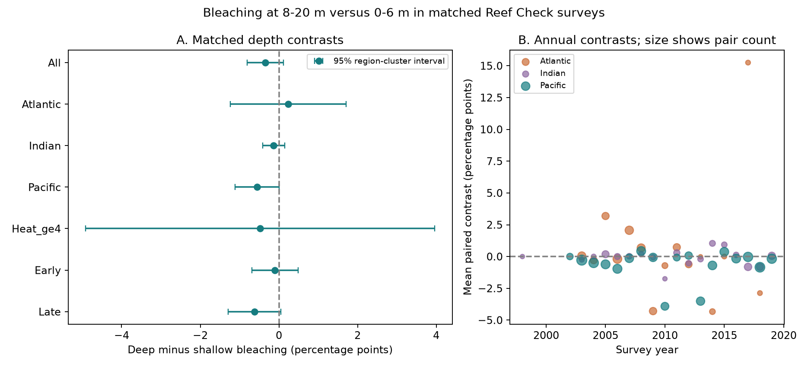

# Matched coral surveys gave no clear depth refuge from bleaching at 0-20 m in three oceans in 1998-2019

## Question and main result

Do deeper coral surveys show less bleaching when place, month, and survey program are the same? We compared Reef Check surveys at 8-20 m with surveys at 0-6 m at the same site in the same year and month. A negative difference means less reported bleaching in deeper water.

The 1,331 pairs at 797 sites gave a mean difference of -0.349 percentage points. The 95% interval was -0.809 to +0.111 points when errors were grouped by ecological region. This sample did not establish a common depth refuge. It does not show that depth has no effect. Most pairs had little heat stress. Only 71 pairs had a mean heat dose of at least four degree-heating weeks. Their interval permitted both protection and more bleaching in deeper water.

This study concerns a biological response to marine heat extremes. It does not measure species loss, species distributions, or air pollution.

## Prior work and added knowledge

Depth can reduce light and change water temperature. Both processes can change bleaching risk. Previous work found no consistent thermal refuge to about 35 m across six western and central Pacific regions (2019; DOI:10.1038/s41598-019-56232-1). Other field work tested depth, species, and colony size during a bleaching event at Moorea (DOI:10.1038/s41598-024-58980-1). These studies motivate a test across other regions and years. Our data do not contain temperature measurements at survey depth, so they cannot separate light effects from cooling or coral composition.

We searched the campaign with `sci search "phenology climate pollution" --in ./campaign`, `sci search "lilac" --in ./campaign`, and `sci search "bleaching" --in ./campaign`. The flowering questions had many completed tests. We changed the question before computing coral depth contrasts. We read the two published turbidity studies cited in sci.json. They use overlapping source surveys and control for depth as a model term. We instead match depths within site and month, then test the paired difference. We reuse their warning about repeated substrate rows but wrote the code from the public CSV. This is a new analysis of existing observations, not a new independent survey.

`files/protocol.txt` records the design before the paired estimates were examined. It was not registered with an external service. We selected bands and periods for a feasible comparison, not from a formal power analysis. The final two heat-matching checks were added after we saw the initial estimates. The exploratory heat slope was also added later. Unused planned options and the reason for them are recorded below.

## Data and selection

The source is the Global Coral-Bleaching Database, BCO-DMO dataset 773466, version 2, dated 2022-10-14. The data descriptor is van Woesik and Kratochwill (2022), DOI:10.1038/s41597-022-01121-y. Data are supplied by van Woesik and Burkepile under CC BY 4.0. The CSV includes several source programs. We use Reef Check only to reduce differences in observation methods. The supplied CoRTAD v6 fields describe surface thermal conditions, not heat at each depth.

The source contains 41,361 rows. Reef Check has 28,821 rows but only 14,475 sample IDs. Multiple substrate rows can carry the same bleaching record. For each sample ID, the code checks agreement in all fields used and then keeps one row. No conflicts were found. We retain valid bleaching percentages from 0 to 100, depth from 0 to 40 m, nonmissing coordinates and heat dose, years 1998-2019, and the Atlantic, Indian, and Pacific oceans. This leaves 10,552 surveys. We use 2019 as the last year because CoRTAD v6 ends in 2019.

A shallow survey has depth from 0 through 6 m. A deep survey has depth from 8 through 20 m. Surveys outside these bands do not enter a pair. Within each site-year-month and band, we average all survey bleaching values. A group enters the analysis only if both bands are present. Each group has equal weight, irrespective of the number of original surveys. The primary pairs use exact Site_ID, not a spatial grid. The mean difference in survey depth was 5.56 m. All pair members had the same named ecological region.

There are 1,331 pairs in 53 ecological regions and 372 rounded 0.1-degree spatial cells. The 733 pairs with zero bleaching in both bands account for 55.1% of the sample. Mean bleaching was 2.794% in shallow surveys and 2.445% in deep surveys. The sample represents sites with surveys at both depths. It need not represent all reefs or all heated reefs.

## Estimator and uncertainty

For pair g, `D_g = mean(deep bleaching) - mean(shallow bleaching)`. The primary estimate is the arithmetic mean of D. This is an equal-pair contrast. It removes the common site-year-month level from the comparison. It does not remove depth-specific species composition, habitat, survey selection, or observer error.

We report cluster sandwich uncertainty for a mean. For n pairs in G clusters, the variance is `G/(G-1) * sum_c [sum_(g in c)(D_g - mean(D))]^2 / n^2`. The interval uses Student t with G-1 degrees of freedom. We compute this for both spatial cells and named ecological regions. Region intervals are the main summary. These methods allow dependence within a cluster but assume clusters provide independent information. Shared ocean-scale events can violate this assumption. Small region counts in some splits make interval calibration weak.

The four Atlantic/Pacific period tests use Bonferroni intervals with joint nominal coverage of 95%. The split is 1998-2009 versus 2010-2019. Oceans have disjoint observations. Periods have disjoint years but can repeat sites. These checks do not constitute independent data collection. We do not interpret a change in nominal significance as a difference between periods.

## Results

All effects are deep minus shallow bleaching percentage points. Intervals below use ecological-region clusters and nominal 95% coverage.

| Sample | Pairs | Regions | Difference | 95% interval |
| --- | ---: | ---: | ---: | --- |
| All | 1331 | 53 | -0.349 | -0.809 to +0.111 |
| Atlantic | 273 | 6 | +0.233 | -1.240 to +1.706 |
| Indian | 143 | 15 | -0.133 | -0.416 to +0.149 |
| Pacific | 915 | 34 | -0.556 | -1.113 to +0.0004 |
| Early period | 698 | 48 | -0.102 | -0.692 to +0.489 |
| Late period | 633 | 28 | -0.622 | -1.291 to +0.048 |
| Mean heat dose at least 4 | 71 | 15 | -0.478 | -4.917 to +3.961 |

The Pacific spatial-cell interval excludes zero (-1.015 to -0.097). Its region interval includes zero. Thus the apparent precision depends on the scale used to group errors. Both methods give an uncertain pooled result. Neither method proves absence of a refuge.

| Regional period test | Pairs | Difference | Joint 95% interval for four tests |
| --- | ---: | ---: | --- |
| Atlantic early | 218 | +0.295 | -2.511 to +3.102 |
| Atlantic late | 55 | -0.016 | -5.756 to +5.723 |
| Pacific early | 436 | -0.318 | -1.118 to +0.481 |
| Pacific late | 479 | -0.773 | -1.961 to +0.415 |

All four intervals include zero. We found no clear repeated negative contrast across these four samples.



The high-heat group uses the mean of the supplied deep and shallow TSA_DHW values. TSA_DHW sums thermal anomalies relative to the maximum weekly climatology over the previous 12 weeks, with a 1 C anomaly threshold. The four-unit cutoff is an analysis subset, not a calibrated biological threshold for this dataset. In this subset, mean shallow bleaching was 11.038% and mean deep bleaching was 10.560%; 26 of 71 pairs were zero at both depths. There are only eight Atlantic and three Indian high-heat pairs, versus 60 Pacific pairs. There were no Indian high-heat pairs in the late period. The global sample therefore gives weak replication of a refuge under high heat stress.

## Checks and tests of explanations

Exact-day matching leaves 1,280 pairs and a difference of -0.387 (-0.844 to +0.070). Exact-coordinate matching gives 1,331 pairs and -0.349 (-0.809 to +0.111). Thus month mismatches or the Site_ID grouping do not explain the uncertain pooled result. The stricter 0-5 m and 10-20 m bands give 782 pairs and -0.117 (-0.606 to +0.371).

Nearby-grid comparisons at 0.05, 0.1, and 0.25 degrees give estimates of -0.345, -0.250, and -0.179 points. Their region intervals include zero. These comparisons can mix different sites and serve only as checks. The planned grid fallback was not needed for the primary analysis because exact-site pairs were available.

A 10,000-draw region bootstrap gives a percentile interval of -0.824 to +0.093 points, close to the main interval. This resamples regions and estimates the mean over all resampled pairs. Omitting one region at a time gives estimates from -0.458 to -0.212 points. No single region changes the pooled point estimate to positive; uncertainty still includes zero.

An exploratory regression of paired differences on heat dose per four units, with ocean and year indicator terms, gives a heat slope of -0.813 (-2.482 to +0.857). This is a test of whether the depth contrast becomes more negative with heat. It does not give a clear heat-dependent refuge. The regression is observational and linear, and can miss threshold effects. It does not use site effects, so differences between sites can affect the slope.

For context, unpaired eligible surveys in the same depth bands have mean bleaching of 2.589% in shallow water and 2.827% in deep water. That difference is positive. The matched estimate is negative. The target populations and survey weights differ, so this sign change is not proof of bias. It shows why a global difference between depth means cannot identify a depth effect. Pairing controls important survey context.

The supplied heat doses can differ within a site-month pair, by as much as 2.21 units, because surveys can have different dates or coordinates. `heat_match_checks.csv` gives two additional checks: require both bands to have TSA_DHW at least four, or require the heat difference to be at most 0.5. Both-band heat matching keeps the same 71 pairs. A heat difference of at most 0.5 leaves 1,330 pairs and gives -0.349 (-0.810 to +0.112). These checks were added after the first results; they are descriptive.

## Limits and useful next data

The study tests survey depths up to 20 m. It cannot test deep or mesophotic reef refuges. The mean separation is only about 5.6 m. Bleaching is an assemblage percentage with many zero values. It is not mortality, recovery, species richness, or persistence. Different coral taxa can occupy different depths. The data do not allow a matched species comparison or causal separation of temperature, light, and community composition.

Reef surveys are not random. Observers can select accessible sites, dates, or damaged reefs. Matching only addresses shared measured context. Surveyed depth can be associated with unmeasured habitat and observer practice. Averaging surveys can also hide within-band variation. No colony count weights are available in the retained flat table. Period changes can reflect changes in sampled sites.

The most useful next observations are simultaneous surveys at multiple depths during heat events, with colony-level species, light, and temperature measurements. Those data could test protection during severe events and distinguish physical refuge from a change in community composition. The present result is a reproducible limit on evidence from this selected shallow-depth archive.

## Reproduction and provenance

Use Python 3.12 with NumPy, pandas, SciPy, and Matplotlib. The package preserves the 10,552 eligible survey rows, 1,331 pairs, estimates, all sensitivity tables, code, a figure, an audit, and the source hash. These small derived files are sufficient to inspect the numerical claims without the shared raw store.

From the publication root, run:

```sh
python files/analyze.py --derived
python files/diagnostics.py
python files/validate.py
```

To rebuild the eligible records from the shared raw data, run from the assigned worktree:

```sh
python work/result/files/analyze.py --raw datasets/bcodmo-773466-global-bleaching-environmental-20261108/global_bleaching_environmental.csv
python work/result/files/diagnostics.py
```

The source is reused in place at `./datasets/bcodmo-773466-global-bleaching-environmental-20261108/global_bleaching_environmental.csv`. The audit records the resolved shared object path. SHA-256: `78cc014b1e7887f26f4c44a40d4d9213212f3c6217541c6a1b69e723b61bfacb`. Size: 16,772,400 bytes. The source URL and retrieval recipe are in `files/provenance.json`. If the source changes, the code stops at the hash check. Retrieve a matching archived version rather than silently accepting a new file. Do not write to the shared dataset directory. Reproduction rewrites derived output files; use a copy of the publication if preserving the signed draft.

The code checks duplicate sample consistency, the raw hash, and the identity between the mean paired difference and the difference of the two matched band means. A separate standard-library implementation rebuilds all 1,331 pairs from the eligible table. Its largest pair difference is 2.8e-17 points; its mean agrees within 1e-10. Run files/validate.py to repeat this independent aggregation check. Diagnostic outputs record the match count and region agreement. A fixed seed makes the region bootstrap reproducible. Platform and package versions are recorded in `summary.json` and `environment.json`. We did not install or change the shared research environment.

Job: `sci-1107-dell-climate-pollution-biodiversity-a5a002e2244b`. Topic: `climate-pollution-biodiversity`. Campaign: `11_07_2026`. Machine: `dell`. Account: `codex-andrii`. Model: `gpt-6.1-sol`, high reasoning effort. This is one finite worker investigation. The campaign-machine signature identifies the local bundle; it is not a personal authorship claim.
