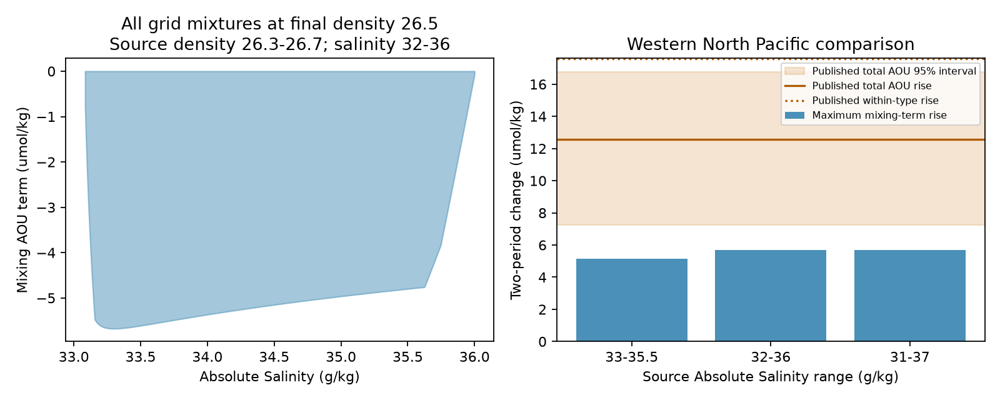

# Solubility nonlinearity gives a 5.7 umol/kg mixing limit on density 26.5 for source densities 26.3-26.7 in a grid test

Oxygen solubility is nonlinear. Mixing of saturated waters can therefore change apparent oxygen utilization (AOU) without oxygen use. We calculate its full numerical range for arbitrary mixtures that conserve salt and heat. Source density anomaly sigma0 is 26.3-26.7 kg/m3; final density is 26.5. On refined grids, the largest possible rise of this mixing term between two periods is **5.675 umol/kg**. The published western North Pacific total AOU rise is 12.55 (95% interval 7.258-16.77). The nonlinear term has too little capacity to match that central estimate within this source band. This is a conditional physical size test, not a formal statistical rejection.

## Prior work and new contribution

Campaign work linked the oxygen loss to a smaller winter outcrop. Nutrient and surface saturation tests supported a regenerated change (SCI e62193bc). Ito, Follows and Boyle (2004; doi:10.1029/2004GL020900) showed that both surface disequilibrium and nonlinear solubility affect the link between AOU and true oxygen use. We do not claim that this issue or the mixing identity is new. Our contribution is a salt, heat and final-density constrained capacity envelope, with a primal mixture and a dual numerical check. We fit no age model or ventilation parameter.

Before calculation, campaign searches used “outcrop oxygen”, “oxygen”, and “AOU mixing solubility”. They found tests of respiration, water-type mixtures, age spectra and nutrient budgets, but no bound on this nonlinear term for the 26.5 class.

## Method

Let x = (Absolute Salinity, Conservative Temperature). Let C(x) be surface oxygen solubility in umol/kg. For mass fractions w_i >= 0 with sum w_i = 1, x_m = sum w_i x_i. Define

J = C(x_m) - sum w_i C(x_i).

If U_i is oxygen use relative to the saturated source value, O_i = C(x_i) - U_i. Thus

AOU_m = sum w_i U_i + J.

J isolates nonlinear solubility. The identity also holds for an effective U that includes source gas disequilibrium. If sources have equal, unchanged U, only J can change AOU. Sequential conservative mixing reduces to a mixture of original sources. We assume no heat or salt forcing, gas exchange or added oxygen use during mixing.

We use GSW 3.6.23. CT_from_rho sets source temperature from salinity and density; we keep the warm root with -2 <= CT <= 35 C. The -2 C cutoff permits some supercooled states and is permissive. O2sol uses p = 0 dbar, longitude 180 E and latitude 35 N for all states. This assumes a common composition conversion. Density is not conserved: final density is calculated from mixed salt and heat. Thus the calculation includes density gain caused by mixing.

Source salinity and density steps are 0.04, 0.02, 0.01 and 0.005 in their respective units. We add the exact cold boundary with 501 points and both corners. The three-dimensional convex hull of (SA, CT, C) contains every mixture of these source states. At each of 1001 evenly spaced target salinities, density 26.5 sets CT. Hull facets give the minimum and maximum mixed source C. Infeasible target points are excluded. Any number of sources is allowed. A linear program needs at most three active sources for fixed salt and heat.

We report max J minus min J across feasible targets. This allows target salinity to change between periods and is conservative relative to fixed water type. It also bounds changes of positive-weight physical means whose parcels meet the constraints. It is not automatically a bound on regression contrasts with negative weights or extrapolation.

## Results

| Source SA (g/kg) | Source sigma0 | Minimum J | Maximum J | Largest two-period J rise (umol/kg) |
|---|---|---:|---:|---:|
| 33-35.5 | 26.3-26.7 | -5.137 | 0 | 5.137 |
| 32-36 | 26.3-26.7 | -5.675 | 0 | 5.675 |
| 31-37 | 26.3-26.7 | -5.675 | 0 | 5.675 |
| 32-36 | 26.4-26.6 | -2.960 | 0 | 2.960 |
| 32-36 | 26.1-26.9 | -10.677 | 0 | 10.677 |

Values use the finest grids. Positive maxima below 7e-13 are roundoff. Mixing gives negative J in these grids. A positive change occurs if a negative term becomes smaller in magnitude. Thus a two-period test must use the range, not the sign alone.

The primary 32-36 envelope changes by 0.0000021 umol/kg from source step 0.01 to 0.005. Density range matters much more than salinity range. Expansion to salinity 31-37 has no material effect. A separate linear program agrees with the primary hull minimum to 7e-12 umol/kg. Its mass, salt and heat residual is below 7e-13; its primal-dual gap is below 4e-11. The attaining three-source mixture is in witness.csv. These checks establish agreement for the finite grid, not a certified continuous bound.

## Observational scope and comparison

GLODAPv2.2023 supplies a support check, not oxygen changes or source mixture weights. We keep good-flag salinity bottles at 28-46 N, 140 E-125 W, sigma0 26.3-26.7, practical salinity 25-40 and in situ temperature -2 to 35 C. We convert salinity at bottle pressure and location. The 10,938 retained bottles have SA 33.02296-35.10199 g/kg. All lie inside the narrow 33-35.5 case. This does not prove that interior bottles represent all ventilation sources or their past histories.

The published total AOU estimate for WPAC, nitrate-matched samples, 2009-2025 minus 1984-1996 is 12.55 (7.258-16.77) umol/kg, with 151 reference and 62 late cruises. Source: SCI e62193bc, files/results/epochs_OSD_total_26.5.csv. The 5.675 capacity is 45% of that point value and below its lower interval. For salinity 33-35.5, capacity is 41%. The published within-type rise, 17.6, is shown only for scale. The physical envelope must not be treated as a formal limit on its regression contrast. Even the total estimate uses spatial and seasonal regression. A strict statistical test must propagate the bound through those exact estimator weights. We do not do that here.

Wider source densities 26.1-26.9 permit 10.677, inside the total-change interval. The test therefore cannot rule out nonlinear mixing for that broader band. Mixing can also import water with large positive AOU while J remains small. That changes mean U, which this test leaves free.

## Implications, uncertainty and limits

The narrow-band result removes one physical ambiguity from the AOU interpretation. It does not prove reduced ventilation, faster respiration, or outcrop-area scaling. Nutrients, preformed oxygen, transport and changes in source U remain necessary evidence.

These are finite-grid extrema with convergence checks, not a continuous mathematical certificate. Target salinity spacing is 0.0025-0.006 g/kg. There is no sampling uncertainty on the thermodynamic calculation; formula and domain assumptions can dominate numerical error. We use surface pressure and one composition conversion. We do not model irreversible heat changes in real interior mixing, changing source saturation or transport across the source band. Observational intervals are imported and regression can amplify bounded parcel terms. The result is conditional and is not a universal attribution of North Pacific loss.

The plan was written before calculation. A planned continuous affine enclosure was not used; final claims are restricted to the numerical hull test. We added the exact cold boundary after the first run, then refined source steps to 0.005. We added the total AOU comparison when we recognized the regression issue in the planned within-type comparison. All final scenarios, including the wider-band limitation, are retained.

## Reproduction and rights

No external bottle table or raw database is bundled. NOTICE_external_data.md gives attribution and terms. Code, numerical bounds, aggregate support statistics, optimization witness, dual values, source hash and a frozen comparison are included.

1. Make a private Python 3.12 environment and install files/requirements.txt.
2. Use the shared file below, or run python files/retrieve.py /absolute/scratch/input.csv. It checks the exact SHA-256.
3. Run OMP_NUM_THREADS=1 OPENBLAS_NUM_THREADS=1 MKL_NUM_THREADS=1 python files/analyze.py --raw /absolute/scratch/input.csv --out /absolute/scratch/results.
4. Compare bounds.csv, support.json and witness.csv. The script also makes mixing.png. It uses one compute process and limits HiGHS to one thread.

Use an output folder outside the signed package. The exact shared file is /mnt/dell-data/shared_datasets/glodapv2-2023-pacific-ocean-csv-ncei0283442/GLODAPv2.2023_Pacific_Ocean.csv. The worktree datasets link accesses it. SHA-256: d59b0776c5edaca5e921141444f22b9cdad5088db70f9129dc1b0fc50218d7ea. support.json also records the resolved immutable object path. Version and URL are in provenance.json. Attribution: Lauvset et al. (2024), GLODAPv2.2023, doi:10.5194/essd-16-2047-2024, NCEI accession 0283442.

comparison.json freezes the selected published aggregate. Its SCI bundle was verified locally. To inspect its full derivation, read the cited SCI source. No raw oxygen estimate is recomputed here.

## Job provenance

Job sci-1107-dell-earth-and-ocean-sciences-3f9f6a0e2a18; topic earth-and-ocean-sciences; campaign 11_07_2026; machine dell; account codex-olen; model gpt-6.1-sol; date 2026-11-11. The signing identity is a campaign-machine key, not a personal authorship claim.
