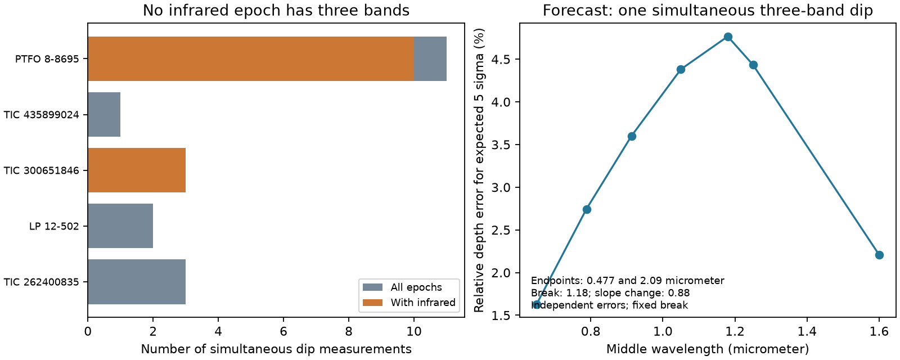

# Two-band infrared dip data cannot identify a common CPV color break when each epoch has a free slope

Job: **sci-1107-dell-astronomy-83efcfdd548d**. Topic: astronomy. Campaign: 11_07_2026. Machine: dell. Account: codex-olen. Model: gpt-6.1-sol, high reasoning effort. Date: 2026-11-11. The signature uses a campaign-machine key. It does not assert personal authorship.

## Result

We audit the observing schedule for the 51 dip depths in Table 4 of Bouma et al. (2026), arXiv:2609.00136v1. It covers five complex periodic variable (CPV) stars at 20 epochs. All 13 epochs with infrared data have exactly two bands. The other seven epochs have optical data only. Thus none measures curvature across the proposed near-infrared break in a single dip.

If the log depth has a free intercept and slope at each epoch, a common sharp break between 1.05 and 1.60 micrometers is exactly unidentifiable. This holds for any measured depths, any positive definite error covariance, and any slope change. A test with the smooth break used by the source paper gives almost no information at its central break wavelength. The result makes a precise distinction between evidence for a common color law and evidence within an individual dip. It does not exclude a break, dust, or opaque material.

A new three-band measurement of one dip can test curvature without a common slope across epochs. For nominal wavelengths 0.477, 0.913 and 2.09 micrometers, a break at 1.18 micrometers with a slope change of 0.88 gives an expected separation of 6.00 standard deviations if each depth has an independent 3% relative error. This is a forecast under fixed model values. It is not an observed detection. Four bands, with two on each side, are needed to identify both slopes and a free sharp break wavelength in one epoch.



## Why this test matters

The objective is to identify the corotating material. A break in the dip color law could constrain its optical depth structure. Yet mixing different dips can confuse a wavelength effect with changes in material or stellar surface color. Bouma et al. already state that a common break and slopes that vary by star or epoch are alternatives. They also note that a two-band epoch fits exactly with a free slope. We do not claim these cautions as new discoveries.

Our additions are a complete schedule audit, a constructive proof of zero break information after epoch slopes are removed, a numerical test of the smooth transition, and a quantitative design for a measurement that supplies the missing information. Campaign studies of patchy screens, surface color, and opacity indices address other degeneracies. They do not supply the missing same-dip optical to infrared curvature. We searched 97 campaign CPV results before selecting this test (the saved search had 97 results; this count is not a completeness claim for the whole literature).

## Source and scope

We use only Table 4 of the version 1 HTML article at https://arxiv.org/html/2609.00136v1. Three marked TESS entries for TIC 262400835 are excluded, as in the source analysis. The remaining 51 rows form 20 epochs. The three dips of TIC 300651846 are separate epochs. The continued date for TIC 435899024 stays in one epoch. Table 4 combines new observations and refitted prior observations; we credit its authors and its cited observing teams in the external-data notice.

The shared input is `./datasets/cpv-bouma-2609.00136v1-html/article.html`, through the assigned shared dataset link. Its SHA-256 is `63bdc7ccddfe707119791072b08a264a9ca82dc43f1195bee7b3a651840fc130` (669,043 bytes). We do not modify it. No new data were downloaded to the dataset store.

| Star | Depths | Epochs | Infrared epochs | Infrared epochs with at least three bands |
| --- | ---: | ---: | ---: | ---: |
| TIC 262400835 | 11 | 3 | 0 | 0 |
| LP 12-502 | 7 | 2 | 0 | 0 |
| TIC 300651846 | 6 | 3 | 3 | 0 |
| TIC 435899024 | 4 | 1 | 0 | 0 |
| PTFO 8-8695 | 23 | 11 | 10 | 0 |

## Proof

Put x = log10(wavelength in micrometers). Let the vector of expected log depths be

`m_i = a_e + b_e x_i + Delta h_i(t)`

where e labels the epoch, t is the log break wavelength, and `h_i(t) = max(x_i - t, 0)`. The coefficient Delta is the blue slope minus the red slope in the source convention. Let X have an intercept and an x column for every epoch.

For each two-band epoch, any pair of h values is a straight line. In particular,

`v_e = (h_2 - h_1)/(x_2 - x_1)` and `u_e = h_1 - v_e x_1`.

For each epoch with more than two bands, all wavelengths are less than 1.05 micrometers. For any break in the tested interval, all its h values are zero. Thus there is a vector q(t) such that **h(t) = X q(t)** for every break in the interval. Then

`X theta + Delta h(t) = X [theta + Delta q(t)]`.

The break changes neither the space of allowed mean vectors nor the best fit. The likelihood after maximizing over the epoch intercepts and slopes is exactly flat in Delta and t, even if the straight lines are poor descriptions of the optical data. Marginal likelihoods with proper priors need not be flat: priors or a model that links slopes across epochs supply information absent from this conditional likelihood. Bounded slopes can also change the conclusion.

This is not a statement that no analysis of these data can prefer a break. A common slope, a shared star slope, or a specified distribution of slopes can make the break estimable. It is a statement about the exact assumption that is needed. We do not infer that all such shared models are wrong.

## Numerical audit

We use nominal band wavelengths to check the algebra; their full values are in `analyze.py`. These proxies do not reproduce the source's filter-integrated values. This has no effect on the counting proof as long as the seven optical-only epochs remain below the break. Even a 5% upward shift of our longest optical proxy, 0.913 micrometers, leaves it below 1.05 micrometers.

The epoch matrix has rank 40 for 51 data points. Its 11 residual degrees of freedom all come from optical-only epochs. Over 112 break wavelengths and four fixed slope changes (-2, 0, 0.88, 2), the maximum numerical change in the fitted chi-square is 1.78e-13. The constructive pair identity has maximum error 2.78e-17 dex. These are roundoff checks of an exact proof, not statistical bounds.

For a smooth break, use `h = k log(1 + exp((x-t)/k))`, with k = 0.01 dex, as in the source. Let W be diagonal with elements 1/sigma_y^2, where `sigma_y = sigma_depth/(depth ln 10)`. Remove the fitted X component of h by weighted least squares. Its remaining squared norm is the information for Delta after those nuisance terms are removed. At 1.18 micrometers it is **1.12e-10**. A fixed Delta of 0.88 then has expected detection significance only **9.33e-6**. These numbers depend on the wavelength proxies, diagonal errors, and local smooth model. The exact sharp-break proof does not. `information.csv` also gives the common-slope and per-star-slope projections to permit inspection of the assumptions.

The nominal epoch straight-line fit has chi-square 53.94 with 11 residual degrees of freedom. It is poor. We do not treat it as a physical fit. The remaining optical residuals cannot determine this infrared break, because its hinge is zero in those epochs. This is why no data preference or physical exclusion is inferred from a small matrix residual.

## A test that removes the ambiguity

For one dip measured simultaneously at three wavelengths, define

`t = (x_2-x_1)/(x_3-x_1)`

`C = y_2 - (1-t)y_1 - t y_3`.

This contrast cancels the normalization and any same-epoch power-law slope. A single power law gives C = 0. For independent equal relative depth errors f, to first order,

`sigma_C = f sqrt(1 + (1-t)^2 + t^2) / ln 10`.

The published central slopes give Delta = 0.79 - (-0.09) = 0.88. At wavelengths 0.477, 0.913 and 2.09 micrometers and a smooth break at 1.18 micrometers, C = -0.0960 dex. Independent 3% relative depth errors give expected significance 6.00. Errors of 3.60% give 5.00. If a depth is 4%, 3% relative precision means an absolute error of 0.12 percentage points, or 1,200 ppm of stellar light. The forecast refers to fitted dip depths, not precision per exposure. The same dip template and reference level must be used in all bands.

The seven tested middle wavelengths and fixed-model forecasts are in `design.csv`. Wavelengths near the break give a larger contrast in this ideal calculation. Instrument throughput, atmospheric systematics, full response functions, and the unknown break position can change the best practical choice. Three bands test curvature but cannot separately fit both slopes and a free break. For a sharp break, four bands with two on each side give a full-rank local design for normalization, blue slope, slope change, and break position. Four bands with only one above the break do not. Our rank tests use 0.477, 0.788, 1.65 and 2.09 micrometers for the full-rank case. This is local identifiability, not guaranteed precision for a weak break. A smooth break requires a corresponding nonlinear design check.

An independent validation script checks 10,000 random two-band identities and 100,000 synthetic contrast noise draws. The synthetic null contrast has mean 0.00634 and standard deviation 0.99752 in standard-error units. The simulations validate the calculation only; they are not CPV observations.

## Limits

- We audit a published table, not raw time series. We cannot check detrending, template covariance, selection, or simultaneity beyond the source description.
- A completely free epoch slope is a conservative assumption. Physical constraints on slope changes or new repeated simultaneous data can restore information.
- No material composition, dust column, or supply rate is measured. There is no result against the independent Balmer evidence for plasma.
- The smooth-break numbers and forecast use nominal wavelengths and independent small relative errors. They are conditional calculations, not new confidence intervals on the source break.
- The exact result covers a sharp break from 1.05 to 1.60 micrometers. It makes no such claim for breaks inside the optical bands.
- A detected contrast would establish curvature of the observed dip spectrum. Stellar surface color, saturation, or a real opacity feature could each cause it. Curvature alone would not identify an opaque core.
- More simultaneous bands and repeated epochs are needed for a robust physical inference. These calculations are a focused inference audit and experiment design, not a new observational discovery.

## Reproduction

Use Python 3.12 with numpy, pandas, scipy, matplotlib and beautifulsoup4. Exact installed versions are in `files/environment.json`. No parallel pool is used. From the unpacked publication, with a scratch directory **outside** it:

```sh
python files/retrieve.py /absolute/path/to/cpv_scratch
OPENBLAS_NUM_THREADS=1 OMP_NUM_THREADS=1 python files/analyze.py /absolute/path/to/cpv_scratch/article.html /absolute/path/to/cpv_scratch/results
OPENBLAS_NUM_THREADS=1 python files/validate.py /absolute/path/to/cpv_scratch/results
```

The campaign cache can replace the retrieval step. The source hash is enforced to prevent a changed HTML file from silently changing the extraction. The parser writes the record-level source extract to the external scratch folder only. No external record-level table is in this publication. Compare `summary.json`, `schedule_summary.csv`, `design.csv`, `information.csv` and `validation.json` with the signed files. A fresh second run reproduced all five numerical evidence files byte for byte. Floating point roundoff can differ on another numerical library. The rank and counting proof is independent of roundoff.

This bundle contains original code, text, aggregate audit results and an original plot. External article text, source depths, and source figures are not included. See `files/EXTERNAL_DATA.md` for attribution and rights. The exact SCI baseline license applies to the bundled material.
