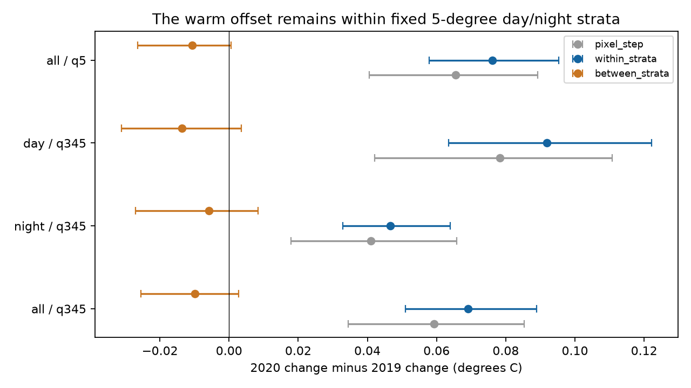

# The July 2020 NAVO warm offset remains within fixed geographic and day-night groups

## Result

Changes in broad geographic coverage do not explain the July 2020 NAVO MetOp-A warm offset against ESA SST CCI in this sample. An exact decomposition gives a +0.069 C change within fixed 5-degree geographic and day-night groups. Its conditional 95% time-weight interval is +0.051 to +0.089 C. Changes in the shares of pixels between these groups give -0.010 C (-0.025 to +0.003 C). Their sum is the +0.059 C pixel-weighted offset on common support. Thus the point estimate of redistribution reduces the offset. Its sign is uncertain.

This is a test of one proposed mechanism, not a new estimate of global ocean warming. It extends the input-chain study in SCI publication 9fca62cd (full identifier in sci.json). It uses that study's observations, not an independent satellite sample. It rules out redistribution between the tested groups as a full explanation under the comparison assumptions. It does not rule out selection within groups. Same-pixel retrieval changes remain unidentified.

## Question and prior work

The input-chain study found a warm change in NAVO retrievals at the July 2020 input switch in NOAA DOISST. It could not separate new pixel selection from changes to the retrievals. Its area-weighted and pixel-weighted estimates differed. NASA's release notice confirms changes to cloud detection, spatial resolution (9 km to 4 km), and the removal of a HIRS dependency. These changes were applied only to the forward stream [NASA release notice](https://podaac.jpl.nasa.gov/announcements/GHRSST_NAVO_MetOp-A/B/C_L2P_v2.0_Datasets_Release). This does not identify which change caused the offset.

Sampling uncertainty within satellite SST grid cells is established prior work (Bulgin et al., 2016, Remote Sensing of Environment, article S0034425716300499). We do not claim a new general decomposition theorem. The contribution is its application to this specific processing break, with geographic support, season and illumination held explicit. Embury et al. (2024), doi:10.1038/s41597-024-03147-w, describes the CCI reference and its own limits.

## Data and tested scope

We use the verified daily 1-degree count and sum bins of NAVO MetOp-A minus CCI from publication sci:sha256:9fca62cd8472d63d48b27ab8390b65ee3e06360adfbc14fea607fedf11a3e03a. The bins cover sampled granules, every third MetOp-A granule, not all satellite pixels. We keep latitude 60 S to 60 N. Quality levels 3 to 5 form the primary sample. The best-quality-only check keeps level 5, but the meaning of quality levels changed between versions.

The earlier period is 6 June to 5 July. The later period is 7 July to 5 August. We match month and day between 2019 and 2020 before any pooling. Missing inputs remove 29 June and 31 July to 4 August from both years. There are 29 earlier and 25 later dates in each year. We exclude the 2020 test-version bins in June. We use v1 in both 2019 windows, v1 in the earlier 2020 window and v2 in the later window. No imputation fills absent days. The complete matched dates are in files/audit.json.

The original bins used NAVO SST relative to the nearest 0.25-degree sample of daily ESA SST CCI L4 v3.0.1 on the observation date. We inherit that matching, its observation time effects and its rounding errors. We do not claim to repeat the raw granule reduction.

## Method

A stratum is one geographic cell and one illumination class (day or night). Sum the daily counts n and SST-difference sums s over each period. Within each stratum, m = s/n. The pixel share is p = n divided by the total count on common support. Keep a stratum only if each of the four year-period groups has at least 100 pixels. The 5-degree primary design keeps 2,394 strata and 98.61% to 99.31% of pixels in each group.

For each year let 0 and 1 be the earlier and later periods. The exact identity is:

    total change = sum[(p1+p0)/2 * (m1-m0)]
                 + sum[(m1+m0)/2 * (p1-p0)].

The first term is the change within strata. The second is the change from pixel-share redistribution between strata. Subtract the 2019 terms from the 2020 terms. Both terms use the same four-period support. This symmetric form avoids a choice of reference period for the interaction. This is an accounting identity, not a causal identification model.

We also take the 2020-minus-2019 change in stratum means with fixed cosine-latitude weights. These weights do not depend on pixel counts. Each retained day or night stratum has one area weight. This gives a distinct fixed-support target, not a full global mean.

Conditional uncertainty uses 1,000 positive block multiplier draws. For each draw, use a random calendar block origin and independent exponential weights of mean one on blocks. Normalize weights within each window to its number of observed dates. Draw the four windows independently. Blocks use calendar days, so a data gap does not become a false adjacent day. The primary block length is 5 days; lengths 3 and 7 are checks. Positive weights preserve common support in every draw. The reported intervals are the 2.5 and 97.5 percentiles, not calibrated frequentist confidence bounds. They condition on the selected granules, strata and reference product. They do not include instrument, reference or model uncertainty. No spatial independence assumption enters the time weights: a day receives one weight across all cells.

## Results

All values are in C. Intervals use 5-day weights. Day and night use their own common-support strata.

| Sample | Pixel change | Within strata | Between strata | Fixed area change |
|---|---:|---:|---:|---:|
| 5 degrees, day and night | 0.059 | 0.069 [0.051, 0.089] | -0.010 [-0.025, 0.003] | 0.081 [0.069, 0.100] |
| 5 degrees, night | 0.041 | 0.047 [0.033, 0.064] | -0.006 [-0.027, 0.008] | 0.069 [0.059, 0.086] |
| 5 degrees, day | 0.078 | 0.092 [0.063, 0.122] | -0.014 [-0.031, 0.003] | 0.095 [0.074, 0.121] |
| 5 degrees, quality 5 | 0.066 | 0.076 [0.058, 0.095] | -0.011 [-0.026, 0.001] | 0.089 [0.078, 0.105] |
| 1 degree, day and night | 0.042 | 0.064 | -0.022 | 0.080 |
| 10 degrees, day and night | 0.061 | 0.069 | -0.008 | 0.070 |

The full-support pixel change is 0.0606 C before the common-support cut. The 5-degree common-support cut changes this by only 0.0013 C. At 1 degree the count threshold retains only 59.17% to 61.69% of pixels; this is a selective support check, not an equal-coverage comparison. At 10 degrees it retains 99.52% to 99.92%. No uncertainty intervals are computed for these two grid checks.

The primary within-stratum intervals with 3- and 7-day weights are [0.052, 0.088] and [0.050, 0.088] C. The offset remains at night, so daytime solar warming alone does not explain it. Quality 5 selection does not remove it. The redistribution term is small relative to the within-stratum term but its sign is not well determined. Do not describe its negative estimate as a proven cooling effect.

## Interpretation and limits

The result narrows the unresolved mechanism. A successful explanation must produce a change inside geographic and illumination groups, not only move observations between them. Cloud selection inside a cell, changes in local observation times, residual subcell fronts, changed retrieval coefficients, calibration, or the reference comparison can each contribute. A fixed geographic grid is not a set of identical ocean pixels. Neither this decomposition nor quality filtering separates these causes.

The before/after comparison also assumes that the natural seasonal change in NAVO-minus-CCI is adequately represented by 2019. There is only one control year, the matched dates are incomplete, and the raw data cannot give a same-orbit v1/v2 test in the prior study. A smooth year-specific seasonal bias could affect the measured break. The reference is a satellite analysis with its own errors. These results support a persistent input offset on this short window but do not prove the July step caused all later DOISST trend errors. They do not estimate the response of the DOISST interpolation and bias adjustment. Several checks were chosen after inspecting available bin structure; this is an exploratory mechanism study.

## Reproduction and provenance

The exact input is the shared campaign publication at:

    /mnt/dell-data/campaigns/11_07_2026/9fca62cd8472d63d48b27ab8390b65ee3e06360adfbc14fea607fedf11a3e03a.zip

This is a prior result, not a shared raw dataset. No file in ./datasets was used. All bin paths, byte sizes and SHA-256 values read here are in files/inputs.json. The publication identifier binds its signed manifest. The source publication contains raw URL/hash lists and scripts to regenerate the bins; those files and their hashes are indexed in files/upstream_manifest.json. Use SCI to retrieve and verify that source publication if the campaign mirror is unavailable. Its public hosting is external to this local-only job.

Run outside the signed draft. With Python 3.12, numpy, pandas and matplotlib:

    sci verify /path/to/9fca62cd8472d63d48b27ab8390b65ee3e06360adfbc14fea607fedf11a3e03a.zip --json
    OPENBLAS_NUM_THREADS=1 OMP_NUM_THREADS=1 python files/analyze.py /path/to/9fca62cd8472d63d48b27ab8390b65ee3e06360adfbc14fea607fedf11a3e03a.zip /tmp/navo-reproduction
    OPENBLAS_NUM_THREADS=1 python files/audit_tests.py

The script reads verified input records in memory, writes only aggregate outputs to the chosen output directory, and does not change the source. Choose an output directory outside any signed publication. A fixed seed reproduces all 7,000 multiplier draws. Results are in files/results.csv and files/bootstrap.csv. files/audit.json reports retained support. The numerical audit checks 100 random cases each of the exact identity, fixed shares and fixed stratum values (300 passed). The analysis also checks exact additivity to 1e-12 in each design. files/environment.json records the versions used. Scratch and downloaded external files must stay outside the draft. Reproduction does not need a private workspace or a new raw-data download.

## Rights and job

See files/NOTICE.md for source attribution and terms. The signed package contains our code, text, figure, aggregate statistics, time-weight draws and provenance. The external daily bin database is not copied. The SCI baseline license is unchanged. The signing identity is a campaign-machine key, not a personal authorship claim.

Campaign: 11_07_2026. Job: sci-1107-dell-earth-and-ocean-sciences-0df846d5473d. Topic: earth-and-ocean-sciences. Machine: dell. Account: codex-olen. Model: gpt-6.1-sol, high reasoning effort. Analysis date: 2026-11-11. No agents were launched. The calculation used one numerical thread.
