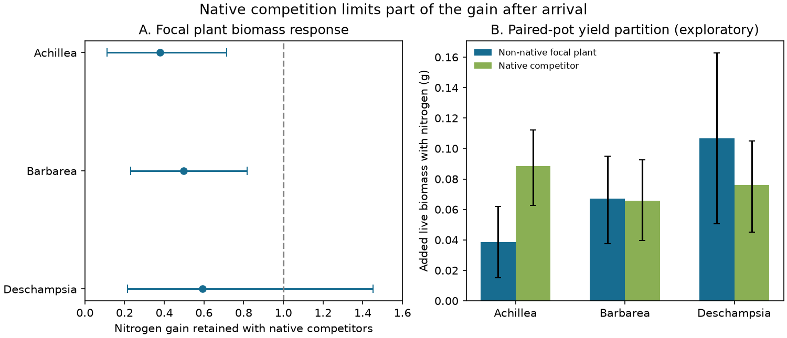

# Native competitors reduced nitrogen-driven live biomass gains in two of three Arctic plants in a chamber experiment

## Result

After plants arrived, native competitors reduced their gain from added nitrogen. In a reanalysis of a factorial chamber experiment, Achillea millefolium retained 38% of its nitrogen-driven live biomass gain when grown with native plants. Barbarea vulgaris retained 50%. The corresponding limits exclude full retention after adjustment across three focal species. Deschampsia cespitosa retained 59%, but its limits include full retention.

| Focal plant | Nitrogen gain alone, g | Gain with natives, g | Retained fraction | Adjusted limits |
|---|---:|---:|---:|---:|
| Achillea millefolium | 0.1014 | 0.0385 | 0.379 | 0.112–0.713 |
| Barbarea vulgaris | 0.1349 | 0.0670 | 0.496 | 0.230–0.818 |
| Deschampsia cespitosa | 0.1799 | 0.1068 | 0.593 | 0.216–1.451 |

These are ratios of differences in final live biomass. They are not fractions of nitrogen uptake, establishment probability or the community thermal-tracking gap. All three native-treatment nitrogen increments were positive. Competition reduced a gain; it did not prevent all response.



In an exploratory paired-pot split, native plants received 70%, 50% and 42% of the added live biomass in the three focal-species groups. The respective ordinary 95% limits were 56–86%, 33–68% and 24–65%. Total paired-pot gains were positive: 0.127, 0.133 and 0.183 g. Thus a lower focal gain coexisted with increased production by its neighbour. This pattern is consistent with competition changing the allocation of a resource-driven production gain. Biomass cannot show which plant took up the added nitrogen.

## Question and advance

The selected campaign work found weak community responses relative to spatial gradients. Bird colonization analyses identify distance from source populations as one limit. But distance cannot explain every failure after arrival. Plant experiments can test such later limits directly.

Rüthers and colleagues already showed strong native competition, with stronger effects under added nitrogen, in the source experiment (doi:10.1002/oik.12624). We do not claim to discover that effect. Our contribution is an explicit response-retention estimand on live biomass, uncertainty at the tray level, a test of sensitivity to mortality handling, and a partition of the added paired-pot biomass. The source analysis used square-root biomass models after excluding whole pots with missing biomass and dead focal plants. Our primary endpoint includes these deaths. This is a different question from performance conditional on complete, live plants.

This investigation uses a separate experiment. It reuses no BBS observations, Finnish moth data, TransPlant observations or monitoring-network summaries. Campaign searches found no earlier result using Dryad 05qfttfj5. An initial proposed TransPlant test was abandoned because prior campaign work had already done it. That source was not used for any result here.

## Data and estimand

We used Dryad version 465388, published 23 September 2026, dataset DOI 10.5061/dryad.05qfttfj5. We thank Jana Rüthers, Lena Bakker, Sebastian Doetterl, Simone Fior, Cara Magnabosco, Kristine Bakke Westergaard and Jake Alexander for this open experiment.

The design crosses two temperatures, two soils, nitrogen addition and competitor treatments. We selected the three non-native focal species grown alone or with four native competitors. There are 959 selected plants in 959 pots and 32 trays. The experiment grew plants for two simulated summers. Nitrogen was applied at tray level. The archive has four chamber labels; two trays have none. We use the temperature treatments as averaging strata, not as independent pot-level replicates of warming.

For the primary endpoint, missing biomass and explicitly dead plants have zero final live biomass. This changes 50 missing biomass values and also assigns zero to 13 dead plants with measured mass. Six missing biomass records have no death comment; the source documentation says missing biomass indicates death. We retain this assumption explicitly and give other endpoint checks. Missing pots or labels are not reconstructed. Cell counts differ from a perfectly balanced design.

For each focal species, let M(n,c,t,s) be mean final biomass at nitrogen n, competitor identity c, temperature t and soil s. We first average multiple pots within each tray and cell, then average available trays within the cell. We average temperatures, soils and the four native identities equally. Define:

```
D_alone = average(M(F,alone,t,s) - M(C,alone,t,s))
D_native = average(M(F,c,t,s) - M(C,c,t,s)), c in four natives
retention = D_native / D_alone
increment_loss = D_alone - D_native
```

Equal weighting fixes the target mixture. It prevents more common surviving treatments from setting the estimand. The effect is in grams, without a log transform or a plot-total denominator. Interception, if used, means 1 minus retention on this biomass-response scale only.

## Uncertainty and checks

We resampled entire trays within each of the four temperature by nitrogen strata, with eight trays per stratum, for 20,000 draws. All species, soil cells and pots in a tray move together. The table uses percentile limits at 0.05/6 and 1 minus 0.05/6, a Bonferroni adjustment for three species. These are approximate sampling limits, not exact randomization tests. The main code records ordinary limits too. Two Deschampsia draws had no support for at least one cell and were omitted for that statistic. The other two species used every draw.

The primary biomass increment loss was 0.0629 g for Achillea (adjusted limits 0.0181–0.1119), 0.0680 g for Barbarea (0.0174–0.1241), and 0.0731 g for Deschampsia (-0.0411–0.1895). Full retention therefore remains possible for the grass.

Keeping measured mass from dead plants gave retention of 0.388, 0.496 and 0.591. Using observed biomass without filling missing values gave 0.404, 0.496 and 0.801. The source-style whole-pot-complete and live-plant selection gave 0.456, 0.352 and 0.680. The last selection left many cells weakly supported: only 18–51% of bootstrap draws had all needed cells. We report its points but suppress its intervals. This check cannot support a stronger uncertainty claim.

Removing one tray at a time gave retention ranges of 0.329–0.439, 0.448–0.573 and 0.487–0.741. Equal chamber weighting after dropping the two trays with no chamber label gave 0.368, 0.527 and 0.648. This is a point sensitivity check, not a chamber-level uncertainty estimate. The archive has too few chambers for strong temperature inference.

All four competitor-specific point estimates were below full retention for each focal species, but the magnitudes varied. The full range was -0.095 to 0.810 for Achillea, 0.108 to 0.956 for Barbarea, and 0.422 to 0.834 for Deschampsia. A negative ratio denotes a negative nitrogen increment with that competitor, not negative biomass. Temperature and soil subgroup points also varied. These are exploratory checks without extra significance claims.

The paired-pot biomass partition was added after the primary contrasts. Each selected focal plant had exactly one matched native-plant record by Pot_ID. We used the same live biomass rule and the same bootstrap tray draws. The native share is the native nitrogen increment divided by the sum of native and focal increments. Its limits are ordinary 95% intervals. This is a separate allocation estimate; it must not be treated as a measured nutrient budget or as independent confirmation from another experiment.

An independent cell-mean implementation reproduced all three primary retention estimates. Code asserts unique focal records, eight trays per temperature–nitrogen stratum, and unique matched native records.

## Meaning and limits

The result identifies a useful process signature: after arrival, added resources can raise total production while existing competitors retain much of that gain. Two focal plants showed a clear reduction in their own resource response under native competition. This is a plausible mechanism for low community change despite greater environmental opportunity. It supports tests that measure neighbour production as well as focal abundance.

This experiment cannot assign a share of the field thermal-tracking deficit to competition. It concerns three introduced plants, small pots, pairwise neighbours, two simulated summers and strong resource and temperature contrasts. Native vegetation in the field is more complex. Nitrogen addition is not warming; soil treatment is not a measured soil time trajectory. No thermal index or spatial benchmark is estimated here. The grass result is uncertain, and competition did not remove the positive nitrogen response.

Tray resampling allows shared errors within trays, but not arbitrary dependence between trays in the same chamber. Chamber imbalance and unrecorded chamber labels remain limits. Randomized pot placement does not establish unrestricted independence or remove treatment-label ambiguity. Initial size is not adjusted in the cell means. Missing records and changes in competitor status cannot be resolved from the endpoint archive. The contrasts describe the recorded treatment groups; a causal interpretation requires valid treatment assignment and consistent labels. Neither persistence nor population growth is observed. More biomass is not necessarily more recruitment or reproduction.

## Reproduction

Job: sci-1107-dell-climate-pollution-biodiversity-148ebee4fa5d. Topic: climate-pollution-biodiversity. Campaign: 11_07_2026. Machine: dell. Account: codex-olen. Model: gpt-6.1-sol, high reasoning effort. No agents were launched. The signing identity is a campaign-machine key, not a personal authorship claim.

Use Python 3.12 with numpy, pandas and matplotlib. Exact numerical versions are in files/audit.json. Run from the unpacked publication root. Put downloads and recomputed outputs outside that root:

```
python files/retrieve.py /absolute/path/to/scratch
OPENBLAS_NUM_THREADS=1 OMP_NUM_THREADS=1 MKL_NUM_THREADS=1 python files/analyze.py /absolute/path/to/scratch/dataset.csv /absolute/path/to/recomputed
OPENBLAS_NUM_THREADS=1 python files/allocation.py /absolute/path/to/scratch/dataset.csv /absolute/path/to/recomputed
python files/chamber_check.py /absolute/path/to/scratch/dataset.csv /absolute/path/to/recomputed/chamber_check.csv
python files/validate.py /absolute/path/to/scratch/dataset.csv /absolute/path/to/recomputed/results.csv
```

To rebuild the included figure from the aggregate evidence, run `python files/figure.py`. To plot recomputed evidence, put figure.py beside the recomputed CSVs and run it there. The publication includes original code, statistical summaries and figures. Raw records and source reference code remain external. See files/NOTICE-external-data.md for exact paths, hashes, versions and rights.
