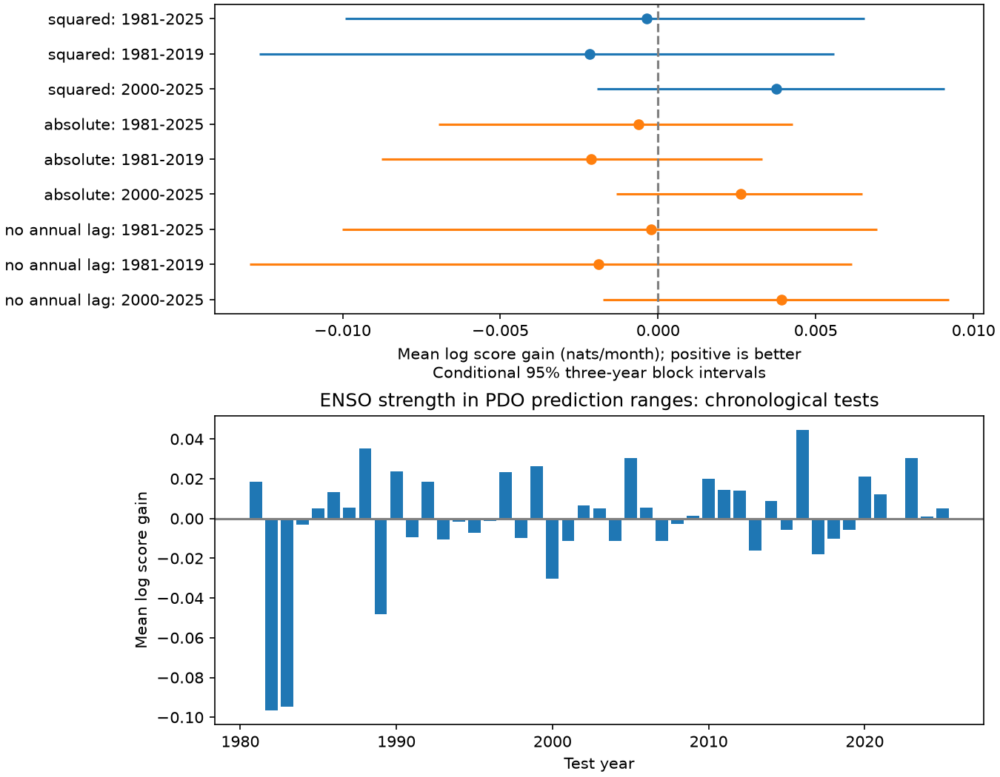

# ENSO strength gave no clear gain in monthly PDO prediction ranges in a 1981-2025 test

Adding squared Nino 3.4 to a seasonal variance model gave no clear improvement in one-month Pacific Decadal Oscillation (PDO) prediction ranges. The mean log score gain was -0.00036 nats per month. The conditional 95% three-year block interval was -0.00993 to +0.00655. Positive gain means a better prediction distribution. This result does not show that ENSO has no effect on North Pacific variability.



The top panel shows all planned model and period checks. Lines show conditional 95% three-year block intervals. These are separate intervals, not a joint band. The bottom panel shows yearly primary score gains. Small positive gains in many years did not give a clear mean gain. Large losses in some early years remain part of the primary test.

## Question and prior work

Can ENSO strength improve prediction of monthly PDO uncertainty beyond calendar season? Useful prediction ranges must describe both error size and extreme errors. A mean prediction alone does not provide this information. The tested explanation is that stronger tropical anomalies change the size of unexplained North Pacific monthly variation after controls for ocean surface memory and the ENSO mean effect.

Newman, Compo and Alexander (2003), in the [published abstract](https://journals.ametsoc.org/abstract/journals/clim/16/23/1520-0442_2003_016_3853_evotpd_2.0.co_2.xml), describe PDO variation through ENSO forcing, winter memory and random atmospheric forcing. [Newman et al. (2016)](https://doi.org/10.1175/JCLI-D-15-0508.1), in the abstract, describe several distinct processes that form the PDO index. These sources motivate the mean controls. They do not establish the variance model tested here. We do not reproduce their physical models.

Campaign searches for PDO and PDO variance uncertainty preceded the plan. A [prior campaign study](sci:sha256:27f15150d2de9b140a792051f912a3499b4e267541ac77f0dd7567a9e509044c) found that short-memory models missed the selected 2020-2025 mean PDO. We read its full published text. It assumes a common residual distribution across seasons and concerns six-year means. This study instead tests an ENSO strength term in one-month predictive variance against a seasonal variance reference. It uses the same revised input observations. It is not independent confirmation of that mean mismatch and does not explain it. No claim of a first global test is made.

## Data and scope

We reused two shared datasets in place. No new download or shared-data change was needed. There are 912 monthly pairs from January 1950 to December 2025. All selected values are present. There is no filling or smoothing. We use full years and exclude 2026.

- `datasets/ncei-ersstv5-pdo-index-20261108/ersst.v5.pdo.dat`: NOAA NCEI ERSSTv5 PDO. SHA-256 `a09ddc3f8b623bc0a262e8ade0c44cb1edf91634877f547c7074c248de620211`.
- `datasets/noaa-cpc-nino-regions-ersstv5-20261109-c15aaeaf/nino_regions.txt`: NOAA CPC ERSSTv5 Nino 3.4 anomaly, 1991-2020 reference. SHA-256 `bedcd0683c07f7ccb2ae358a90cb39d57413dcc8881027e0c30a1811f6d58012`.

These are paths relative to the assigned worktree. Exact absolute shared paths, resolved paths, source URLs, saved download times and sizes are in [provenance.json](files/provenance.json). The prior cited SCI bundle also preserves both exact snapshots. Source tables and monthly record-level outputs remain outside this package. See [NOTICE.txt](files/NOTICE.txt) for attribution and external-data terms. The signed package contains original code, narrative, a figure, coefficients and yearly aggregate results under the SCI baseline license.

## Method

The local [plan](files/plan.txt) was saved before computation. It is not an external registration. All reported cases were planned. Target months are January 1981 through December 2025, or 540 predictions. At the start of each year, we fit models using January 1951 through the previous December. There are 360 training targets for 1981 and 888 for 2025. We hold coefficients fixed within each test year. Actual prior-month observations remain available as predictors as each month advances. Thus these are one-month predictions, not forecasts of a full year made in January.

The common mean model is ordinary least squares:

`PDO[t] = month_intercept[t] + a PDO[t-1] + b Nino34[t-1] + c PDO[t-12] + error[t]`.

There are 12 month intercepts and no extra constant. The annual PDO lag is a limited surface-memory control. It does not observe subsurface memory. Both variance models use exactly the same mean prediction.

For a training set with n rows and p mean parameters, let `q[t] = fitted_error[t]^2 * n/(n-p)`. This common correction partly adjusts for fitted mean parameters. It is not a correction for all serial dependence or leverage effects. We fit two-stage Gaussian variance models by minimizing `mean(eta + q exp(-eta))/2`, where `eta = log(variance)`:

- Seasonal reference: `eta[t] = d0 + d1 sin(2 pi (month-1)/12) + d2 cos(2 pi (month-1)/12)`.
- ENSO model: the same terms plus `g Nino34[t-1]^2`.

There is no sign restriction on g, no tuning, and no added variance lag. This model tests a symmetric dependence on amplitude. It does not test different warm and cold variance responses. The fit is conditional on the mean model. We do not jointly fit its mean and variance or add parameter uncertainty to prediction ranges.

The primary score is the Gaussian negative log density `0.5 log(2 pi) + log(sigma) + 0.5 ((observed-mean)/sigma)^2`. We subtract the ENSO score from the reference score for each month. The primary result is the equal mean of those differences. This proper score penalizes distributions that are too narrow as well as too broad. A gain is in nats per month, not a percent gain or a physical temperature unit.

We also report coverage of central 90% Gaussian ranges and the 90% interval score: `width + 20 max(lower-observed,0) + 20 max(observed-upper,0)`. Lower interval score is better. Score gains use the same subtraction direction as the primary score.

For conditional uncertainty, we first average paired monthly score differences within each year. We sample circular blocks of three consecutive years with replacement until 45 years are reached, truncate to that length and take their mean. Percentiles 2.5 and 97.5 of 9,999 draws give the primary interval. Blocks can wrap across the record boundary. Five-year blocks are a planned check. Seed 720911 and loop order are fixed in the code. Separate overlapping subperiods are resampled at their own lengths. This procedure conditions on all fitted forecasts. It does not refit training models in bootstrap draws, prove stationarity, or provide simultaneous coverage.

Planned checks use absolute Nino 3.4 instead of its square, omit the annual PDO lag from the common mean, or score only 1981-2019 and 2000-2025. Both alternate models retain the same training start to keep samples matched. No case was selected as a winner.

## Results

| Variance term and mean check | Test years | Log score gain | 95% three-year block interval |
| --- | --- | ---: | ---: |
| Squared Nino, primary | 1981-2025 | -0.00036 | -0.00993 to +0.00655 |
| Squared Nino | 1981-2019 | -0.00218 | -0.01264 to +0.00558 |
| Squared Nino | 2000-2025 | +0.00375 | -0.00194 to +0.00908 |
| Absolute Nino | 1981-2025 | -0.00062 | -0.00696 to +0.00426 |
| Absolute Nino | 1981-2019 | -0.00212 | -0.00877 to +0.00329 |
| Absolute Nino | 2000-2025 | +0.00263 | -0.00132 to +0.00648 |
| Squared Nino, no annual PDO lag | 1981-2025 | -0.00022 | -0.01000 to +0.00693 |
| Squared Nino, no annual PDO lag | 1981-2019 | -0.00189 | -0.01295 to +0.00614 |
| Squared Nino, no annual PDO lag | 2000-2025 | +0.00392 | -0.00174 to +0.00922 |

All nine three-year intervals and all nine five-year intervals include zero. The primary five-year interval is -0.00921 to +0.00574. Subperiod point gains differ in sign. They do not establish a change in physical coupling.

The primary mean negative log scores are 0.838375 for the reference and 0.838731 for the ENSO model. Reference 90% coverage is 477/540, or 88.33%. ENSO coverage is 476/540, or 88.15%. The interval score gain is -0.00389 PDO index units. Coverage is descriptive; dependent months prevent a simple binomial interpretation. Neither coverage nor the interval score shows a clear practical improvement. We do not provide an interval score significance test.

The squared-Nino variance coefficient is negative in the 1981 and 2025 fits: -0.16464 and -0.11298 per squared degree C. Thus these fits give smaller conditional ranges for strong ENSO, rather than the proposed larger ranges. These are fitted coefficients without inferential intervals. They do not by themselves show a physical reduction in atmospheric noise. All yearly coefficients, annual aggregate scores and exact numerical summaries are saved.

## Limits and use

The useful result is a small benchmark for prediction uncertainty, with a null test outcome. It separates a proposed ENSO variance effect from already known ENSO mean effects and seasonal variance. Failure to improve a proper score does not prove constant noise or absence of physical coupling. A stronger nonlinear model, other seasons, different lag structure or another dataset can give different results.

Both indices are revised products built from shared SST observations. Historical index construction can use later information. We assume preceding-month observations are available, without a reporting delay. Therefore this is a retrospective model test, not an operational forecast. The result concerns one surface index, not local water temperature, heat content, ecosystem harm or event recovery. We observe no atmospheric forcing or subsurface heat. The Gaussian shape, stable expanding fit, small number of ENSO cycles, simple seasonal harmonics, omitted variance persistence, approximate residual correction and conditional uncertainty all limit inference. No causal claim, new climate regime or new physical law follows. A next study could test wind-based variance predictors and calibrated non-Gaussian ranges on a separate product.

## Reproduction and checks

Use Python 3.12 with numpy, pandas, scipy and matplotlib. Exact versions are in software.json. Verify and extract this bundle, then enter its root. All generated files and external data must go into a separate directory, outside this signed package. Example commands use a sibling directory named repeat_data and repeat_outputs:

```bash
sci verify THIS_BUNDLE.zip --json
python files/retrieve.py --shared /mnt/dell-data/shared_datasets --out ../repeat_data
python files/analyze.py --data ../repeat_data --out ../repeat_outputs
python files/audit.py --data ../repeat_data --out ../repeat_outputs
```

When the shared store is unavailable, replace the retrieve command with:

```bash
python files/retrieve.py --bundle /path/to/27f15150d2de9b140a792051f912a3499b4e267541ac77f0dd7567a9e509044c.zip --out ../repeat_data
```

The script verifies that source bundle and uses sci read to extract the exact source members. A fresh URL retrieval is also supported by omitting both --shared and --bundle. Changing source hashes are rejected. The cited SCI snapshot is required if the upstream source has changed. No key or network access is needed for the local snapshot route.

analyze.py checks raw hashes and recreates every forecast, coefficient, aggregate, score interval and the figure. Monthly predictions stay in the chosen output directory. Compare summary.json, annual.csv and coefficients.csv with the bundled versions. Figure bytes can vary with software. A fresh repeat matched all four numeric outputs byte for byte, including the external predictions.csv. repeat_check.json records this result.

The separate audit reparses sources and uses pivoted QR for mean fits and Newton updates for variance fits. It checks all 3,240 forecast rows across three cases and two models. Maximum discrepancies were 5.8e-15 in predicted means, 1.4e-8 in standard deviations and 5.6e-8 in log scores. All coverage flags, annual aggregates and point score gains passed. This checks arithmetic, not model validity. audit.json records the checks. The block intervals were checked by the deterministic repeat, not by a second bootstrap implementation.

## Campaign record

Campaign 11_07_2026. Job sci-1107-dell-earth-and-ocean-sciences-72dd5a5c4331. Topic earth-and-ocean-sciences. Machine dell. Account codex-andrii. Model gpt-6.1-sol with high reasoning effort. One finite worker completed this study without agents. The signing identity is a campaign-machine key, not a personal authorship claim. Private keys are outside this publication. The bundle is saved locally; this worker performs no remote upload or index submission.
