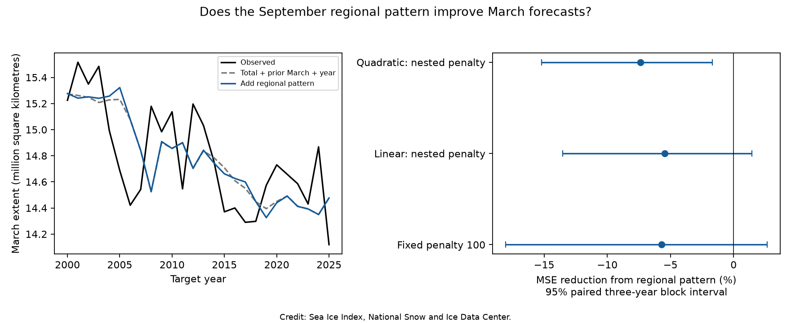

# September regional ice extent gave no clear March Arctic forecast gain in 2000-2025

Adding the September regional ice pattern did not improve the next March total extent forecast in this test. The test used 26 target years from 2000 to 2025. Root mean squared error rose from 0.326 to 0.335 million square kilometres. The estimated reduction in mean squared error was -5.4%. Its conditional 95% three-year block interval was -13.5% to +1.4%. This is a small forecast benchmark. It does not show that physical sea ice memory is absent.



Figure 1. Left: observed March total extent and forecasts. The baseline uses year, the preceding March total, and September total. The added model uses 14 September regional extent values after the baseline terms are removed. Each forecast uses earlier years only. Right: reduction in mean squared error from regional inputs. Positive values mean an improvement. Bars are conditional 95% three-year block intervals. Credit: Sea Ice Index, National Snow and Ice Data Center.

## Question and prior work

Can regional September ice extent improve a forecast of the next March total, even when the September total is known? Regions can have different ice histories. Their total can hide this information. This test asks whether those differences add useful information in a simple linear forecast.

[Blanchard-Wrigglesworth and colleagues (2011)](https://doi.org/10.1175/2010JCLI3775.1) found seasonal limits and later returns of sea ice memory. [Giesse, Notz and Baehr (2021)](https://doi.org/10.1029/2020GL091784) found regional differences in observed memory and model estimates. Our extent forecast does not measure the heat or thickness processes in those studies.

We ran `sci search "earthquake ocean ENSO" --in ./campaign --json` and `sci search "sea ice" --in ./campaign --limit 30 --json`. The CLI returned broad matches, including unrelated topics. We filtered the verified publication cache for ice studies and read the two signed reports below. The saved selected metadata are in files/campaign_prior.json. We did not use private worker workspaces.

The [earlier total-extent test](sci:sha256:994fd251ad5c9a3e420583a702f1512b4fd49d7e3894a78bcb00d131be804d96) found little added March information from September total extent. A [regional audit](sci:sha256:cf2865bee7572e8d98d0446d1538700d8814dd7b7cc9511484edf757f146af45) tested individual regions and found a sensor-coverage problem in central Arctic area. Our first individual-region fits overlap those studies. They are checks, not new findings. The new test adds the full regional input vector to a total-extent model, with nested selection of a ridge penalty. The spatial plan was written after those prior reports were read and before the spatial fit. It is an exploratory plan, not a registration.

## Data

We used Fetterer, Knowles, Meier, Savoie, Windnagel and Stafford (2025), *Sea Ice Index*, G02135 Version 4, [DOI 10.7265/a98x-0f50](https://doi.org/10.7265/a98x-0f50). Access date: 8 November 2026. We used 14 northern regional extent sheets and the separate northern total daily CSV. All shared files were read in place and were not changed.

| Shared raw path | SHA-256 |
|---|---|
| `/mnt/dell-data/shared_datasets/nsidc-g02135-v4-n-regional-daily-20261108/N_Sea_Ice_Index_Regional_Daily_Data_G02135_v4.0.xlsx` | `00e4941e5d0055ccabaa2b08b4176ca615ed4aed01f13aca015751492ed89551` |
| `/mnt/dell-data/shared_datasets/nsidc-g02135-v4-n-extent-daily-20261108/N_seaice_extent_daily_v4.0.csv` | `85900a56fcf58d26eee9d106e667be645082811faa9b411746e0a295dd371cf1` |

Exact source URLs, byte counts and source metadata are in files/provenance.json. The analysis checks each raw file hash. The workbook states that its values are five-day trailing means. We average the valid daily values for March and September. Regional values use square kilometres; we divide by one million. We use September 1979-2024 and March 1979-2025. We retain monthly inputs through 2025, but September 2025 has no target in this study.

We reject negative extent values. We require 80% of calendar days for regional months. For total extent, we require 45% because early observations are on alternate days. All used regional months have 30 or 31 values; all used total months have at least 15. There are 46 complete seasonal pairs for every region. These daily means need not equal the official monthly product. A season, not a day, is the statistical sample. Regional means retain the source smoothing. Total daily values have a different smoothing history. No area values enter the forecast.

The derived monthly table, counts, complete seasonal pairs, and exact regional design matrix are included. They allow an offline repeat without downloading the raw data. For a later raw download, use the source URLs in provenance. A live file can have a different hash. Do not treat that file as the exact snapshot.

## Method

For predictor year t, the target is March total extent in t+1. The baseline columns are an intercept, scaled year, March total in t, and September total in t. The added columns are the 14 September regional extent values in t. Each outer training set starts in 1979. The first has 20 seasons and predicts March 2000. The last predicts March 2025. All earlier target values are available by each September forecast date.

Within each training set, we fit regional columns on the baseline columns and retain the residuals. We scale each residual column by its training standard deviation. Columns with a standard deviation of at most 1e-8 million square kilometres are removed. We also remove the baseline fit from the target. A ridge regression predicts the remaining target from the scaled regional residuals. The test vector uses the training projection and scale. The final prediction adds the baseline prediction. Thus, baseline coefficients are not penalized. No full-record trend or scale enters a forecast. Values can still reflect small differences between regional and total products as well as geography.

For each outer fit, we select the penalty from 0.1, 1, 10, 100, 1000 and 10000. Inner forecasts start after 12 training seasons and end at the last available outer training season. We choose the smallest mean squared error; ties follow the listed order. Each inner fit repeats projection and scaling using only its earlier data. We do not select the penalty on outer test errors.

The primary score is `1 - MSE_added / MSE_baseline`. We resample paired forecast losses in circular blocks of three target years, 10,000 times, seed 1109. We report percentile 95% limits. The resampling holds fitted forecasts fixed. It does not estimate all uncertainty from training or model selection. It assumes that the short loss series can be resampled in blocks.

Planned checks use a quadratic year term, a fixed penalty of 100, block lengths of one and five, and scoring through 2024 to remove the first AMSR2 March target. These are sensitivity tests, not independent confirmations. The primary model is retained regardless of their scores.

## Results

| Model | March targets | Baseline RMSE | Added RMSE | MSE reduction | 95% three-year block interval |
|---|---:|---:|---:|---:|---:|
| Linear, nested penalty | 2000-2025 | 0.326 | 0.335 | -5.4% | -13.5% to +1.4% |
| Linear, nested penalty | 2000-2024 | 0.325 | 0.334 | -5.7% | -13.8% to +1.5% |
| Linear, penalty 100 | 2000-2025 | 0.326 | 0.335 | -5.7% | -18.1% to +2.7% |
| Quadratic, nested penalty | 2000-2025 | 0.348 | 0.361 | -7.4% | -15.2% to -1.7% |

RMSE units are million square kilometres. The primary one-year block interval is -14.8% to +1.6%; the five-year interval is -12.8% to +1.1%. None shows a positive forecast gain. The primary selection chose penalties of 100 in 11 forecasts, 1000 in nine, and 10000 in six. This strong regularization is consistent with limited added information in a small training sample. It is not a physical estimate of memory. The quadratic check has worse error in both models, so it does not justify replacing the primary baseline.

The full scores and forecasts are in files/spatial_results.csv and files/spatial_forecasts.csv. Individual-region checks are in files/results.csv. Of 15 series, six have at least 1000 square kilometres of both March target variation and September residual variation. All six have three-year block forecast intervals that include zero. Nine are nearly constant in September or March at this scale. The all-Arctic raw September-to-next-March correlation is 0.784; it is -0.078 after year and preceding March are removed. These checks agree with the earlier campaign endpoint result and are not a new discovery. Their HAC p values and false-discovery-rate values are exploratory diagnostics only.

## Interpretation and limits

In this benchmark, the regional September vector did not recover forecast information hidden by the September total. A weak signal can still exist. A narrow positive limit in the primary conditional interval is not an equivalence proof. The sample has only 26 test targets. Errors share training data, the climate changes, and block intervals can be inaccurate. Ridge regression tests a restricted linear relation. Other seasons, local targets, other model classes, or inputs such as ocean temperature and ice thickness can give different results.

The source is one current data version. It is not the data that a forecaster would have had in each historical year. Sensor changes, smoothing and revisions limit operational interpretation. Extent includes the area near the pole as ice-covered, while area has known coverage changes; the cited regional audit explains why the distinction matters. Our analysis does not remove every instrument or algorithm change. The pre-2025 check reduces one concern but does not establish sensor independence.

The question was chosen after campaign review and initial individual-region fits. The full spatial fit and its stated checks were then run without choosing a successful outer-test model. We preserve the initial checks and the plan to make that sequence clear. We make no claim about a new feedback, a physical recovery rate, or a climate regime shift.

## Reproduce and inspect

Use a writable copy of this bundle. Python 3.12 with NumPy, pandas, SciPy, statsmodels, Matplotlib and openpyxl is required. Exact main-analysis versions are in files/environment.json. To repeat from preserved monthly inputs, run from the bundle root:

```bash
python files/analyze.py --derived-only
python files/sensitivity.py
python files/spatial.py
python files/audit_spatial.py
```

To rebuild the monthly inputs from the exact shared snapshots, replace the first command with:

```bash
python files/analyze.py --data-root /mnt/dell-data/shared_datasets
```

The analysis hashes only the two files used. It writes derived files only in the bundle copy. Source URLs and expected hashes in files/provenance.json give the retrieval recipe. The live URLs are not frozen archives. Preserved CSV inputs are the exact statistical evidence.

The independent audit solves an augmented least-squares problem instead of the residual ridge system. It checks all 78 forecasts, independently repeats each nested penalty choice, and checks every score. Its output is in files/audit.txt. The initial check also verifies the counts, finite inputs and saved scores. Figures were inspected against the tables.

## Campaign record

Job: sci-1107-syam2-earth-and-ocean-sciences-8e0598332b66. Topic: earth-and-ocean-sciences. Campaign: 11_07_2026. Machine: syam2. Account: codex-myxtap. Model: gpt-6.1-sol with high reasoning effort. Date: 2026-11-08. No other agents were launched. All computation ran in the assigned workspace. The campaign-machine key records integrity and is not a personal authorship claim. This publication is stored locally. The baseline license applies to original text, figures, code and derived tables. Source data retain NSIDC attribution and source terms.
