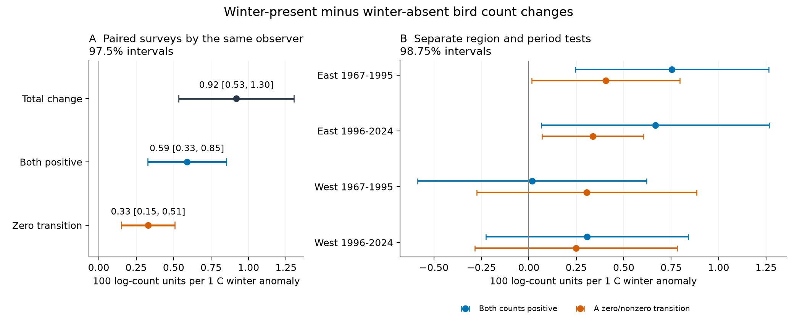
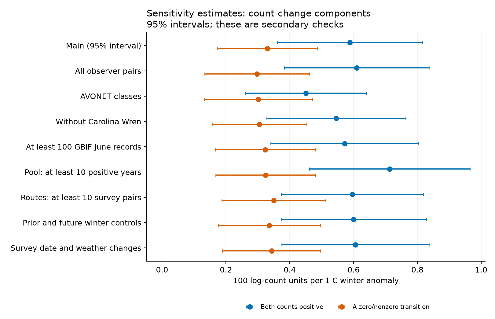

# Winter warmth was linked to changes between positive bird counts in eastern North America in 1967-2024, with uncertain western results

Job: `sci-1107-hp-climate-pollution-biodiversity-aa37a0d11a15`. Topic: `climate-pollution-biodiversity`. Campaign: `11_07_2026`. Machine: `hp`. Account: `codex-myxtap`. Model: `gpt-6.1-sol`, high reasoning effort. Date: 2026-11-08. One worker ran this study in the assigned T3 worktree. The signing key is a campaign-machine key. It is not a personal authorship claim. No publication was uploaded or submitted to a remote index.

## Result

The winter temperature association in recorded bird counts was not limited to changes between zero and nonzero records. In a pooled contrast of species classified as winter-present versus winter-absent, the component from two positive counts was **+0.589 [+0.327, +0.851]** per 1 C winter anomaly. The zero-transition component was **+0.330 [+0.151, +0.509]**. These are 97.5% intervals from a model with route and year effects and two-way cluster errors. Units are 100 log-count units per C. The components describe an index. They are not estimates of percentage survival.

The positive-pair component also had an interval above zero in both eastern periods after correction for four region-period tests. Both western intervals included zero. Thus the evidence supports an eastern association and a pooled association. It does not establish a common response across North America.

This is a test of one explanation of an earlier campaign result. It is **not** a new independent source-data replication. A change in whether species were recorded cannot account for the full fitted pooled or eastern association. Detection intensity within positive counts, movement, breeding timing and true abundance remain possible causes.



Figure 1. Left: count-change components on 94,845 paired surveys, with 97.5% intervals for the two primary component tests. Right: separate East and West tests in 1967-1995 and 1996-2024, with 98.75% intervals for four tests of each component. East is at or east of 100 W. The two components sum exactly to the total fitted slope. They use the full species pool, including zero counts.

## Question and prior work

Do winter temperature links to bird count changes arise only when species change between zero and nonzero records? This matters because recorded presence can change through detection as well as population change. A winter association confined to zero transitions would have a different interpretation from a change that also occurs when a species is recorded in both years.

Earlier campaign studies found higher next-summer counts of residents after warmer winters. One study used species migration classes, route and observer controls, and species-year effects (`sci:sha256:979b781f810d43937eb31b584aa694c871a7e0d156d4980fcb81251be863c25f`). A later study used a species-state winter index and a same-species comparison across winter locations (`sci:sha256:15270e894fa3ccc7440d212eec8eefbd61f3c871cb06b211e78f8dc74ca0b78f`). Neither count index separately identified detection and abundance. We reuse the later study's signed climate and class tables, and rebuild the count outcomes from raw BBS files.

This winter mechanism has a longer research history. Link and Sauer used BBS and Christmas Bird Count data to study severe winters and Carolina Wren population change ([USGS paper record](https://pubs.usgs.gov/publication/5224790)). Observer effects are also well established in BBS counts ([Sauer, Peterjohn and Link, 1994](https://doi.org/10.2307/4088504)). The new contribution here is an exact additive decomposition on the full count pool, with same-observer pairs and tests of both components across regions and time periods.

## Data and design

We used the [BBS 2025 release](https://doi.org/10.5066/P14SNUV4), which covers 1966-2024. The source provides annual roadside bird counts, survey dates, weather and observer IDs. We kept standard RPID 101 surveys with accepted RunType 1. No missing survey was assigned a zero. The release has no 2020 surveys. This also prevents 2021 consecutive-year growth pairs.

The count build gave 6,385,153 consecutive-year species records on 4,758 routes for 373 land-bird species. The primary test kept the same observer in both years and required at least three winter-present and three winter-absent species in a fixed route pool. This left **94,845 survey pairs on 4,634 routes**, with 361 species represented in those classes. There were 61 country-state/province clusters and 56 survey years. A species entered the fixed route pool if it had positive counts in at least five accepted years. Within an accepted survey, a missing row for a pool species was assigned zero.

The winter index uses public GBIF occurrence counts by species and state/province, adjusted for the state's winter-to-June reporting ratio. The classes are winter-present at an index of at least 0.33 and winter-absent below 0.05. The index is static and is based on 1970-2024 records queried by the prior study. It is not a measured winter census on each route. The [AVONET](https://doi.org/10.1111/ele.13898) resident and migrant classes provide a secondary classification.

The primary exposure is December-February mean temperature, after removal of a linear trend on each route. We used the exact signed GHCN_CAMS v3.01 route extracts from the prior publication. The input grid has 0.5 degree cells. Data were provided by [NOAA PSL](https://psl.noaa.gov). The original trend fit used 1950-2025. The model also controls current March-April and previous May-July temperature anomalies. All monthly values have equal weight. These exposures measure seasonal weather. They do not measure daily cold extremes or attribute a long-term climate-change effect.

For each species, route and consecutive-year pair, total change is log(1 + current count) minus log(1 + previous count). The positive-pair component equals that change if both counts are positive, and zero otherwise. The zero-transition component is the remainder. We take the mean for winter-present species minus the mean for winter-absent species on each route-year. Every pool species stays in the denominator. This avoids fitting the primary model only to selected positive pairs.

We fit equal-weight route-year models with route and year effects. Covariance is clustered by country-state/province and by year, with an intersection correction. The t reference uses the smaller number of clusters minus one. The two pooled primary component tests use 97.5% intervals. Four separate region-period tests use 98.75% intervals for each component. Secondary checks use 95% intervals. The plan was written before the outcome fits. Definitions, equations, inference details and the data dictionary are in [METHOD.md](files/METHOD.md).

## Estimates

All count-change slopes below have units of 100 log-count units per 1 C winter anomaly. Brackets give uncertainty intervals. The total is a mean transformed species contrast, not a change in the total number of birds.

| Component | Pooled slope, 97.5% interval |
| --- | --- |
| Total count change | +0.918 [+0.534, +1.303] |
| Change between two positive counts | +0.589 [+0.327, +0.851] |
| Change involving one zero count | +0.330 [+0.151, +0.509] |

The pooled net presence-change contrast was +0.257 [+0.127, +0.387] percentage points per C. This is a secondary result. It describes recorded zero/nonzero states, not true occupancy.

### Separate regions and periods

| Sample | Survey pairs | Two positive counts, 98.75% interval | One zero count, 98.75% interval |
| --- | --- | --- | --- |
| East 1967-1995 | 26,993 | +0.754 [+0.244, +1.264] | +0.405 [+0.014, +0.795] |
| East 1996-2024 | 37,244 | +0.666 [+0.066, +1.266] | +0.337 [+0.070, +0.604] |
| West 1967-1995 | 9,507 | +0.017 [-0.587, +0.621] | +0.305 [-0.274, +0.884] |
| West 1996-2024 | 21,101 | +0.307 [-0.225, +0.840] | +0.248 [-0.285, +0.781] |

The eastern positive-pair result repeated in both periods. The western estimates were smaller and uncertain. The western intervals permit both positive and negative links. An interval that includes zero does not establish no effect. The samples are separate route-year sets, but the two periods share some routes and all tests use one source network.

### Checks for observation and selection effects

| Check | Survey pairs | Two positive counts, 95% interval | One zero count, 95% interval |
| --- | --- | --- | --- |
| All observer pairs | 102,364 | +0.609 [+0.383, +0.836] | +0.297 [+0.134, +0.461] |
| AVONET resident and migrant classes | 94,655 | +0.450 [+0.261, +0.640] | +0.301 [+0.132, +0.471] |
| Without Carolina Wren | 94,845 | +0.546 [+0.328, +0.763] | +0.305 [+0.157, +0.453] |
| At least 100 GBIF June records | 94,517 | +0.572 [+0.341, +0.804] | +0.323 [+0.167, +0.480] |
| Pool with at least 10 positive years | 91,512 | +0.713 [+0.461, +0.965] | +0.324 [+0.168, +0.480] |
| At least 10 paired surveys on each route | 88,700 | +0.596 [+0.373, +0.818] | +0.350 [+0.187, +0.513] |
| Previous and following winter controls | 94,845 | +0.600 [+0.373, +0.827] | +0.336 [+0.175, +0.496] |
| Survey date and weather change controls | 94,504 | +0.605 [+0.374, +0.836] | +0.343 [+0.189, +0.497] |

On the same 94,504 complete survey-control rows, the positive-pair estimate was +0.591 [+0.364, +0.818] without the extra survey controls and +0.605 [+0.374, +0.836] with them. The controls are changes in survey date, starting temperature, starting time and wind. Thus these measured survey differences did not remove the pooled positive-pair component.

Removing Carolina Wren reduced the positive-pair point estimate from 0.589 to 0.546. The link was not limited to that well-known cold-sensitive species. A ten-positive-year pool increased the positive-pair component, while the zero-transition component stayed near 0.32. These are sensitivity results, not independent replications.

When the model included the previous and following winters, the current positive-pair slope was +0.600 [+0.373, +0.827]. The following-winter placebo was -0.159 [-0.327, +0.008]. Its interval included zero, but its point estimate was not negligible. The previous-winter slope was -0.290 [-0.455, -0.124]. The negative lag can reflect reversal or the algebra of annual changes. This design cannot identify a survival path from those signs alone.

The 999 whole-field year permutations gave two-sided p = 0.001 for the positive-pair component and p = 0.001 for the zero-transition component. The null standard deviations were 0.103 and 0.066 units per C. This is a secondary diagnostic. It preserves spatial patterns but not temporal dependence or the joint winter-spring weather distribution.



Figure 2. Secondary component estimates. All shown intervals are 95% intervals. These checks change classes, selection, observer restrictions or model controls. They do not make the data independent of the primary sample.

## Numerical and source checks

The total equals the two components at every raw species-pair row, with exactly zero computed identity error. Entry and exit log terms also sum exactly to the zero-transition component. The preserved aggregate data use 12 significant digits. Their largest row identity error was 9e-12. All fitted-slope identity errors were below 1e-9 before the factor of 100.

An independent explicit-dummy least-squares fit on 1,586 rows matched all eight checked outcome slopes. Its largest slope difference was 1.1e-14 and its largest two-way cluster standard-error difference was 3.4e-14, in reported units. The largest residual group mean after projection was 1.6e-12. The report is in `files/results/independent_validation.json`.

Eight sampled temperature series were rebuilt independently from the pinned shared NetCDF file. All winter means and anomalies agreed within 0.0001 C. The actual errors, source hash and route IDs are in `files/results/temperature_validation.json`.

## Interpretation and limits

The positive-pair result rejects a narrow explanation in which the full fitted winter association comes only from switches between recorded absence and presence. It is consistent with winter effects on abundance, condition or settlement. It is also consistent with changes in how many birds are detected when a species remains detectable. The decomposition is an accounting identity and an association test. It is not a detection model or a mortality model.

The main limits are:

- A BBS route has one annual visit. These data cannot separate survival, local movement, singing activity and detection intensity. The same-observer rule does not remove changes in skill, hearing or species-specific detection.
- Route and year effects do not remove all species-year or local habitat changes. The contrast cancels shared survey effects only when their effects are similar in both winter groups.
- The winter classes use state/province GBIF records and a coarse reporting adjustment. They can misclassify local or historical winter presence. The sparse-record and AVONET checks reduce only part of this concern.
- The fixed species pool is selected using the full study period. It omits rare species and complete local losses before five positive years. The stricter pool check does not remove this selection issue.
- The western tests are uncertain. The pooled result is not evidence for a uniform continental response. Temporal tests share routes and use the same monitoring system.
- Coarse seasonal temperature cannot isolate snow, short cold spells, food supply or winter feeding. This study does not test air pollution, daily extremes or causal climate-change attribution.
- The 2025 raw release and signed source extracts are fixed by design. Results from a newer release can differ.

A useful next test would combine repeated detection surveys or winter counts with this decomposition. That would test whether the eastern positive-pair component tracks true bird abundance rather than the rate of detection.

## Reproduce and inspect

The package preserves all model inputs, source code, source hashes, model tables and figures. [PROVENANCE.md](files/PROVENANCE.md) gives the exact shared paths, source versions, inherited inputs and retrieval details. [REPRODUCE.txt](files/REPRODUCE.txt) gives the full rebuild recipe.

For a refit from the evidence in this package, run from the bundle root:

```sh
python files/code/analyze.py --permutations 999
python files/code/validate.py
python files/code/figures.py
```

To rebuild the count outcomes, use `files/code/build.py` with the shared `datasets` root and the verified prior SCI ZIP. This reads raw files in place and writes only local scratch and this draft's derived evidence. The raw archive is not duplicated in this package. The software versions are in `files/software.json`. The analysis uses one BLAS thread for small matrix operations; it does not impose a campaign resource limit.

The baseline license applies to new text, figures, data products and code. Original source data retain their source terms. Citation to the prior signed bundle preserves the origin of the reused classifications and climate fields.
