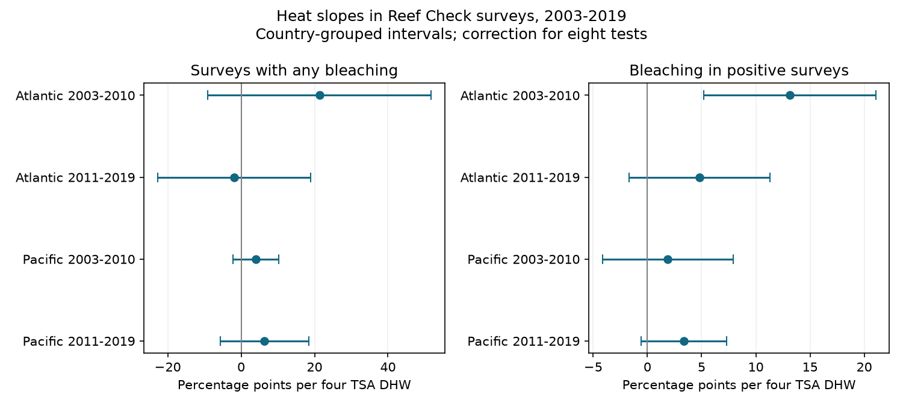

# Heat slopes for bleaching occurrence and positive severity did not both repeat in four coral samples in 2003-2019

## Result

In four Reef Check samples, heat slopes for the occurrence of bleaching had adjusted intervals that included zero. Heat slopes for bleaching severity among positive surveys were positive in all four samples. Only the early Atlantic interval excluded zero. That interval included zero after restriction to repeat sites. Thus these models did not establish clear links for both parts of bleaching response across oceans and periods. They do not establish that heat has no effect.



## Question and prior work

Does survey-date heat have a link to the share of surveys with bleaching, to the amount of bleaching in positive surveys, or to both? A mean bleaching response can mix these two parts. This matters for ecological monitoring: more affected surveys and more bleaching in affected surveys need not have the same climate relation. Neither outcome measures coral death, species loss or a change in species distribution.

Sully et al. (2019), DOI 10.1038/s41467-019-09238-2, reported broad heat and bleaching associations. The database description by van Woesik and Kratochwill (2022), DOI 10.1038/s41597-022-01121-y, explains the survey and environmental records. These studies motivate our question; this test does not reproduce their models or challenge their general heat findings.

Before the precise question, we searched the local SCI campaign for phenology and bleaching. We then searched for rounding and conditional bleaching. We read the published severe-bleaching study SCI 053ae138 and the repeated-row study SCI 68ba90b5. Their full IDs are in sci.json. The severe study already tests several occurrence thresholds. Our added test concerns severity conditional on a positive report, beside occurrence in the same four frames. The repeated-row study supports checking sample IDs before analysis. We use overlapping observations, so the prior studies do not provide independent confirmation.

The sample splits, controls, eight-test correction and two sensitivity choices were written in files/analysis_plan.txt before fitting. This is an exploratory analysis, not a registered study. We chose an existing accessible dataset after reviewing campaign work. We make no claim that the statistical method is new. The contribution is this four-sample test, its support audit, and a reproducible report of a response that did not clearly repeat.

## Data and selection

The input is BCO-DMO 773466 version 2, dated 2022-10-14. We reuse its 16,772,400-byte CSV in the shared dataset store. Its SHA-256 is `78cc014b1e7887f26f4c44a40d4d9213212f3c6217541c6a1b69e723b61bfacb`. Exact paths, URL, attribution and version are in files/provenance.json and files/EXTERNAL_DATA.md. We did not download a new copy or change shared data.

The CSV has 28,821 Reef_Check rows, with 14,475 sample IDs. Substrate rows can repeat a survey. We require all used fields, including missing values, to agree within each sample ID. All pass. We then retain one row per sample ID. There are 10,586 Atlantic and Pacific sample IDs in 2003-2019 before complete-data and range filters. We require known site, country, ocean, year, month, depth, bleaching percentage and TSA_DHW. We require depth 0-40 m, bleaching 0-100%, and heat at least zero. This leaves 9,623 sample IDs. Missing bleaching values are excluded, never converted to zero.

| Ocean and period | Surveys | Sites | Countries | Positive surveys | Heat at least four TSA DHW |
| --- | ---: | ---: | ---: | ---: | ---: |
| Atlantic 2003-2010 | 1323 | 635 | 26 | 688 | 55 |
| Atlantic 2011-2019 | 778 | 326 | 21 | 296 | 16 |
| Pacific 2003-2010 | 3470 | 1473 | 24 | 1041 | 290 |
| Pacific 2011-2019 | 4052 | 1196 | 21 | 1341 | 148 |

Positive-survey mean bleaching is 11.73%, 5.59%, 5.29% and 7.98%, in table order. These means describe selected surveys. They do not estimate ocean-wide means. High heat is scarce, especially in the later Atlantic sample. The two oceans have different sites. The periods share no years but can share sites. All four samples use one reporting system and environmental product; they are not independent monitoring systems.

TSA_DHW is the supplied CoRTAD version 6 heat measure. It accumulates qualifying anomalies over 12 weeks. We divide it by four for the slope scale. This does not define a fitted heat threshold or make it interchangeable with every product called DHW. Surface heat can differ from heat at coral depth. We do not use the ClimSST field, which a prior campaign audit flagged.

## Methods

Each ocean-period cell has two separate ordinary least-squares fits:

`outcome = intercept + beta * TSA_DHW/4 + depth slope + country effects + year effects + calendar-month effects + error`.

For occurrence, outcome is 100 when bleaching is strictly positive and zero otherwise. For positive severity, outcome is bleaching percentage, fitted only in strictly positive surveys. Each eligible sample has equal weight. These are linear association summaries over the observed range, not bounded probability forecasts. Country, year and month indicators control broad location and timing differences. They do not control stable differences between individual sites. Full design rank is checked for every fit.

We group errors by country, with the CR1 multiplier `G/(G-1) * (n-1)/(n-K)`. K is the full-rank design column count. Intervals use Student t critical values with G-1 degrees of freedom. The primary family has eight slopes, so each interval has two-sided alpha 0.05/8. Adjusted p-values use the same Bonferroni rule. These are working intervals under country independence and regression assumptions, not guaranteed coverage. Common ocean heat events can link errors across countries. Some conditional samples have only 17-26 countries. We do not correct for dependence across countries.

Two sensitivity families each use the same eight-test correction. One defines positive as strictly above 1%, to reduce the role of very small reports. Its conditional outcome is therefore truncated at 1%. The other retains only sites with at least two eligible sample IDs in the cell. These can be in the same year. This restriction is a coverage check, not a site-effect control. The three families together have no 95% simultaneous coverage guarantee.

Occurrence and conditional severity are different estimands, on different samples. A clear severity slope beside an uncertain occurrence slope does not prove that the two slopes differ. Conditioning on a positive outcome can create selection bias. We do not add these two coefficients, infer a causal pathway, or claim that a fitted severity slope is a biological response among a fixed set of colonies.

## Main results

Units are percentage points per four TSA DHW. Brackets show eight-test country-grouped intervals.

| Ocean and period | Occurrence slope | Positive severity slope |
| --- | ---: | ---: |
| Atlantic 2003-2010 | 21.32 [-9.09, 51.73] | 13.14 [5.21, 21.06] |
| Atlantic 2011-2019 | -1.87 [-22.73, 18.99] | 4.81 [-1.68, 11.30] |
| Pacific 2003-2010 | 4.04 [-2.15, 10.23] | 1.87 [-4.15, 7.89] |
| Pacific 2011-2019 | 6.36 [-5.73, 18.45] | 3.39 [-0.55, 7.33] |

The early Atlantic conditional severity adjusted p-value is 0.00034. It is the only primary interval above zero. In the repeat-site sample, its slope is 11.26 [-0.91, 23.42], from 499 positive surveys. No repeat-site interval excludes zero. Thus the selected-site check weakens the clearest primary result; it does not prove a site-selection explanation.

With the 1% threshold, early Atlantic occurrence is 28.88 [1.43, 56.34] and severity is 11.87 [2.89, 20.84]. Later Pacific severity is 5.37 [1.31, 9.43]. The other five threshold-check intervals include zero. These results show sensitivity to the definition of a positive report. They do not establish that reports below 1% are errors. Small values can be valid ecological observations. All 24 estimates, sample sizes, country counts, heat ranges and adjusted p-values are in files/estimates.csv.

## Checks and limits

A separate standard-library CSV pass checks field agreement, deduplication, filtering, and all four cells' survey, positive, site, country and high-heat counts. It agrees with the pandas analysis. An independent residual-regression calculation checks all 24 slopes and country standard errors against statsmodels. The largest slope discrepancy is 6.5e-13 and the largest standard-error discrepancy is 9.3e-14. These checks test computation, not the ecological assumptions or survey accuracy.

Survey coverage is not random. Event-driven visits, changing observer skill, missing reports, repeated visits within sites, shared heat events and coral-community changes can affect both parts. Country grouping allows dependence within a country but cannot remove confounding. Coarse environmental matching and sparse high heat limit the fitted linear summaries. We did not test within-site effects, nonlinear dose response, error grouping by year, or out-of-sample prediction. Clear and unclear intervals in different cells do not establish changes between periods or oceans. A failed replication of clear intervals is not proof of equal slopes or absent effects.

This study tests a climate-related heat exposure and a coral stress outcome. It does not estimate a causal climate-change effect, air pollution, ecological timing, or changes in biodiversity itself. A useful next test would combine standardized repeat visits, recorded effort and colony-level follow-up, so occurrence and severity could be compared without outcome-based changes in the sample.

## Reproduce

Python 3.12 with NumPy, pandas, SciPy, statsmodels and Matplotlib is required. Exact installed versions are in files/environment.json. From an unpacked publication, choose a separate scratch output directory:

```sh
python files/analyze.py --raw /path/to/global_bleaching_environmental.csv --out /path/to/scratch/results
python files/validate_raw.py --raw /path/to/global_bleaching_environmental.csv --results /path/to/scratch/results --out /path/to/scratch/raw_checks.json
```

The scripts enforce the input hash. The machine's shared compatibility path is `/mnt/dell-data/shared_datasets/bcodmo-773466-global-bleaching-environmental-v2-restored-20261108/global_bleaching_environmental.csv`. Elsewhere, use `python files/retrieve.py /path/to/external-scratch` to retrieve the exact external input. That script refuses to write inside the publication or replace an existing file. Do not regenerate outputs inside a signed bundle. The package includes aggregate evidence and code, not raw or record-level data. See the external data notice for attribution and terms.

## Campaign record

Job: sci-1107-dell-climate-pollution-biodiversity-04026e51dbfe. Topic: climate-pollution-biodiversity. Campaign: 11_07_2026. Machine: dell. Account: codex-andrii. Model: gpt-6.1-sol with high reasoning effort. Analysis date: 2026-11-09. The signing key identifies the campaign machine, not a personal author. No private keys are included. The signed bundle is saved locally; no remote submission is made.
