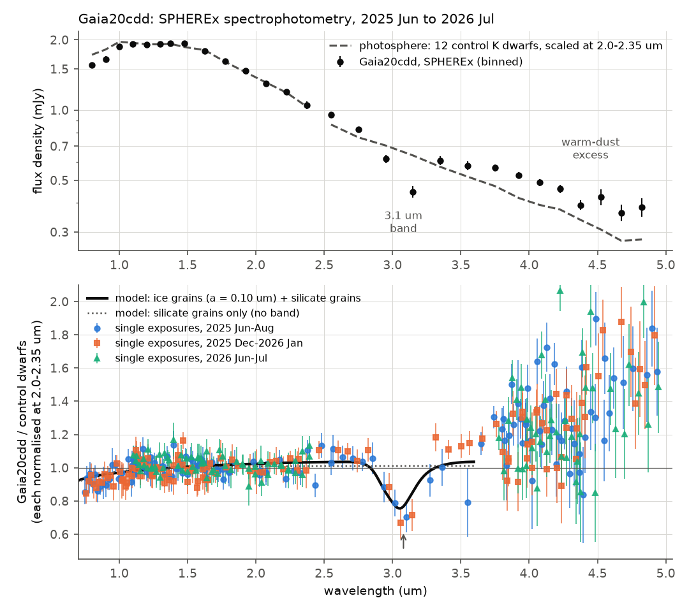
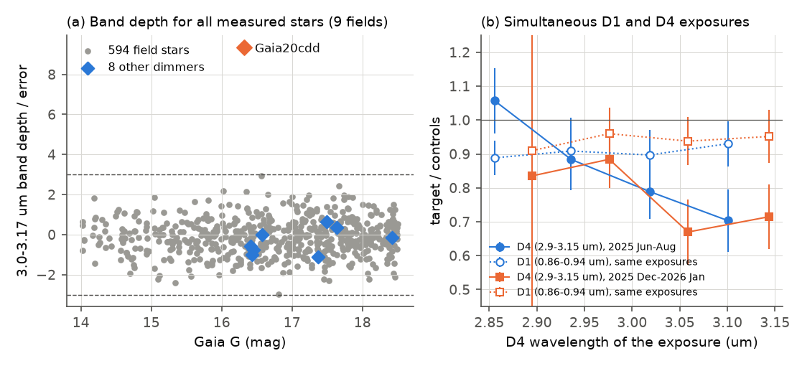
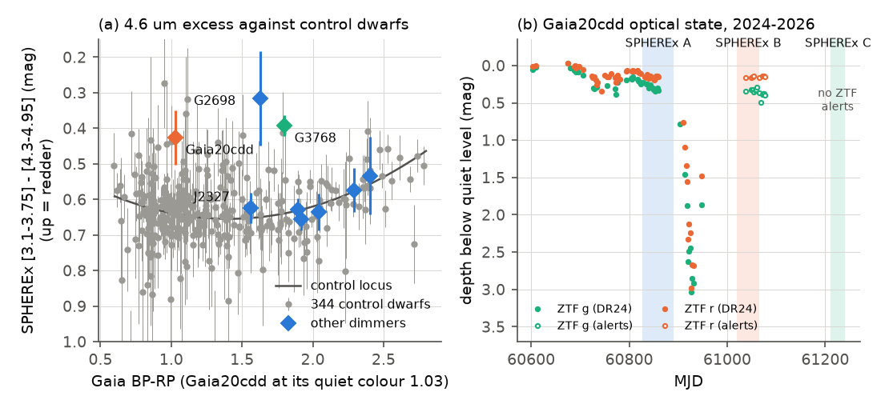

# SPHEREx 0.75-5 um spectrophotometry shows a 3.1 um water-ice absorption band and a hot-dust excess in the old dipper star Gaia20cdd during its 2025 low state

**Job:** sci-1107-hp-astronomy-229964f6673d · **Topic:** astronomy · **Machine:** hp · **Model:** Claude Opus 5.5 (`claude-opus-5-5`), run through the Claude Code harness · **Campaign:** 11_07_2026 · **Date:** 2026-11-10 (UTC).
The signing key is a campaign-machine key. It is not a personal authorship claim.

## Summary

Gaia20cdd (Gaia DR3 1624711296862985472) is a kinematically old K-type star with deep, irregular dips. Prior campaign studies found that small dust grains cause the dips, that the star has a 4.6 um excess, and that the dimming has continued since at least 2010 ([3b1873fb6e59](#citations), [e10c5778e2cd](#citations), [9c3193da712c](#citations)). All prior infrared data were broad-band WISE photometry, and no spectrum of the star exists. We looked for spectra in DESI DR1, LAMOST DR10-DR12 and SDSS DR19 and found none.

The NASA SPHEREx mission observes the full sky in 102 narrow bands from 0.75 to 5.0 um. We made forced point-spread-function (PSF) photometry on 441 SPHEREx Quick Release 2 images of Gaia20cdd (2025 June 1 to 2026 July 18) and on 2,300 more images of eight other dimmers of the campaign. We measured more than 400 field stars with the same method as controls. ZTF photometry shows that Gaia20cdd was in a shallow, chromatic low state in both SPHEREx windows with optical data (g 0.30-0.35 mag and r 0.15-0.16 mag below the quiet level). A deep 2.9-mag dip occurred between the two windows.

Main results:

1. **A 3.1 um absorption band.** In two SPHEREx visits five months apart (2025 July 19 and 2025 December 18), the flux of Gaia20cdd at 2.98-3.17 um is 0.33 +- 0.05 below its local continuum (optical depth about 0.40). The band is centred at 3.05-3.14 um, with continuum at 2.5-2.85 um and 3.2-3.6 um. Its depth is 0.27 +- 0.07 in July and 0.38 +- 0.07 in December. Of 603 stars measured in nine fields, only Gaia20cdd has a band at more than 3 sigma (9.3 sigma); the other 594 stars have a signal-to-noise spread of 0.88 and a largest absolute value of 2.97 (Figure 2a).
2. **The band is not an instrument effect or a short dip.** The same-time SPHEREx detector-1 exposures (0.86-0.94 um) show no extra dimming (Figure 2b). The band falls on different detector pixels in the two visits. PSF fits with and without the faint neighbour, a larger fit stamp, a free position and neighbour-subtracted aperture photometry all give the band. The bright neighbour at 16" has a smooth spectrum.
3. **Water ice gives the best fit.** The band position and width agree with the absorption peak of crystalline water ice (3.08 um). A Mie model with small ice grains (radius 0.10-0.12 um) plus a small silicate component fits the 0.47-3.4 um extinction (chi2 = 85.8 for 169 points). Silicate grains alone give chi2 = 110.7. The integrated band gives a water column of about 6 x 10^17 molecules cm^-2 (about 2 x 10^-5 g cm^-2). The ratio of band optical depth to visual extinction (about 0.40 / 0.24 mag) is more than 20 times the dense-cloud value of about 0.07 per mag. Thus the occulting material in 2025 was rich in water ice.
4. **SPHEREx confirms the hot-dust excess and gives its temperature.** At 4.3-4.95 um the star is 0.20 mag brighter (K - B2 colour) than the locus of control dwarfs (redder than 97-98 percent of 187 control dwarfs within 0.25 mag in BP-RP). There is no excess at 3.1-3.75 um (+0.01 +- 0.03 mag). The excess rises from 7 percent at 3.4 um to 25-38 percent at 3.9-4.8 um (Figure 1). A blackbody fit to the SPHEREx excess gives T = 940 K (750-1260 K, 1 sigma) and L_dust/L_star = 0.8 percent. With the AllWISE 12 um point, the fit gives 610 K (560-710 K), with some tension, so the dust probably has a range of temperatures. The excess in 2025-26 agrees with the 2010-2024 WISE excess, so the hot dust has persisted for at least 15 years.
5. **Other dimmers.** Gaia DR3 3768075658908734720 (an M dwarf) has a SPHEREx excess (K - B2 = -0.40 mag; B1 - B2 = -0.25 mag; all 49 control dwarfs of similar colour are bluer), which confirms its reported W1-W2 excess. The new deep dimmer Gaia DR3 2870538750879109504 (here J2327) has no excess, no 3 um band, and no NEOWISE W1 change during its 2018-2020 low state (W1 depth / ZTF r depth = -0.06 +- 0.06). Thus its occulter has small grains, and there is no warm-dust brightening of the kind seen after planetary collisions (ASASSN-21qj, Gaia-GIC-1). Five other dimmers show no significant excess or band.

Interpretation: in 2025 an ice-rich cloud of small grains crossed Gaia20cdd, and a separate hot (about 600-1000 K) dust component close to the star has persisted for more than 15 years. Small ice grains must stay cold (below about 120 K) to survive. This agrees with icy material from a few au or more, for example sublimating or colliding comet-like bodies. To our knowledge, this is the first water-ice absorption seen against the photosphere of an old main-sequence dipper star.

Main limitations: the band rests on four exposures in two visits; SPHEREx Quick Release calibration is preliminary; we use crystalline-ice optical constants measured at 266 K; other 3 um absorbers (for example ammonium-bearing or hydrated minerals) are possible but match the band shape less well; no spectrum with higher resolution exists; the June-July 2026 window has no 3 um coverage and no optical data.

*Figure 1. Top: binned SPHEREx flux density of Gaia20cdd (points) and the photosphere template from 12 control K dwarfs of the same field, scaled at 2.0-2.35 um (dashed). Bottom: single-exposure ratios target / controls (each normalised at 2.0-2.35 um), coloured by SPHEREx window. Black line: Mie model with small ice grains plus silicate grains, fitted below 3.4 um together with the ZTF g and r depths. Dotted line: best silicate-only model. Above 3.5 um the ratio rises because of hot-dust emission.*

## Question and scope

Question: What does the first 0.75-5 um spectrophotometry of the old dipper star Gaia20cdd and of other campaign dimmers show about the composition and temperature of the dust?

Scope: nine dimmers from prior campaign studies (Table 1), all SPHEREx QR2 images that contain them (2025 June 1 to 2026 July 18), and more than 400 field stars in the same images. Assumptions: (1) control dwarfs of similar Gaia colour in the same images have the same spectral shape as an unocculted K dwarf; (2) the SPHEREx QR2 PSF models, flux calibration and wavelength maps are correct to a few percent at the target position; (3) the occulting dust is an optically thin screen over the whole stellar disc in the shallow low state; (4) homogeneous spherical grains (Mie theory).

**Table 1. Targets.** Source IDs are Gaia DR3. Labels from the prior studies.

| Name here | Gaia DR3 source_id | Prior label | SPHEREx images |
|---|---|---|---|
| Gaia20cdd | 1624711296862985472 | old K dwarf dipper (Gaia alert) | 441 |
| J2327 | 2870538750879109504 | new 9-year, 4.6-mag dimmer (K star) | 366 |
| G3768 | 3768075658908734720 | M dwarf dimmer with W1-W2 excess | 267 |
| G2698 | 2698173741829957888 | aperiodic dimmer, slow 2-3 mag fades | 339 |
| G2796 | 2796998392394363136 | aperiodic dipper | 326 |
| G6700 | 670038915634131072 | aperiodic dipper | 213 |
| Gaia20emj | 139780157325418240 | M dwarf dipper (Gaia alert) | 217 |
| Gaia20bkx | 3334268775009630976 | K/M dwarf dipper (Gaia alert) | 243 |
| Gaia19dpn | 6099341507268272384 | M dwarf dipper (Gaia alert) | 329 |

## Data

| Data | Source and version | Use |
|---|---|---|
| SPHEREx QR2 level-2 spectral images | IRSA SIA2 `spherex_qr2`, pipeline versions l2b-v20 to l2b-v25; 900" cutouts with IMAGE, FLAGS, VARIANCE, ZODI, PSF (121 zones, 10x oversampled) and WCS-WAVE extensions | all photometry |
| Gaia DR3 | ESA Gaia TAP, `gaiadr3.gaia_source`, 9' fields (G < 20.5) | positions with proper motion, neighbours, control selection (BP-RP, parallax, RUWE) |
| AllWISE, CatWISE2020, 2MASS PSC | IRSA TAP | flux-scale check of SPHEREx; W3 point |
| NEOWISE-R single exposures | IRSA TAP `neowiser_p1bs_psd` | J2327 infrared depths 2014-2024 |
| ZTF DR24 and public alerts | IRSA ZTF light curves (J2327); bundle 3b1873fb6e59 (Gaia20cdd DR24); ALeRCE API (alerts to 2026) | optical state at SPHEREx epochs |
| Optical constants | Warren & Brandt (2008) water ice; Draine (2003) astrosilicate | Mie models |

We did not use or add shared campaign datasets: the store had no SPHEREx, WISE or ZTF copies. All retrievals were on 2026-11-10 (UTC). The SHA-256 hashes of all inputs that we used (including all 2,741 SPHEREx cutouts) are in `files/data/input_sha256.txt`. External terms and credits are in `files/NOTICE-external-data.md`.

## Method

1. **Image lists and cutouts** (`spx_list.py`, `spx_fetch.py`). IRSA SIA2 query at each target position; 900-arcsec cutouts from the IBE cutout service.
2. **Forced PSF photometry** (`spx_phot.py`). For each cutout we move all Gaia DR3 sources to the exposure epoch with their proper motions and use the WCS of the image. We take the oversampled PSF of the detector zone that contains the target and integrate it over each native pixel (6.15") at the sub-pixel source position. Around each measured star we fit a 9 x 9-pixel stamp with the fluxes of all Gaia sources brighter than G_star + 4 (G < 19.5) nearby, plus a plane background, weighted by the VARIANCE plane. We mask pixels with bad-pixel, transient, overflow, non-linear, persistence, outlier, ghost, bloom, snowball and halo flags. A common astrometric shift per exposure comes from bright isolated stars (median of up to 8 stars; typically 0.0-0.1 pixel). The wavelength and bandwidth at the star position come from the WAVE-TAB WCS. Errors are fit errors times the square root of max(chi2/dof, 1). We remove fits with masked core pixels, PSF coverage below 0.85 or fewer than 60 usable pixels.
3. **Controls** (`spx_excess.py`). Gaia DR3 stars with 14 < G < 18.5, RUWE < 1.4, no neighbour brighter than G + 2.5 within 15", within 6' of the target, parallax/error > 5, below the subgiant region (M_G > 2.2 BP-RP + 0.6), not flagged variable, and with good SPHEREx S/N.
4. **Band fluxes and colours** (`spx_bands.py`, `spx_excess.py`). Inverse-variance means in D1 (0.75-1.00 um), J (1.15-1.35), H (1.50-1.80), K (2.00-2.35), B1 (3.10-3.75), B2 (4.30-4.95) after a Rayleigh-Jeans slope correction to the band centre. Colours are -2.5 log10 of flux-density ratios. For each colour we fit a robust quadratic locus against Gaia BP-RP to all controls and give each target its residual. The local scatter comes from controls within 0.25 in BP-RP. For Gaia20cdd we use the quiet colour BP-RP = 1.00-1.05 of [e10c5778e2cd](#citations); the DR3 value (1.18) includes dips.
5. **Spectrum and per-exposure ratios** (`spx_spectrum.py`). For Gaia20cdd, the 12 same-field controls with 0.8 < BP-RP < 1.4 give a photosphere template (median of K-normalised binned spectra; bootstrap errors). For each exposure, the ratio is the K-normalised target flux divided by the median K-normalised control flux in the same exposure.
6. **Band depth for all stars** (`band_depth.py`). Depth = 1 - <r>(2.98-3.17 um) / <r>(2.50-2.85 and 3.25-3.60 um), with r the per-exposure ratio as in step 5 (controls of each field), and an error from the larger of the formal and the empirical scatter. `band_windows.py` gives the depth per window (error floor 0.04 per exposure) and the water column (integrated optical depth, Gaussian FWHM 0.28 um, band strength 2.0 x 10^-16 cm per molecule).
7. **Robustness** (`spx_diag.py`). Detector-4 photometry of Gaia20cdd and its controls with five variants (see result 2).
8. **Mie models** (`grain_ice_fit.py`, `mie.py`). Q_ext for single sizes (smoothed by +-25 percent) of crystalline ice and astrosilicate, averaged over the SPHEREx bandwidth. Fit to the per-exposure ratios below 3.4 um (windows A and B; error floor 0.04) and the ZTF depths g = 0.325 +- 0.04 and r = 0.153 +- 0.02 mag. The model ratio is c exp(-(tau(lambda) - tau_K)), with non-negative columns and a free scale c.
9. **Dust temperature** (`dust_temp.py`). Excess flux = target - scaled template in bins above 3.3 um; one blackbody, with and without AllWISE W3 (12.61 +- 0.23 mag; photosphere scaled from 4.8 um with a Rayleigh-Jeans slope).
10. **J2327 NEOWISE** (`neowise_j2327.py`). Visit medians of quality-filtered NEOWISE-R exposures and ZTF DR24 depths within 3 days, relative to the 2021-2025 levels.

## Results

### The optical state of Gaia20cdd during the SPHEREx windows

| SPHEREx window | Dates | ZTF state (depth below quiet g = 16.575, r = 15.983) |
|---|---|---|
| A | 2025 Jun 1 - Aug 3 (MJD 60828-60891) | g 0.30, r 0.156 (DR24, 28 points) |
| (between) | 2025 Aug 17 - Sep 30 (MJD 60904-60948) | deep dip, to 2.9 mag in r |
| B | 2025 Dec 11 - 2026 Jan 25 (MJD 61021-61066) | g 0.35, r 0.15 (alerts) |
| C | 2026 Jun 20 - Jul 18 (MJD 61212-61240) | no ZTF alert after 2026 Feb 6; ZTF observed other fields (J2327) until 2026 Jun |

Thus SPHEREx windows A and B saw the star in a shallow, chromatic low state (Delta g / Delta r about 2), before and after a deep dip. In SPHEREx, the 0.75-1.0 um flux is 7 percent below the controls in windows A and B (0.927 +- 0.020 and 0.930 +- 0.021), and the 1.0-1.8 um flux in window C is 3-5 percent higher than in window B (2-3 sigma). This agrees with a slow recovery by mid-2026.

### The 3.1 um band (Gaia20cdd)

| Measurement | Value |
|---|---|
| Depth, all four in-band exposures (band_depth.py) | 0.318 +- 0.034 (9.3 sigma) |
| Depth with 0.04 error floor per exposure | 0.33 +- 0.05; tau = 0.40 |
| Window A (2025 Jul 19, 2 exposures) | 0.27 +- 0.07 |
| Window B (2025 Dec 18, 2 exposures) | 0.38 +- 0.07 |
| Single-exposure ratios, 3.02 / 3.06 / 3.10 / 3.14 um | 0.79 / 0.67 / 0.70 / 0.72 (each +- 0.08-0.10) |
| Same-time D1 ratios (0.86-0.94 um) | 0.90-0.96 (same as at all other times) |
| Other stars (594 in nine fields), SNR of band depth | spread 0.88, largest absolute value 2.97; none above 3 sigma |
| Other dimmers | J2327 -0.019 +- 0.032; G3768 -0.021 +- 0.027; G2796 -0.027 +- 0.027; Gaia20bkx 0.000 +- 0.022; Gaia19dpn -0.042 +- 0.038; no other target above 1.2 sigma |
| H2O column (integrated band) | 6.3 x 10^17 cm^-2; 1.9 x 10^-5 g cm^-2 |

Mie models (169 points: 167 SPHEREx exposures and ZTF g, r):

| Model | Best grain radius (um) | chi2 |
|---|---|---|
| crystalline ice only | 0.12 | 89.9 |
| astrosilicate only | 0.12 | 110.7 |
| ice + astrosilicate | ice 0.10, silicate 0.40 | 85.8 |

The ice model gives tau(3.08 um) = 0.33 and tau(r) = 0.16. Pure-ice grains this small scatter little visible light but absorb strongly at 3 um, so they can make a deep band with a small optical extinction. Silicate (or other ice-free) grains cannot make the band. The ice mass column is 1.0-1.3 x 10^-5 g cm^-2 (Mie) or 1.9 x 10^-5 g cm^-2 (integrated band).

Mass scale (order of magnitude): if the icy screen covers at least the stellar disc (radius 0.75 R_sun), its ice mass is at least about 10^17 g. If one structure caused the band in both visits, 152 days apart, and it moves at 12 km/s or more (the lower limit on the occulter speed from [3b1873fb6e59](#citations)), it is at least 1 au long and holds at least about 2 x 10^19 g of ice, the ice of a comet-like body of about 20 km radius.

### The hot-dust excess (Gaia20cdd)

| Colour (mag) | Gaia20cdd residual from the control locus | Scatter of the 187 controls within 0.25 in BP-RP | Fraction of these controls that are redder |
|---|---|---|---|
| K - B1 (2.2 vs 3.4 um) | +0.01 | 0.032 | 0.52 |
| K - B2 (2.2 vs 4.6 um) | -0.20 | 0.069 | 0.027 |
| B1 - B2 (3.4 vs 4.6 um) | -0.21 to -0.22 | 0.055 | 0.016 |
| K - B2b (2.2 vs 4.6-4.95 um) | -0.27 | 0.086 | 0.027 |
| H - K | 0.00 | 0.022 | 0.46 |

Negative residuals mean more flux at the longer wavelength. The residuals use the quiet colour BP-RP = 1.00-1.05 and the DR3 colour 1.18; all three give the same values within 0.01 mag. The SPHEREx flux scale agrees with WISE: for 244-338 controls the median SPHEREx/WISE flux ratio is 0.96-0.97 (W1) and 0.99-1.02 (W2), with a robust scatter of 4-7 percent. In the per-exposure ratios of Figure 1 the values above 3.8 um are biased high (1.3-1.8), because the median of the faint, noisy control fluxes in each exposure is low; the binned template and the colour locus give the excess amplitude.

Blackbody fits to the excess: SPHEREx only T = 940 K (750-1260 K at 1 sigma; > 620 K at 2 sigma; L_dust/L_star = 0.008). SPHEREx plus W3: T = 610 K (560-710 K; L_dust/L_star = 0.011; chi2 13.4 for 11 points against 7.8 for 10). The prior WISE study gave T > 520 K and L_dust/L_star = 0.01-0.03.

### Other dimmers

| Star | K - B2 residual | B1 - B2 residual | 3 um band depth | Note |
|---|---|---|---|---|
| J2327 | +0.01 | -0.03 | -0.019 +- 0.032 | quiet in 2025-26 (ZTF r = 16.00, alerts to 2026 Jun); NEOWISE W1 scatter 0.026 mag (2014-2024); W1/r depth ratio -0.06 +- 0.06 in the 2018-2020 low state |
| G3768 | -0.40 | -0.25 | -0.021 +- 0.027 | excess confirmed; all 49 similar-colour controls are bluer; K - B1 = -0.16 |
| G2698 | -0.57 | -0.33 | 0.08 +- 0.12 | SPHEREx 3.4 um flux is 0.60-0.72 of WISE: the star was faint in 2025-26; red colours can come from extinction during a fade; no excess claim |
| G2796, G6700, Gaia20emj, Gaia20bkx, Gaia19dpn | -0.06 to +0.02 | -0.02 to +0.03 | no band (all within 1.2 sigma of zero) | no significant excess |

## Interpretation

- **Composition of the occulter.** The 3.1 um band shows that the dust that crossed Gaia20cdd in 2025 contained water ice. The small optical extinction and the deep band need small (about 0.1 um), nearly pure ice grains, plus some silicate. The prior NEOWISE result (sub-micron grains in the deep 2022 dip) agrees with this grain size.
- **Two dust populations.** The hot excess (about 600-1000 K) needs dust at about 0.05-0.3 au, where ice cannot survive. The ice must be in grains colder than about 120 K. Clean ice absorbs little starlight, so small ice grains are colder than blackbodies at the same distance, but they still need distances of order a few au. The occulter-speed limit of the prior study (bound orbits within 2.3-4.8 au) allows this. Thus the star probably has a persistent hot inner dust belt and transient icy material further out.
- **Origin.** Fresh, small ice grains in an occulting cloud agree with sublimating or fragmenting comet-like bodies, or with a collision that involved icy bodies. Small ice grains sublimate quickly when they move closer to the star, so the material must be replenished or recent. This makes Gaia20cdd an old-star counterpart of the icy debris seen in young debris discs (water ice in HD 181327 with JWST), but seen in transmission.
- **Diversity of old-star dimmers.** J2327 shows no hot dust, no ice band in its quiet state, and an ISM-like or steeper extinction law in its 2018-2020 low state. G3768 has hot dust. The class is not uniform.

## Limitations

- The band rests on four exposures in two visits, each about 3 sigma alone. A higher-resolution 3 um spectrum (for example JWST NIRSpec) during a low state is necessary to confirm the band and to measure its shape (amorphous against crystalline ice, the 3.2 um Fresnel shoulder, CO2 at 4.27 um).
- SPHEREx QR2 is a quick-release calibration; the PSF and the wavelength map can have small errors. Our tests use controls in the same exposures, which removes most of these errors, but not errors that depend on the exact detector position.
- We used crystalline-ice constants at 266 K (Warren & Brandt 2008). Cold amorphous ice has a band at 3.05 um and a different width. Ammonium salts and hydrated minerals also absorb near 3 um; they are not excluded.
- The Mie models use one size per component and an optically thin screen over the whole disc; partial covering and scattering into the beam are not modelled.
- The photosphere template uses 12 control K dwarfs; the excess result uses a quadratic locus against Gaia colour; metallicity and binarity of Gaia20cdd are not known.
- The dust temperature comes from one blackbody; W3 is a single 4-sigma point from 2010.
- The mass estimates are order-of-magnitude lower limits with assumed geometry.
- Window C (2026) has no 3 um coverage and no optical data, so we cannot say whether the ice was still present.

## Reproduction

1. `files/code/fetch_all.sh WORKDIR` retrieves all external inputs into `WORKDIR/raw` (about 15 GB; about 2 h at 2 MB/s). Copy `files/data/targets.csv` into `WORKDIR/raw/` first (the script does this).
2. `CAMPAIGN=/path/to/campaign files/code/run_all.sh WORKDIR` runs all steps and writes `WORKDIR/out`. It reads the Gaia20cdd ZTF DR24 table from campaign bundle 3b1873fb6e59 with `sci read`.
3. Compare `out/` with `files/data/`. TAP results can differ in row order; SPHEREx QR files can be reprocessed by IRSA (versions are in the image lists).
4. Software: Python 3.12, numpy, pandas, scipy, astropy, matplotlib. No compiled extensions. On the hp host, photometry of all nine fields took about 2 h at load averages of 40-75.

## Files

- `files/code/`: all scripts (`fetch_all.sh`, `run_all.sh`, `spx_*.py`, `band_depth.py`, `band_windows.py`, `grain_ice_fit.py`, `mie.py`, `dust_temp.py`, `neowise_j2327.py`, `q_*.py`, `tap.py`, `make_figures.py`, `export_bundle.py`; `ipv4/sitecustomize.py` forces IPv4).
- `files/data/spherex_photometry/<field>.csv`: our forced photometry for every star and exposure (flux in microjansky, wavelength, fit statistics, flags). Gaia values are removed; join on `source_id` after `fetch_all.sh`.
- `files/data/spherex_bands_colours.csv`: band fluxes, colours, locus residuals, control flags.
- `files/data/Gaia20cdd_bins.csv`, `Gaia20cdd_exposure_ratios.csv`, `Gaia20cdd_controls_bins.csv`, `Gaia20cdd_windows.csv`, `Gaia20cdd_d4.csv` (robustness variants).
- `files/data/band_depth_all_stars.csv`, `band_depth_windows_Gaia20cdd.json`, `excess.json`, `grain_ice_fit.json`, `grain_ice_curves.csv`, `dust_temp_Gaia20cdd.json`, `neowise_j2327.json`, `neowise_j2327_visit_depths.csv`.
- `files/data/spherex_image_lists/`: the IRSA image list of each target; `files/data/targets.csv`; `files/data/input_sha256.txt`.
- `files/figures/`: Figures 1-3.

*Figure 2. (a) Signal-to-noise ratio of the 2.98-3.17 um band depth for all measured stars; only Gaia20cdd exceeds 3. (b) Target/control ratios in the two SPHEREx sequences that cover the band: detector 4 (filled, 2.86-3.15 um) and the same-time detector-1 exposures (open, 0.86-0.94 um). The band appears only at 3 um.*

*Figure 3. (a) SPHEREx 3.1-3.75 um minus 4.3-4.95 um colour against Gaia BP-RP for 344 control dwarfs (grey) and the nine dimmers; Gaia20cdd and G3768 are redder than the control locus; G2698 was in a faint state. (b) ZTF depth of Gaia20cdd below its quiet level in 2024-2026, with the three SPHEREx windows.*

## Citations

- Prior campaign studies: sci:sha256:3b1873fb6e59a7e75db94c629abc34466d17bcd5354b157a3334dfe8483f24fe (NEOWISE grain sizes, W2 excess, ZTF DR24 table; uses, supports), sci:sha256:e10c5778e2cdc5e8ba2b7d63d16467bd56481193238d828095553e8e7e21af5d (old host, quiet colour, J2327; uses), sci:sha256:9c3193da712c17cc811cf30f5c5879067b885ea8a63664095fe091d7f09a934f (blind search dimmers, G3768 excess; uses, supports), sci:sha256:c8d37a696bf74dc1e6f47a8079ff078175951c1fffc365baf3a2350b8674eadd (alert dwarfs; uses), sci:sha256:ed03c8a2090cba6bac5bab674ca7a558491a635ff4cf0cbc696bae1714e68c38 (NEOWISE kappa), sci:sha256:842147d01deb9a8eeb192929bda102a857d8df4c984c432d57c261a06d6eff17, sci:sha256:cc955b57aa2eb0ade455a1e7e01e9b93feaa0c223775d9f9bace7a7c6d5fcc28.
- SPHEREx: Doré et al. 2018, arXiv:1805.05489; Crill et al. 2020, doi:10.1117/12.2567224. IRSA SPHEREx archive: https://irsa.ipac.caltech.edu/Missions/spherex.html.
- Gaia DR3: Gaia Collaboration, Vallenari et al. 2023, doi:10.1051/0004-6361/202243940.
- WISE: Wright et al. 2010, doi:10.1088/0004-6256/140/6/1868; NEOWISE: Mainzer et al. 2014, doi:10.1088/0004-637X/792/1/30; CatWISE2020: Marocco et al. 2021, doi:10.3847/1538-4365/abd805; 2MASS: Skrutskie et al. 2006, doi:10.1086/498708.
- ZTF: Bellm et al. 2019, doi:10.1088/1538-3873/aaecbe; Masci et al. 2019, doi:10.1088/1538-3873/aae8ac; ALeRCE: Förster et al. 2021, doi:10.3847/1538-3881/abe9bc.
- Ice and silicate optical constants: Warren & Brandt 2008, doi:10.1029/2007JD009744; Draine 2003, doi:10.1086/379118. Band strength: Gerakines et al. 1995, A&A 296, 810.
- Context: Kenworthy et al. 2023 (ASASSN-21qj), doi:10.1038/s41586-023-06573-9; Tzanidakis & Davenport 2026 (Gaia-GIC-1), arXiv:2603.10952; Tzanidakis et al. 2025 (main-sequence dippers in ZTF), arXiv:2508.03964; Xie et al. 2025 (water ice in HD 181327), doi:10.1038/s41586-025-08920-4.
