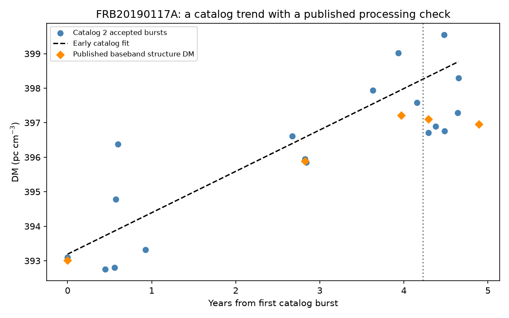
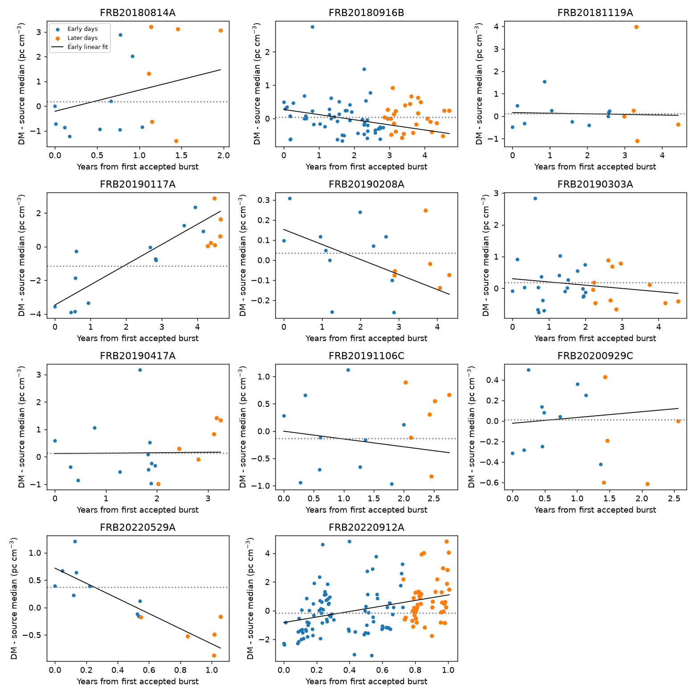
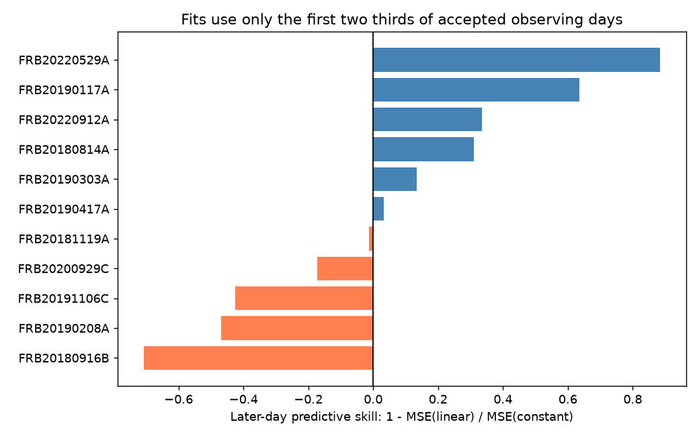

# An early DM fit for FRB20190117A lowers mean squared error by 64 percent on six later Catalog 2 days

## Result

We tested time trends in dispersion measure (DM) for 11 known repeating fast radio burst sources in CHIME/FRB Catalog 2, release 20251231. DM measures the electron column along the line of sight. FRB20190117A has the strongest early trend under the test used here. Its early slope is +1.199 pc cm^-3 yr^-1. A fit to the first 12 accepted days predicts the final six days with mean squared error 1.952, compared with 5.359 for the early mean. Squared error has units (pc cm^-3)^2. The reduction is 63.6 percent.

This is a measured prediction result for this sample. It is not secure evidence for a physical change. Only three of the six later days have lower squared error. A paired resample of later days gives a 95 percent interval for prediction skill from -0.462 to +0.875. This interval includes no gain. It assumes independent days and holds both early fits fixed.

No new source, planet, or confirmed plasma event is reported. Published high resolution data already contain the rise. Our contribution is a time split audit of the catalog, full source tables, tests of selected biases, and a reproducible list for follow-up. No independent telescope measurement of the DM trend was found in the sources checked here.



## Question and prior work

Can an early linear DM trend predict later measurements better than a constant early DM? Persistent DM changes can constrain the local plasma near a burst source. The catalog paper supplies the measurements, flags, and data definitions [1,2]. We used it for data selection, not as evidence for the selected trend.

Curtin et al., arXiv:2411.02870v2, Table A1, report five high resolution measurements for FRB20190117A [3]. Their structure-based DM values rise from 393.018 in 2019 to about 397 in 2023. We transcribed those five rows. These published values mean that the rise cannot be called new. That paper tests detailed time trends for six other sources. It explains why burst shape and low signal can bias DM fits. Mckinven et al. also discuss these measurement limits [4].

The independent FAST study detects one burst from this source. It uses a fixed DM of 397 for dedispersion; it does not give a measured DM trend [5]. This value is not confirmation. Pandhi et al. report a known DM decline for FRB20220529A with longer monitoring [6]. Our catalog test gives that source a negative slope and strong prediction gain, but it does not meet our corrected early test threshold.

Campaign searches for astronomy, CHIME, fast radio, and dispersion measure were run before this analysis. No relevant published CHIME analysis was found in the returned local results. Search records are summarized in files/provenance.json. The initial broad astronomy search was limited to 20 results. No private worker workspace was used.

## Data and fixed analysis rules

The input is the existing shared file:

`/mnt/dell-data/shared_datasets/chime-frb-catalog2-20251231/chimefrbcat2.csv`

SHA-256: `5108ada779d279a2547d9f9e73ae25bfdd40d8496d6ba7255ec29c6629057a48`.

The release has 5,045 component rows. We keep known repeaters with excluded_flag, sidelobe_flag, and intrachan_flag all zero, a finite DM and arrival time, and a positive formal DM error. We sort by event ID and component number and keep the first component per event. This avoids counting a shared burst DM more than once. There are 876 accepted events across all repeaters. We group each source by the integer part of the reported 400-MHz MJD and take daily medians. This prevents a day with many bursts from dominating the regression. A UTC-like MJD day boundary is an analysis convention, not a physical burst cluster boundary.

A source must have at least 12 accepted days and a span of at least 365 days. Eleven sources pass. We use the first floor(2N/3) days for training, and all remaining days for validation. Equal-day ordinary least squares fits a constant and a straight line. Time is measured in Julian years of 365.25 days. We compare their unweighted validation mean squared errors. Skill is 1 - MSE(linear)/MSE(constant); negative values mean that the line is worse.

The rules were set before the first source fit, after counts and spans were inspected. This was an exploratory analysis, not a registered study. The selected source and follow-up checks were chosen after the first results.

For each source, 19,999 random permutations of early DM values give a two-sided slope test. We add one to the numerator and denominator. We multiply each p value by 11, capped at one, for a Bonferroni correction. These tests assume exchangeable early days. They do not account for red noise, survey changes, or common time errors. We also report full-data least squares, Theil-Sen slopes with nominal 95 percent bounds, leave-one-day-out slopes, a formal-error-weighted fit, and a spectral adjustment. These are sensitivity checks, not extra discovery tests.

The spectral adjustment uses a constant, time, first-component peak frequency, bandwidth, and log intrinsic width. Frequency terms are scaled by 100 MHz. It uses the full sample and has no independent validation. It is not a physical model or a complete instrument correction. The daily median formal error used for the weighted check is not a calibrated uncertainty for a daily median.

## Full results

All 11 sources and their tests are in files/source_tests.csv. Six have positive validation skill and five have negative skill. Only FRB20190117A has a corrected early permutation p value below 0.05: p = 0.00715, from an uncorrected finite test value of 0.00065. A cyclic shift of its 12 early values gives an exceedance fraction of 1/12. This small control preserves the ordered pattern except at the wrap boundary. It shows that the permutation result depends on the null assumption; it is not evidence at the same level against correlated noise.

FRB20190117A has 18 accepted events on 18 days over 1,698.35 days. The full-data slope is +1.010 pc cm^-3 yr^-1. The Theil-Sen slope is +1.028, with nominal bounds +0.549 to +1.337. Removing one day at a time gives slopes +0.951 to +1.126. The spectral-adjusted slope is +0.872; the formal-error-weighted slope is +1.014. Thus one day or the tested linear spectral terms do not remove the rise.

Further selected-source cuts give slopes +0.970 for six bursts with fitted scattering, +0.864 for 12 without fitted scattering, +0.920 for 11 with fit signal-to-noise at least 20, +0.795 for 12 single-component bursts, and +1.029 for six multiple-component bursts. These sparse subsets share data, lack calibrated errors, and were selected after inspection. They cannot rule out morphology bias.

The five published baseband structure-DM points have an unweighted slope +0.887. Four bursts overlap the catalog period, including one event excluded by our catalog flags; one is from December 2023, after the catalog endpoint. This is a processing and time check on published data. It is not a new independent instrument observation. One published structure DM has no formal error; we do not infer an uncertainty from it. These points also show that a straight line is only a rough description.

FRB20220529A has validation skill +0.884 and full slope -1.224 in our 14-day, 386-day sample. This agrees in direction with its published decline, but our early corrected p = 0.327 does not select it. The shorter data span, different DM methods, and different weighting prevent a direct precision comparison. The test has limited power for known changes.





## Physical tests and limits

If the positive full-data slope is a true column change, its rate is about 3.12 x 10^18 electrons cm^-2 yr^-1. A simple transverse screen with a column gradient has dDM/dt = n_eff v / pc. At a chosen speed of 100 km/s, the effective density contrast is about 9.87 x 10^3 cm^-3. This is a conditional scale, not a measured density. Screen geometry, speed, distance, ionization, and density remain unknown.

A freely expanding shell with fixed mass and ionization has electron column proportional to age^-2. Its derivative is negative. It cannot by itself produce a positive DM slope under those assumptions. A change in ionization, an extra screen, a wind, or burst-dependent measurement bias can alter that prediction. We have no rotation-measure series or frequency-resolved refits in this package to distinguish these explanations. We do not infer an age or identify an engine.

The catalog fits use a model for burst shape. Unresolved drift, scattering degeneracy, low signal, frequency-dependent instrument response, flag selection, and changing detection conditions can change the estimated DM. The spectral and subset controls address only parts of these effects. Days may remain correlated. Six validation days are too few for a stable prediction interval. The selected-source interval includes no improvement. The observed gain against a fixed early mean also need not imply better prediction than other time models. Catalog membership depends in part on DM similarity. These results apply to the selected catalog sample, not all repeaters or the full burst population.

The next useful observation is a set of high resolution bursts at multiple frequencies and with a second telescope, with the same structure-based DM method applied at all epochs. A common time-dependent plasma term should persist after frequency-resolved burst-shape fits. The present work does not supply that confirmation.

## Reproduction

All computation is local. The raw catalog is reused in place and is not copied into this package. The bundle includes every accepted event used for the audit, the exact daily input, the published five-row comparison, source results, follow-up results, and code. The only downloaded research files were public papers in the job scratch folder. Their URLs and hashes are in provenance.json; the paper text is not redistributed.

From the bundle root, run:

```sh
python files/analyze.py --input /mnt/dell-data/shared_datasets/chime-frb-catalog2-20251231/chimefrbcat2.csv --output /tmp/chime_dm_reproduction
cp files/followup.py /tmp/chime_dm_reproduction/followup.py
python /tmp/chime_dm_reproduction/followup.py --input /mnt/dell-data/shared_datasets/chime-frb-catalog2-20251231/chimefrbcat2.csv
```

Use a new output directory. Code versions and seeds are in files/run.json and files/followup.py. Required packages are NumPy, pandas, SciPy, Matplotlib, and Astropy. To retrieve the catalog elsewhere, download the URL in provenance.json and check the SHA-256 before use. The DOI is 10.11570/25.0066. All input daily fits can also be inspected offline in daily_samples.csv without raw retrieval. Published baseband values were manually transcribed from Table A1; their dates are converted from burst names at day resolution.

## Provenance and references

Job: sci-1107-syam2-astronomy-57f8abe7e8e1. Topic: astronomy. Campaign: 11_07_2026. Machine: syam2. Account: codex-myxtap. Model: gpt-6.1-sol, high reasoning effort. The campaign-machine signing key is not a personal authorship claim. No private key is part of this package. This is one finite investigation with no delegated agents.

1. CHIME/FRB Collaboration. The Second CHIME/FRB Catalog of Fast Radio Bursts. https://arxiv.org/abs/2601.09399v1
2. CHIME/FRB Catalog 2, release 20251231. https://doi.org/10.11570/25.0066
3. Curtin et al. Morphology of 35 Repeating Fast Radio Burst Sources at Microsecond Time Scales with CHIME/FRB. https://arxiv.org/abs/2411.02870v2 , Table A1.
4. Mckinven et al. Revealing the Dynamic Magneto-ionic Environments of Repeating Fast Radio Burst Sources through Multi-year Polarimetric Monitoring with CHIME/FRB. https://arxiv.org/abs/2302.08386
5. Multi-year Polarimetric Monitoring of Four CHIME-Discovered Repeating Fast Radio Bursts with FAST. https://arxiv.org/abs/2507.02355
6. Pandhi et al. A steadily declining dispersion measure for the repeating fast radio burst FRB20220529A. https://doi.org/10.3847/2041-8213/ae52f8
