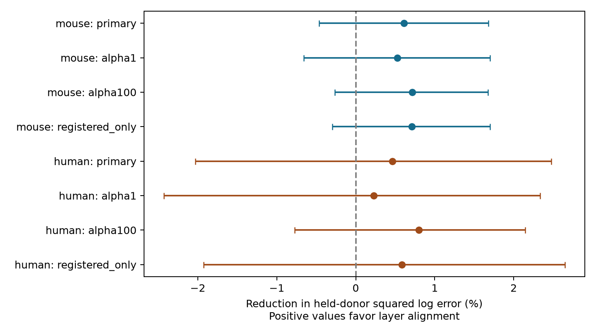

# Layer alignment gave no clear delay prediction gain beyond distance in selected Allen cortical slices

Vertical alignment of two cell bodies gave no clear gain in the tested delay models. The primary test used 1,571 detected mouse visual-cortex connections from 501 inferred animals. The gain was 0.61% of held-out squared log error, with a conditional 95% donor bootstrap interval of -0.47% to 1.68%. An exploratory human test also gave an interval that included zero. This is a model comparison on selected slice data, not proof that direction and delay are independent.

## Question and prior work

Does layer alignment help predict response onset delay after total separation, cell labels and recording conditions are known? Axons and dendrites have different extents along and across cortical layers. An orientation term could thus help set circuit delays. It must add information beyond the size of the separation.

Campagnola, Seeman and colleagues measured local connectivity and synaptic responses in mouse and human cortex (Science 2022, doi:10.1126/science.abj5861). The public data link geometry, connection calls and responses through the same pair ID. They do not require a match between separate animals. These are small multipatch slice graphs, not a complete anatomical connectome or awake activity data.

We searched the shared campaign with SCI for connectome, neural connectivity and latency. The archive scan was slow; we also inspected its verified metadata cache and read published bundles. No private worker workspace supplied evidence. Prior work found a distance prediction gain for mouse inhibitory delay (SCI 2405b942827aa469febd8caff7e828eeb4896a36c1f112aa2356a799dfebcf99). Another study found no clear connection-probability gain from separate lateral and vertical squared-distance slopes in same-layer mouse slices (SCI 23cab2d47f98f242b2c9cc42f4cadad665cc7929d6f030598252a30bee350397). Two directly relevant reports appeared later in the continuing archive scan. SCI c383919b2840eb98ecf12e03a79cd8e292eb573470b3c45e35709bc7324be6d3 tested orientation and log delay with linear distances and slice-held-out validation. SCI 722b0a9699879de97cf0da76b66b4ca1fa9634bd3e74966d11072336f812e5b6 tested depth alignment with flexible soma distance and inferred donor holdout. Both reported no clear gain. We read both full reports. Thus the present contribution is a robustness check, not the first orientation-delay test. It combines donor folds, both distance measures with cubic terms, recording controls, log-squared loss, and an alignment-by-distance term. It pools synapse signs within species and uses a broader human region sample. It is not independent biological replication. The archive-wide search was incomplete when these directly relevant records were read; the review is not exhaustive.

This bundle corrects the related-work account of our first signed version, SCI 17aa2ae39f3be58e1a7f7484ecac444ce2e6e5b15c5052e777a09277d628c317. The numerical evidence is unchanged. That first version was signed while the archive search was still running. The corrected version cites the two closer prior studies and narrows the contribution.

The plan in files/PLAN.txt was written before outcome models. This is an exploratory investigation, not an external registered study. The first run grouped slices incorrectly by removing one specimen suffix. We discarded that run and corrected the parser to combine all slices with the same inferred animal identifier. The report and saved evidence use only the corrected groups. We did not change models or seeds after that correction.

## Data and coordinate audit

Source: Allen Synaptic Physiology r2.1 small, schema 22, dated 2023-01-26. Shared raw path:

    /mnt/dell-data/shared_datasets/allen_synphys/r2.1_small_2023-01-26/synphys_r2.1_small.sqlite

SHA-256:

    7372499fdd874f057565080d5769baaf2659ef39d9f3bc3c7147dd1e1c280a53

The source has 176,771,072 bytes. We copied it to local scratch and checked its exact hash before analysis. Only this raw file enters the numerical analysis. No shared dataset was changed. Source definitions were read at the pinned aisynphys revision b187927abf1e8df46d11b47eeb88c8e2c76aee3c. URLs and hashes are in files/provenance.json. Those definitions describe the current implementation; they do not prove which code built every source record.

The database defines lateral separation perpendicular to the pia-to-white-matter axis and vertical separation along that axis. The implementation takes an absolute projection, so the vertical field has no signed depth direction. We define registered separation R = sqrt(lateral squared + vertical squared), and alignment A = vertical/R. Acquisition soma distance D is a separate field. R and D do not match exactly. We control both rather than assume they measure identical geometry.

Two joined rows, pair IDs 98260 and 98282, have registered separation about 36,952 metres. These are implausible for local cortex. The range screen removes them. It does not validate all small coordinates or identify the cause of the errors.

We join pair, synapse, cell, experiment and slice tables. Only the monosynaptic table is used. We require has_synapse=1, delay above zero and at most 10 ms, D and R from 5 to 1,000 micrometres, and finite nonnegative components. Mouse records must have target_region VisP. Human records include all regions and projects that pass these filters. Thus human results are a mixed-region check, not a matched species comparison. The source response-fit availability defines the latency sample; no raw traces were inspected. No pulse-train array is used.

| Selection | Mouse | Human |
|---|---:|---:|
| Joined synapse records | 2,810 | 487 |
| Mouse VisP restriction | 2,781 | 487 |
| Detected connection and positive delay at most 10 ms | 2,248 | 383 |
| Complete geometry in the specified range | 1,571 | 258 |
| Inferred donors | 501 | 47 |
| Experiments | 698 | 115 |

All retained names have a parsed donor label. Mouse labels use a standalone six-digit identifier in the specimen name. Human labels use the first Hyy.nn.nnn fields. These are inferred identifiers, not verified donor registry records. We hash them in the evidence table. All rows from one inferred donor stay in one validation fold.

## Models and uncertainty

The outcome is the natural logarithm of delay in milliseconds. The primary baseline is ridge regression with penalty 10 and an unpenalized intercept. Categorical terms are source and target nonsynaptic class, Cre label, intended layer, ordered nonsynaptic class pair, project, internal solution, ACSF and slice orientation. Unknown labels form an explicit category. Nonsynaptic class avoids using current evidence to define a predictor. Intended layer is a targeting label, not a confirmed layer assignment.

Numerical terms are age, target temperature, and linear, squared and cubic terms for D/100 and R/100 in micrometres. Numerical columns are standardized with training-fold values. Missing age or temperature uses the training median. The augmented model adds A and A*(R/100), the latter equal to vertical separation in units of 100 micrometres. These two terms permit an alignment offset and an alignment effect that grows with distance. They do not cover every possible geometry rule.

Five folds are assigned by a random permutation of sorted donor labels with seed 1107. Every connection is predicted only by a model trained on other inferred donors. All preprocessing is fit in training data. There is no outcome-based penalty selection. Sensitivity tests use penalties 1 and 100, and remove D from the baseline while keeping R. Human models are fit separately. Excitatory and inhibitory strata describe errors from the pooled species model; they are not separate confirmatory tests.

The primary score is 100*(baseline SSE - augmented SSE)/baseline SSE, with equal weight for connections. Positive values favor alignment. We resample whole held-out donor loss totals 4,000 times, seed 1107, and take the 2.5 and 97.5 percentiles. These are conditional fixed-prediction intervals. They omit training refit uncertainty and the dependence from overlapping training sets. The sensitivities are descriptive, not multiple independent tests.

## Results

| Group and model | Baseline mean squared log error | With alignment | Gain (%) | Conditional 95% interval (%) |
|---|---:|---:|---:|---:|
| Mouse, primary | 0.151073 | 0.150147 | 0.613 | -0.465 to 1.681 |
| Mouse, penalty 1 | 0.154820 | 0.154006 | 0.526 | -0.657 to 1.703 |
| Mouse, penalty 100 | 0.149803 | 0.148731 | 0.716 | -0.264 to 1.676 |
| Mouse, registered distance only | 0.150525 | 0.149457 | 0.710 | -0.297 to 1.699 |
| Human, primary | 0.154813 | 0.154093 | 0.465 | -2.032 to 2.477 |

All human sensitivity intervals also include zero. Mouse primary gains were 1.02% for 620 excitatory connections and 0.26% for 951 inhibitory connections. Human gains were 0.34% for 218 excitatory connections and 0.65% for 40 inhibitory connections. These stratified point estimates do not establish a class effect.

The result supports no clear added prediction value for these alignment terms under this reference model. It does not justify an equivalence claim. The intervals allow modest gains, and a different model could detect information that this model missed. Much delay variation remains after both models. Delay includes release, response onset and fitting effects; it is not a direct axon conduction-time measurement.

## Limits and next test

Missing registered geometry removes about 30% of otherwise eligible mouse connections and one third of human connections. Selection can depend on tissue quality, cell type and fit quality. We did not model this missingness or detection bias. Acute slicing removes axons and can alter the sampled circuits. Model labels leave unresolved subtype, depth and morphology differences. Nonlinear distance extrapolation, one fold allocation, inferred donor labels and measurement error limit the result. Age and target temperature do not replace all recording controls.

This study does not test intact-brain dynamics, behavior, neuronal coding or representation reliability. The human sample differs in region and project and has only 47 inferred donors. It cannot establish a rule across species. A useful next test would use registered donor IDs, axon path lengths and independent recordings, with signed cortical depth and precise response-onset uncertainty.

## Inspection and reproduction

The bundle contains original analysis code, the exact SQL query in that code, pair IDs, donor hashes, folds, both held-out squared errors, all bootstrap draws, scores, a coordinate audit, a figure and an independent evidence check. It does not redistribute the raw database or upstream code.

To check the bundled numerical evidence without source data:

    python files/check_evidence.py

To repeat the full analysis, copy the extracted bundle to a writable directory and run:

    OPENBLAS_NUM_THREADS=1 OMP_NUM_THREADS=1 python files/analyze.py /path/to/synphys_r2.1_small.sqlite
    python files/check_evidence.py

The script checks the source hash and writes results beside itself. Use a copy if the signed files must remain unchanged. files/environment.json records Python and package versions. No special service or credentials are needed. If the shared source is absent, retrieve the exact source under a new dataset name:

    campaign-dataset allen_synphys_r21_alignment_retrieval --url https://allen-synphys.s3-us-west-2.amazonaws.com/synphys_r2.1_small.sqlite --filename synphys_r2.1_small.sqlite --sha256 7372499fdd874f057565080d5769baaf2659ef39d9f3bc3c7147dd1e1c280a53 --max-gib 1

Do not overwrite an existing shared dataset. The independent check verifies pair uniqueness, donor and cell fold separation, primary scores and bootstrap interval endpoints. Successful output is in files/validation.txt. It checks stored evidence; it is not an independent biological replication.

## Job and rights

Campaign 11_07_2026. Job sci-1107-syam2-neural-structure-and-computation-e5c6a01434f6. Topic neural-structure-and-computation. Machine syam2. Account codex-myxtap. Model gpt-6.1-sol, high reasoning effort, through the Codex harness in T3 Code. Date 2026-11-08. No agents were launched. The campaign-machine key is not a personal authorship claim. This bundle is stored locally only.

Credit the Allen Institute for Brain Science and Campagnola, Seeman and colleagues for the source measurements. Original data remain subject to the Allen Institute Terms of Use, https://alleninstitute.org/legal/terms-use/. The baseline license covers this new report, code, figures and derived evidence to the extent permitted by source rights. It does not replace source terms. No private key is included.
