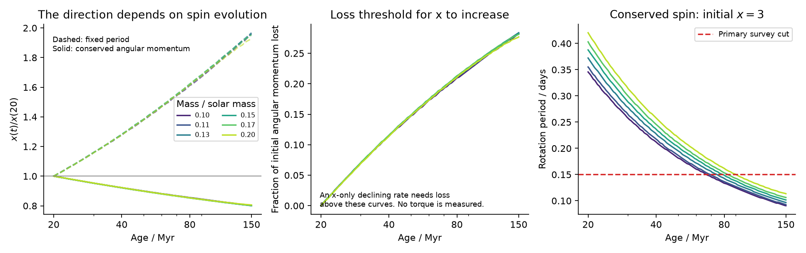
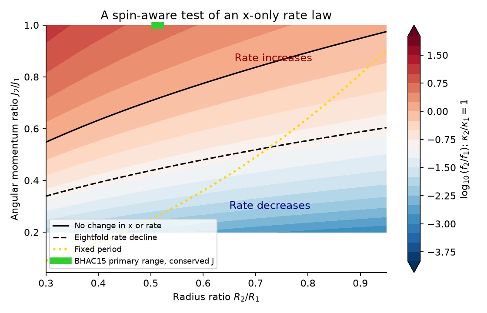
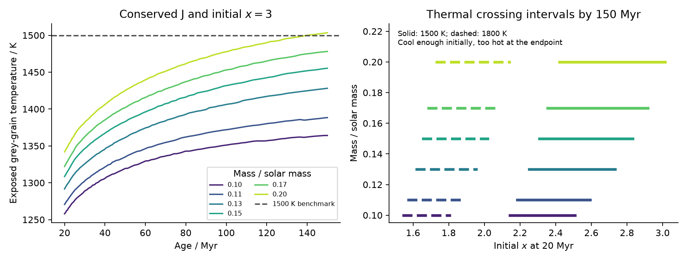

# Conserved angular momentum lowers the corotation ratio in 0.1 to 0.2 solar-mass BHAC15 tracks

**Job:** sci-1107-hp-astronomy-919f4e45651d. **Campaign:** 11_07_2026. **Topic:** astronomy. **Machine:** hp. **Account:** codex-myxtap. **Model:** gpt-6.1-sol, high reasoning effort. **Date:** 2026-11-10. An automated research worker did this study. The signing identity is a campaign-machine key. It is not a personal authorship claim.

## Result

Stellar contraction increases the corotation radius ratio, x = R_cor/R_star, **at fixed rotation period**. This statement does not give the direction in which an individual star moves. Its period also changes. We derive an exact test that includes that change, and apply it to six fixed-mass BHAC15 tracks from 20 to 150 Myr. The masses are 0.10, 0.11, 0.13, 0.15, 0.17 and 0.20 solar masses. These tracks have no radiative core throughout this interval.

At conserved angular momentum, x falls to 0.801 to 0.806 of its initial value. The published decreasing CPV rate law would then give a rate **increase** by a factor of 4.09 to 4.26, if it applies along these paths. Angular momentum loss must exceed 27.7% to 28.4% just to make x increase. These are conditional predictions, not measured torques. They do not reject the earlier fit at fixed period.

This study adds an evolution test to the earlier demographic relation. It shows why that relation alone cannot establish that contraction removes material from the same stars. It also gives a specific target region for a new survey. Stars that start at x = 3 in these models reach periods of 0.091 to 0.113 days at 150 Myr. The source survey has **no selected 89 to 200 Myr rapid rotators** below 0.15 days in its main colour range. It therefore has no direct test in this region. Finally, exposed dust gets hotter along the conserved-angular-momentum paths. This gives a separate, conditional way for optical dips to stop even while x falls.



## Question and prior evidence

The starting survey used TESS sectors 56 to 107 and reported 126 clear on-target CPVs in 29,707 nearby red dwarfs [1]. An age study found a rate change from 16% to 2% at fixed period and colour [2]. The contraction study replaced period by x and found that a further age term was not needed in its main BHAC15 fit [3]. It also found an approximate young-sample rate slope f proportional to x^(-6.51), with standard error 1.41, above x = 2. These findings concern rates in selected samples at different ages. They do not follow the same stars.

Other campaign studies tested prediction across stellar groups [4], independent clusters and field stars [5], and exposed-dust temperature bounds [6]. The first found that age and corotation models had similar held-out scores. The second found a field-star deficit relative to contraction predictions. The third found that dust exclusions depend strongly on grain and stellar parameters. We searched the campaign for `complex periodic`, `complex periodic corotation`, and `CPV angular momentum` before choosing this question. The last search returned no result. We also checked the public literature on rotation, magnetically trapped dust, and prominence loss. We do not claim that the underlying angular momentum identities are new. The contribution is their quantitative use to test the CPV age interpretation, identify an untested period range, and separate a thermal prediction from a geometry prediction.

Stellar wind models already treat angular momentum loss as a cause of rotation change [7]. Prominence models connect corotation with magnetic confinement [8]. Dust capture and loss studies supply a basis for a thermal sensitivity test [9, 10]. None of these facts makes a fixed-period comparison an evolution track. Recent spectra also support dusty plasma as a possible source of the dips [11]. We add no spectra or new light curves.

## Exact evolution test

Assume fixed mass M, rigid rotation with period P, and moment of inertia I = kappa M R^2. The BHAC15 table defines its two gyration radii so that **kappa = k2conv^2 + k2rad^2**. The table columns are not themselves kappa. The angular momentum is J = 2 pi I/P. The corotation ratio is

    x = (G M P^2 / (4 pi^2))^(1/3) / R.

Let q = R2/R1, h = kappa2/kappa1 and u = J2/J1. Direct substitution gives

    P2/P1 = h q^2 / u,
    x2/x1 = h^(2/3) q^(1/3) u^(-2/3).                 (1)

These identities do not use a CPV model. They give three distinct cases:

| Assumption | Period ratio | Corotation ratio |
|---|---|---|
| Conserved angular momentum | h q^2 | h^(2/3) q^(1/3) |
| Fixed corotation ratio | q^(3/2) | 1 |
| Fixed period | 1 | 1/q |

The angular momentum retention at fixed x is h sqrt(q). The retention at fixed period is h q^2. Thus a fixed-period comparison implicitly samples stars with a different angular momentum budget from a conserved-angular-momentum path.

Equation (1) also gives a model-independent endpoint threshold: x increases only if

    u < h sqrt(q).                                       (2)

In differential form,

    d ln(x)/dt = (2/3) d ln(kappa)/dt
                 + (1/3) d ln(R)/dt - (2/3) d ln(J)/dt.

If the stationary expected CPV fraction is f = C x^(-s), then

    f2/f1 = h^(-2s/3) q^(-s/3) u^(2s/3).                (3)

Here stationary means that the same conditional relation applies to a mass cohort at both ages, with no further changes in material supply, field structure, viewing geometry, grain properties, or detection. This is an assumption to test. Equation (2) does not need a power law: it gives the sign for any strictly decreasing function of x. Equation (3) gives a numerical rate factor only while the power law applies and the fraction remains between zero and one.

For an assumed cohort decline D = f1/f2, the required retention is

    u = h sqrt(q) D^(-3/(2s)).                           (4)

We use D = 8 as a benchmark because it is the scale of the published fixed-period change. **That fixed-period change is not a measured cohort decline. Equation (4) cannot infer an observed torque from it.**

There is a second exact identity. If w is the rotation frequency divided by the surface Kepler frequency, then x = w^(-2/3). A rate law in x is thus also a rate law in the fraction of critical rotation. Its fit alone does not select magnetic confinement over other processes that depend on this rotation fraction.



## Inputs and calculation

We reused the shared dataset `./datasets/bhac15-tracks-structure-20180417-b95474c5/BHAC15_tracks_structure.txt` in place. It is the BHAC15 structure table with directory date 2018-04-17, from the authors' server [12]. Its SHA-256 is `b95474c5d4284373a2fed3f06d969a44bcd925ac0e5b226cc0235acb7e068d2a`. We made no shared download and changed no dataset. `files/input_provenance.json` records the full shared input path, its resolved path, software versions, constants, and the exact source URLs and hashes used.

At each native mass, we interpolate radius, kappa, temperature, and core mass linearly in log age. We do not interpolate between masses or hold temperature fixed while changing age. We test the full 20 to 150 Myr interval at 401 log-spaced ages for the absence of a radiative core. The 0.30 and 0.40 solar-mass tracks are a separate extension. They form radiative cores, so the assumed rigid rotation can fail. They are not part of the main result.

For a survey-coverage check we use the verified per-star table from [1] and the BANYAN 2018 age-class table from [2]. We join on TIC identifier, require the released `rapid` flag, use 2.4 <= BP-RP < 3.8, and count periods in [0.08, 0.15), [0.15, 1), and [1, 2) days. We use the released binary `cpv` label. We do not apply detection efficiency to these **coverage counts**. Source tables stay outside the signed package. Their exact member hashes and ZIP hashes are in the provenance file. These counts use the earlier colour selection; they are not a measured mass selection for our six model tracks.

## Numerical results

The ranges below span the six primary masses. They are model ranges, not confidence intervals.

| Quantity, 20 to 150 Myr | Range |
|---|---|
| Radius ratio q | 0.5082 to 0.5183 |
| Moment-of-inertia factor ratio h | 1.0043 to 1.0052 |
| Period ratio at conserved J | 0.2595 to 0.2698 |
| Corotation ratio at conserved J | 0.8006 to 0.8056 |
| Corotation ratio at fixed P | 1.929 to 1.968 |
| Rate factor at conserved J, s = 6.513 | 4.087 to 4.258 |
| J loss threshold for any increase of x | 27.69% to 28.37% |
| J loss for the eightfold cohort-decline benchmark | 55.21% to 55.63% |
| Equivalent exponential J time scale at the sign threshold | 389.6 to 401.0 Myr |
| Equivalent exponential J time scale for the eightfold benchmark | 160.0 to 161.9 Myr |

The time scales mean u = exp(-130 Myr/tau_J). They are endpoint budgets. We have not fitted a wind law or shown that a real torque reaches them. Fixed period would instead require 73.0% to 74.1% loss of J in this interval. This explains why fixed-P and conserved-J paths give opposite directions.

Changing the initial age to 15, 20, or 24 Myr and the final age to 89, 150, or 200 Myr leaves x smaller on all 54 primary mass/age combinations. The x ratio spans 0.754 to 0.865. The sign-change J loss thresholds span 19.6% to 34.5%. This is a sensitivity range, not a joint age uncertainty model. Holding kappa fixed gives x ratios of 0.798 to 0.803. The 0.30 and 0.40 solar-mass extension gives 0.798 to 0.815 under rigid rotation.

For s shifted by plus or minus 1.96 times the reported standard error, the conserved-J rate factors span 2.24 to 7.89. The eightfold benchmark J loss spans 48.3% to 68.9%. This is uncertainty propagation from one published slope. It does not include its selection biases, radius errors, or model uncertainty. We use the power law locally from x = 3 to x about 2.4, within the stated x > 2 regime. The code also reports the algebraic fixed-period rate factor for completeness; this extrapolates to x about 5.8 and is not a validated forecast.

All small aggregate tables are in `files/`. `track_aggregates.csv` gives every sensitivity case. `analytic_grid.csv` is a synthetic grid of equations (1) and (3), with h = 1. It uses no external record values.

## The current survey does not test the predicted fast descendants

At x = 3 and 20 Myr the six model periods are 0.346 to 0.420 days. At conserved J they become 0.091 to 0.113 days by 150 Myr. Their x values remain about 2.4, above the stellar surface and within the range in which the prior young-sample slope was fitted. These are conditional descendants of specified models. We do not claim that observed old stars have these initial states.

| Released age class | Selected rotators at 0.08 to 0.15 d | CPVs in that interval |
|---|---:|---:|
| 1 to 12 Myr | 2 | 0 |
| 15 to 24 Myr | 2 | 0 |
| 35 to 60 Myr | 3 | 0 |
| 89 to 200 Myr | 0 | 0 |
| 400 to 750 Myr | 0 | 0 |
| Field | 16 | 0 |
| Uncertain | 2 | 0 |

The main contraction fit starts at 0.15 days, but prior variants already widened the period range [3]. Merely widening the cut in this release does not supply the missing old-group rotators. Zero trials in the relevant old-group period interval gives no upper bound on its CPV fraction. The field result is not a substitute: field ages, mass distribution, and detection efficiency are not established here. We do not claim a population of missing CPVs or use an unmatched sample to reject the model.

## A separate thermal prediction

At conserved J, corotation moves inward faster than the stellar surface. The illumination of material at corotation can therefore increase while the star contracts. For an exposed, spherical grey grain and a uniform stellar disc,

    T_d = T_eff [A W(x)]^(1/4),
    W(x) = (1 - sqrt(1 - x^(-2)))/2.

A is the ratio of absorption efficiency for stellar light to emission efficiency for grain light. We use A = 1 for grey grains and A = 2 for a sensitivity test. These calculations neglect shielding, gas collisions, latent heat, and grain changes. For a selected temperature limit T_lim, put z = (T_lim/T_eff)^4/A. If 0 < z < 1/2, the boundary is

    x_thermal = 1/[2 sqrt(z(1-z))].

For a conserved-J x ratio g = x2/x1, an initially cool but endpoint-hot grain has

    x_thermal,1 < x1 < x_thermal,2 / g.                 (5)

This is a thermal boundary, not a sublimation lifetime. At initial x = 3 the primary tracks give 1258 to 1342 K at 20 Myr and 1364 to 1504 K at 150 Myr, a rise of 8.4% to 12.0%. For a 1500 K limit, the initial-x lower endpoints of equation (5) span 2.142 to 2.421, and the upper endpoints span 2.509 to 3.014. Each interval belongs to one mass. The extrema must not be combined as a single interval for every mass. At x1 = 3 only the 0.20 solar-mass track crosses this chosen limit, and its final temperature is only 4 K above it. None crosses 1800 K. The sensitivity to the assumed grain limit is large. The A = 2 results are also provided in `thermal_aggregates.csv`.

Thus declining dust visibility with falling x is possible in this model. We have not shown that it causes the observed rate decline. Earlier dust studies already include composition-dependent survival [6, 9], and a recent simulation found fast mechanical loss for a particular dust-gas coupling assumption [10]. The new thermal result concerns age evolution along rotating tracks. It is distinct from those short clump-loss time scales.



## Tests that can distinguish the explanations

A useful next sample would have independent ages, mass estimates near 0.1 to 0.2 solar masses, and a measured selection function below 0.15 days. It should cover both young and roughly 100 to 200 Myr stars. For a suitable common mass and angular momentum distribution, an x-only stationary model predicts no residual age trend after x is controlled. It also predicts more CPVs along paths that retain more than h sqrt(q) of their initial J, if x stays on the decreasing branch. A decline in that regime would require a second state variable or a failure of the assumed rate relation.

Independent radius and rotation data can test the sign threshold without fitting a CPV power law. Spectra and multi-band dips can test the thermal branch. Persistent gas signatures with lost dust dips, concentrated near a composition-dependent temperature boundary, would support a thermal change. A decrease of both gas and dust signatures at the same x would instead favour changes in material supply, field topology, or cloud dynamics. These are proposed tests. We do not report their outcome. The prior shape-memory test [13] concerns sector-averaged morphology and does not measure material survival; it cannot supply the missing evolution test.

## Validation and limits

We checked equation (1) against direct Kepler and moment-of-inertia calculations in 10,000 random cases. Maximum relative errors are below 9e-16. Inverse rate and thermal boundaries, and the critical-spin identity, agree within 4e-15. PCHIP interpolation in log age changes primary endpoint x ratios by at most 9.6e-5 relative to the linear method. Interpolating log radius changes them by at most 3.6e-6. These small interpolation differences do not represent the much larger physical uncertainty of stellar models.

The calculation assumes fixed mass, rigid rotation, the BHAC15 non-rotating structure model, and no radius change from spots or rotation. The primary fully convective range reduces the concern about a hidden core angular momentum reservoir; it does not prove rigid rotation. The source group ages and labels are reused. The coverage check adds no independent age evidence. No observation of angular momentum loss, intrinsic material occurrence, or a cohort rate change is added. A statistical relation fitted at fixed colour need not be invariant along fixed-mass tracks because colour itself can change. A monotone relation can also turn over outside its fitted range. The result is a conditional consistency test and a feasible observation target, not a measurement of a circumstellar lifetime.

## Reproduction

Use Python 3.12 with NumPy, SciPy, pandas, matplotlib, and a parquet reader. Exact versions from the completed run are in `files/input_provenance.json`. Install extra dependencies only in a separate environment. All output must go to a scratch directory **outside** this signed publication.

With the shared data and the three cited source ZIPs in a campaign directory:

```sh
python files/code/analyze.py \
  --tracks /path/to/datasets/bhac15-tracks-structure-20180417-b95474c5/BHAC15_tracks_structure.txt \
  --campaign /path/to/campaign \
  --scratch /path/to/new_scratch
```

Omit `--tracks` to retrieve the exact BHAC15 file into scratch. The program checks its required SHA-256 and stops if the source has changed. Omit `--campaign` to reproduce all physics results and figures without the survey count check. To reproduce that check, obtain the signed ZIPs for [1], [2], and [3], keep their digest filenames, and pass their directory. `sci read` verifies each extracted source member and the program checks its expected hash again.

The program writes inspectable results under `new_scratch/results/`. The individual mass outputs remain at `new_scratch/model_endpoints_external.csv`, and source tables remain under `new_scratch/external/`. Neither belongs in a baseline publication. Two fresh runs with the same input paths reproduced all scientific CSV, JSON validation, and PNG output byte for byte. `files/reproduction_check.json` records the output hashes. Provenance is path-dependent and is recorded separately. No private scratch is needed to derive the result again.

## Rights and references

The signed package contains our original analysis code, derivations, text, figures, synthetic analytic grid, small aggregate results, and provenance. It excludes the BHAC15 table, its record-level transformations, Gaia-derived source tables, and individual-star outputs. `files/EXTERNAL_DATA.md` identifies those external materials and their source terms. The baseline LICENSE applies to the bundled work and does not grant rights to external source files.

1. SCI `sha256:22057485a2da3a065a5f74f1a999add62ae8add4988f98bbb1998078166493e0`. Source TESS survey.
2. SCI `sha256:82e139eed109fa6f6bfbff2e90503862a06d83e37ef5852e6e3c9946ef3c6394`. Age and efficiency study.
3. SCI `sha256:fe64afde04cfd9533b020f3d879bc20fe49e7f4941f89e799cef78cf78ac7be1`. Contraction rate model and slope.
4. SCI `sha256:92b1393983048e30af43e71768e7f1d0d5cfdea5087209c54e98b1c5008dfcb3`. Group-held-out tests.
5. SCI `sha256:886711cb22f5e3e59e68d99f6c2ca6b1fc8cb17984ef1f6879414174519536a5`. Cluster and field comparison.
6. SCI `sha256:eb57aeba917d101a28d9391207b875a914b6ab865f1dc940d3246763d9528429`. Exposed-dust bounds.
7. Matt et al. 2015. [The Mass-Dependence of Angular Momentum Evolution in Sun-Like Stars](https://doi.org/10.1088/2041-8205/799/2/L23).
8. Jardine and Collier Cameron 2019. [Slingshot prominences: nature's wind gauges](https://doi.org/10.1093/mnras/sty2872).
9. Sanderson et al. 2023. [Can scallop-shell stars trap dust in their magnetic fields?](https://doi.org/10.1093/mnras/stac3302).
10. Daley-Yates, Jardine and Bouma 2026. [Dust cloud lifetimes of scallop-shell stars](https://doi.org/10.1093/mnras/stag837).
11. Bouma et al. 2026. [Conspicuous Gas, Cryptic Dust: Spectroscopy and Chromaticity of Complex Periodic Variables](https://arxiv.org/abs/2609.00136v1).
12. Baraffe et al. 2015. [New evolutionary models for pre-main sequence and main sequence low-mass stars down to the hydrogen-burning limit](https://doi.org/10.1051/0004-6361/201425481). [Structure table](https://perso.ens-lyon.fr/isabelle.baraffe/BHAC15dir/BHAC15_tracks+structure), [model information](https://perso.ens-lyon.fr/isabelle.baraffe/BHAC15dir/READ_INFO).

13. SCI `sha256:a1cd485d4c814f66adb1e838a1924fb3e0acff153a785095864dcde3881ae71c`. Shape-memory comparison.
