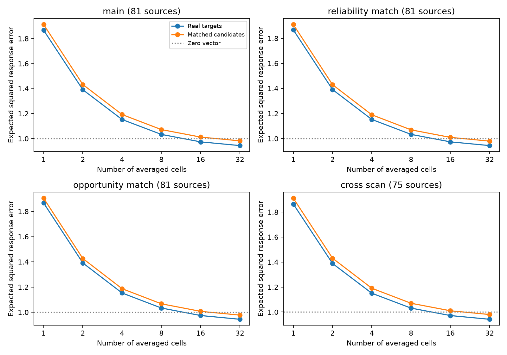
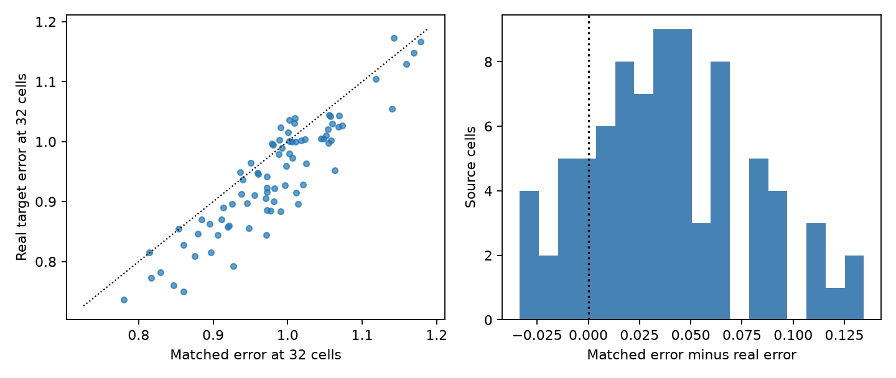

# Target response averages had lower reconstruction error than matched cells in 81 selected MICrONS axons

We tested whether the mean movie response of connected targets reconstructs the measured response of their source cell. We used public MICrONS v1 wiring and 120-entry movie response vectors from one mouse. We centered each vector and set its length to one. An exact sampling formula gave the mean squared error for subsets of 1 to 32 targets. The primary sample had 81 source cells with at least 32 targets. At 32 targets, real error was 0.94418, and matched candidate error was 0.98214. The gain was 0.03796, with a descriptive 95 percent source bootstrap interval of 0.02952 to 0.04669. The zero-vector error was 1. We matched area, layer, soma distance and imaging scan, then tested added response reliability and contact opportunity controls. The method separates source alignment from target redundancy. Shared targets, one animal, coarse matching, selected axons and measurement error limit inference. This test does not measure trial noise or causal recovery after cell loss. Code, reduced inputs, source hashes, exact error terms and null draws support reproduction.



## Question and prior work

Ding et al. (2025; doi:10.1038/s41586-025-08840-3) found pairwise and target-cohort response similarity in MICrONS. Campaign study sci:sha256:3e5fef923a07bb94d498dc9eb6b0af96089dd32ec2149a31a20966cb3e71b937 tested extra target-cohort information in connection models. Study sci:sha256:3f421179a43c393dc713cd33133e8e34e31dbc6459112398b0c663ec77c2e8fb tested cleft weights and response redundancy. Our question is different: does an anatomical target mean give a useful estimate of the source response, and how does target redundancy affect that estimate as more cells are used? We do not claim a new wiring rule. The exact finite-set formula is standard sampling algebra. Its use here gives an auditable structure and function benchmark.

## Data and scope

We reused the two public v1 tables of Ding et al. from the existing shared datasets. Each node has a 120-entry in_vivo_mean_resp vector. These are released movie response summaries. They are not independent trials. We subtracted each vector's mean and divided by its Euclidean length. No response was missing or had zero length. All 295,371 candidate pairs had positive axon_len and dend_len and a Connected or ADP label. We used n_synapses > 0 to define targets. Each ordered candidate pair occurred once.

The primary cohort had 81 source cells with at least 32 targets, 7226 target links, and 32 to 281 targets per source. This is a selected high-target-count cohort. The 148 source cells in the full candidate table are not all in the primary cohort. All source cells and target cells are from one mouse. We use each source once in the mean score. Shared targets still cause dependence.

## Method and proof

Let u be the unit source response, x_i the unit target responses, m the number of targets, and c their full mean. Let A = u dot c and C = c dot c. Draw k distinct targets with equal subset probabilities. Let their mean be c_k. The error is the squared length of u - c_k. Then

E_k = 1 + C - 2 A + (1/k - 1/m) m(1-C)/(m-1).

To prove the formula, E[c_k] = c and the trace of Var(c_k) is (1/k - 1/m) times the unbiased finite-set variance trace. That trace is m(1-C)/(m-1), since each target has squared length one. Expanding the squared error gives the formula. An equivalent expression is 1 + 1/k + (k-1)/k times the mean dot product of two distinct targets, minus twice the mean source-target dot product. This exposes the tradeoff: source alignment lowers error, while redundant targets raise the residual floor. At k=1, only mean source-target alignment matters.

The target mean has no fitted scale, intercept or shrinkage. Its norm is not forced to one. The zero vector is a valid comparator with error 1. The experiment withholds the source vector from the estimator, but uses the full released target vectors. It does not withhold movie entries or test new stimuli. For k=1,2,4,8,16,32, we integrate over all target subsets by the formula rather than sample them.

For each source, we divided all candidate cells into strata of brain_area, layer, same imaging scan as the source, and source-candidate soma-distance quintile. Missing area or layer labels form their own text group. Soma distance uses the three released nucleus coordinates. A scan is the tuple animal_id, scan_session, scan_idx. Each null draw retains the real target count in every stratum. It samples without replacement within each stratum from all candidates, including true targets. The same cell cannot occur twice within a source draw. The null does not hold target in-degree fixed across sources.

We made 999 independent draws for each source. A null cohort combines one draw per source. Conditional p is (1 + count of null cohort errors at most the real error)/1000. This is a conditional exchangeability test of the stated stratified null. It is not a test across mice. The gain is the null mean minus real error. We made 5000 source bootstrap samples with replacement for descriptive percentile intervals. They condition on the measured target panel and do not correct shared-target dependence. Seed: 681107. The primary comparison was k=32; other subset sizes show the curve and are not separate confirmatory tests.

We also added candidate cc_max_cvt reliability quartiles to the strata. A contact-opportunity check instead added axon_len and dend_len tertiles. A cross-scan check excluded same-scan candidates before making the strata and selected a new cohort with at least 32 remaining targets. These are sensitivity checks. The opportunity check was added before reconstruction scores were read. See files/PLAN.md.

## Results

| Control | Sources | Real error | Matched error | Gain | 95% source interval | Conditional p |
|---|---:|---:|---:|---:|---|---:|
| main | 81 | 0.94418 | 0.98214 | 0.03796 | 0.02952 to 0.04669 | 0.001 |
| reliability_match | 81 | 0.94418 | 0.97967 | 0.03549 | 0.02763 to 0.04354 | 0.001 |
| opportunity_match | 81 | 0.94418 | 0.97719 | 0.03301 | 0.02471 to 0.04136 | 0.001 |
| cross_scan | 75 | 0.94208 | 0.98017 | 0.03809 | 0.02969 to 0.04705 | 0.001 |


At one target, real mean error was 1.86744 and matched mean error was 1.91314. The gain was 0.04570. At 32 targets, the gain was 0.03796, or 3.86% of matched error. Real error was lower than matched mean error for 68 of 81 sources.

Mean source alignment was higher by 0.022849. Mean squared target-mean length was higher by 0.007881. The latter is a redundancy cost in the error formula. The gain at 32 targets was about 17 percent smaller than the gain at one target. Thus target redundancy reduced, but did not remove, the source alignment advantage in this score. The added reliability, contact opportunity and cross-scan checks each retained a positive gain. The full real target mean had mean error 0.92861. The 95 percent descriptive source interval for real error at 32 was 0.92413 to 0.96502. Compare these values with the fixed zero-vector error of 1.

The mean share of target positions in strata with at least one alternative selection was cross_scan: 99.9%; main: 99.8%; opportunity_match: 97.6%; reliability_match: 98.7%. All sources remain in a matched check even if some strata are fixed. Finer matching can weaken the contrast as well as improve control.



## Meaning and limits

The result measures response reconstruction from anatomical target cohorts in the released panel. It does not prove synaptic transmission of the reconstructed response. Source alignment and target redundancy both enter the score. A decreasing error curve with k is a mathematical property of averaging; the comparison with matched cells supplies the structural test.

The one mouse does not support generalization across animals, conditions, regions or species. We did not test such transfer. Cells were selected for recording, registration and axon reconstruction. The cohort threshold favors sources with many recovered targets. Coarse geometry, area and layer strata cannot remove all cell-type, retinotopic or anatomical effects. Matching candidate response reliability does not remove measurement error. No trial-noise covariance, release probability or temporal dynamics is inferred. Target counts are anatomical counts in the released panel, not a complete output census. Equal response weights do not model physiological synaptic weights. A null draw can reuse targets across sources and does not retain their in-degrees. Source bootstrap intervals do not solve that dependence. The conditional null can be rejected by unmeasured selection features. No causal robustness after cell removal is established.

## Checks and reproducibility

The source SHA-256 hashes were checked before data were used. files/provenance.json records exact resolved shared paths, URLs, version, file size and software versions. Recomputed source-target correlations agreed with the released in_vivo_sig_corr field within 2.63e-07. Exhaustive subsets of a four-vector example verified the expectation. A separate script used explicit target-target dot products and the released pair correlations to reproduce every primary source score within 2.87e-08. It also checked unit norms and aggregation. See files/audit.json.

To rerun from the shared raw v1 files, from the workspace root:

```bash
python work/result/files/analyze.py --datasets ./datasets --out work/reproduced
```

To rerun offline from the reduced inputs in this bundle:

```bash
python work/result/files/analyze.py --derived-dir work/result/files --out work/offline
python work/result/files/audit.py
```

Use Python 3.12 with numpy, pandas and matplotlib. No new packages were installed. The reduced inputs contain all normalized response vectors, node metadata used here, and the candidate graph with contact lengths and released pair correlations. responses.npz rows follow nodes.csv.gz. These support inspection without loading the raw pickle files. per_source.csv has the exact alignment, centroid and error terms; summary.csv and null_*.csv preserve the scores and null draws. An offline run from the reduced inputs, with nine null draws per source, reproduced every observed error and centroid term exactly. That small run only checked the input route; the reported null results use 999 draws. The audit runs on these saved files. The figure is static PNG.

If the shared data are absent, retrieve the two URLs in files/provenance.json with campaign-dataset using the recorded filenames and --sha256 values. Use a new dataset name for each absent file; do not replace an existing dataset. Point --datasets to a directory with the two documented dataset directory names. No raw download was needed for this investigation. The baseline license covers this worker's original text, code and derived results; original data credit and terms remain with the MICrONS contributors.

## Worker record

Job: sci-1107-dell-neural-structure-and-computation-68f583cd2eab. Topic: neural-structure-and-computation. Campaign: 11_07_2026. Machine: dell. Account: codex-andrii. Model: gpt-6.1-sol, high reasoning effort, through Codex in T3 Code. No subagents were used. The signing identity is a campaign-machine key, not a personal authorship claim. No private key is included. The signed bundle stays in the local campaign folder; it is not submitted to a remote archive or index.
