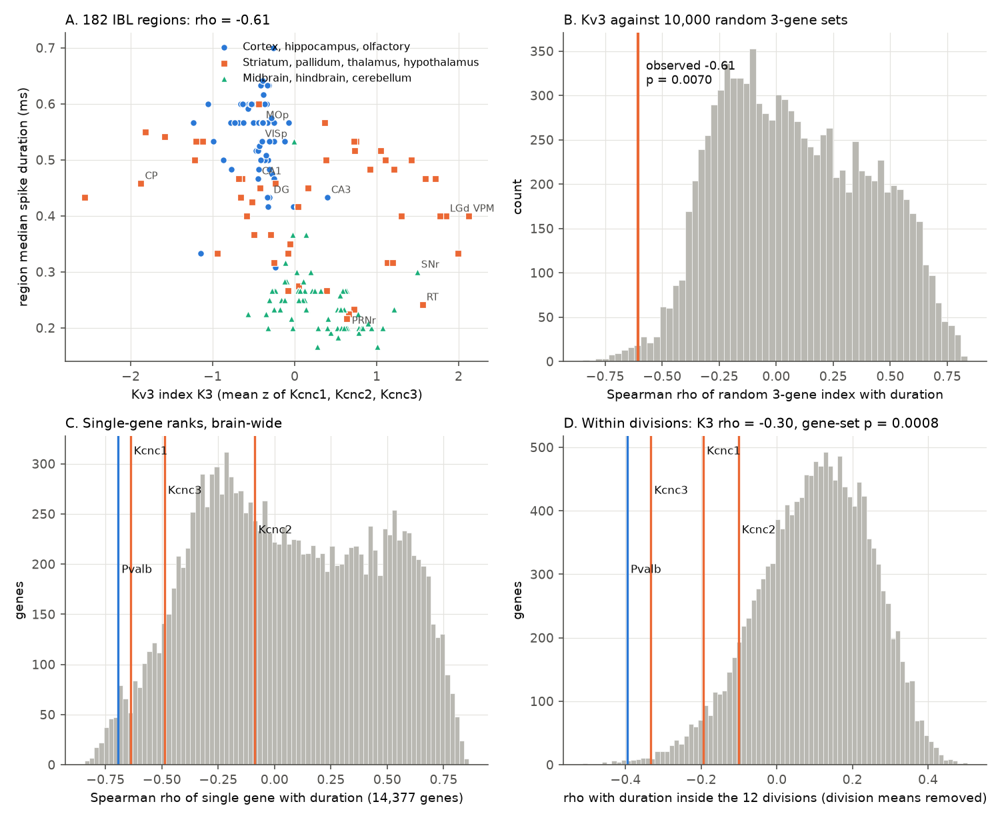
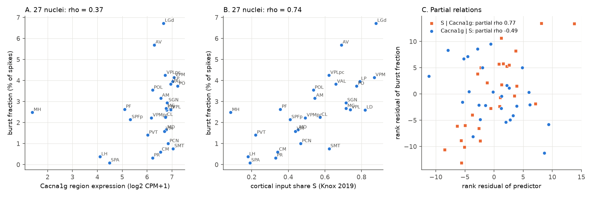
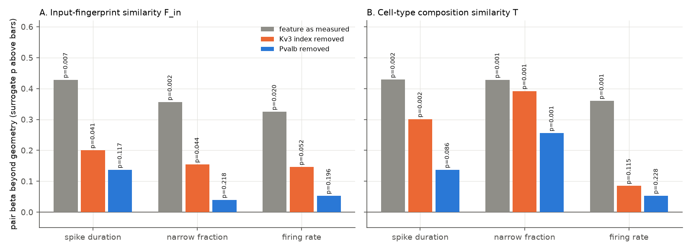

# Kv3 channel expression predicted shorter spikes in 182 mouse brain regions beyond spatial and random-gene nulls, but T-type calcium-channel expression did not predict bursts or explain the thalamic cortical-input link

Job `sci-1107-dell-neural-structure-and-computation-bc3d6aabe127`, campaign 11_07_2026, topic
neural-structure-and-computation, machine dell. Analysis, code and text: Claude Opus 5.5
(`claude-opus-5-5`) with the SCI CLI, 2026-11-10. The signing key is a campaign-machine key. It is not a
personal authorship claim.

## Summary

**Question.** Earlier campaign work found two things. Regions with similar axonal inputs have similar spiking
phenotypes beyond geometry. Regions with similar cell-type mix have them too, and cell-type mix is the
stronger unique predictor (sci:sha256:48d934f4..., sci:sha256:49479722...). In the thalamus, the cortical
share of input (S) predicts burst firing, but S cannot be separated from position and relay cell type
(sci:sha256:0b0f9e1c..., sci:sha256:48d934f4...). Those tests used whole-composition similarity, not
mechanism. We asked a mechanistic question. In single cells, Kv3 channels (Kcnc1-3) make spikes short,
and Cav3.1 T-type channels (Cacna1g) make low-threshold bursts. Does the regional expression of these
genes predict the same features across brain regions, beyond spatial smoothness, and better than
random genes? And does the matched gene carry the link between wiring and phenotype?

**Data.** Region spike phenotypes of 62,049 IBL Brain-Wide Map units in 182 regions (from 48d934f4).
Burst fraction in 27 thalamic nuclei (from 0b0f9e1c). Region gene expression for 14,377 expressed genes:
each MERFISH neuron (1.92 million in brain C57BL6J-638850, 0.99 million in Zhuang-ABCA-1) gets the
Allen WMB-10X mean expression of its transcriptomic cluster, and we take the mean per region.
Replication: 33,651 Allen Visual Coding Neuropixels units in 26 regions.

**Method.** We froze and hashed a plan (`files/code/PLAN.md`) before we computed any association
between genes and phenotypes. Inference used two independent nulls: 1,000 variogram-matched spatial
surrogate maps (brainsmash) and 10,000 random gene sets of the same size, built in the same way.

**Main results.**

1. **H1 passed: Kv3 expression predicted spike duration.** Across 182 regions, the Kv3 index K3
   correlated with the median spike duration at Spearman rho -0.61. Spatial surrogates gave a mean of
   0.01 (p = 0.001). Only 0.7% of random 3-gene sets did as well (p = 0.007). Against
   expression-matched random genes, p = 0.001. Kcnc1 (rho -0.64) and Kcnc3 (-0.49) carried the effect.
   Kcnc2 did not (-0.09).
2. **H1w passed: the link held inside brain divisions** (rho -0.30). Random gene sets gave a mean of
   +0.15 there (gene-set p = 0.0008; stratified permutation p = 0.0003). It was negative in 9 of 11
   divisions, strongest in pons (-0.73), hippocampal formation (-0.72) and striatum (-0.60). It was
   absent in cerebellum (-0.04). Holm-corrected p: H1 0.028, H1w 0.004.
3. **Replications passed.** With a second MERFISH brain, rho was -0.54 (gene-set p = 0.006) and -0.32
   within divisions (p = 0.0004). With independent Allen Visual Coding recordings (26 regions), rho was
   -0.69 (p = 0.0001; gene-set p = 0.036).
4. **H2 failed in the reverse direction.** For the fraction of narrow units, Pvalb predicted better than
   Kv3 (rho 0.61 against 0.45; difference -0.16, 95% CI -0.26 to -0.06). In an exploratory gene-wide
   scan, the genes that best predict short spikes inside divisions include several markers of
   fast-spiking neurons: Pvalb, Syt2, Scn1a (Nav1.1), Vamp1, Hapln1, Kcnab3 and Kcnc3.
5. **H3 failed: Cacna1g did not predict bursts brain-wide** (ACG burst index rho 0.12; surrogate
   p = 0.29; gene rank p = 0.24; second brain 0.14).
6. **H4 failed, and the partial correlations reverse the mechanistic reading.** In 27 thalamic nuclei,
   Cacna1g correlated with burst fraction at only 0.37 (surrogate p = 0.059). Cacna1g correlated with S
   at 0.78, but S kept a partial rho of 0.77 given Cacna1g (p = 0.0001), and Cacna1g given S was
   negative (-0.49). Cacna1h (-0.51) and Cacna1i (-0.57) were negative. The amount of T-type channel
   transcript does not explain the thalamic burst gradient.
7. **H5 passed in part: Kv3 carried about half of the wiring link, but this was not gene-specific.**
   With Kv3 removed from the duration map, the beta of input-fingerprint similarity fell from 0.43 to
   0.20 (-53%). It stayed significant (surrogate p = 0.041), so the full pre-set criterion was not met.
   The composition beta fell less (0.43 to 0.30). An exploratory gene-wide reference shows that
   removing Kv3 lowered the wiring beta more than 85% of single genes and 95.5% of random 3-gene sets
   did. Removing Pvalb lowered it more than 92-97% of single genes did. After Pvalb removal, the wiring
   link was not significant for duration, narrow fraction or rate. For narrow fraction, the composition
   link stayed (0.26, p = 0.001).

**Conclusion.** A specific, biophysically expected gene family, Kv3, predicts regional spike width
across the mouse brain beyond spatial smoothness, within divisions, in two MERFISH brains and in two
Neuropixels data sets. Kv3 belongs to a fast-spiking gene program (with Pvalb and others) that accounts
for most of the link between wiring similarity and waveform similarity. Bursting does not follow the
same logic. T-type channel transcript levels predict neither brain-wide bursts nor the thalamic burst
gradient, and the cortical input share S stays a strong predictor after control for Cacna1g. S does not
stay strong after control for midline position, or for several genes of the medial-lateral thalamic
axis (exploratory). The data support a molecular route for spike shape, but not for burst firing.

## 1. Background

Prior campaign work tested whether wiring, geometry or cell types set regional physiology:

* sci:sha256:0b0f9e1c...: in 27 thalamic nuclei, cortical input share S predicted burst fraction
  (rho 0.74).
* sci:sha256:cc71e4a4...: axonal input predicted which task variables a region encodes.
* sci:sha256:19f7eb8e... and sci:sha256:6e6b5461...: response reliability fell with distance from the
  retina; specific wiring mattered in zebrafish, not in mouse.
* sci:sha256:e251a8ce...: the number of transcriptomic types did not predict spike-feature diversity.
* sci:sha256:48d934f4...: input-fingerprint similarity (F_in) and cell-type similarity (T) both
  predicted phenotype similarity beyond geometry. Composition added more unique variance. The thalamic
  S link was not separable from midline position.
* sci:sha256:49479722...: wiring predicted task coding, composition predicted intrinsic spiking.
* sci:sha256:f4e4c521...: a calibrated null kept wiring links for coding and thalamic bursts, not for
  waveform.
* sci:sha256:18f77139... and sci:sha256:745e2c94...: narrow-unit share and Pvalb-type share; the second
  found no link inside divisions.

None of these tested a named molecular mechanism against all other genes.

## 2. Data

| Input | Version / shared path | Use |
| --- | --- | --- |
| IBL region phenotype (8 features) and 182 primary regions | sci:sha256:48d934f4..., bundled in `files/data/from_48d934f4/` | phenotype |
| Thalamic burst fraction, 27 nuclei | from 0b0f9e1c via 48d934f4, bundled | H4 |
| ABC WMB-10X cluster means, AIT21 (`precomputed_stats_ABC_revision_230821.h5`) | `datasets/abc-wmb-10x-precomputed-stats-230821-20240831` | expression per cluster |
| ABC WMB-10X `gene.csv` | `datasets/abc-wmb-10x-gene-20231215` | gene symbols |
| MERFISH C57BL6J-638850 cell metadata with CCF parcellation | `datasets/abc-merfish-638850-parcellation-meta-20231215` | primary spatial brain |
| Zhuang-ABCA-1 cell metadata, CCF coordinates, parcellation terms | `datasets/abc-zhuang-abca1-*`, `datasets/abc-ccf2020-parcellation-membership-acronym-20230630` | replication brain |
| Knox 2019 connection density; CCF 2017 annotation; structure graph 1 | `datasets/knox2019-...`, `datasets/allen-ccf2017-annotation10-20261109`, API | regions, centroids, F_in, T, S |
| Allen VCN `units.csv`, `channels.csv` | `datasets/allen-vcn-ecephys-*-20261109` | replication phenotype |

SHA-256 values, sizes and URLs: `files/provenance/input_sha256.txt`. Terms: `files/NOTICE.md`.

## 3. Methods

**Region expression (`02_expression.py`).** We kept neurons only (classes 01-29). Each MERFISH neuron
gets the 10x mean log2(CPM+1) vector of its cluster (5,322 clusters; all cluster names matched). It goes
to the Knox region that is its CCF structure or nearest ancestor (same mapping as 48d934f4). E[r, g] is the
mean over neurons in region r. The gene universe U has 14,377 genes with a symbol and a maximum region
value >= 1.0. A gene-set index is the mean of the region z-scores of its genes. K3 = Kcnc1, Kcnc2,
Kcnc3. CaT = Cacna1g.

**Tests (`03_tests.py`).** Spearman correlations across regions. The surrogate null makes 1,000
variogram-matched maps of the phenotype on region centroid distances (brainsmash 0.11). The gene-set
null draws 10,000 random 3-gene sets from U and builds the index in the same way. The within-division
test removes the division mean from the ranks of both variables. H5 uses the pair design of 48d934f4:
pair similarity of a single feature (minus the absolute z difference), ranked, regressed on a distance
spline (5 df), rank G (distance-only connectome model), same division, and rank F_in or rank T. We
repeat it after removal of the rank-linear part of K3 (or Pvalb) from the feature. Each version gets
its own 1,000 surrogate maps.

**Exploratory analyses** (not in the plan): Pvalb as a second mediator in H5 (written into the code
before results, but not in PLAN.md); a gene-wide reference for H5 (`06_mediation_genome.py`); gene-wide
partial correlations in the thalamus (`05_thalamus_genes.py`).

**Clarifications of the plan.** (1) For Allen VCN, "good units" means quality = good plus the AllenSDK
default filters (amplitude cutoff <= 0.1, presence ratio >= 0.95, ISI violations <= 0.5). Our tables
have no session id, so "sessions" became probes (>= 3 probes, >= 20 units). (2) For R1 we kept
regions with >= 50 Zhuang neurons (181 of 182).

## 4. Results

### 4.1 Pre-registered tests

| Test | Statistic | Observed | Null | p | Holm p | Verdict |
| --- | --- | --- | --- | --- | --- | --- |
| H1 K3 vs duration | rho | -0.606 | surrogate mean 0.006; gene-set mean 0.081 | surrogate 0.001; gene-set 0.007 | 0.028 | pass |
| H1w within division | rho | -0.298 | gene-set mean +0.146 | gene-set 0.0008; stratified perm 0.0003 | 0.004 | pass |
| H2 K3 minus Pvalb, narrow fraction | rho difference | -0.162 (0.453 vs 0.615) | bootstrap CI -0.262 to -0.064 | 1.0 (one-sided) | 1.0 | fail (reverse) |
| H3 Cacna1g vs ACG burst | rho | 0.118 | surrogate mean 0.000 | surrogate 0.29; gene rank 0.24 | 0.58 | fail |
| H4 Cacna1g vs thalamic BF (27) | rho | 0.373 | surrogate mean -0.003 | 0.059 | 0.18 | fail |

Single genes, fraction of the 14,377 genes with a rho at least as negative for duration (brain-wide /
within division): Kcnc1 0.025 / 0.034; Kcnc2 0.40 / 0.10; Kcnc3 0.075 / 0.005; Pvalb 0.013 / 0.002.

### 4.2 Replications (R1-R3)

| Test | n | rho | p |
| --- | --- | --- | --- |
| R1 Zhuang-ABCA-1, K3 vs duration | 181 | -0.543 | gene-set 0.006 |
| R1 within division | 181 | -0.316 | gene-set 0.0004 |
| R1 Cacna1g vs ACG burst | 181 | 0.135 | gene rank 0.23 |
| R1 K3 agreement between the two brains | 181 | 0.925 | - |
| R2 Allen VCN duration vs K3 | 26 regions, 33,651 units | -0.690 | 0.0001; gene-set 0.036 |
| R2 Allen VCN duration vs Pvalb | 26 | -0.705 | - |
| R2 IBL vs VCN duration | 26 | 0.864 | - |
| R3 expression-matched gene null (H1 / H1w) | 182 | - | 0.0012 / 0.0013 |

### 4.3 Thalamus

| Statistic (27 nuclei) | Value |
| --- | --- |
| rho(Cacna1g, BF); rho(S, BF) | 0.37; 0.74 |
| rho(Cacna1g, S); rho(Cacna1g, midline distance) | 0.78; 0.50 |
| partial rho(S, BF given Cacna1g) | 0.77 (residual permutation p = 0.0001) |
| partial rho(Cacna1g, BF given S) | -0.49 (p = 0.010) |
| partial rho(Cacna1g, BF given midline distance) | 0.005 (p = 0.98) |
| rho(Cacna1h, BF); rho(Cacna1i, BF) | -0.51; -0.57 |
| Exploratory: partial rho(S, BF given Cacna1g and midline) | 0.52 |
| Exploratory: partial rho(S, BF given midline) | 0.35 |
| Exploratory: genes (of 12,517) with a stronger rho with BF than S | 5 (Tmem108 0.81, Hs6st3, Kctd16, Pcdh9, Pcp4l1); all correlate 0.85-0.89 with S |
| Exploratory: partial rho(S, BF given gene), median over genes; minimum | 0.71; 0.13 (Tmem108) |

The relay marker Prkcd (partial of S 0.68), Hcn2 (0.70) and Kcnc1 (0.60) did not absorb S either. A small
set of genes that follow the same medial-lateral thalamic axis as S does absorb it. Thus the thalamic
link is not explained by T-channel transcript, but S remains inseparable from a medial-lateral
transcriptomic and positional axis.

### 4.4 H5: does the matched gene carry the wiring link?

| Feature | Version | beta F_in (surrogate p) | beta T (surrogate p) |
| --- | --- | --- | --- |
| duration | as measured | 0.429 (0.007) | 0.429 (0.002) |
| duration | K3 removed | 0.201 (0.041) | 0.301 (0.002) |
| duration | Pvalb removed (exploratory) | 0.137 (0.117) | 0.137 (0.086) |
| narrow fraction | as measured | 0.356 (0.002) | 0.428 (0.001) |
| narrow fraction | K3 removed | 0.154 (0.044) | 0.392 (0.001) |
| narrow fraction | Pvalb removed (exploratory) | 0.040 (0.218) | 0.256 (0.001) |
| firing rate | as measured | 0.325 (0.020) | 0.360 (0.001) |
| firing rate | K3 removed | 0.147 (0.052) | 0.085 (0.115) |
| firing rate | Pvalb removed (exploratory) | 0.053 (0.196) | 0.053 (0.228) |

Gene-wide reference (exploratory, `06_mediation_genome.py`, Figure 5): we removed each of the 14,377
genes in turn. Fraction of genes whose removal left a beta F_in at least as low: K3 0.15 (duration),
0.19 (narrow), 0.16 (rate); Pvalb 0.075, 0.046, 0.025. For beta T: K3 0.28, 0.56, 0.07; Pvalb 0.054,
0.18, 0.037. The median gene left beta F_in at 0.38 (duration), 0.31 (narrow) and 0.28 (rate). Thus
many genes that follow the phenotype also absorb part of the wiring link. Kv3 is not special in this
respect, and Pvalb is near the top 5%.

### 4.5 Gene-wide scan (R4, exploratory)

The 115 voltage-gated channel genes (Kcn*, Cacn*, Scn*, Hcn*) had larger absolute brain-wide
correlations than other genes for 7 of 8 features (Mann-Whitney p 0.000 to 0.025; acg_mid p = 0.35).
Inside divisions this enrichment was absent for the waveform features (duration p = 0.92, narrow 0.93,
peak-to-trough 0.99) and present only for rate and acg_mid (p = 0.012). Thus channel genes as a class
are not special for waveform inside divisions; specific members (Kcnc1, Kcnc3, Scn1a) and fast-spiking
markers are. The full table is in `files/results/gene_scan_rho.csv.gz`.

## 5. Interpretation

1. **Spike width follows a fast-spiking molecular program.** The Kv3 result passed both nulls, inside
   divisions, with expression-matched genes, in a second MERFISH brain and in a second Neuropixels data
   set. This gives a mechanistic basis for part of the "cell-type composition" effect of
   sci:sha256:48d934f4.... It also partly disagrees with sci:sha256:745e2c94..., which found no
   Pvalb-type link inside divisions for the narrow fraction. With region-mean expression and the
   median duration, the Pvalb and Kv3 links inside divisions were clear.
2. **Wiring and waveform.** The link between input similarity and waveform similarity shrinks to non-
   significance when the fast-spiking marker Pvalb is removed. With Kv3 removed it falls by about half.
   Many other genes also absorb part of it. The simplest reading: regions with similar inputs have
   similar proportions of fast-spiking neurons, and this, not a direct effect of input, makes their
   waveforms similar. For the narrow fraction, composition similarity keeps information beyond Pvalb
   and Kv3; wiring does not.
3. **Bursting is different.** Neither brain-wide burstiness nor the thalamic burst gradient followed
   T-type channel transcript. Most thalamic nuclei express Cacna1g at a high level; the low-burst
   midline nuclei express it at similar levels (Figure 2A). The difference in bursting between nuclei
   probably depends on other factors, for example resting membrane potential set by neuromodulatory and
   cortical input, or channel localisation, which transcript levels do not show. This is in agreement
   with, but does not prove, a role for cortical input in thalamic burst state.

## 6. Limitations

* Correlational and region-level. Region expression is an average over neurons, weighted by MERFISH cell
  counts in one brain (plus one replication brain), and it uses cluster-mean 10x expression. Expression
  differences inside a cluster and protein levels are not measured.
* Extracellular units are biased toward large neurons, and spike duration depends on probe geometry and
  sorting. Both data sets agree (IBL vs VCN rho 0.86), but they share these biases.
* The gene-set null controls for generic spatial smoothness of gene maps. It does not separate Kv3 from
  genes that mark the same cell types (Pvalb, Syt2, Scn1a). The result shows that the fast-spiking
  program predicts spike width, not that Kv3 alone causes it.
* H2 used narrow fraction with a 0.35 ms cut-off; Pvalb predicted this better than Kv3.
* The thalamic tests have 27 nuclei with collinear predictors; partial correlations are approximate.
  The exploratory gene-wide thalamic analysis searches 12,517 genes, so its top genes are selected.
* Variogram surrogates assume an isotropic, stationary spatial process.
* The Pvalb mediator, the gene-wide references and the thalamic gene scan are exploratory.

## 7. Reproduction

1. `bash files/code/00_get_data.sh /path/scratch` downloads all external inputs (about 4.2 GB) into the
   scratch folder and prints SHA-256 values. Compare them with `files/provenance/input_sha256.txt`. In the
   campaign, the same files are in the shared store (`SCI_DATASETS=./datasets`).
2. `pip install --no-deps --target pylib brainsmash==0.11.0 nibabel==5.3.2 pynrrd==1.1.3`, then
   `PYTHONPATH=pylib`. Other versions: `files/provenance/environment.txt`.
3. `SCI_DATASETS=/path/scratch/datasets SCRATCH=/path/scratch PYTHONPATH=pylib bash files/code/run_all.sh`.
   Outputs go to `SCRATCH/derived`, `SCRATCH/results`, `SCRATCH/figures`. Seeds are fixed. The run
   took about 2 hours at a host load average of about 230 (mostly `03_tests.py`).

Bundled files:

* `files/code/`: all scripts, `PLAN.md` and its hash record `PLAN.sha256.txt` (frozen 2026-11-10T14:32Z).
* `files/data/from_48d934f4/`: IBL-derived inputs from sci:sha256:48d934f4... (CC BY 4.0).
* `files/results/`: `tests.json` (all pre-registered and replication statistics), `null_H1_*.npy`,
  `gene_scan_rho.csv.gz` (rho of every gene with every feature, brain-wide and within division),
  `mediation_genome.*`, `thalamus_gene_partials.*`, run logs.
* `files/figures/`: Figures 1-5.

## References

* International Brain Laboratory et al. (2025) A brain-wide map of neural activity during complex
  behaviour. Nature. doi:10.1038/s41586-025-09235-0
* Yao Z et al. (2023) A high-resolution transcriptomic and spatial atlas of cell types in the whole
  mouse brain. Nature 624:317-332. doi:10.1038/s41586-023-06812-z
* Zhang M et al. (2023) Molecularly defined and spatially resolved cell atlas of the whole mouse brain.
  Nature 624:343-354. doi:10.1038/s41586-023-06808-9
* Knox JE et al. (2019) High-resolution data-driven model of the mouse connectome. Netw Neurosci
  3:217-236. doi:10.1162/netn_a_00066
* Wang Q et al. (2020) The Allen Mouse Brain Common Coordinate Framework. Cell 181:936-953.
  doi:10.1016/j.cell.2020.04.007
* Siegle JH et al. (2021) Survey of spiking in the mouse visual system reveals functional hierarchy.
  Nature 592:86-92. doi:10.1038/s41586-020-03171-x
* Burt JB et al. (2020) Generative modeling of brain maps with spatial autocorrelation. NeuroImage
  220:117038. doi:10.1016/j.neuroimage.2020.117038
* Rudy B, McBain CJ (2001) Kv3 channels: voltage-gated K+ channels designed for high-frequency
  repetitive firing. Trends Neurosci 24:517-526. doi:10.1016/S0166-2236(00)01892-0
* Perez-Reyes E (2003) Molecular physiology of low-voltage-activated T-type calcium channels. Physiol
  Rev 83:117-161. doi:10.1152/physrev.00018.2002
