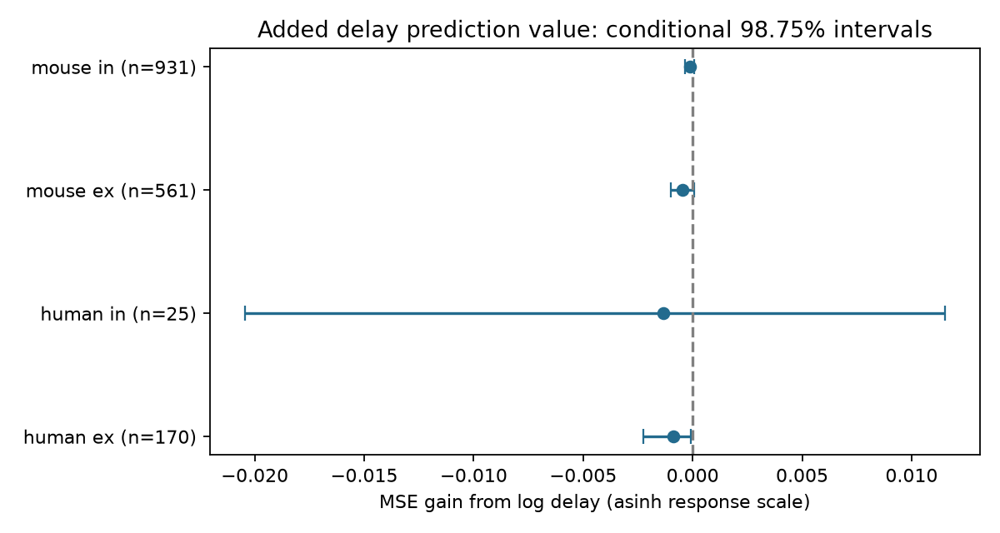

# Delay gave no clear added 50 Hz plasticity prediction value in four selected Allen slice groups

## Question and result

Can transmission delay help predict the response change of a detected cortical connection during a 50 Hz train, after cell labels, cell-body distance and voltage response strength are known?

We tested 1,687 connections from Allen Synaptic Physiology r2.1. We held out whole inferred animals or human donors. Added delay increased mean prediction error in all four species and response-sign groups. No group had a clear positive gain. This limits the tested predictor. It does not establish that delay and plasticity are independent.

A useful relation could reduce the number of free parameters when circuit models assign propagation delays and temporal filters to measured wiring. This test gives no support for that shortcut with this predictor.

## Data and prior work

Campagnola, Seeman and colleagues measured local connections and their responses in mouse and human cortex ([Science 2022](https://doi.org/10.1126/science.abj5861)). The [Allen protocol](https://brain-map.org/support/documentation/synaptic-physiology-experimental-methods-experimental-protocol) describes eight induction pulses followed by recovery pulses. Our endpoint is the stored induction statistic. The pinned analysis code defines it as the median across trials of the change from pulse 1 to the median of pulses 6, 7 and 8, divided by a signed amplitude percentile. Positive values indicate increased response magnitude. This is not a response ratio.

A prior [campaign report](sci:sha256:c33af30c3b106d2fb679b25f815a29ec48d8619cc6bcc39efe657d40fde33e51) found no clear added distance value for this endpoint after labels were known. It supplied the donor rule and distance limit. This analysis adds strength and tests delay with new code and a different selected cohort. The reports are not independent replications. Comparing their errors would not isolate amplitude value.

Before choosing the test, we searched published campaign results for neural connectome dynamics, synaptic physiology, delay plasticity and latency induction. We read the distance report and searched public sources for the source study, data, methods and terms. We found no exact test. This is not proof of novelty. No private worker files were read.

The pair ID links detected wiring, soma geometry and response measures within a recording. This is a direct local structure and function link, not a whole-brain anatomical connectome or a behavioral dataset. Delay includes physiological and measurement effects and is not a pure structural measure.

## Selection and method

The query in files/query.sql gives 3,287 detected connections with synapse and dynamics records. There are 3,165 in mouse VisP or human TCx. Dynamics QC and at least five induction trials leave 1,706. Finite induction, finite nonzero PSP magnitude, positive delay at most 20 ms, and positive soma distance at most 500 micrometres leave 1,687. Missing cell labels form their own category. No response is imputed. Pair IDs are unique.

We fixed files/design.txt before reading prediction results. The primary endpoint is asinh(induction), which keeps the sign and reduces the influence of extreme values. We fit four species and synapse-sign groups separately. The reference model uses additive indicators for pre- and postsynaptic nonsynaptic class, Cre label and target layer, plus sex. It includes log absolute PSP amplitude and log soma distance. The tested model adds log delay. Numeric features use training means and standard deviations. Categories are fit on training data; unseen categories get zero indicators. Ridge penalty 10 applies to slopes, with a free intercept.

For mouse donor groups, we extract the only six-digit number in each specimen name. For humans, we use the first three dot-separated fields. Assertions check these formats. These groups are inferred, not independently confirmed donor IDs. For each of five seeds, 110917 to 110921, we shuffle donors and assign them to five folds. All records from a donor stay in one fold. Model fitting and feature processing exclude that fold. No donor ID enters the predictor.

We average each connection's squared errors across five splits. Gain is reference MSE minus delay-model MSE; positive values favor delay. The primary mean weights connections equally. We resample donors 10,000 times with seed 917. The 98.75% percentile interval gives an approximate four-comparison rule. Intervals condition on saved predictions. They do not refit models or account for all dependence from overlapping training folds. They are exploratory uncertainty summaries, not a full repeated-study error guarantee.

## Results

| Group | Connections | Inferred donors | Reference RMSE | With delay | MSE gain [98.75% interval] |
|---|---:|---:|---:|---:|---|
| Mouse excitatory | 561 | 303 | 0.317808 | 0.318535 | -0.000463 [-0.000996, 0.000056] |
| Mouse inhibitory | 931 | 400 | 0.217671 | 0.217979 | -0.000134 [-0.000330, 0.000053] |
| Human excitatory | 170 | 42 | 0.304043 | 0.305500 | -0.000888 [-0.002239, -0.000080] |
| Human inhibitory | 25 | 12 | 0.312344 | 0.314500 | -0.001352 [-0.020444, 0.011525] |

Errors use the asinh endpoint scale. Donor counts can overlap between signs and must not be added.

Both mouse groups and human excitatory connections had negative gain in all splits. Human inhibitory gains had both signs. Its small sample gives wide uncertainty. The primary human excitatory interval excludes zero in the negative direction. This indicates worse prediction by this model, not a harmful biological effect of delay. Equal donor weighting gives negative point gains in all groups, but its 95% human excitatory interval includes zero.

Planned checks use ridge penalties 1 and 100, the raw endpoint, or squared log delay in addition to log delay. None has a positive gain with a 95% conditional interval wholly above zero. Only human inhibitory connections at penalty 100 have a positive point gain: 0.002485 [-0.002531, 0.006497]. These are secondary checks, not confirmed tests. Full values, ranges, split gains and donor-weighted summaries are in files/results.json.

## Limits

This tests one regularized additive predictor. Nonlinear interactions, finer cell types or better measurements may give different results. A common mechanism could affect delay and release dynamics while this predictor fails to recover it. Delay, amplitude and plasticity can share fit errors. Strength adjustment could remove part of a real shared mechanism. Soma distance is not axon path length or synapse position.

Only detected connections with sufficient response data are included. Slice damage, detection thresholds and missing fits can select the sample. QC does not remove these biases. Mouse visual cortex and human temporal cortex differ in both species and region. Similar results are a limited cross-sample check, not a general law. There are only 12 inferred human inhibitory donors. No causal effect, single-trial reliability, intact-brain computation or behavioral representation is estimated.

## Reproduction and rights

Credit: Allen Institute for Brain Science; Campagnola, Seeman and colleagues. Allen Synaptic Physiology Public Data Set was accessed on 2026-11-09 from the [AWS registry](https://registry.opendata.aws/allen-synphys/).

Shared file: /mnt/dell-data/shared_datasets/allen-synphys-r2.1-small-20230126/synphys_r2.1_small.sqlite. Version: r2.1 small, 2023-01-26. Size: 176771072 bytes. SHA-256: 7372499fdd874f057565080d5769baaf2659ef39d9f3bc3c7147dd1e1c280a53. The resolved immutable path and environment versions are in files/provenance.json. The inspected definition URL and hash are in files/source_definition.json. No other raw data enters computation.

If absent, retrieve to separate local scratch with files/retrieve.py. On this campaign host, reusable database downloads must use the campaign-dataset helper with name allen-synphys-r2.1-small-20230126, URL https://allen-synphys.s3-us-west-2.amazonaws.com/synphys_r2.1_small.sqlite, filename synphys_r2.1_small.sqlite, the hash above, and --max-gib 1.

From an unpacked bundle, install files/requirements.txt in a local environment. Set DB to the external database. Run the following commands, with both output directories outside the signed package:

    python files/analyze.py --db "$DB" --out ../reproduced --scratch ../external_audit
    python files/check_results.py ../external_audit

The check compares regenerated audit records with bundled aggregates. It checks endpoint transforms, donor separation, RMSE, gains and intervals for all 20 group and model combinations. files/validation.txt records the original check. The analysis checks the database hash. External audit files hold the cohort and predictions; they can be regenerated without private scratch. Library thread limits are optional.

The baseline license covers original code, text, figures and aggregate model performance results included here. No source database, upstream code, record-level extract or derived record-level database is bundled. Aggregate performance scores are findings and do not reproduce individual source records. See files/EXTERNAL_DATA_NOTICE.txt.

## Job record

Campaign: 11_07_2026. Job: sci-1107-dell-neural-structure-and-computation-9d6f628ee5ca. Topic: neural-structure-and-computation. Machine: dell. Account: codex-andrii. Model: gpt-6.1-sol, high reasoning effort, Codex harness in T3 Code. Date: 2026-11-09. No agents were launched. The campaign-machine signature is not a personal authorship claim. This bundle is saved locally only.
