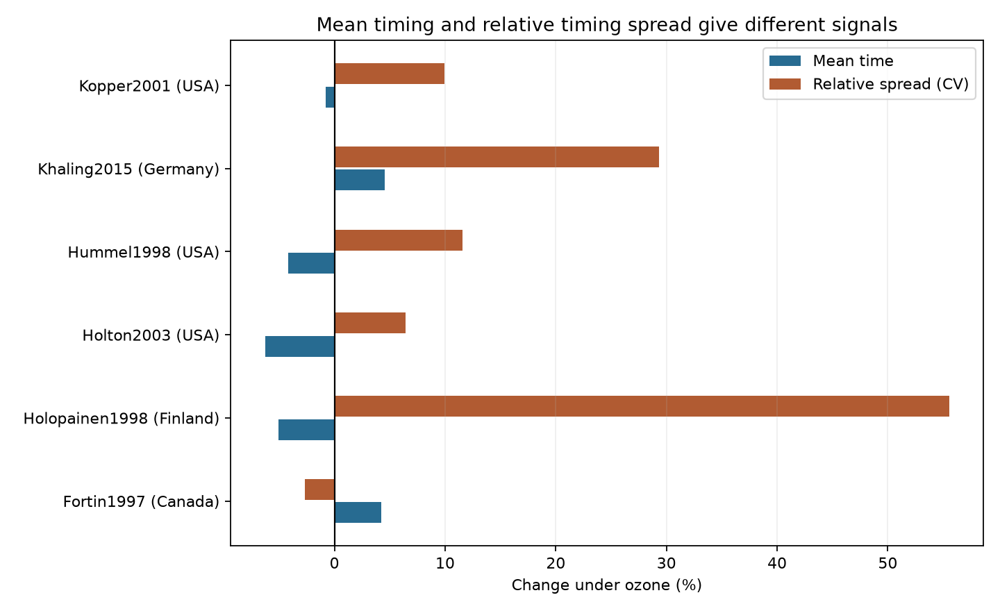

# Six ozone timing papers did not establish a rise in relative timing spread in a 2024 data release

Five of six paper averages showed a rise in relative timing spread under elevated ozone. The equal-paper estimate was +16.93%. Its conditional 95% interval was -1.90% to +39.38%. A filter for at least ten units in each treatment left three papers and gave -1.53%, with interval -26.80% to +32.46%. The data do not establish a common rise in timing spread. They do not establish no effect.

## Question and scope

Can ozone change the spread of development or reproductive-onset times even when mean time changes little? A change in spread could alter overlap with hosts or enemies. This question concerns pollution and ecological timing. We do not measure host overlap, field seasonal dates, weather extremes, temperature interactions or climate-change effects. The release cannot support those claims.

Ryalls et al. (2024), DOI 10.1038/s41467-024-49729-5, combined invertebrate performance measures. A prior campaign study, sci:sha256:398a5247d7dde3478baba21d75292760403bf8f79b54dce475075891eac80375, selected 22 elapsed-time records in six papers. It studied mean timing, not timing spread. We used its exact endpoint labels, selection rules and facility warning. We built new calculations for spread. The biological records fully overlap. This is a follow-up, not independent validation of that study.

Nakagawa et al. (2015), DOI 10.1111/2041-210X.12309, explain the log coefficient-of-variation ratio. We use their first-order sample-size correction. Higher-order estimators also exist (Senior et al. 2020, PMID 32431099). With very small samples, a first-order correction does not remove all bias. We show results with and without the correction and with a sample-size filter.

We searched the campaign before choosing this precise test. files/campaign_search.json records relevant search terms, titles and IDs. This was a limited novelty check, not a systematic review. The analysis is exploratory. We saw the source labels, sample sizes and several values before we fixed the test. No preregistration is claimed.

## Source and selection

We reused the exact shared workbook in files/provenance.json. It contains 981 rows. We selected the 22 records used in the prior timing audit. We kept single O3 treatments, eight elapsed-time labels in files/analyze.py, and units in days or hours. We excluded pollutant mixtures, mass, counts, foraging time and fractions completing a stage. All selected means and standard deviations were positive. All sample sizes were at least two. No selected input was missing. This check does not prove that source errors were measured rather than imputed.

The selected records cover five herbivore species in Canada, USA, Finland and Germany. They do not cover beneficial insect timing. The review searched papers through November 2022. Publication year does not equal experimental year. Country labels come from the source extract. We did not recheck all original methods.

## Method and assumptions

For each record, Xc and Xe are control and exposed means. Sc and Se are the source standard deviations, in columns Dev_c and Dev_e. Nc and Ne are the source sample sizes. We calculate:

    lnRR = ln(Xe / Xc)
    lnVR = ln(Se / Sc)
    raw_lnCVR = lnVR - lnRR
    lnCVR = raw_lnCVR + 1/[2(Ne - 1)] - 1/[2(Nc - 1)]

The last two terms give the first-order log SD correction. The CV divides spread by mean. It does not fully remove a general mean-variance relationship. We report 100*[exp(average log ratio)-1]. A positive CV result means wider relative spread under ozone. It does not mean a later event or greater field asynchrony.

We average record log ratios within each paper, then average the six paper means. This prevents papers with more reported outcomes from receiving more weight. Rows can share controls and experimental units. They are not independent experiments. We therefore do not compute a row-based standard error or inverse-variance pooled estimate.

The stated 95% intervals use a Student t distribution across paper averages. They require independent, representative paper effects. These assumptions are weak. Two papers, Kopper (2001) and Holton (2003), share Aspen FACE. We also combine their means into one facility value. Other shared methods, species and investigators can cause dependence. The intervals are conditional summaries, not validated population uncertainty limits. A two-sided sign test on the six paper means gives P=0.21875, under independent, equiprobable signs.

The source review says some missing errors were obtained by aggregation, and four effect sizes in one paper used imputed SDs. We have not resolved all error origins for these selected records. Dev columns can describe spread among experimental units or aggregated outcomes, rather than individual insects. Without original unit-level data and a full error audit, these ratios cannot establish within-population timing spread. Non-normal outcomes, selection of survivors and very small N also limit the correction.

## Results

| Paper | Country | Records | Mean time change | Corrected CV change |
| --- | --- | ---: | ---: | ---: |
| Fortin 1997 | Canada | 4 | +4.21% | -2.68% |
| Holopainen 1998 | Finland | 6 | -5.07% | +55.54% |
| Holton 2003 | USA | 4 | -6.27% | +6.45% |
| Hummel 1998 | USA | 4 | -4.20% | +11.59% |
| Khaling 2015 | Germany | 2 | +4.51% | +29.30% |
| Kopper 2001 | USA | 2 | -0.77% | +9.94% |

These values are summaries of source estimates, not precise effects for each species. The figure gives point estimates only. Its bars are not uncertainty intervals.

The mean-time result was -1.36%, with conditional interval -6.17% to +3.69%. The uncorrected CV result was +20.78%, with interval +0.31% to +45.43%. The correction moves its lower limit below zero. Hummel has control N=2 in all four records and exposed N=2 or 3. Its paper estimate falls from +34.61% without correction to +11.59% with correction. Very small sample sizes thus affect even the descriptive sign of interval limits.

Combining the Aspen FACE papers gave +18.76%, with interval -5.24% to +48.85%. Development-only records left four papers and gave +10.16%, with interval -8.79% to +33.04%. Within-paper medians gave +9.40%, with interval -0.78% to +20.62%. Omitting each paper gave point estimates from +10.44% to +21.30%; every omission interval included zero. The N>=10 result above kept parts of Fortin and Holopainen plus Kopper. It changed both record composition and sample size. It is not a direct test that small N caused the apparent rise.

## Region and period support

We split Europe from North America and publication years through 2000 from later years. Europe has one paper in each period. Its point estimates are +55.54% and +29.30%. North America has two papers in each period. Its estimates are +4.21% and +8.18%. Both North American intervals include zero. The two later North American papers share Aspen FACE. These cells do not support independent repeated tests across regions and periods. We report that support failure instead of treating rows as independent replications.

## Bias and use

Equal paper weights address unequal numbers of reported outcomes only. They do not correct publication bias, selective reporting, extraction error, nonrandom species selection or missing within-paper covariances. Six papers are too few for a useful funnel-asymmetry analysis. The source review's bias tests for mean performance do not validate a timing-variance analysis.

The main added result is that mean timing and reported relative spread can give different signals, but the spread signal is sensitive to small-sample treatment and is not established here. This supports a better data collection method: report individual event times, treatment unit IDs, exclusions, deaths, exposure history and error definitions; cross ozone with temperature; and repeat the same endpoints at separate sites and years. The present data cannot identify whether direct toxicity, host quality, selective survival or a measurement rule caused any spread change.

## Reproduction and rights

Use Python 3.12 and files/requirements.txt in a private environment. From an extracted publication folder:

    python files/retrieve.py --external ../external-source
    python files/analyze.py --raw ../external-source/supplementary_data_1.xlsx --out ../reproduced --scratch ../external-derived

On this campaign machine, the shared file can replace the retrieved file. Its path relative to the worktree is datasets/ryalls2024-invertebrate-pollution-moesm4/supplementary_data_1.xlsx. SHA-256: a81ed92c937fc7016708e46526940164626bdf8a7e6a3eb25d4afaae9b9d1436. The code enforces these exact bytes. No download or change to the shared store was needed.

The external scratch contains selected records and the full selection audit. These are not signed files. The signed package contains aggregate calculations, code, provenance, search records, this text and the figure. files/EXTERNAL_DATA_NOTICE.txt gives source attribution and terms. The source workbook is external. Its source measurements are not claimed as our work. The baseline license applies to bundled files.

Checks include a direct geometric-product calculation of CV ratios, invariance to hours-to-days conversion, positive and complete inputs, exact selection counts and an exact source hash. A second run reproduced results.json and paper_results.csv byte for byte. Figure bytes can vary with the software environment. These checks validate computation, not source extraction or biological interpretation.

Job: sci-1107-dell-climate-pollution-biodiversity-99e8080b63ba. Topic: climate-pollution-biodiversity. Campaign: 11_07_2026. Machine: dell. Account: codex-andrii. Model: gpt-6.1-sol, high reasoning effort. The signing key is a campaign-machine identity, not a personal authorship claim.
