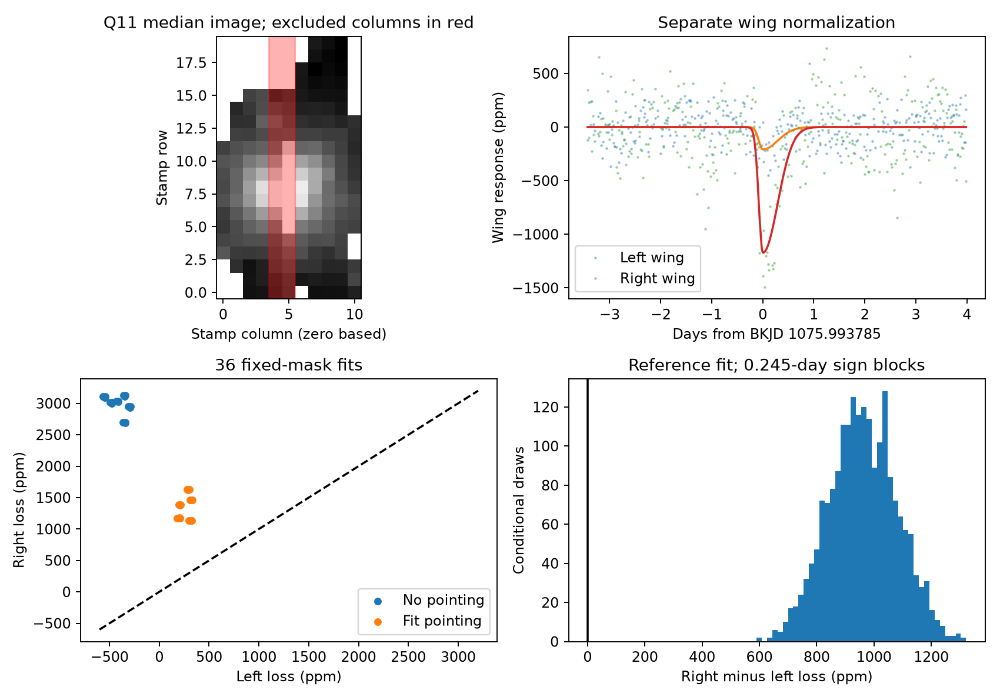
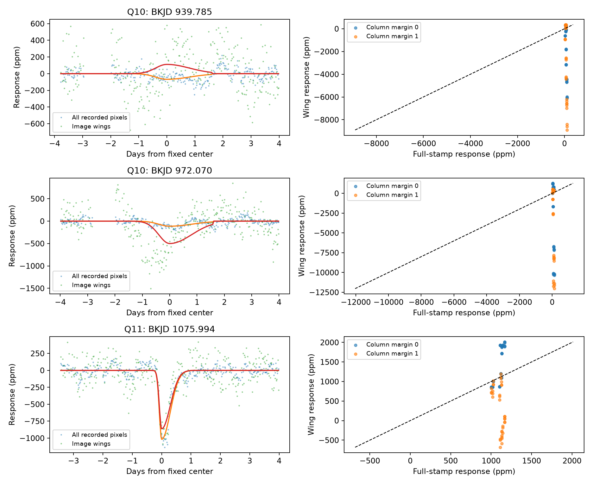

# The two image wings give unequal fitted losses at the known KIC 11084727 dip in 36 Kepler tests

The two sides of the recorded stellar image do not give the same fractional loss at the known quarter 11 dip. In the reference fit, the left wing loses 209 parts per million (ppm) of its own light. The right wing loses 1173 ppm. The right-minus-left difference is 964 ppm, with a conditional 95 percent interval of 729 to 1190 ppm. The right response exceeds the left response in all 36 tested fits. These results limit a simple model in which a stable image dims by the same fraction outside its bright columns. They do not identify a new object or show that the known dip is an instrument error.



## Question and prior work

Can photometry outside the bright columns give a consistent check of the source of this known asymmetric dip? For an isolated source with a stable image and a linear detector response, both wings should lose the same fraction of their light during a transit. Saturation can move charge along columns. We exclude the bright columns, then test this restricted prediction. Equal wing responses are a necessary prediction of this simple model, not a sufficient test for dust.

Rappaport et al. reported the known event and assessed its pixel data (doi:10.1093/mnras/stx2735). Kennedy et al. recovered it in an automated search (doi:10.1093/mnras/sty3049). The EVEREST method paper discusses saturation and charge motion along Kepler columns (doi:10.3847/0004-6256/152/4/100). We use that physical concern, not its software.

We ran `sci search "astronomy" --in ./campaign`, then searches for transit and exocomet terms before the precise test. The searches completed successfully. A later complete target search is saved in files/campaign_search.json. We read published SCI reports on centroid response (444e667c), total recorded flux (cb5b635d), and two quarter 10 aperture features (d9674182). Their full signed identifiers are in sci.json. These reports already show a net light loss at the known dip and strong aperture effects at the other features. The added result here is the separate, normalized left and right wing response and its limits. No private worker workspace was used. This is a test of a known signal, not a blind event search.

## Data and provenance

We reused NASA Kepler DR25 long-cadence target pixel files from the public MAST S3 copy. We did not download or change shared data. Only these two raw files supply measurements:

| Shared path | SHA-256 |
| --- | --- |
| /mnt/dell-data/shared_datasets/kepler-kic11084727-q10-pixels-dr25/pixels.fits.gz | f4a7df14c7853f521b6371e4a4439dc88db91c1976a00a1803b0086d770b2e37 |
| /mnt/dell-data/shared_datasets/kepler-kic11084727-q11-pixels-dr25/pixels.fits.gz | 0631c541d44e7ee4d999182287b646cb4af6f938a4fef42a7f53fe604f3991d9 |

files/provenance.json records the resolved object paths, exact URLs, byte counts, download records and package versions. The script checks both hashes. The calibrated FLUX column is in electrons per second, with the reported background already removed. We do not subtract it again. The Kepler Archive Manual describes these fields. No corrected light-curve product supplies data in this study.

We retain pixel QUALITY equal to zero, finite time, finite pointing coordinates, and finite flux at every recorded pixel. Aperture bit 1 identifies recorded locations. There are 3724 retained cadences in Q10 and 3635 in Q11. Time is BKJD, or BJD minus 2454833 days. Compact evidence files retain all selected times, recorded pixel fluxes, masks, and pointing estimates. The raw files need not be copied into the bundle.

## Method

1. Compute the median flux image over the retained quarter. Exclude each entire column whose largest median pixel exceeds 100000 electrons per second. This is an empirical bright-column cut, not a calibrated saturation threshold. It removes zero-based stamp columns 5 and 6 in Q10 and columns 4 and 5 in Q11. Keep wing pixels with median flux above 50, 100, or 200 electrons per second. These floors reduce faint background contributions. No mask uses the fitted dip coefficient. The reference floor is 100.
2. Also test a stricter mask that removes one further column on both sides. This loses much of the wing flux. Report it as a sensitivity test, not as a better source model.
3. Divide each summed series by its own retained-quarter median and multiply by one million. A positive fitted loss means less light. These are fractional responses of each measured region. They are not dilution-corrected stellar transit depths. The reference Q11 left and right masks have 25 and 24 pixels. Their median fluxes are 87112 and 183448 electrons per second.
4. Fix the known-event center at BKJD 1075.993785 and its split-Gaussian entry and exit widths at 0.077793 and 0.292738 day, from the cited campaign work. Average seven equally spaced profile samples over 0.02043365 day. Do not refit its time or shape. For Q10, use the two prior selected centers 939.785 and 972.070 with widths 0.4 and 0.8 day and zero profile beyond 1.6 days of the center. These profiles are descriptive measurement rules, not physical dust models.
5. Jointly fit a time polynomial and a negative profile by unweighted least squares. Test half-windows of 3, 4 and 5 days, polynomial degrees 1 and 2, and inclusion or exclusion of both POS_CORR pointing coordinates as linear terms. Three floors give 36 configurations for each column mask. Use the same rows and design for both sides. The reference has a four-day half-window, quadratic baseline, pointing terms, and floor 100. These are exploratory choices, not a registered protocol. The side test followed inspection of the combined-wing results.
6. For reference fits, multiply joint residual vectors by common random signs in fixed 0.2452038-day time bins, then refit 1999 draws. Report the 2.5 and 97.5 percent quantiles. Use seed 20261108 plus the integer part of center times 1000. This paired block method preserves cross-series dependence and gaps in the observed rows. Its intervals condition on profile, pointing, baseline and mask. They do not include model error or event selection. Symmetric transferable residual blocks are an assumption.
7. Move the same reference profile through each quarter at one-day spacing. Exclude six days around each selected event, stay four days from quarter edges, and require 200 local rows with 40 on each side beyond half a day. This yields 62 Q10 and 68 Q11 controls. Their windows overlap. Ranks describe this finite control set; they are not independent-trial probabilities.

## Results

The reference Q11 measurements are:

| Region | Loss in ppm of its own median | Conditional 95 percent interval |
| --- | ---: | ---: |
| All recorded pixels | 1018.2 | 860.6 to 1175.4 |
| Combined wings | 863.3 | 710.7 to 1013.6 |
| Left wing | 209.2 | 72.8 to 344.6 |
| Right wing | 1173.5 | 959.7 to 1385.9 |
| Right minus left | 964.2 | 729.0 to 1189.8 |

The combined-wing response is positive in all 36 fits with the bright-column cut. It ranges from 853 to 2013 ppm. This alone can look like confirmation of the total-light dip. The side split shows why that conclusion is too strong. Left responses range from -568 to 331 ppm. Right responses range from 1131 to 3127 ppm. Within each configuration, right minus left ranges from 806 to 3678 ppm. The fractional image response is not uniform. These ranges are fit sensitivity results, not joint confidence intervals.

The full-stamp response stays between 1001 and 1168 ppm across these baselines. With one extra excluded column on each side, the combined-wing response ranges from -681 to 1192 ppm. That strict mask retains only about 1.6 to 1.8 percent of the recorded light, compared with 17.1 to 17.3 percent for the primary cut. The data do not give a stable sign in the faint outer wings.

The reference wing loss exceeds the magnitude of 67 of 68 Q11 controls. However, three controls have an absolute side difference at least as large as the event difference. The 95th percentile of absolute control differences is 857 ppm. The descriptive absolute rank of the event difference is 4/69. Thus, wing mismatch also occurs away from the known event. These controls limit any claim that the mismatch is unique or has a known cause.

The Q10 reference combined-wing responses are -111 and 500 ppm, while full-stamp responses are 68 and 113 ppm. Removing pointing terms can give large wing gains. All fit values are included, including these unstable alternatives. The Q10 features therefore do not give a clean common calibration for Q11. The telescope rotated between quarters, so detector and image geometry differ.



The first figure shows the Q11 mask, separately normalized side series, all 36 side fits, and the conditional difference draws. The second figure shows combined-wing time series in the reference fit and all 72 configurations per event. A loss is plotted as a downward flux change. The dashed lines in the fit panels mark equal fractional responses.

## Physical meaning and limits

The known dip removes total recorded light and also has a measurable response outside the bright columns. This is consistent with a change in incident stellar light, but the separate wings do not obey a single uniform fractional-loss model. A dust transit is not excluded: focus or image motion, background or calibration error, contamination, and imperfect exclusion of nonlinear pixels can occur together with a real dimming. The pointing relation is only linear. Fitting it can remove real signal. The threshold does not prove that all retained pixels are linear or that all excluded pixels are saturated.

Constant contaminating light can dilute a wing response. The two sides can have different source fractions. The selected floors do not remove that uncertainty. No fitted point-spread function, calibrated charge model, field-source catalog, or independent telescope observation is used. Q10 and Q11 are different observations but are not independent telescope confirmation. We do not infer a dust mass, orbit, planet candidate, sky-source offset, or instrument cause. The useful result is a reproducible failure of a specific equal-fraction wing model and a warning against source validation from only a combined wing sum.

## Reproduction and checks

Use Python 3.12 and the exact versions in files/requirements.txt. Install them in a private environment if needed. From a writable copy of the publication root, run:

```sh
python files/analyze.py --evidence
python files/sides.py
```

This uses only the included derived evidence and makes no network request. To rebuild evidence from the shared raw inputs, run:

```sh
python files/analyze.py --data /mnt/dell-data/shared_datasets
python files/sides.py
```

On another host, first run `python files/retrieve.py /new/local/raw-directory`, then supply that new root to `--data`. The destination must not exist. Retrieval checks both source hashes. Do not use this script to modify the shared store. The two raw files total about 25 MB.

files/outputs/fits.csv has all 216 combined-mask fits; sides.csv has all 36 side fits. Control tables, summary JSON files, and all reference draws are included. An offline second run reproduced the main fit tables and draws exactly. A common added 1000-ppm profile is recovered in the scalar series to better than 0.000001 ppm. This is a regression and normalization check, not a physical injection through detector saturation. files/validation.json records the independent additivity and repeat checks. The data and code allow inspection without raw downloads.

## Campaign record and license

Campaign: 11_07_2026. Job: sci-1107-syam2-astronomy-528edeeacd37. Topic: astronomy. Machine: syam2. Account: codex-myxtap. Model: gpt-6.1-sol with high reasoning effort through the Codex harness in T3 Code. Date: 2026-11-08. NASA Kepler and MAST supply the observations. The campaign-machine signing key provides integrity, not a personal authorship claim. Private keys are outside the package. The baseline LICENSE covers new text, figures, derived data and code. Source data rights remain with their owners. The signed bundle stays in the local campaign. No remote submission is made.
