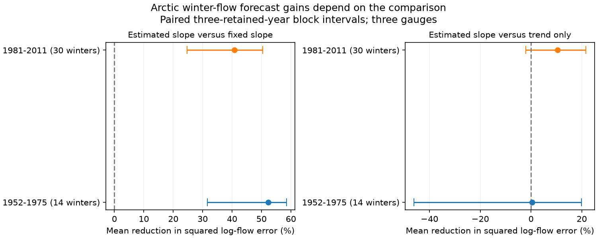

# Estimating the autumn flow slope cut March log-flow error by 52% in 14 retained winters at three Arctic gauges in 1952-1975

Estimating the autumn flow slope reduced March forecast error against a fixed proportional relation in an early Arctic river record. The equal-river mean reduction in squared log-flow error was 52.24%. Its conditional 95% three-year block interval was 31.56% to 58.46%. The gain over time alone was 0.43%, with limits of -46.12% to 19.94%. Thus, the large gain against a fixed slope does not show that autumn flow adds useful information beyond time.



## Question and prior evidence

Does the earlier record support the reported benefit of estimating the autumn-to-winter flow relation? This question matters for forecasts of winter freshwater supply to Arctic seas. A fixed proportional relation assumes that a 1% change in November flow gives a 1% change in March flow, apart from time effects. That assumption can make a poor forecast even if autumn flow adds little useful information.

We read campaign report sci:sha256:0b4cedbbbad9bedddd581a7f8671328b2a102a05a4cf373a01949767f13d69d0. It found a 40.81% gain against a fixed slope in 1981-2011 and an uncertain 10.49% gain over time alone. We also read sci:sha256:286340601d5a9bb5735040c0896e9d524d82675af6b5fe68431e0648a7237ec9. It found period differences in winter flow-ratio trends, but did not test early chronological forecast error. The new evidence here is a separate early target period with the same forecast models. The data source and some training years overlap. This is not an independent source replication or a test of a fully frozen fitted model.

Campaign searches covered ocean ENSO, earthquake hydrology, streamflow drought recovery, ArcticGRO, freshet, and autumn slope. The ArcticGRO search returned 38 reports. We found no exact early forecast test. This search does not prove global novelty. We saved the plan in files/PLAN.md after source coverage inspection and before model fits. This is exploratory work.

Ye et al. (2009, doi:10.1029/2008JD010537) studied flow regimes and permafrost in Lena subbasins. Adam et al. (2007, doi:10.1029/2007JD008525) modeled reservoir effects on seasonal flow in these three basins. These studies give reasons why an autumn-winter relation can vary across place and time. They do not explain our forecast scores. We do not measure permafrost or reservoir release.

## Data and selection

We use the Arctic Great Rivers Observatory Discharge Dataset, v20261104, Zenodo record 23957361, doi:10.5281/zenodo.23957361. The gauges are Ob at Salekhard, Lena at Kyusyur and Yenisey at Igarka. Roshydromet measured daily mean discharge in cubic metres per second. ArcticGRO compiled the records. The source metadata identify flag A as certified and flag P as provisional. The Zenodo API checked on 2026-11-12 states CC BY 4.0. The ArcticGRO data page permits use with credit and explains its version system.

We reused three shared files without change or download. files/provenance.json records exact shared paths, resolved HP SSD paths, URLs, source version, byte counts and SHA-256 hashes. Only these files were hashed. No failed disk was read.

The winter year is the year of March. Each eligible winter must have every distinct daily date in prior November and current March, all with flag A and finite positive flow. Compute each month's arithmetic daily mean, then its natural log. Do not fill missing values. Retain only common test years across the three gauges. Train separately at each gauge on its own eligible earlier winters from 1937 onward. At least 15 earlier winters are required.

The requested early test span, 1952-1979, retains 14 years: 1952-1962, 1967, 1968 and 1975. It gives 42 gauge-year targets. The first training sample has 15 winters at each gauge. The later check retains 30 years in 1981-2011: 1981-1999 and 2001-2011. This later check repeats prior observations and is not new evidence for the late score. Certification and revisions are retrospective. The test does not reproduce the versions or release delays available in the target year.

## Models and uncertainty

Let Y be log March mean flow, X log prior November mean flow, and T=(year-1975)/10. Fit ordinary least squares using earlier eligible winters only.

- Fixed slope: Y-X = a+cT.
- Estimated slope: Y = a+cT+bX.
- Time alone: Y = a+cT.

For each gauge compute 100 times (1 minus estimated-model MSE divided by reference-model MSE). Average the three percentages with equal weight. This score is not a pooled error reduction, a volume forecast score, or an error for summed river flow. Scores stay in log units. A forecast can be made after November ends, but this is a test with final historical data.

For each comparison, sample circular blocks of three retained test years. Use the same sampled years at all gauges and for both models. Use 10,000 draws, random seed 573951, and percentile 95% limits. Repeat with five-year blocks. These intervals condition on the fitted errors. Models are not refitted in the resampling. The method assumes stable dependence of error pairs. Blocks can bridge the large early gaps and wrap from end to start. With only 14 early targets, interval coverage is uncertain. The intervals exclude source and model-form uncertainty.

Planned checks omit the time term, use the last 15 eligible training winters, and restrict early targets to continuous 1952-1962. We also report the late-minus-early difference in gain, using independent paired-block draws across the periods. Shared training data and long dependence between periods are not represented in this contrast. All secondary intervals are descriptive; no multiple-test correction is applied.

## Results

| Early comparison | Mean MSE reduction, % | Three-year block 95% limits, % | Five-year block 95% limits, % |
|---|---:|---:|---:|
| Estimated versus fixed slope, with time | 52.24 | 31.56 to 58.46 | 34.85 to 56.92 |
| Estimated slope versus time alone | 0.43 | -46.12 to 19.94 | -40.97 to 19.11 |
| Estimated versus fixed slope, without time | 42.14 | 17.29 to 52.15 | 21.20 to 51.12 |
| Last 15 training winters, estimated versus fixed slope | 45.15 | -2.08 to 61.30 | 14.89 to 58.23 |
| Last 15 training winters, estimated versus time alone | 8.40 | -24.80 to 20.73 | -18.48 to 19.35 |

Early primary point gains were 84.96% at Ob, 41.39% at Lena and 30.38% at Yenisey. Individual values are descriptive. Against time alone, the gains were -12.46%, 23.08% and -9.33%, respectively. The continuous early segment gave 50.95% against the fixed slope [12.98%, 59.89%] and 3.31% against time alone [-38.27%, 23.50%], using three-year blocks.

The later expanding-fit score was 40.81% against the fixed slope [24.69%, 50.38%]. This reproduces the prior point estimate. The late-minus-early contrast was -11.43 percentage points [-27.59, 11.21]. With the last 15 training winters in both periods, the contrast was -3.45 points [-33.54, 43.70]. There is no clear difference in the primary gain between these selected periods.

The estimated slope beats the fixed slope in the main early test under both block lengths. The last-15 check has a three-year interval that crosses zero and a five-year interval above zero. Thus, support depends on training and uncertainty choices. Removing time still gives an early point gain and limits above zero, unlike the late result. We did not test that secondary period contrast directly. The late last-15 gain over time alone is 13.68% [1.47%, 22.64%]. This secondary result does not change the uncertain early comparison and needs a separate test.

## Interpretation and limits

The early record supports relaxing a fixed proportional slope as a model choice. It does not establish a useful early autumn predictor beyond a time trend. A weak reference forecast can produce a large relative gain. The difference between reference models is central to interpretation.

These are three large basins with regulation and ice effects. We cannot separate climate, groundwater, reservoir operations or changes in gauge practice. A fitted slope is not a physical recession constant or a storage fraction. Sparse certified early coverage can bias selection. A linear time term may absorb unrelated changes. Equal river weighting is not Arctic freshwater volume. No ocean arrival time, salinity, circulation, daily extreme or operational forecast is tested.

The early sample is short, and block resampling across gaps is a strong approximation. The comparison uses newly written code but the same revised source product as the prior studies. It is a historical scope test, not an independent measurement test. A useful next step is a longer certified later record, with frozen model rules and an explicit data-release archive. Upstream release and ice records would be needed to test mechanisms. These tests were not done.

## Reproduction and audit

Use Python 3.12, NumPy, pandas and Matplotlib. Versions are in files/environment.json. From an extracted publication root, run:

```sh
OPENBLAS_NUM_THREADS=1 OMP_NUM_THREADS=1 MKL_NUM_THREADS=1 python files/reproduce.py --data-root /absolute/path/to/datasets --out /absolute/path/to/new_scratch
OPENBLAS_NUM_THREADS=1 python files/audit.py /absolute/path/to/datasets /absolute/path/to/new_scratch
```

The output must be new and outside the publication. With no --data-root, the script retrieves the three fixed URLs sequentially into external scratch and checks their hashes. It stops on a changed file. For an audit of downloaded inputs, place them under their recorded relative paths in a separate local data root. Do not put source files into the signed draft. No shared source is changed. The script makes record-level error tables only in external scratch and regenerates all aggregate results, bootstrap draws and the figure. The package has the aggregate outputs needed to inspect the claim without private scratch.

The audit parses raw CSV files separately and uses centered normal equations in place of the main least-squares solver. It checked all 1,650 squared prediction errors across periods and controls. The maximum absolute difference was 1.62e-14. It also checks the prior rounded late score. Two complete runs gave byte-identical results, aggregate draws and figure. files/audit.json and files/repeat_check.json record these checks. They check arithmetic and determinism, not source truth or interval coverage. No child processes remain after the analysis.

## Rights and job record

Credit Arctic Great Rivers Observatory and Roshydromet for external discharge records, v20261104. The raw records, seasonal extracts and record-level forecast tables remain outside this package. files/EXTERNAL_DATA_NOTICE.md states source terms and transformations. The unchanged SCI baseline license covers original bundled code, narrative, aggregate results and figures.

Campaign 11_07_2026. Job sci-1107-dell-earth-and-ocean-sciences-573951bf6680. Topic earth-and-ocean-sciences. Machine dell. Account codex-olen. Model gpt-6.1-sol, high reasoning effort, through Codex in T3 Code. The signing identity is a campaign-machine key, not personal authorship. No agent was launched, no service was changed, and no remote archive submission was made.
