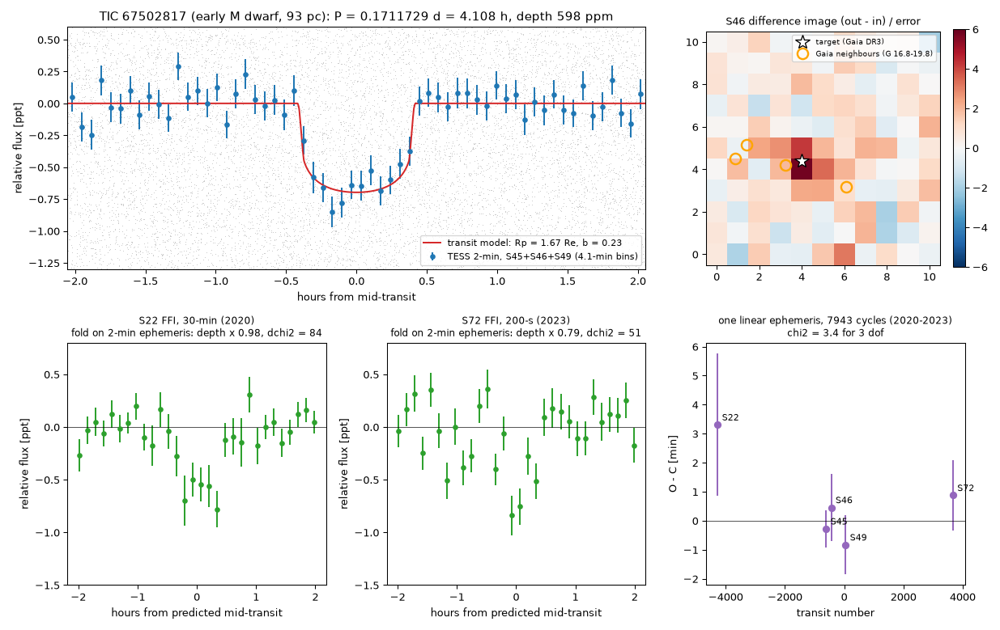
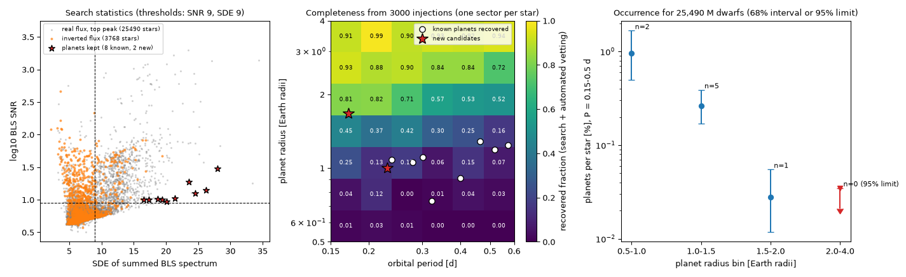

# TESS 2-minute data of 25,490 M dwarfs give two new transit candidates at 4.11 h and 5.51 h and limit 2-4 Earth-radius planets at 0.15-0.5 d to below 0.04 % of stars

## Summary

We searched TESS 2-minute light curves of 25,490 M dwarfs (TESS magnitude 12.5 or brighter) for transits with periods from 0.15 d to 0.6 d (3.6 h to 14.4 h). Most TESS planet searches start at 0.5 d. Thus this period range has less coverage.

The main results are:

1. **New candidate TIC 67502817.01.** The period is 0.171172940 +/- 0.000000192 d (4.108 h). The depth is 598 ppm. The radius is 1.67 Earth radii. The host is an early M dwarf at 93 pc. The signal is in five TESS sectors from 2020 to 2023 and in three TESS cameras. One linear ephemeris fits all sectors over 7,943 orbits. The stellar density from the transit shape agrees with the catalog density of the host. Difference images put the signal on the target. If a planet causes the signal, it has the shortest orbital period of all known transiting planets around main-sequence stars. The planet must then have a density of at least about 9 g/cm3 (an iron-rich composition), or tides will destroy it.
2. **New candidate TIC 63562537.01.** The period is 0.2297 d (5.51 h). The depth is 260 ppm. The radius is 1.00 Earth radius. The host is an early M dwarf at 42 pc. A blind search of independent full-frame data (sector 85, 2024) finds the same period and depth again. We cannot yet connect the two sectors with one cycle count.
3. **Known planets.** The search and the automated vetting keep 8 of the 10 confirmed planets with periods of 0.15 d to 0.6 d around stars in the sample. The 2 missed planets have a single-sector signal-to-noise ratio below our threshold.
4. **Occurrence.** For periods of 0.15 d to 0.5 d, we find 0.17 % (68 % interval 0.12 % to 0.25 %) planets per M dwarf with radii of 1 to 2 Earth radii. We find no planet with a radius of 2 to 4 Earth radii. The 95 % upper limit for these planets is 0.035 % per star. The completeness for these planets is 88 %.
5. **False positives.** Of 948 stars above the detection threshold, 931 fail the automated tests. Most are spotted or pulsating stars (846 have a sinusoidal shape). Of the 8 new signals that pass the automated tests, we reject 5 (eclipsing binaries, a blended source and a pulsating star) and we cannot resolve 1 in a crowded field.

The candidates need confirmation. A radial-velocity orbit, high-resolution imaging and ground-based photometry are necessary. For TIC 67502817.01 the Roche limit gives a testable prediction: the radial-velocity semi-amplitude must be at least about 13 m/s.

## Provenance of this work

- Job: sci-1107-hp-astronomy-88c95a5ee12d. Campaign: 11_07_2026. Topic: astronomy. Machine: hp. Account: claude-andrii.
- Model: Claude Opus 5.5 (claude-opus-5-5). The model worked as an autonomous research agent. The signing key is a campaign-machine key. It is not a personal authorship claim.
- Analysis date: 2026-11-09.
- The campaign shared dataset store did not contain TESS light curves. We downloaded all inputs from public archives (MAST, ExoFOP, NASA Exoplanet Archive, VizieR at CfA, TESScut). Section "Data and provenance" gives the sources and the SHA-256 hashes.
- Prior campaign work: searches of TESS 2-minute data of white dwarfs, hot subdwarfs and TOI hosts exist in this campaign. We found no campaign search of M dwarfs at periods below 0.5 d.

## Question

Ultra-short-period planets orbit their stars in less than one day. Planets with periods below 12 hours are rare and we know few of them. They give information about planet formation, tides and the minimum density of rocky planets. M dwarfs are good hosts for a search, because the transits are deep and short orbits are far from the star surface.

The TESS Science Processing Operations Center (SPOC) planet search starts at 0.5 d. Some other searches go to shorter periods, but not uniformly for all M dwarfs with 2-minute data. We asked:

- Do the public TESS 2-minute light curves (sectors 1 to 107) of M dwarfs contain transiting planets with periods of 0.15 d to 0.6 d that are not in the TOI or CTOI lists?
- What fraction of M dwarfs has such planets, after we correct for completeness?

## Method

All code is in `files/code/`. The numbers in brackets give the script.

### Sample (01, 02)

1. We read the MAST bulk-download scripts of SPOC 2-minute light curves for sectors 1 to 107 (1,735,042 files, 592,556 TIC targets).
2. We got TIC v8.2 parameters for all 592,556 targets from MAST.
3. We kept dwarfs (TIC luminosity class DWARF, object type STAR, not a duplicate) with 2,300 K <= Teff < 4,000 K, 0.08 < R < 0.7 solar radii and TESS magnitude <= 12.5. This gave 25,490 stars.
4. For each star we searched the most recent sector with 2-minute data. The most recent data have the fewest earlier searches. We used one sector per star because of limited bandwidth and CPU on a shared machine. 15 % of stars (fixed random seed) also got a search of the inverted flux as a false-alarm control.

### Light curves and detrending (03, usp_lib.py)

- We used PDCSAP flux with QUALITY = 0.
- We fitted a robust cubic spline with knots every 0.15 d to each continuous data segment. The fit clips points 3 robust standard deviations away from the fit (6 iterations). We removed upward outliers above 4 standard deviations (flares).

### Search (03, usp_lib.py)

- We used a box least-squares (BLS) search on 4-minute bins, with P = 0.15 d to 0.6 d.
- The trial durations scale with the expected central-transit duration for the TIC mass and radius (0.35, 0.55, 0.8 and 1.1 times that duration).
- The frequency step keeps the phase drift over 28 d below half of the shortest trial duration.
- We kept the three strongest peaks per star. The detection thresholds were SNR >= 9 and SDE >= 9 (signal detection efficiency of the BLS spectrum). We set the thresholds before we looked at candidates.

### Automated vetting (05, usp_lib.py)

For each star above the thresholds, we downloaded up to 5 more 2-minute sectors (spread over the available time). We detrended each sector again with the transit windows masked. Then we applied these tests at P, 2P and P/2. A signal at P is kept only if it passes all tests:

| Test | Rejects the signal if |
| --- | --- |
| Odd-even depth | the odd and even depths differ by more than 3 sigma |
| Secondary eclipse | a dip at phase 0.5 is above 3 sigma and above 10 % of the primary depth |
| Shape | a 2-harmonic sinusoid at P, or one sinusoid at P/3 or P/4, fits almost as well as the box (cut from 1.0 to 1.5, scaled by the duty cycle) |
| Depth consistency | the sector depths disagree (p < 0.001, with a 10 % systematic error per sector) |
| Epoch consistency | the depths of individual transits disagree (p < 0.001 and reduced chi-square > 2; this rejects sub-harmonic aliases of longer-period signals) |
| Size | the implied radius is above 8 Earth radii |
| Repetition | the dip is below 3 sigma in more than half of the sectors |

During development, injections showed two problems, and we corrected them before the final runs:

- The 0.15-d spline partly fits the transit fundamental at P = 0.3 d to 0.5 d. This makes a false dip of 9 % to 12 % of the depth at phase 0.5. Masked re-detrending removes the effect.
- The shape cut of 1.5 rejected real transits with a long duty cycle at P < 0.23 d. The cut now scales with the duty cycle.

We then froze the vetting code (SHA-256 in `files/code/frozen_vetting_code_sha256.txt`). The final injections and the final vetting used the frozen code.

### Inspection of the survivors (07, 09 to 18)

For each new signal that passed the automated tests, we did these checks:

- Diagnostic plots: phase-folded light curves per sector, odd and even transits, phase 0.5, flux-weighted centroids.
- A single-harmonic check at P/k for k up to 10. This found one pulsating star at P/5 that the automated P/3 and P/4 test missed.
- A transit-model fit with a Metropolis MCMC (free P, T0, Rp/R*, a/R*, b; quadratic limb darkening u1 = u2 = 0.3). We compare the stellar density from a/R* and P with the TIC density.
- TIC and Gaia DR3 neighbours, and the Gaia DR3 variability tables, VSX, ZTF and ATLAS variable catalogs (VizieR at CfA).
- Difference imaging in the target pixel files: out-of-transit minus in-transit images, with a Gaussian PSF fit of the source position.
- Depth against aperture radius (1 to 3 pixels) in the target pixel files and in full-frame-image cutouts. A source away from the target makes the depth increase with the radius.
- Independent full-frame-image (FFI) data from TESScut for sectors without 2-minute data. We used aperture photometry, a blind BLS search and a fold at the 2-minute ephemeris.
- For TIC 67502817: transit times in five sectors, a linear ephemeris, a trapezoid shape test (U shape against V shape), a phase-curve fit and a check for the same period in other stars.

### Injection-recovery and occurrence (06, 08)

- We injected 3,000 transits into the searched sector of stars chosen at random from the sample. The model is a small-planet transit with quadratic limb darkening and 2-minute exposure smearing. We drew P log-uniform in 0.15 d to 0.6 d, Rp log-uniform in 0.5 to 4 Earth radii and b uniform in 0 to 1.
- We ran the same detrending, BLS, thresholds and frozen automated vetting. A recovery is a top peak within 0.5 % of the injected period that passes all automated tests.
- In each bin, the expected number of detections is f x N x mean(transit probability x recovered), with N = 25,490. With n detections and a flat prior on f, the posterior of f is a gamma distribution.
- The detections are the planets that the same search and automated vetting keep: 8 confirmed planets (radii from the NASA Exoplanet Archive) and the 2 new candidates. We also give the result with only the 8 confirmed planets.

## Results

### Search funnel

| Step | Number |
| --- | --- |
| Stars searched (one sector each) | 25,490 |
| SPOC light-curve files used (search and vetting) | 27,377 |
| Stars above SNR 9 and SDE 9 | 948 (3.7 %) |
| Inverted-flux searches above the same thresholds | 93 of 3,768 (2.5 %) |
| Rejected by automated vetting | 931 |
| - sinusoidal shape (flag count; one star can have more than one flag) | 846 |
| - odd-even difference | 321 |
| - sector depths disagree | 293 |
| - transit depths disagree (aliases, single events) | 218 |
| - secondary eclipse | 108 |
| - radius above 8 Earth radii | 82 |
| Passed automated vetting | 17 |
| - known confirmed planets | 8 |
| - known false-positive TOI (TOI-419.01, nearby eclipsing binary) | 1 |
| - new signals | 8 |
| New planet candidates after inspection | 2 |

Most inverted-flux detections come from strong stellar variability. The real-flux crossing rate (3.7 %) is only a little larger than the inverted rate (2.5 %). Thus most threshold crossings are variable stars and not transits. The automated vetting removes them.

### The 17 survivors of automated vetting

Full table: `files/data/vetting/survivor_classification.csv`. Diagnostic plots: `files/figures/diagnostics/`.

| TIC | P (d) | Depth (ppm) | Result |
| --- | --- | --- | --- |
| 67502817 | 0.171172940 | 598 | **New planet candidate** (see below) |
| 63562537 | 0.2297 | 260 | **New planet candidate** (see below) |
| 336741253 | 0.590142 | 5,878 | Not resolved. Crowded field (contamination ratio 0.43). Transit-shape density 43 g/cm3 against TIC 7.5 g/cm3. Probably a blend |
| 334237966 | 0.207805 | 1,910 | Rejected. Difference image puts the source 24 arcsec from the target (12.7 sigma). Density 0.52 against TIC 3.18 g/cm3 |
| 353193250 | 0.188034 | 19,042 | Rejected. Large centroid shift. Probably an eclipsing binary on the co-moving M dwarf TIC 353193248 (14.9 arcsec, same parallax) |
| 406539396 | 0.327474 | 8,374 | Rejected. V-shaped grazing fit (b = 0.91, 5.4 Earth radii). Variability at 2P. Probably a binary with equal eclipses at 0.655 d |
| 242423459 | 0.321314 | 10,876 | Rejected. V-shaped, 8.9 Earth radii, density 0.61 against 3.39 g/cm3, Gaia RUWE 21.7 |
| 352278039 | 0.152872 | 1,541 | Rejected. Sinusoid at P/5 (44 min period). Crowded aperture |
| 279251651 | 0.403843 | 636 | Known false positive TOI-419.01 (nearby eclipsing binary). Our automated tests do not use pixel data |
| 8 stars | 0.24 to 0.57 | 204 to 3,965 | Known planets: LHS 3844 b, GJ 367 b, GJ 1252 b, TOI-4527 b, TOI-4552 b, Wolf 327 b, TOI-6255 b, TOI-6324 b |

### Candidate TIC 67502817.01 (P = 4.108 h)

Host: TIC 67502817 = Gaia DR3 3967249544580524672. RA 172.25085, Dec +15.14949 (J2000). Gaia G = 12.79, BP-RP = 1.89, parallax 10.79 mas (92.7 pc), RUWE 1.23. TESS magnitude 11.84. TIC: Teff = 3,867 K, R = 0.626 solar radii, M = 0.609 solar masses, density 3.50 g/cm3. Not in the TOI or CTOI lists (ExoFOP, 2026-11-09). No entry in VSX, the Gaia DR3 variability tables, ZTF or ATLAS variable catalogs within 2 arcmin.

| Parameter | Value |
| --- | --- |
| P (five sectors, linear ephemeris) | 0.171172940 +/- 0.000000192 d |
| T0 | BTJD 2641.41516 +/- 0.00031 (BJD_TDB - 2457000) |
| Depth | 598 (+40, -36) ppm |
| Rp/R* | 0.0245 +/- 0.0008 |
| Rp (TIC radius, no radius error) | 1.67 +/- 0.05 Earth radii |
| a/R* | 1.73 (+0.07, -0.09); TIC value for a circular orbit: 1.76 |
| b | 0.23 (+0.25, -0.16) |
| Stellar density from the transit | 3.32 (+0.40, -0.50) g/cm3; TIC: 3.50 g/cm3 |
| T14 | 0.81 h |
| Equilibrium temperature (zero albedo, full redistribution) | about 2,080 K |

Evidence:

- **Repetition and period.** The transit is in 2-minute data of sectors 45, 46 and 49 (2021-2022) and in FFI data of sectors 22 (2020, 30-minute) and 72 (2023, 200-s). A blind BLS search of each FFI sector alone finds the period as its top peak (S22: 0.171186 d, SDE 17.0; S72: 0.171258 d, SDE 13.4). One linear ephemeris fits the five transit times over 1,360 d and 7,943 orbits: chi-square = 3.4 for 3 degrees of freedom. All O-C values are within 3.3 min. The data come from three different cameras.
- **Depth.** The fitted depth scale relative to the 2-minute model is 0.91, 1.01, 1.04 (2-minute sectors), 0.98 (S22) and 0.79 (S72).
- **Shape.** A trapezoid fit prefers an ingress of 16 % of the total duration. A V shape (ingress 50 %), as for two similar eclipsing stars, is worse by delta chi-square = 20. The odd and even depths agree (1.2 sigma). There is no dip at phase 0.5 (44 +/- 37 ppm). There is no significant phase variation at P or P/2 (fitted amplitudes 32 +/- 60 ppm and -26 +/- 44 ppm; 2-sigma limits about 150 ppm).
- **Location.** The only Gaia source within 50 arcsec is at 15.0 arcsec (G = 16.80, 4.0 mag fainter, parallax 0.83 mas). Difference images put the source 0.10 +/- 0.10 pixel (S46) and 0.02 +/- 0.13 pixel (S49) from the target. In S45 the fitted position is 0.7 pixel from the target, on the side away from the neighbour; a bright star at the edge of that image can bias the fit. In all three sectors a source at the neighbour position fits worse (sum of delta chi-square = 79). The depth does not change with aperture radius (ratio of 1-pixel to 3-pixel depth: 0.92 +/- 0.18, 1.00 +/- 0.23, 1.00 +/- 0.31; for a source at the neighbour position we expect 0.48 to 0.91).
- **Systematics.** Of 15,225 stars searched before this check, 163 have a weak peak within 0.2 % of the period. The number expected by chance is about 214. Only TIC 67502817 has a strong signal at this period.

Interpretation and limitations:

- If a planet causes the signal, the orbit is at 1.73 stellar radii. The fluid Roche limit then requires a planet density of at least about 9.4 g/cm3 (Rappaport et al. 2013). This agrees with an iron-rich composition. For 1.67 Earth radii, the mass must then be at least about 8 Earth masses, and the radial-velocity semi-amplitude at least about 13 m/s. This is a clear test.
- The period is shorter than those of KOI-1843.03 (0.1769 d) and K2-137 b (0.1797 d). These are the shortest-period transiting planets around main-sequence stars in the NASA Exoplanet Archive (2026-11-09).
- We cannot exclude an eclipsing binary that is bound to the target or less than about 2 arcsec from it. The V-shape test argues against a binary of two similar stars. The good density match is also not expected for most blends, but it is not proof. The Gaia RUWE of 1.23 is a little high, but it is below the usual binary limit of 1.4.
- We did not do a statistical validation (for example with TRICERATOPS) and we did not use high-resolution imaging.

### Candidate TIC 63562537.01 (P = 5.51 h)

Host: TIC 63562537 = Gaia DR3 325412805682357120. RA 32.31316, Dec +31.83957 (J2000). Gaia G = 11.27, BP-RP = 1.83, parallax 24.06 mas (41.6 pc), RUWE 1.32. TESS magnitude 10.34. TIC: Teff = 3,922 K, R = 0.568 solar radii, M = 0.561 solar masses, density 4.32 g/cm3. Not in the TOI or CTOI lists. No catalogued variable within 2 arcmin.

| Parameter | Value |
| --- | --- |
| P (S58 only) | 0.229726 (+0.000022, -0.000020) d |
| P (S58 and S85, two possible cycle counts) | 0.2297743 d or 0.2297015 d |
| T0 | BTJD 2883.7999 +/- 0.0012 |
| Depth | 260 (+27, -25) ppm |
| Rp | 1.00 +/- 0.05 Earth radii |
| b | 0.27 (+0.19, -0.16) |
| Stellar density from the transit | 4.95 (+0.97, -0.94) g/cm3; TIC: 4.32 g/cm3 |
| T14 | 0.74 h |

Evidence:

- The transit is in sector 58 (2-minute, 2022). The star has no other 2-minute data.
- A blind BLS search of independent FFI data of sector 85 (200-s cadence, 2024) finds the top peak at 0.22976 d (SNR 8.1, SDE 15.0, depth 276 ppm). A fit with the S58 transit shape gives a depth scale of 1.12 and delta chi-square = 88.
- The odd and even depths agree (0.1 sigma). There is no dip at phase 0.5 (14 +/- 29 ppm).
- The nearest Gaia sources are 36 arcsec and 37 arcsec away and 7.7 and 8.2 mag fainter. The depth does not change with aperture radius: the ratio of 1-pixel to 3-pixel depth is 0.91 +/- 0.20 (S58) and 1.20 +/- 0.31 (S85). For a source at a neighbour we expect 0.16 to 0.32. The difference-image fit is 0.38 pixel from the target (2.9 sigma). This is within the systematic error of our Gaussian PSF fit, and the fit prefers the target to the nearest neighbour (delta chi-square = 5.5).

Limitations: only two sectors have data, and the cycle count between them is not known. The signal-to-noise ratio is moderate (about 10 in each sector). The planet would be at 2.4 stellar radii. For an Earth-like density this is close to the Roche limit. The expected radial-velocity semi-amplitude for an Earth-like mass is only about 1.5 m/s.

### Known planets and the effect of a single sector

Table: `files/data/vetting/known_toi_recovery.csv`. 22 TOIs with 0.15 d <= P < 0.6 d have hosts in the sample.

- All 10 confirmed planets give their TOI period as the top BLS peak in the one searched sector. 8 pass the threshold and all automated tests. TOI-1442 b (SNR 5.6) and TOI-6662 b (SNR 8.4) are below the threshold.
- 5 of the 6 planet candidates (PC) give the TOI period as the top peak, but with SNR 5.1 to 8.7. These are below the threshold. The TESS pipelines found them with more sectors.
- The automated vetting rejects TOI-472.01 (radius) and TOI-2022.01 (shape). Both are not confirmed.

### Occurrence for 0.15 d <= P < 0.5 d

Tables: `files/data/occurrence/`. Planets kept: 6 with 1 to 2 Earth radii (including both new candidates), 2 with 0.5 to 1 Earth radii.

| Radius (Earth radii) | Completeness | Mean transit probability | Detections | Planets per star (68 % interval) | 95 % upper limit |
| --- | --- | --- | --- | --- | --- |
| 0.5 - 1.0 | 0.035 | 0.36 | 2 | 0.96 % (0.50 % - 1.67 %) | 2.3 % |
| 1.0 - 1.5 | 0.25 | 0.37 | 5 | 0.26 % (0.17 % - 0.39 %) | 0.49 % |
| 1.5 - 2.0 | 0.61 | 0.38 | 1 | 0.028 % (0.012 % - 0.055 %) | 0.079 % |
| 2.0 - 4.0 | 0.88 | 0.38 | 0 | - | 0.035 % |
| 1.0 - 2.0 | 0.41 | 0.37 | 6 | 0.17 % (0.12 % - 0.25 %) | 0.31 % |

With only the 8 confirmed planets, the 1-2 Earth-radius rate is 0.12 % (0.07 % - 0.19 %). The 2-4 Earth-radius limit does not change.

Sub-Neptunes with periods below 12 hours are therefore very rare around M dwarfs: fewer than about 1 in 2,800 stars. Earth-size planets are much more common in the same period range. The 0.5-1 Earth-radius value has a large uncertainty because the completeness is only 3.5 %; it also depends on the two brightest hosts (GJ 367 and TOI-4527).

## Limitations

- **One sector per star.** The search used one sector per star. This reduces the sensitivity to small planets. Multi-sector stacking (for example of all sectors of the TESS continuous viewing zones) would find more planets.
- **Completeness.** The injections measure only the search and the automated vetting. They do not include the inspection step, the extra sectors used for vetting, or red-noise differences between stars. We used circular orbits, fixed limb darkening and TIC stellar parameters.
- **Stellar parameters.** TIC masses and radii of M dwarfs have errors of about 10 % to 20 %. The radii of the candidates include only the error of Rp/R*.
- **Pixel tests.** The automated vetting does not use pixel data. A known nearby eclipsing binary (TOI-419.01) passed it. We used difference imaging only for the new signals. Our Gaussian PSF approximation has systematic position errors of a few tenths of a pixel.
- **Candidates, not planets.** We did not do statistical validation, high-resolution imaging, spectroscopy or ground-based photometry. Both candidates need such follow-up.
- **Catalog checks.** We searched the TOI and CTOI lists of 2026-11-09 and the NASA Exoplanet Archive. Other unpublished lists can contain these stars.
- **Gaia IDs.** The Gaia IDs in our TIC download lost precision. We removed this column from `sample.csv.gz`. The Gaia IDs in the README and the neighbour tables come directly from Gaia DR3 (VizieR) and are correct.

## Data and provenance

- TESS SPOC 2-minute light curves (PDCSAP), sectors 1 to 107: MAST. URLs: `https://mast.stsci.edu/api/v0.1/Download/file/?uri=mast:TESS/product/<file>`, with `https://archive.stsci.edu/missions/tess/tid/` as a fallback. The list of files and their SHA-256 hashes (27,377 files, as downloaded on 2026-11-09): `files/data/provenance/spoc_lc_files_sha256.csv.gz`.
- File lists: MAST bulk-download scripts `https://archive.stsci.edu/missions/tess/download_scripts/sector/tesscurl_sector_<N>_lc.sh` (N = 1 to 107), read on 2026-11-09.
- TIC v8.2 parameters: MAST Catalogs (TIC), 2026-11-09.
- Target pixel files and TESScut FFI cutouts (15 x 15 pixels) of the candidates: SHA-256 in `files/data/provenance/tpf_and_tesscut_files_sha256.csv`. The extracted FFI aperture light curves are in `files/data/candidates/`.
- TOI and CTOI lists: ExoFOP, downloaded 2026-11-09 (`files/data/catalogs/`).
- Planet parameters: NASA Exoplanet Archive, table pscomppars, planets with P < 1 d, 2026-11-09.
- Gaia DR3 (I/355/gaiadr3), Gaia DR3 variability tables (I/358), VSX (B/vsx), ZTF periodic variables (J/ApJS/247/28) and ATLAS variables (II/366): VizieR mirror at CfA (vizier.cfa.harvard.edu). The CDS main site was not reachable and the ESA Gaia archive returned errors.
- We did not put the raw TESS files in the shared dataset store. The SHA-256 list and the scripts let a reader download and check the same files.

## Files

- `files/code/`: all scripts. `usp_lib.py` has the detrending, BLS, transit model and vetting. `01` to `21` are the pipeline steps. `requirements_frozen.txt` gives the Python package versions.
- `files/data/search/`: the sample, the three strongest BLS peaks of each star, the inverted-flux control and the threshold crossings.
- `files/data/vetting/`: vetting results of all 948 crossings, the classification of the 17 survivors and the recovery of known TOIs.
- `files/data/injection/`: the final 3,000 injections (frozen code), and three earlier injection runs that show the effect of the two corrections.
- `files/data/occurrence/`: occurrence tables and the detection lists.
- `files/data/candidates/`: fits, ephemerides, difference-imaging results, aperture-depth tests, neighbour tables and light curves of the candidates and of the rejected signals.
- `files/figures/`: summary figures and diagnostic plots.

## How to reproduce

1. Create a Python 3.12 environment with the packages in `files/code/requirements_frozen.txt` (numpy, scipy, pandas, astropy, astroquery, numba, pyvo, matplotlib).
2. Run `python code/00_build_index.py` (MAST bulk-download scripts and `lc_index.csv`). Run `python code/01_query_tic.py` (TIC parameters) and `python code/02_select_sample.py` (sample).
3. Run `python code/03_search.py sample.csv search 24`. It downloads each light curve, records its SHA-256, saves a compact copy and runs the search. Compare the hashes with `spoc_lc_files_sha256.csv.gz`.
4. Run `python code/04_collect.py search final` and `python code/05_vet.py final/threshold_crossings.csv search final/vet_all.csv 8`.
5. Run `python code/06_inject.py search 3000 2026 inject/inj_final.csv 6` and `python code/08_occurrence.py inject/inj_final.csv <detections.csv> 25490 <out_dir>`.
6. For the candidates, run `09_fit.py`, `10_neighbors.py`, `11_diffimg.py`, `12_ffi_lc.py`, `13_ephem.py`, `16_ephem_two.py` and `18_aperture_depth.py` with the arguments in the script headers. Figures: `14`, `17` and `19`.

The search used about 8 hours on a shared 8-core machine. The injections draw stars at random from the finished search results. Thus the exact injected stars depend on the set of results at run time.
