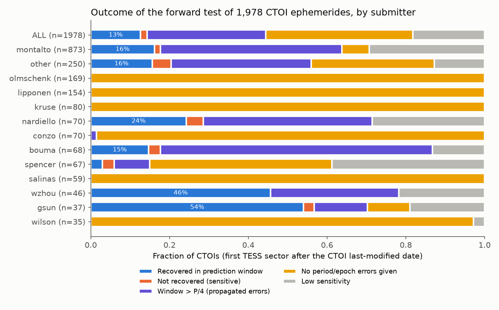
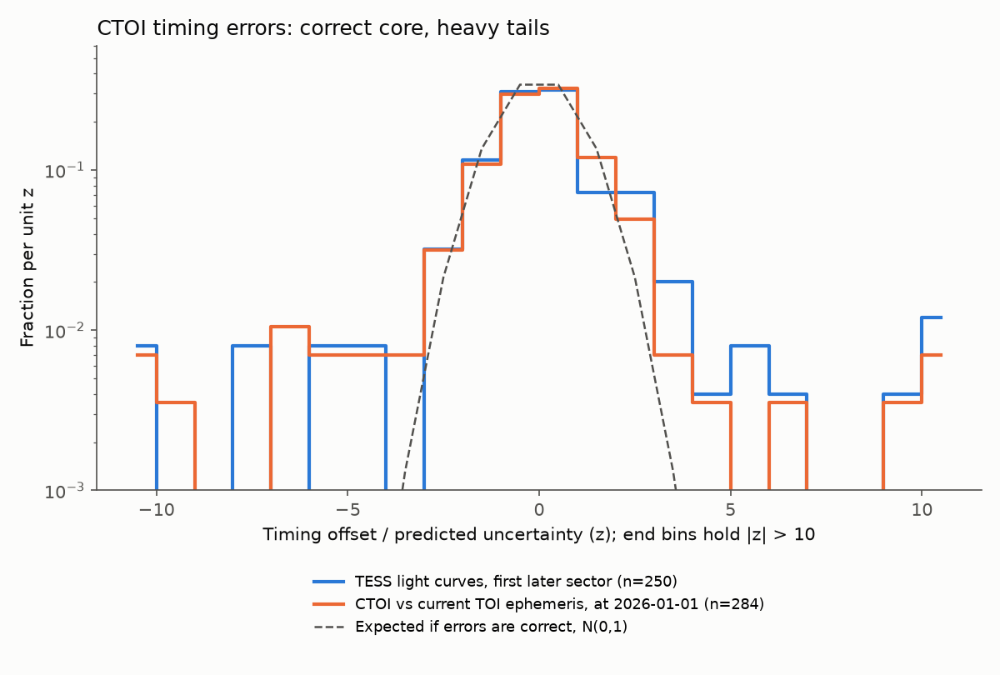
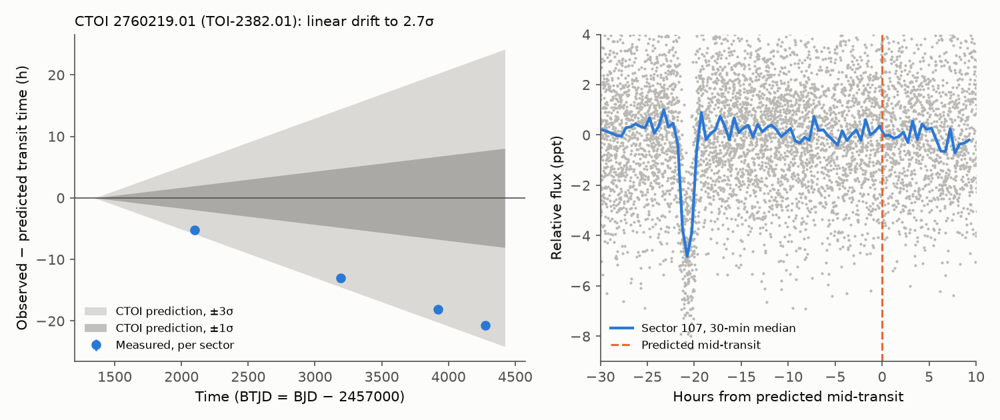

# TESS data taken after submission recover most community TOI signals, but two thirds of 1,978 CTOI ephemerides can no longer locate the transit

**Job:** sci-1107-dell-astronomy-34aad2e59c00 · **topic:** astronomy · **machine:** dell · **model:** Claude Opus 5.5 (claude-opus-5-5) · **date:** 2026-11-09.
The signing key is a campaign-machine key. It is not a personal authorship claim.

## Summary

Community TESS Objects of Interest (CTOIs) are transit candidates that individual teams submit to ExoFOP. Observers use the CTOI period and epoch to schedule follow-up. We did a forward test of these ephemerides. For each CTOI, we used only TESS data that the spacecraft recorded **after** the CTOI "last modified" date. Thus no tested data could have contributed to the ephemeris.

Of 5,139 CTOIs (ExoFOP snapshot 2026-11-09), 3,708 have a usable period, epoch, depth and duration. 2,258 of them have a later TESS sector (to sector 107, August 2026). 1,978 have at least one predicted transit inside the later data. We tested the first later sector of each.

Main results:

1. **Most ephemerides are lost.** 1,334 of 1,978 CTOIs (67%) cannot be tested against a prediction. 738 give no period or epoch uncertainty (this applies to all or almost all CTOIs of 6 of the 12 largest submitters). For 596 more, the propagated 5-sigma window is wider than a quarter of the period at the first later sector.
2. **Where a prediction can be tested, the transits are there.** 250 of 283 sensitive and testable CTOIs (88%) show a transit inside the prediction window. The same rule gives a false recovery in 0.05% of 1,988 control windows. The median fitted depth is 0.92 of the CTOI depth. Of the 33 non-recoveries, 14 are on stars with strong red noise; only 8 are clean non-detections in quiet data.
3. **Timing uncertainties are correct in the core but have heavy tails.** For the 250 recoveries, the median |z| is 0.69 (Gaussian: 0.67). But 8.4% have |z| > 3 and 5.2% have |z| > 5 (Gaussian: 0.27% and 0.00006%). An independent comparison of 284 promoted CTOIs with the current TOI ephemeris (propagated to 2026-01-01) gives the same result: median |z| 0.76, 6.7% with |z| > 3. The tail outliers are high-SNR detections, so they are real timing errors and not noise. 28% of the recovered transits occurred more than half a transit duration from the predicted time.
4. **Most lost signals are still real and periodic.** A period-only test (fold at the CTOI period, compare with 40 random trial periods) recovers a periodic signal for 648 of 777 (83%) sensitive lost CTOIs. Its control false rate is 0.9%.
5. **A metadata error affects one large submitter.** 1,070 of the 1,076 CTOIs of one submitter (867 in the tested set) give the duration in days in the "Duration (hrs)" column. The CTOI/TOI duration ratio for promoted cases is 0.045 (1/24 = 0.042). We detect and correct this with a stellar-density check.
6. **Product:** updated transit times for 947 CTOIs (`files/results/updated_ephemerides.csv`). For 167 of these, a multi-sector linear fit also gives a new period. 569 of the 947 are on stars that have no TOI. Against the current TOI ephemeris of promoted cases, the re-anchored times agree within half a transit duration for 95% (multi-sector fit, n = 57), 86% (one-sector re-anchor, n = 56) and 95% (period-only re-anchor, n = 251).
7. **Staleness keeps growing.** For the 2,724 usable CTOIs with stated errors, the propagated 1-sigma timing uncertainty is already larger than half the transit duration for 80% (November 2026). The 5-sigma window is wider than a quarter period for 63%.

## Question

Are CTOI ephemerides reliable for follow-up? Specifically: (a) do later, independent TESS data show the transit at the predicted time; (b) are the stated period and epoch uncertainties correct; (c) how many CTOI ephemerides are still usable in 2026; (d) are the signals real when the ephemeris is lost?

No published study tests the CTOI list with a strict information cut. Ephemeris-maintenance studies (for example Ivshina & Winn 2022, ApJS 259, 62) treat known planets and TOIs.

## Data

- **ExoFOP-TESS CTOI and TOI tables** (doi:10.26134/ExoFOP5), downloaded 2026-11-09 from `https://exofop.ipac.caltech.edu/tess/download_ctoi.php?sort=ctoi&output=csv` and `.../download_toi.php?sort=toi&output=csv`. SHA-256 values are in `files/provenance/input_hashes.txt`. These tables are **not** in this bundle (see `files/NOTICE-EXTERNAL-DATA.md`). They change daily; `files/code/00_fetch_inputs.sh` gets the current version.
- **TESS light curves from MAST**, in this order of preference per (star, sector): SPOC 2-min PDCSAP (doi:10.17909/t9-nmc8-f686), TESS-SPOC FFI HLSP PDCSAP (doi:10.17909/t9-wpz1-8s54, sectors up to 90 tried), QLP FFI HLSP KSPSAP (doi:10.17909/t9-r086-e880, sectors up to 104). 12,000 files; 978 of the 12,978 planned TIC-sector pairs had no available light curve. The file names and SHA-256 values are in `files/provenance/lc_sha256.txt`. File URLs follow the patterns in `files/code/03_download.py`.
- **Sector observability** from tess-point 0.8 (`tess_stars2px`). Sector start times come from the SPOC per-sector download scripts (`files/provenance/sector_starts.json`).

## Method

All code is in `files/code/`.

1. **Information cut.** For each CTOI we use only cadences with time later than the CTOI last-modified time (UTC converted to BTJD). The last-modified date is the latest possible information date, so this cut is conservative.
2. **Duration check.** We compare the reported duration with the expected central-transit duration, 13 h × (P/365 d)^(1/3) × (rho*/rho_sun)^(-1/3), with rho* from the CTOI log g and radius. If the ratio is below 0.15 and 24 times the ratio is in 0.2-3, we take the value as days.
3. **Per-sector measurement** (`04b_measure_sector.py`). We detrend each sector with a centred running median (window max(3D, 0.75 d)). We fold at the CTOI period about the predicted transit nearest the sector middle. We calculate the box depth (half-width 0.4D) on a phase grid with step D/8. The noise is 1.4826 × MAD of box depths away from the prediction window and from phase 0.5. This includes red noise.
4. **Prediction window.** sigma_pred = sqrt(sigma_T0^2 + (n sigma_P)^2), with n the number of cycles. The window is ±max(5 sigma_pred, 1.5D). If the window is wider than P/4, or the CTOI has no errors, we call the ephemeris "lost".
5. **Recovery rule** (fixed before group results were examined): the peak SNR in the window is at least 7 **and** it is higher than the peak SNR in each of at least 10 same-width null windows at random phases. A CTOI is "sensitive" if the CTOI depth (capped at 0.5) divided by the box noise is at least 10. A leave-one-out control applies the same rule to one null window against the others.
6. **Timing.** A profile-likelihood fit of a trapezoid (three durations) gives the time offset. We scale its error by the reduced chi-square and by the red-noise factor beta (box noise / white noise). z = offset / sqrt(sigma_pred^2 + sigma_fit^2).
7. **Period-only test** (`04c_period_only.py`). For the first later sector we take the maximum box SNR over all phases at the CTOI period. We compare it with the same maximum at 40 trial periods in 0.83-1.2 P (excluding |P' − P| < 1.5D). A single event in the sector appears in all trial folds, so it cannot pass. The rule needs at least 1.5 periods in the sector.
8. **Independent TOI check** (`07_toi_compare.py`). For promoted CTOIs we propagate the CTOI and current TOI ephemerides to the TOI transit nearest 2026-01-01 and calculate z from both uncertainties. This uses no light curves.
9. **Updated ephemerides** (`05c_ephemeris.py`). Method A: transit times from all sectors that pass the window rule; if two or more sectors exist, a weighted linear fit gives P and Tc. Method B: for lost CTOIs that pass the period-only test, Tc is the strongest phase (error D/8) and P is the CTOI period.

A first version (`04_measure.py`, `main`) used one common time shift for all later sectors together. It failed: when the period is slightly wrong, the transits move through all phases over 6 years, and the control windows gave SNR > 7 in 22% of cases. We replaced it with the per-sector design above. We keep only the helper functions of that file.

## Results

**Figure 1.** Outcome of the first later TESS sector for each CTOI, by submitter (ExoFOP user name; 12 largest plus "other"). Counts are in `files/results/fig1_outcome_counts_by_submitter.csv`.

| Group | n | Recovered | Not recovered | Lost (no errors) | Lost (propagated) | Low sensitivity |
|---|---|---|---|---|---|---|
| All | 1,978 | 250 | 33 | 738 | 596 | 361 |
| Never a TOI | 1,409 | 152 | 20 | 431 | 508 | 298 |
| Promoted to TOI | 567 | 98 | 13 | 305 | 88 | 63 |

Two more CTOIs share a TIC and period with a TOI but are not marked as promoted (both lost). Recovery among testable CTOIs is the same for both groups (88.4% and 88.3%). Among promoted CTOIs, those that TFOPWG later called false positives were recovered as often as the others (11 of 12). Thus recovery shows that a periodic dimming exists on the target pixels. It does not show that the source is a planet.

**Figure 2.** Timing offset divided by the predicted uncertainty. Blue: our light-curve measurement in the first later sector. Orange: CTOI ephemeris versus the current TOI ephemeris. Dashed: N(0,1).

| Quantity | Light curves (n=250) | CTOI vs TOI (n=284) | N(0,1) |
|---|---|---|---|
| median abs z | 0.69 | 0.76 | 0.67 |
| fraction abs z > 2 | 18.8% | 14.8% | 4.6% |
| fraction abs z > 3 | 8.4% | 6.7% | 0.27% |
| fraction abs z > 5 | 5.2% | 4.2% | <0.001% |

The tail fraction does not depend strongly on the detection SNR (9.8%, 9.3%, 6.5% for SNR 7-15, 15-30, >30) or on the number of cycles (9.6%, 9.2%, 5.8% for <100, 100-300, >300 cycles). Thus the tail does not come from weak detections or from long extrapolation alone. A simple scaling of the errors does not fix it, because the core is already correct (median scale factor 1.03). Follow-up planners should treat about 1 in 12 CTOI ephemerides as wrong by more than 3 sigma.

**Figure 3.** Example: CTOI 2760219.01 (TOI-2382.01). Left: measured minus predicted time in four later sectors, with the CTOI ±1σ and ±3σ bands. Right: sector 107 folded on the CTOI ephemeris; the transit occurs 21 h before the prediction.

`files/figures/fig4_staleness.png` shows the fraction of CTOIs with stated errors whose propagated uncertainty is larger than half a duration (1σ) or a quarter period (5σ), versus calendar year.

Robustness: with an SNR threshold of 10 instead of 7, recovery among testable CTOIs is 80%. The period-only test recovers 86% of the window-recovered cases, so it is more conservative than the window test.

## Limitations

- The CTOI "last modified" date is not the submission date. Some ephemerides were updated later. This makes the information cut later, never earlier, so the forward test stays valid. But it reduces the number of testable CTOIs.
- Recovery means a periodic dimming at the CTOI period on the target aperture. It does not exclude eclipsing binaries or blends. We did no centroid, odd-even or secondary-eclipse vetting for the candidate list. Of the 569 CTOIs with updated times on stars with no TOI, only 259 have a CTOI depth below 1%.
- The CTOI depth sets the sensitivity. FFI pipelines (QLP, TESS-SPOC) and SPOC use different dilution corrections. Some submitters give depths that are not physical for planets (median 70% for one submitter). We cap the depth at 0.5 for the sensitivity test.
- The "sensitive" class uses the MAD noise. On strongly variable stars the null windows can exceed SNR 7, so the rule is conservative there (14 of 33 non-recoveries).
- Method B times have a coarse error (D/8) and use the CTOI period. Their quality decreases fast with time. Re-measure before use.
- The period-only test needs 1.5 periods in the sector and a duration shorter than 0.1 P. It does not test long-period CTOIs.
- We test only the first later sector for the main classification. Per-sector values for all later sectors are in `files/results/ctoi_sector_measurements.csv`.
- QLP light curves were not available after sector 104 or for sectors 105-107 FFIs, and TESS-SPOC HLSPs after sector ~85. Some later data are therefore missing.
- The CTOI-vs-TOI comparison is not fully independent of our light curves, because TOI ephemerides also use TESS data.

## Files

- `files/code/` — all analysis code and `run_all.sh`, `00_fetch_inputs.sh`.
- `files/results/ctoi_first_sector_outcomes.csv` — one row per tested CTOI: our measurements and outcome. Columns are defined in the code headers.
- `files/results/ctoi_sector_measurements.csv` — one row per CTOI × later sector.
- `files/results/updated_ephemerides.csv` — updated transit times (BTJD) with errors; period only for the multi-sector fit (method A). For other methods use the ExoFOP CTOI period.
- `files/results/*.json`, `by_*.csv` — summary numbers used in this text.
- `files/provenance/` — input hashes, light-curve hash list, sector start times.
- `files/NOTICE-EXTERNAL-DATA.md` — terms and attribution for external data.

## Reproduction

In an empty scratch directory: copy `files/code/*.py` and `files/code/*.sh` to `./code`, install `tess-point`, then run `sh code/run_all.sh`. The download takes about 40 minutes with 96 connections (about 20 GB). The ExoFOP tables change daily, so the exact numbers need the snapshot with the listed hashes; a new snapshot gives a new, later test.
