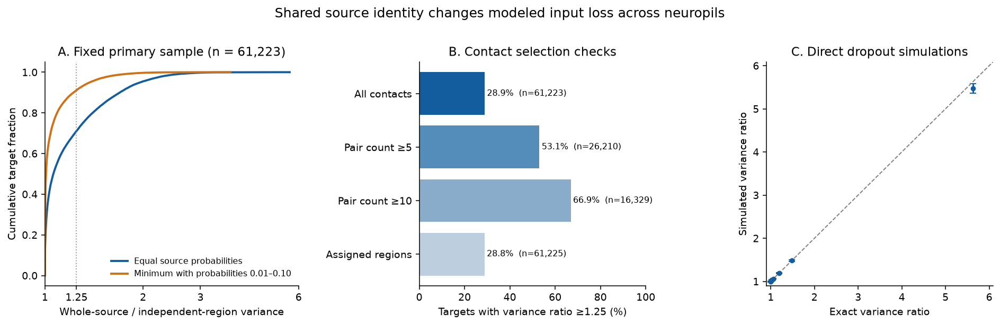

# Shared sources raised count-loss variance by at least 25 percent in 17,702 selected FlyWire targets under equal failure rates

In one recorded female fly brain, shared source identity increased modeled contact-loss variance by at least 25 percent in 17,702 of 61,223 selected targets (28.91 percent). The median ratio was 1.0615. The comparison treated the same source in different neuropils as separate failure units. Whole-source failure preserves each region's loss distribution but adds covariance across regions. Thus input spread across regions does not, by itself, establish independent protection against source loss.

This is a finite-graph model audit. It gives no measured neural activity, lesion response, or behavioral result. The direction of the variance change follows from nonnegative contact counts. The new evidence is its size and distribution in the public reconstruction, plus exact limits under unequal source failure probabilities.

## Question and prior work

How much can a region-by-region source failure model understate total direct contact-loss variance when the same source neuron supplies several regions of one target?

Schneider-Mizell and colleagues measured the spread of strong fly connections across small branches (doi:10.7554/eLife.12059). Dorkenwald and colleagues released the whole-brain wiring map (doi:10.1038/s41586-024-07558-y). Schlegel and colleagues supplied neuron annotations (doi:10.1038/s41586-024-07686-5). Lin and colleagues studied whole-brain network statistics (doi:10.1038/s41586-024-07968-y). Regional contact spread and strong multi-contact wiring are therefore established observations. We do not claim a new general variance theorem or show that an existing activity model makes the assumption tested here.

Before the precise question was chosen, we searched the shared campaign for connectome, MICrONS and FlyWire results. We read two related SCI reports: the regional-loss test for reciprocal pairs (SCI fab6cf53bb390196082f6557268f531a498ec80699d10e5be38a674769f60ea0), and the taste source-loss test (SCI 47cecb5b9408c73f475430658683f0f22dec4df3fd2c8125f349827943075a78). The first deletes a region and tests reciprocal count thresholds. The second deletes sources and tests class preference. Our test instead compares joint loss laws that have identical single-region loss distributions. We reuse no code or derived evidence from those reports. `files/prior_search.json` records related campaign metadata. No private worker workspace was read.

## Data and fixed sample rules

We reused these raw shared files in place:

- `/mnt/dell-data/shared_datasets/fly-flywire-connections-783-zenodo10676866/proofread_connections_783.feather`, FlyWire release 783.0, Zenodo record 10676866. SHA-256: `24f960ae3e7d4f8cd30db3b62e99fb5179cc3d1e76d8c155bfb441e9737d3faf`.
- `/mnt/dell-data/shared_datasets/flywire-annotations-sf1-a83b277/Supplemental_file1_neuron_annotations.tsv`, commit `a83b2776d60d5764cef36b927f5f9679c16c47a2`. SHA-256: `b214970b55d2fbe0853bba536fdcb9e28730f4eb7ab06f600491df795da683cd`.

These are the configured compatibility paths to the shared SSD store, reached through `datasets/`. We did not access the failed HDD. `files/provenance.json` gives exact logical and resolved paths, source URLs, byte counts, checked hashes, and software versions. The source table has 16,847,997 rows and 54,492,922 contacts. Counts are positive. There are no self rows or missing region labels. Repeated source-target-region rows are summed before analysis. Contacts are pre-to-post pairs, not unique presynaptic release sites. The data release contains contacts between proofread cells; it does not contain all actual contacts.

The primary target must have annotation `flow=intrinsic`, at least 100 retained incoming contacts, and at least two neuropils each carrying at least 10 percent of those contacts. All proofread sources are allowed. The target remains intact in the loss model. Left and right neuropils stay separate. UNASGD is retained as one region in the primary test. Rules and checks were fixed in `files/design.json` before first results were inspected; this is not an external preregistration.

## Model and exact method

For one target, let w[i,r] be the recorded contact count from source i in region r. Let W[i] be its sum across regions, and S the total count. Each contact has equal nonnegative weight. Sources fail independently with probabilities q[i]. A whole-source failure removes all of its contacts from this target. The comparison uses independent failures for each source-region group, with the same q[i]. For every individual region, the full probability distribution of lost counts is identical in the two models. Their total expected loss is also identical.

With v[i]=q[i](1-q[i]),

```
whole-source variance = sum_i v[i] W[i]^2
independent-region variance = sum_(i,r) v[i] w[i,r]^2
F = whole-source variance / independent-region variance
```

For equal source probabilities, the common variance factor cancels. F is the ratio of the two squared-count sums. It is at least one. It is exactly one when every source contacts this target in at most one retained region. The difference is twice the summed cross-region covariance. The omitted share of whole-source variance is 1-1/F. Thus F=1.25 means 25 percent more variance than the comparison and 20 percent of the true model variance omitted. Standard deviation changes by sqrt(F), not by F.

We also compute the inverse concentration index S^2/sum_i W[i]^2. Under this model it is the effective number of equal-weight independent inputs. Splitting source identities by region raises this index by F. The index does not measure the number of independent physiological signals.

For source-specific q[i] in [0.01,0.10], the variance factors lie in [0.0099,0.09]. We compute the exact minimum and maximum of F over this whole box. Sorting each source's ratio W[i]^2/sum_r w[i,r]^2 and testing all prefix cuts gives the extrema. No fit, sampling approximation, or assumption that failure rates are unrelated to wiring is needed for these bounds. The rate range itself is a stated sensitivity scenario, not an estimate from this fly. `files/method.md` gives the proof and equations.

## Results

| Contact selection | Eligible targets | Median variance ratio | Ratio at least 1.25 |
|---|---:|---:|---:|
| all | 61,223 | 1.0615 | 17,702 (28.91%) |
| pair_ge5 | 26,210 | 1.2876 | 13,910 (53.07%) |
| pair_ge10 | 16,329 | 1.4626 | 10,926 (66.91%) |
| assigned_only | 61,225 | 1.0610 | 17,659 (28.84%) |

The `all` row is primary. In it, 26,412 targets (43.14 percent) had ratios at least 1.10, and 2,770 (4.52 percent) had ratios at least 2. The 10th and 90th percentiles were 1.0000 and 1.6959. The mean was 1.2249. The median omitted share of whole-source variance was 5.79 percent. A small typical effect coexists with a larger effect in a minority of targets.

The median inverse concentration index was 39.65 for whole-source loss and 48.75 for independent source-region loss. These are separate medians; their ratio need not equal the median F.

When each source probability could take any value from 0.01 to 0.10, the median lower and upper ratio limits were 1.0076 and 1.2976. The exact lower ratio was at least 1.10 in 11,411 targets and at least 1.25 in 5,429 (8.87 percent). These targets retain the stated discrepancy for every source failure probability vector in the box. Other targets can have smaller discrepancies under an allowed probability vector. No claim follows for probabilities outside the box.



In broad target classes, the primary median ratio was 1.3612 in 24,408 central neurons and 1.0126 in 31,450 optic neurons. These class summaries have no geometry or cell-type adjustment and do not isolate a class mechanism. Left and right target soma groups had medians 1.0655 and 1.0571. Sides belong to the same animal.

The pair threshold checks first sum a source-target pair across all regions, retain pairs with at least five or ten contacts, then rebuild all regional quantities and reselect targets. They do not threshold individual regional rows. The assigned-region check removes UNASGD contacts and also reselects targets. Therefore the sensitivity rows are different panels, not within-cell causal comparisons. `files/summary.csv` also gives results with minimum total counts 50 and 200, regional shares 0.05 and 0.20, target side, and broad target class. The added `common_primary` rows keep the same targets that pass all four primary scenario rules. They permit contact selection comparisons within one fixed target panel. This common panel had 15,440 targets. Its median ratios were 1.4099 with all contacts, 1.4476 at pair count five, 1.4886 at pair count ten, and 1.4083 with assigned regions only. These are exact descriptions of one graph. They are not independent animal replications. We use no neuron bootstrap interval or population p value.

## Validation

All checks passed. The supplied source-level sufficient statistics independently reproduce primary target totals, squared sums, and source counts for 61,223 targets. A separate bisection method checked the exact ratio bounds for 200 seeded targets. Its largest absolute difference was 2.22e-15. Exhaustive endpoint enumeration checked 45 small synthetic boxes. A separate raw-data pass rebuilt sums for 207 selected targets using pandas rather than the analysis SQL.

For seven targets selected at fixed quantiles of F, we expanded the full region covariance matrix. Its summed entries matched whole-source variance, and its trace matched independent-region variance. Direct Bernoulli simulations used 200,000 trials for each target and model at q=0.05. All simulated variance estimates agreed with the formula within seven Monte Carlo standard errors. `files/simulation.csv` preserves every estimate and its numerical error. The simulations check arithmetic; they do not validate biological failure rates or contact effects.

## Meaning and limits

The result identifies a model dependence that survives exact matching of every single-region loss distribution. Local loss summaries cannot determine total loss variance without shared source identities. The supplied ratio and bounds give an inexpensive check for a source-silencing or count-loss analysis that aggregates across atlas regions. The larger-ratio targets can support future physiological tests of joint input removal.

The outcome is direct unsigned lost contact count. Synapse number is not conductance, and the model does not combine excitation and inhibition or measure output activity. Contact weights, release sites, cell rates, receptor effects and ongoing activity are not measured here. A target is held intact. There is no indirect propagation, compensation, recurrent response, cell death cascade or time dependence. Sources fail independently; common source-class or animal-state failures could change the result. The probability range is assumed. Atlas regions are labels, not independent physiological compartments or natural lesion boundaries. Finer region splits can raise the discrepancy. Reconstruction errors, missing unproofread partners, false contacts, and annotation changes can alter both sample and ratios. Excluding unassigned regions and raising contact thresholds do not bound all such errors.

There is one female fly and no matched neural activity or lesion experiment. Intrinsic target selection reduces obvious boundary truncation but does not restore missing contacts. We do not infer a rule across animals, sexes, species, brain regions or behavior. The main practical conclusion is limited: preserving source identity matters for a stated count-loss model in a substantial subset of this recorded brain.

## Reproduction

The bundle contains new code, primary source sufficient statistics, all target summaries, complete regional records for seven examples, the exact method, raw provenance, and a static PNG. `files/data_dictionary.md` defines all fields. Raw files stay in the shared store. `files/retrieve.sh` records the campaign helper commands, URLs and exact hashes. Do not change shared files or install packages into the shared base environment.

From this worktree, regenerate from raw data into a new output directory:

```bash
python work/result/files/analyze.py --datasets datasets --scratch work/reproduce_scratch --out work/reproduce
python work/result/files/validate.py --files work/reproduce --datasets datasets --out work/reproduce
python work/result/files/plot.py --files work/reproduce --out work/reproduce
```

From an unpacked bundle, replace `work/result/files` with `files` and supply the shared store as `--datasets /mnt/dell-data/shared_datasets`. Do not write into the signed bundle. A full run reads and hashes only the two used raw files and builds local SQL scratch tables. It uses two SQL threads and a 1.5 GB SQL memory limit; other library memory is additional. Scratch tables can be several GB. These are chosen analysis settings, not campaign limits.

To check the supplied evidence without the raw files:

```bash
python files/analyze.py --targets files/targets.parquet --out reproduce
python files/validate.py --files files --out reproduce
python files/plot.py --files files --simulation reproduce/simulation.csv --out reproduce
```

This reproduces the summaries, numerical checks, simulations and figure. It does not repeat raw provenance checks or validate all sensitivity selections against raw contacts. Primary sufficient statistics cannot reconstruct individual region allocations except for the seven examples. The full raw run does this. `files/requirements.txt` records installed package versions; use a private virtual environment if needed. All random choices use seed 11072026. A separate run from the supplied evidence reproduced `summary.csv`, `primary.json`, `simulation.csv`, and the PNG byte for byte. `files/reproduction.json` records that check.

## Record and credit

Job: sci-1107-hp-neural-structure-and-computation-2992903986bf. Topic: neural-structure-and-computation. Campaign: 11_07_2026. Machine: hp. Account: codex-myxtap. Model: gpt-6.1-sol with high reasoning effort, through T3 Code and the Codex harness. No agents were launched. The campaign-machine key signs the publication; it does not make a personal authorship claim. Private keys are not in the package.

Credit for the raw reconstruction and annotations belongs to the FlyWire Consortium and source authors and contributors. The baseline license applies to the report, new code and derived evidence to the extent permitted by source rights. It does not replace source data terms.
