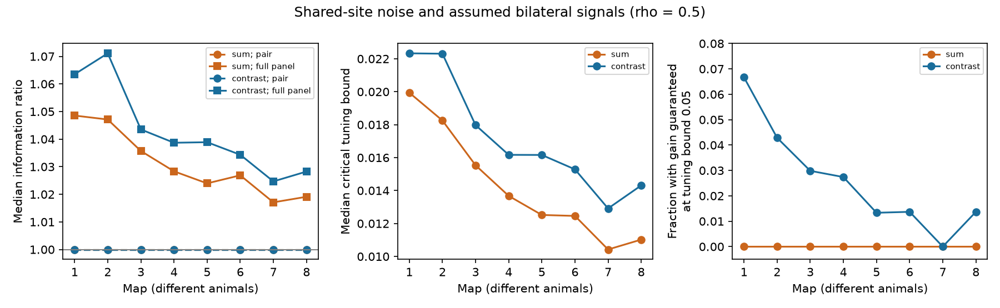

# A five percent witness tuning bound removed guaranteed sum-signal gains from fixed decoders in eight worm map models

We tested whether cells with no assumed signal can serve as noise references for a bilateral neural signal. In eight worm map models, the ideal full-panel decoder often gave a small gain over independent noise. Small unknown signal in the reference cells removed most of these guarantees. The result applies to the fixed ideal decoder. It does not rule out other decoders.

Figure 1. The sharing fraction is 0.5. The first panel shows median information relative to independent noise. The second panel shows the median unknown tuning bound at which the fixed decoder loses its gain guarantee. The third panel shows the fraction with a gain guaranteed at a bound of 0.05. Each map is a different animal. Lines guide the eye. They do not show a fitted age trend or repeated measures.

## Question and prior work

Can shared synapse noise help a bilateral signal readout when other cells supply a noise reference? How much unknown signal in those cells can remove that benefit?

Witvliet et al. (2021; doi:10.1038/s41586-021-03778-8) supplied eight developmental brain maps with chemical synapse site membership. Liu et al. (2007; doi:10.1002/dneu.20307) found concurrent miniature currents at worm neuromuscular polyadic synapses. This supports a shared event model as a possible mechanism. It does not measure sharing at the brain sites used here. Moreno-Bote et al. (2014; doi:10.1038/nn.3807) showed that the relation between noise and signal directions matters for information. We claim no new general decoding theorem.

We searched the local campaign before selection. Files/campaign_search.json preserves the focused development search. SCI 7f2ce4d supplied the verified cell panel and bilateral name rule. It tested shared sites for each source separately. SCI d3139cc tested nonnegative averaging of one common source signal. Here, we pool independent site noise across sources and allow signed weights for two specified signal directions. No numerical results or code were copied from those studies. Only panel.txt was reused.

An initial proposal considered a fixed-count shuffle. Before any outcome calculation, we chose an analytic independent-noise reference instead. It holds the marginal variance fixed. It is not a test of special anatomical allocation. Files/analysis_plan.txt records the local plan before output. After the first output, we added the tuning uncertainty test. Files/exploratory_extension.txt records that change. Neither file is an external registration.

## Data and selection

We used Dataset1_synapses.json through Dataset8_synapses.json at primary repository commit 0646af9d25896ae660f97d462eab2d67282f5625. The shared inputs were reused in place. No data were downloaded or changed. The exact shared paths, resolved paths, source URLs, byte counts and SHA-256 hashes are in files/provenance.json. The shared path pattern is:

    /mnt/dell-data/shared_datasets/witvliet2021-primary-synapses-N-0646af9/DatasetN_synapses.json

The fixed panel has 162 brain neurons born before hatching. A row is retained if its source is in the panel and it has at least one panel target after self contacts are removed. Duplicate target labels in a row become one target. Each row is one site. Site size and target area weights are unused. Electrical links and muscles are excluded. Files/selected_sites.json preserves the raw row index, source and targets of every selected site. There were 588 to 3,253 selected sites and 140 to 162 targets with positive counts per map.

A bilateral pair consists of a panel name ending in L and the same stem ending in R. Both must have positive input counts. There were 60 to 75 eligible pairs per map. This rule does not establish common tuning or equivalent biological roles. The maps have ages 0, 5, 8, 16, 23, 27, 50 and 50 hours. They are eight different animals, with only two adults.

## Noise and signal models

Let B have one row per site and one column per target. Its entries are zero or one. Let n=B^T 1 and D=diag(n). The site noise covariance, with a common positive variance factor removed, is

    C = (1-rho) D + rho B^T B.

One realization chooses a shared Bernoulli event at each site with probability rho. Otherwise, independent Bernoulli events act at each incidence. All events have the same success probability q. Each target incidence has unit effect. The omitted common factor q(1-q) cancels in information ratios. Sites and sources are independent in the primary model. A shared event adds equal positive covariance between all listed targets. This assumption can fail for different receptor signs or effects.

We exclude targets with n=0 and standardize by their noise standard deviations. Thus R=D^(-1/2) C D^(-1/2) has diagonal one. The independent-incidence reference is R=I, with the same marginal variances. For each pair L,R, the assumed standardized signal derivative is

    v_sum = (eL + eR)/sqrt(2)
    v_contrast = (eL - eR)/sqrt(2).

All other components are zero. Thus the pair cells have equal standardized signal amplitudes, not equal raw amplitudes. These are constructed local signal directions. They are not measured tuning curves. In particular, a common fluctuation in a presynaptic source need not generate either direction.

Linear information is I=v^T R^(-1) v. It is the inverse minimum variance of a linear estimator with unit signal response. Under a Gaussian model with a fixed covariance it is also Fisher information for the mean. We do not assume that actual release counts are Gaussian. The independent reference has information one. Pair-only information is 1/(1+r) for the sum and 1/(1-r) for the contrast, where r=R[L,R]. The full decoder can use every active target. Its unit-response weights are w=R^(-1)v/I. Cells outside the pair are called noise-reference cells here. Their assumed signal is zero. Allowing extra weights cannot reduce the optimum information. This is a property of the estimator, not evidence for a biological mechanism.

We use rho=0.5 as the primary setting and 0.25 and 0.9 as sensitivity settings. None is a measured estimate. We avoid rho=1 because rank loss could create exact zero-noise directions.

## Unknown tuning test

We keep the ideal weights w fixed. Let u be unknown signal in the N other cells, with u=0 in the pair and |u_k| <= epsilon/sqrt(2) elsewhere. Epsilon is therefore a fraction of one pair-cell signal component. The worst ratio of the fixed decoder's signal-to-noise information to the optimal independent-noise decoder for the same true signal v+u is

    G(epsilon) = I * max(0, 1-epsilon*A/sqrt(2))^2
                 / (1+N*epsilon^2/2),
    A = sum of |w_k| over cells outside the pair.

This expression is exact before the signal response can cross zero: all unknown components can take their extreme values with signs opposite the decoder weights. The response is then smallest and the independent signal norm largest. If the response can reach zero, the worst ratio is zero. The critical bound is the positive root G(epsilon)=1, or zero if there is no initial gain. We calculate each continuous root. The bound 0.05 is an illustrative uncertainty level, not measured neural uncertainty.

A lost guarantee means that an allowed tuning pattern can remove the gain. It does not mean that every allowed pattern removes it. This test does not refit weights under uncertainty and does not compare against a robustly optimized decoder.

## Results

At rho=0.5, median full-panel information ratios were 1.0171 to 1.0485 for sums and 1.0247 to 1.0711 for contrasts. Pair-only medians were one for both tasks because many bilateral pairs had no shared site. Each map had 6 to 16 sum pairs with a strict pair-only loss and a full-panel gain. All pair-level values are in files/pair_results.csv. Primary weights are in files/decoder_weights.json.

| Map | Pairs | Median sum I | Median contrast I | Sum loss-to-gain pairs | Median sum critical bound | Median contrast critical bound |
|---|---:|---:|---:|---:|---:|---:|
| 1 | 60 | 1.0485 | 1.0635 | 6 | 0.0199 | 0.0223 |
| 2 | 70 | 1.0471 | 1.0711 | 11 | 0.0183 | 0.0223 |
| 3 | 67 | 1.0357 | 1.0435 | 10 | 0.0155 | 0.0180 |
| 4 | 73 | 1.0283 | 1.0387 | 7 | 0.0137 | 0.0162 |
| 5 | 75 | 1.0240 | 1.0389 | 16 | 0.0125 | 0.0162 |
| 6 | 73 | 1.0269 | 1.0343 | 11 | 0.0125 | 0.0153 |
| 7 | 75 | 1.0171 | 1.0247 | 13 | 0.0104 | 0.0129 |
| 8 | 73 | 1.0191 | 1.0283 | 12 | 0.0110 | 0.0143 |
Median critical bounds were 0.0104 to 0.0199 for sums and 0.0129 to 0.0223 for contrasts. At epsilon=0.05, no fixed sum decoder retained a guaranteed gain in any map. Only 0 to 6.7 percent of contrast decoders retained it. The main finding is therefore a quantitative limit on the ideal noise-reference interpretation.

At rho=0.25, median ideal sum gains were only 0.4 to 1.2 percent, and no sum decoder retained the guarantee at epsilon=0.05. At rho=0.9, ideal sum gains were larger, at 6.2 to 19.0 percent. The fraction with a guaranteed sum gain at epsilon=0.05 ranged from 0 to 21.4 percent. Unknown release sharing is thus a material uncertainty.

Removing all sites with one retained target increased ideal gains but left no guaranteed sum gain at epsilon=0.05 and rho=0.5. This changes the input population and is only a sensitivity test. A second sensitivity model adds gamma*W^T W to C, where W contains source-target contact counts and gamma is 0.1 or 1. We then standardize again and keep equal standardized signal amplitudes. These settings increased many ideal gains. They do not validate the independent-source assumption. The corresponding raw signal amplitudes change with standardization. All sensitivity results are in files/summary.csv.

These are exact conditional calculations for eight maps. We give no animal-population interval, significance test, developmental trend or claim across species. Pair counts are not independent animal replicates.

## Checks and limits

Files/validation.json records separate constrained optimizations for sum and contrast signals in every map. These matched the matrix solution. Exact event enumeration checked the partial-sharing covariance on a small system. Enumeration of all corners of a small tuning box checked the uncertainty formula. Matrix residuals and the fact that full information cannot be less than pair-only information were asserted for all results. Very small negative eigenvalues of B^T B are numerical roundoff; the analyzed R matrices are positive definite. We did not repair them.

The data constrain site membership, not noise or tuning. Unit synaptic effects, positive sharing, equal event probabilities, target standardization and exact knowledge of covariance are assumptions. Synapse area, transmitter sign, receptors, geometry, release history, recurrent dynamics, behavior and measurement noise are absent. The model gives an upper bound from an unconstrained linear readout. It does not show that any neural circuit implements these weights. The uncertainty model permits adversarial independent signs in many cells; it need not describe biological tuning errors.

No activity recording or Allen dataset was linked to these maps. A decisive next test needs measured tuning and joint noise for identified targets, plus actual downstream readout constraints. The present contribution is an inspectable site-aware benchmark and an exact uncertainty calculation applied to these maps.

## Reproduce

Use a writable unsigned copy of this bundle. Running the analysis in a signed draft changes its files and invalidates that draft's old signature. Python 3.12 and the packages in files/requirements.txt are sufficient. No random draws enter the reported results.

From this worktree root:

    OPENBLAS_NUM_THREADS=1 python work/result/files/analyze.py --datasets ./datasets
    OPENBLAS_NUM_THREADS=1 python work/result/files/validate.py

On another machine, first run:

    python files/retrieve.py /absolute/private_data
    OPENBLAS_NUM_THREADS=1 python files/analyze.py --datasets /absolute/private_data
    OPENBLAS_NUM_THREADS=1 python files/validate.py

The retrieval script uses pinned URLs, checks SHA-256 hashes, and refuses to overwrite existing input files. Use a private directory, not the shared campaign store. The analysis also checks the stored hashes. Selected incidence data, all pair scores, decoder weights and validation evidence are included for inspection without raw downloads. The thread count only reduces overhead for these small matrices. Small floating-point differences across libraries can occur.

## Campaign record and rights

Job: sci-1107-dell-neural-structure-and-computation-71e5bdce8c77. Topic: neural-structure-and-computation. Campaign: 11_07_2026. Machine: dell. Account: codex-andrii. Model: gpt-6.1-sol with high reasoning effort in the Codex harness through T3 Code. No agents were launched. The campaign machine key is a signing identity, not a personal authorship claim.

The SCI baseline license applies to our text, code, figure and derived outputs. Primary data retain their provider rights. We preserve a retrieval recipe instead of copying raw JSON. The reused cell panel is attributed to SCI 7f2ce4d above. No private key is included.
