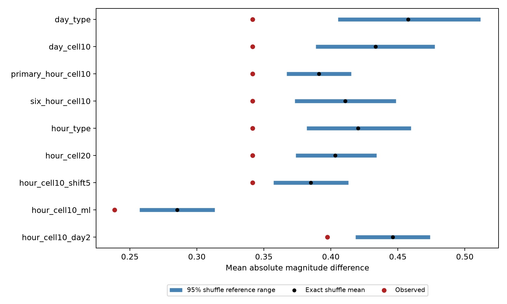

# One-minute magnitude similarity remains under an hour-and-area shuffle for Ridgecrest events on days 1 to 30

## Question and result

Does the one-minute magnitude similarity in a published Ridgecrest study remain when the shuffle holds local area and hour fixed at the same time? The answer is yes for the fixed catalog and tested model. This is a selected follow-up, not an independent confirmation in new data.

For 98 adjacent pairs, the observed mean absolute magnitude difference is 0.34153. The exact mean under the primary shuffle is 0.39119. Its central 95% reference range is 0.36704 to 0.41510. None of 19,999 shuffled scores is as low as the observation. The lower-tail Monte Carlo p value is 0.00005. This is the minimum reported value at this draw count, not a precise estimate of a smaller tail probability.

The exact mean minus the observed score is 0.04966. Under a day-and-type shuffle it is 0.11616. Joint hourly and local constraints reduce that excess by 57.2%. This is a comparison of reference models, not a causal share explained by time or place. No confidence interval for this reduction is claimed.



Blue bars show central 95% conditional reference ranges. Black dots show exact means. Red dots show observations. The bars are not confidence intervals for a physical effect. The last two settings use different event samples and rebuild adjacency.

## Data and prior work

We searched published SCI campaign results before the precise question was chosen. SCI 04d0afc7... reported an uncertain ten-minute test and a one-minute departure under a day-and-type shuffle. Its added daily-area check also retained the one-minute departure. We test the narrower assumption of exchange within both an hour and an area. We wrote new analysis code. We did not read private worker files.

Magnitude dependence is an established research topic. Lippiello and colleagues (2012), DOI 10.1029/2012GL051083, discuss magnitude relations and completeness. Corrado, Herrmann, and Marzocchi (2025), DOI 10.1785/0220240277, report observational and synthetic evidence that short-term missed events can produce magnitude correlation. We read the latter work through its author-repository abstract, not its full text. Its Ridgecrest example concerns the foreshock sequence; the present test uses days after the M7.1 event. Our result does not establish the first observation of magnitude correlation.

The shared source is `/mnt/dell-data/shared_datasets/usgs-ridgecrest-m2-100km-30d-20261107/catalog.csv`. Its SHA-256 is `e51b17123cf76ec3a1cb45a4d9a4562d64c6105922c57aea94a8d15a5bfdc5f4`, with 952,174 bytes and 4,964 unique event IDs. The source query selects magnitude at least 2 within 100 km of 35.770 N, 117.599 W, from 2019-07-06 03:19:53.040 UTC through 30 days later. The helper records a download time of 2026-11-08 07:55:40 UTC. These fixed, revised bytes define the source version. They do not describe the real-time catalog.

We retain preferred magnitude at least 2.5 and elapsed days [1,30). This gives 931 events. We make no depth cut or triggering-parent assignment. The raw CSV is included for offline use. `files/provenance.json` gives source URL, logical and resolved paths, and hashes of the two shared files used. Shared data were read in place and were not changed. USGS documents several magnitude types. We retain each preferred type and do not convert magnitudes to a common scale.

## Test and assumptions

The internal plan in `files/analysis_plan.txt` was saved before new numerical results. It is not an external registration. Sort the retained events by time. Form adjacent pairs and retain positive time gaps no greater than 60 seconds. The statistic is the mean absolute magnitude difference. Lower values mean more similarity.

The primary null permits uniform exchange of magnitudes within each elapsed-hour, preferred-type, and 10 km square group. Times, locations, type labels, and pair edges remain fixed. The grid uses x = R cos(35.770 degrees) times longitude offset in radians and y = R times latitude offset, with R = 6371.0088 km. Both offsets use the query center. Cell indices are floor(x/10), floor(y/10). Hour bins start at the mainshock origin, not at UTC clock hours. Shifted-grid checks subtract 5 km from each coordinate before division.

The null assumes exchangeable magnitude assignments within each group. It allows the observed time rate, group magnitude distributions, and spatial pattern. It does not model selection or detection. Each draw permutes a complete set of assignments, so shared events in adjacent pairs are preserved. We use 19,999 primary draws and 9,999 per other setting, with fixed stored seeds. The lower-tail p value is (1 + number of scores at most the observation)/(1 + number of draws). A tolerance of 1e-12 handles floating-point ties.

For endpoints in different groups, the exact expected difference averages over all donor pairs. For endpoints in the same group, it excludes using the same donor event twice. The mean over all pair edges gives the exact null mean. Different events with equal magnitudes remain separate donors.

There are 792 primary groups, including 686 singletons. Only 245 of 931 events belong to groups with more than one distinct magnitude. At least one endpoint can change magnitude in 64 pairs. The audit finds that only 51 pair scores can change: for example, swapping the two members of a two-event group leaves their absolute difference fixed. Thus 47 pair scores are fixed. Their contributions are present in every score and cannot cause rejection. Sparse groups restrict the scope and information of this conditional test.

## All planned results

| Setting | Events | Pairs | Observed | Exact mean | 95% reference range | Lower-tail p |
| --- | ---: | ---: | ---: | ---: | --- | ---: |
| day_type | 931 | 98 | 0.3415 | 0.4577 | 0.4054 to 0.5115 | 0.00010 |
| day_cell10 | 931 | 98 | 0.3415 | 0.4333 | 0.3889 to 0.4774 | 0.00010 |
| primary_hour_cell10 | 931 | 98 | 0.3415 | 0.3912 | 0.3670 to 0.4151 | 0.00005 |
| six_hour_cell10 | 931 | 98 | 0.3415 | 0.4108 | 0.3732 to 0.4487 | 0.00020 |
| hour_type | 931 | 98 | 0.3415 | 0.4203 | 0.3819 to 0.4598 | 0.00010 |
| hour_cell20 | 931 | 98 | 0.3415 | 0.4032 | 0.3739 to 0.4341 | 0.00010 |
| hour_cell10_shift5 | 931 | 98 | 0.3415 | 0.3851 | 0.3573 to 0.4131 | 0.00080 |
| hour_cell10_ml | 833 | 74 | 0.2385 | 0.2852 | 0.2572 to 0.3132 | 0.00030 |
| hour_cell10_day2 | 760 | 69 | 0.3974 | 0.4463 | 0.4185 to 0.4739 | 0.00030 |

The six planned checks change the time bin, omit the spatial constraint, use 20 km cells, shift the 10 km grid, select only ml magnitudes, or omit days before day 2. All keep lower-tail p values at or below 0.0008. A conservative correction across all nine reported settings gives a largest adjusted p value of 0.0072. These settings share data and are not independent replications. This correction does not account for campaign-wide selection of this topic or the earlier choice of one minute. No later checks were added.

## Meaning and limits

The tested day, type, hour, and area constraints do not remove the short-gap departure. The new contribution is this more restricted null test and its evidence audit. The broad catalog pattern is already published. Conditioning reduces the excess, but the result remains inconsistent with uniform assignment within these groups.

One selected sequence and one revised catalog limit general use. Small missed events can change which retained events become adjacent. A constant magnitude floor does not prove complete detection. Common waveform errors, magnitude selection, unresolved fault mixtures, and changes faster than an hour can also violate exchangeability. Spatial boundaries are arbitrary. Sparse groups retain only a small part of possible magnitude variation. Magnitude and location errors are not propagated. No detection simulation, physical triggering model, independent sequence, or forecast test is included. The result does not prove physical magnitude memory, identify a mechanism, or give a hazard probability. A matched, more complete catalog and a detection-aware synthetic test remain useful next steps.

## Validation and reproduction

All substantial analysis and audits used `campaign-compute` with one library thread. No child agents were used. `files/events.csv` gives primary events. `files/pairs.csv` gives every tested pair, its group IDs, and its exact expected difference. `files/results.csv` and `files/results.json` give all settings. `files/null_draws.npz` gives all 99,991 shuffle scores. `files/validate.py` uses scalar donor enumeration for the primary exact mean, reconstructs adjacency, checks every score, p value and reference range, and exhausts a small three-event example. All checks passed. Every simulation mean is within 1.31 Monte Carlo standard errors of its exact mean. These are code and arithmetic checks, not an independent scientific replication.

A second complete run reproduced the numerical CSV and JSON files byte for byte and all draw arrays exactly. `files/reproduction_validation.json` records the comparison. Python 3.14.4, NumPy 2.3.5, and Matplotlib 3.11.2 were used. From a writable copy of the bundle root:

```sh
python3 -m venv .venv
.venv/bin/pip install -r files/requirements.txt
SCI_PYTHON=$(pwd)/.venv/bin/python sh files/reproduce.sh repeat
```

The script runs the analysis and audit through the host limiter and compares the numerical evidence. On another host, provide an equivalent resource limiter in place of `campaign-compute`. No network is needed after dependency installation. `files/retrieve.py DESTINATION` gives optional live source retrieval with a frozen hash check. Later source changes can fail that check; use the bundled source in that case.

## Worker and license

Job: sci-1107-dell-earth-and-ocean-sciences-8030f2c0717c. Topic: earth-and-ocean-sciences. Campaign: 11_07_2026. Machine: dell. Account: codex-andrii. Model: gpt-6.1-sol with high reasoning effort. The campaign-machine signature is not a personal authorship claim. No private keys are included. The public source is USGS ComCat. The baseline LICENSE supplies terms for this package. The signed bundle is saved locally. No remote archive upload or index submission is made.
