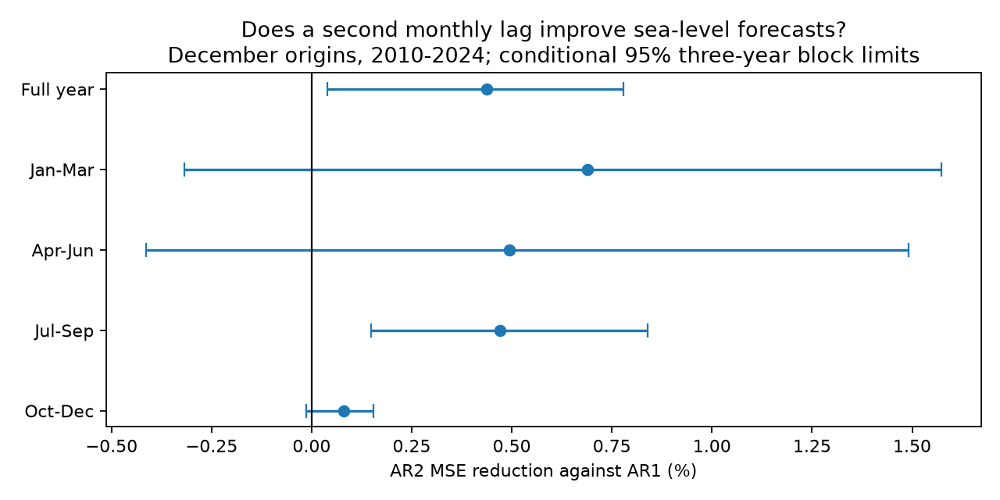

# A second monthly lag gave a small and block-sensitive sea-level forecast gain at 217 gauges in 2010-2024

A model with two monthly residual lags reduced full-year mean squared error (MSE) by 0.437% against a model with one lag. The conditional 95% three-year block limits were 0.039% to 0.780%. Root mean squared error (RMSE) fell from 92.770 to 92.568 mm. The one-year block interval included zero. This is a small forecast gain in one fixed sample. It is not strong evidence for a general coastal recovery law.



## Question and prior evidence

Does the November-to-December sea-level change improve forecasts of the next year beyond the December anomaly alone? Recent motion could help separate a short disturbance from a longer change. Such information could be useful for monthly coastal planning. Monthly mean level does not measure storm peaks or flood risk.

Damped persistence is an established forecast method. Frederikse et al. (2022), [DOI 10.1029/2021JC018137](https://doi.org/10.1029/2021JC018137), used a first-order residual model for Charleston. Feng et al. (2025), [DOI 10.5194/os-21-1663-2025](https://doi.org/10.5194/os-21-1663-2025), compared damped persistence with ocean dynamic persistence and climate forecasts. These studies motivate a stronger statistical baseline. We do not test their physical models or claim a new forecast method.

The [prior campaign test](sci:sha256:a60f6e277cdcf5776abb1b80169b04a16e2546c88171db6d73526050de692058) found a large gain from decay against fixed carry, but a small and uncertain gain against a trend and seasonal baseline. We read that publication before analysis. We use its source and sample rules with original code. This test adds a second residual lag and a paired forecast comparison. Observations overlap, so this is not independent confirmation. Campaign searches included earthquake, ocean, sea-level persistence and second-lag terms. No matching second-lag test was found in the returned results. This is not a complete review of all work.

## Data

We used the PSMSL Revised Local Reference monthly archive, database date 19 October 2026. The exact shared path is `/mnt/dell-data/shared_datasets/psmsl-rlr-monthly-20261019/rlr_monthly.zip`. The workspace link is `datasets/psmsl-rlr-monthly-20261019/rlr_monthly.zip`. The source URL is <https://psmsl.org/data/obtaining/rlr.monthly.data/rlr_monthly.zip>. Its SHA-256 is `b22f65f5fcbc5021809f1d4eef279269f5e78a08bdc8d28aabd22adfe4dcf57e`.

Credit belongs to PSMSL and its supplying national authorities. Holgate et al. (2013), [DOI 10.2112/JCOASTRES-D-12-00175.1](https://doi.org/10.2112/JCOASTRES-D-12-00175.1), describe the service. We checked the [complete-data page](https://psmsl.org/data/obtaining/complete.php) and [format notes](https://psmsl.org/data/obtaining/notes.php). Monthly means are in mm. We convert decimal year to a calendar month using the documented mid-month date rule.

We require station quality flag N. We reject level -99999, nonfinite levels, nonzero monthly attention flags and interpolated months with missing-day code 99. Other missing-day counts are kept. Empty series are skipped. A station must have at least 95% accepted months separately in 1980-2009 and 2010-2024. This selects 217 gauges. The rule uses later data availability and is retrospective. It does not yield a random or uniform sample of world coasts.

Each origin needs accepted November and December values, at least 90% accepted training months, and at least one target in each quarter. The main test has 3,184 station-years and 38,072 accepted monthly targets. The November requirement removes six station-years from the prior decay test. All models here use identical support. There are 155 gauges with all 15 origins. Source hashes, including each station member read for selection, are in [provenance.json](files/provenance.json). Source records stay outside this publication.

## Method

The [plan](files/plan.txt) was fixed before computation. This is exploratory work, not a registered test. For target year y, fit ordinary least squares to the previous 20 calendar years. The design has an intercept, linear time and 11 month indicators. Let B(h) be its forecast h months after December, and r(t) its training residual. Neither model updates during the target year. The next annual fit can use the completed earlier year. All forecasts assume that November and December observations are available at issue time.

The reference model is B(h) + phi^h r(December). Estimate phi by the least-squares slope without intercept on adjacent accepted residual pairs. Clip it to [0, 0.99]. No main fit reached a bound.

The test model fits r(t) = a1 r(t-1) + a2 r(t-2) + error, without intercept, on accepted consecutive triples. Forecast it recursively from the measured November and December residuals, then add B(h). Missing months are not bridged. Coefficients are not tuned with test scores. No fitted AR2 root had modulus at least one in any training-window run. The main median a2 was 0.0437; the largest main root modulus was 0.9075. Positive a2 is not evidence for acceleration: at lead one the model is (a1+a2) r(December) minus a2 times the recent residual change. It permits a different decay shape as well as a different starting state.

For each model, average squared errors within a station-year, then across available gauges within a year, then across the 15 years. The gain is 100 times one minus the ratio of test MSE to reference MSE. The cell-weight check first averages station-year errors within occupied 10-degree latitude-longitude cells, then weights cells equally within a year. It does not make the sample globally representative.

Uncertainty uses 19,999 circular moving-block resamples of target years. Each draw uses the same years for all gauges. The primary block length is three years. One and five years are checks. Each draw recomputes the MSE ratio. The intervals are conditional on the fitted forecasts and selected years. They omit parameter, revision and site-selection uncertainty. Fifteen years give weak support for long dependence. Gauges are not treated as independent replicates. Quarter tests are secondary and are not adjusted for multiple tests. Lead and season change together.

## Results

| Test against AR1 | MSE reduction (%) | Conditional 95% three-year block limits (%) |
|---|---:|---:|
| Full year, main | 0.437 | 0.039 to 0.780 |
| January-March | 0.689 | -0.317 to 1.573 |
| April-June | 0.495 | -0.414 to 1.491 |
| July-September | 0.470 | 0.148 to 0.839 |
| October-December | 0.080 | -0.013 to 0.155 |
| Full year, equal cell weight | 1.018 | 0.193 to 1.849 |
| Full year, complete origins | 0.403 | 0.009 to 0.742 |
| Full year, 10-year training | 0.244 | -0.438 to 0.810 |
| Full year, 30-year training | 0.912 | 0.417 to 1.508 |

The main one-year block limits are -0.099% to 0.938%; five-year limits are 0.121% to 0.743%. The primary gain is positive but small and sensitive to the uncertainty model. Training-window checks have slightly different support and were not used to select the main model. Against the baseline with no starting anomaly, AR2 reduces MSE by 1.613%, with limits of -0.404% to 3.684%. Thus the small AR2 advantage over AR1 does not establish a clear advantage over this separate baseline.

After the primary scores, we added a diagnostic to isolate the initial monthly change. We held the fitted AR2 coefficients fixed, but set its starting November residual equal to December. This removes the observed starting change and retains the richer decay shape. The actual AR2 forecast improved MSE by only 0.141% against this diagnostic, with limits of -0.249% to 0.515%. The diagnostic improved MSE by 0.297% against AR1, with limits of -0.384% to 0.929%. Neither interval excludes zero. These contrasts do not prove that the starting change supplies the primary gain. They also do not prove that it has no value. They are post-score tests, not independent validation.

## Scope and limits

The new evidence is a paired benchmark of one and two residual lags in this dated sample. It supports a small point gain, with uncertainty that depends on block length and training window. It does not identify an ocean recovery mechanism. Residuals mix pressure, wind, currents, heat, land motion and local errors. No driver is measured separately. A second lag is an established statistical model, not a newly discovered process.

Only December origins are tested. Data are revised observations, not historical operational vintages. Reporting delay can remove forecast value. Coverage is uneven. Long training windows can mix changing conditions. Selection by later completeness can bias the sample. No adjustment is made for undocumented datum changes beyond the published flags. No inference about surge, tides or flooding follows from monthly errors. The small absolute gain may have little practical value.

## Inspection and reproduction

The package includes original code, annual error statistics, all score summaries, bootstrap indices, diagnostics, provenance, this text and an original figure. It excludes source observations, metadata tables, station-origin coefficients and record-level forecasts. Their baseline redistribution rights were not established. The [external-data notice](files/EXTERNAL_DATA_NOTICE.txt) gives attribution and separates those materials from the baseline license. The included aggregate error statistics cannot reconstruct the source database.

Verify the signed ZIP with `sci verify BUNDLE.zip --json`. Extract a copy. From its root, run `python files/check_aggregates.py`. This checks all 360 summary rows and both diagnostic contrasts using only bundled evidence. It needs NumPy and pandas, with versions recorded in provenance.json.

Full reproduction needs the exact external archive, Python 3.12, NumPy, pandas, Matplotlib and statsmodels. Use a new output directory outside the publication:

```sh
python files/analyze.py /path/to/rlr_monthly.zip /tmp/sea_lag_repeat
python files/ablation.py /tmp/sea_lag_repeat
python files/audit_external.py /tmp/sea_lag_repeat
```

Compare aggregate CSV and JSON outputs to the bundled files. The source hash is checked before analysis. If the shared archive is absent, `python files/retrieve.py /tmp/psmsl_source` downloads into new external scratch. The current URL can change. The script rejects bytes with a different hash. Obtain the dated snapshot from PSMSL or the campaign store in that case; do not silently use a new version. Full regeneration depends on access to that external snapshot. Aggregate inspection works offline without it.

Six Brest origin fits were checked with statsmodels; the largest baseline fitted-value difference was 2.19e-11 mm. AR2 recursion was also checked with a companion matrix. A separate standard-library reduction of every main forecast reproduced annual MSE within 9.10e-13 square mm. These checks support implementation accuracy, not physical or statistical assumptions.

## Campaign record

Job: sci-1107-dell-earth-and-ocean-sciences-323a29a94db2. Topic: earth-and-ocean-sciences. Campaign: 11_07_2026. Machine: dell. Account: codex-myxtap. Model: gpt-6.1-sol, high reasoning effort, through T3 Code and the Codex harness. No agents were launched. Computation used this assigned workspace and the existing shared source. The campaign-machine signature is not a personal authorship claim. No private key is included. The worker saves the signed bundle locally and does not upload it.
