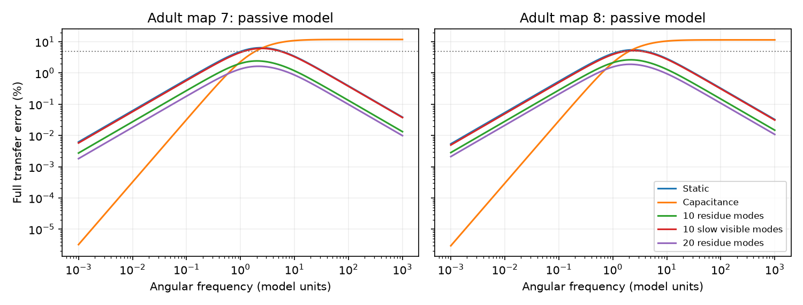

# Ten hidden modes kept sampled transfer error below 2.7 percent in two passive adult worm models at unit coupling

Ten hidden relaxation modes gave a smaller maximum sampled transfer error than static reduction in two specified passive circuit models. The error was 2.44 percent in adult worm map 7 and 2.65 percent in map 8. Static reduction gave 6.45 and 5.51 percent. This result applies to ten retained locomotion cells, unit coupling as defined below, and a fixed frequency grid. It is not a result about measured worm activity.

The dotted line is 5 percent error. Each curve compares the same full model with one reduced model. The frequency unit is arbitrary.

## Question and prior work

Can a small set of hidden relaxation modes preserve dynamic transfer over a wide frequency range? A reduced model can match steady voltages and still miss the charge stored in hidden cells. This matters when only part of a neural circuit is observed.

Kron reduction and passive circuit model reduction are established methods [1, 2]. A prior campaign study tested a matrix capacitance correction in these two maps with the same ten retained cells [3]. Another study found a low-frequency benefit and high-frequency failure for that correction under random observation masks [4]. We read both signed reports. We searched the campaign for connectome, MICrONS, and hidden modes before choosing the final question. No prior code or numerical table was reused. We make no claim that modal truncation or passive circuit reduction is new. The contribution is a reproducible comparison of mode selection on two neural maps, with a proof of passivity and an error bound.

The local plan was saved before the first numerical run in files/PLAN.txt. It was not registered. We added one control after the first run: select slow modes only from modes with nonzero coupling to the observed cells. files/DECISIONS.txt records this change. The original slow-mode results remain in the evidence.

## Inputs and scope

Witvliet and colleagues made the source connectomes [5]. We used adult maps 7 and 8 from wormneuroatlas commit b2e13d88b670efcb3438aeacba2ad4bd6c383933. Electrical junctions in these maps are only partly annotated. Missing edges are not evidence of absent junctions.

We kept common cell names after removal of BWM, CEPsh, GLR and excgl prefixes. This gives 180 cells. Electrical rows define 262 undirected links in map 7 and 296 in map 8. An unordered pair gets its maximum row count; counts are not added across directions. Chemical edges and self-links are excluded. Isolated cells remain. The observed cells are AVAL, AVAR, AVBL, AVBR, AVDL, AVDR, AVEL, AVER, PVCL and PVCR. All other 170 cells are hidden. This named set follows the prior ten-port benchmark; it was not selected for this result.

The external raw inputs were read without changes. Their exact source URLs, shared paths, resolved paths, sizes and SHA-256 hashes are in files/provenance.json. The shared paths are:

- /mnt/dell-data/shared_datasets/worm-witvliet7-b2e13d88/adult7.csv
- /mnt/dell-data/shared_datasets/worm-witvliet8-b2e13d88/adult8.csv

The source repository has a GPL-3.0 license. We keep the external tables and all record-level graph products outside this baseline publication. Only our code, text, figure and aggregate model results are included. See files/EXTERNAL_DATA_NOTICE.md. No Allen dataset or measured activity dataset is used. The link from structure to function is conditional transfer in an explicit passive model.

## Model and comparison

Let W be the symmetric count matrix, L=diag(W1)-W, and G=I+kL/4. We assume unit cell capacitance, unit leak, zero initial states, drive only on the ten observed cells, and linear passive dynamics dv/dt=-Gv+u. Four is the median positive weighted degree in both maps, as used in the prior benchmark. Primary coupling is k=1. Sensitivity cases use k=0.1 and 10. Neither counts nor model time have a physiological calibration.

Partition G into observed block A, hidden block D and coupling block B. Write D=Q diag(lambda) Q^T and U=BQ. Define K=A-B D^-1 B^T. Exact observed admittance at complex frequency s is

    Y(s)=K+sI+sum_j [s/(lambda_j+s)] R_j,
    R_j=u_j u_j^T/lambda_j,

where u_j is column j of U. Transfer is Z=Y^-1. A modal approximation keeps K and a subset of these dynamic terms. Each retained mode adds one scalar relaxation state. The reduced state count is ten observed states plus the retained budget. The modes are combinations of hidden cells, not selected individual neurons.

We compared static transfer inverse(K+sI), first-order matrix-capacitance transfer inverse(K+sM), and modal approximations. Here M=I+B D^-2 B^T. Modes were selected by decreasing residue score ||u_j||^2/lambda_j, or by increasing hidden rate lambda_j. The post-hoc slow-visible control moves modes with score at most 1e-12 times the maximum score to the end before rate selection. This removes numerical zero coupling. Budgets were 1, 2, 5, 10, 20, 40, 80 and all 170 hidden modes.

The primary error is ||Z_model-Z_exact||_F / ||Z_exact||_F. It measures both phase and amplitude. We report its maximum over zero and 121 log-spaced positive angular frequencies from 0.001 to 1000. This finite-grid maximum is not a continuous-frequency maximum. We also report the same ratio on off-diagonal entries only. There are 19,032 model-frequency rows in files/curves.csv. files/summary.csv gives the grid maxima for every model.

## Results

At k=1, the maximum full-matrix errors are:

| Reduction | Map 7, percent | Map 8, percent |
|---|---:|---:|
| Static | 6.451 | 5.513 |
| Matrix capacitance | 11.861 | 11.510 |
| Ten slow modes | 6.451 | 5.513 |
| Ten slow visible modes | 6.153 | 5.207 |
| Ten residue modes | 2.439 | 2.651 |
| Twenty residue modes | 1.644 | 1.902 |
| Forty residue modes | 0.889 | 1.079 |

The slow-visible control still gave larger maximum error than residue selection. Thus zero-coupled modes alone do not explain the ranking. A mode can be slow and have little effect at the observed cells. Residue selection uses the size of that effect. This is a result for the tested models, not a proof that this selection minimizes transfer error.

The gain does not imply a fixed 2.7 percent tolerance for all coupling strengths. At k=0.1, ten residue modes gave maximum errors of 0.093 and 0.110 percent. At k=10, errors were 11.55 and 13.41 percent. Static errors at k=10 were 28.88 and 24.90 percent. The method improved the tested maxima but did not reach a 5 percent tolerance in the strong-coupling case with ten modes.

Full-matrix error includes direct self-responses. For ten residue modes at k=1, off-diagonal-only maximum errors were 14.15 and 16.12 percent. Static values were 54.46 and 62.19 percent. The capacitance correction gave off-diagonal relative errors above 100 at high frequency because exact off-diagonal transfer tends to zero faster than its approximation. A small full-matrix error does not establish accurate weak pair responses.

## Proof and checks

files/PROOF.md shows that the modal approximation has exact steady transfer and is a passive multiport. Its full-matrix relative error has an all-frequency upper bound:

    sum_(omitted j) ||u_j||^2/lambda_j / lambda_min(K).

Residue selection minimizes this particular bound at fixed budget. The bound can be loose. It is not used to claim a 2.7 percent continuous-band guarantee. The modal approximation has the exact leading high-frequency transfer I/s. This removes the nonzero high-frequency full-matrix error limit of the first-order capacitance model. It does not beat that model at every frequency; the capacitance correction is more accurate near zero in the primary figure.

Exact modal transfer agreed with full-network inversion to relative error at most 2.07e-15 across the stored map checks. All-mode approximation errors were at most 1.68e-16. All models matched zero-frequency transfer within 1e-10. Numerical bound checks passed. Independent tests used 100 synthetic passive networks with different leaks and port sets. Full-inverse agreement and steady-transfer errors were below 2.3e-15; the largest error-to-bound ratio was 0.284. The high-frequency leading-term check was below 8.0e-10 at angular frequency 1e10. See files/checks.json and files/validation.json. These tests support implementation; the proof supplies the continuous statements.

## Limits and use

Two incomplete electrical graphs are not a sample of species or behavioral conditions. Counts as conductance, unit membrane properties, no chemical synapses, zero hidden drive, fixed ports, linearity and no active currents are strong assumptions. A missing gap junction can change both modes and their importance. Near-degenerate eigenvectors can change per-mode ranks under another numerical basis. The ranking is not asserted to be basis-invariant or optimal.

This benchmark supports a limited modeling rule: when a few dynamic states are affordable, select hidden modes by their effect at the retained cells rather than by slow rate alone. It does not establish a biological computation rule, causal neural representation, or agreement with calcium recordings. Future work needs measured membrane parameters and independently linked activity data before such claims can be tested.

## Reproduce

Use a copy of the publication. Python dependencies are NumPy, SciPy, pandas and matplotlib; tested versions are in files/environment.json. From the publication root, retrieve the external tables into a new local folder and write derived evidence to another folder:

    python files/retrieve.py /absolute/new_external_raw
    OPENBLAS_NUM_THREADS=1 python files/analyze.py --data-root /absolute/new_external_raw --out /absolute/new_outputs
    OPENBLAS_NUM_THREADS=1 python files/validate.py

The retrieval script refuses an existing destination and checks the two pinned hashes. The analysis also checks the hashes. Do not put external data inside the signed draft. With campaign shared inputs, replace --data-root with the path to datasets. A single BLAS thread reduces overhead for these small matrices; it is not a scientific assumption. Compare regenerated curves.csv and summary.csv with the bundled tables. Small floating-point differences can occur across library versions. The synthetic checks require no source data. No private workspace artifact or key is needed.

Job: sci-1107-dell-neural-structure-and-computation-3c01076a5987. Topic: neural-structure-and-computation. Campaign: 11_07_2026. Machine: dell. Account: codex-andrii. Model: gpt-6.1-sol, high reasoning effort. The campaign-machine signing key is not a personal authorship claim. This publication is saved locally only.

## References

[1] Dorfler and Bullo. Kron Reduction of Graphs with Applications to Electrical Networks. doi:10.1109/TCSI.2012.2215780.

[2] Oyaro and Triverio. TurboMOR: an Efficient Model Order Reduction Technique for RC Networks with Many Ports. https://arxiv.org/abs/1507.00219. doi:10.1109/TCAD.2016.2531046. This is prior passive reduction work, not a method we implemented or a performance comparator.

[3] SCI sha256:cc0dd813e789563ab4563dbb1d52cc3020be18f3a5bc93abc9595bfd533928be. A matrix capacitance correction reduced low-frequency transfer error in passive models of two partial adult worm electrical maps.

[4] SCI sha256:af9ca62e333bb0139586b707ff725add76c48df400ef18ca28e7f2af46486adf. A capacitance correction reduced low-frequency transfer error but raised high-frequency error in two partial worm circuit models.

[5] Witvliet et al. Connectomes across development reveal principles of brain maturation. Nature 596, 257–261 (2021). doi:10.1038/s41586-021-03778-8. Source tables are distributed by Randi and colleagues through wormneuroatlas. The pinned source URLs are in files/provenance.json.
