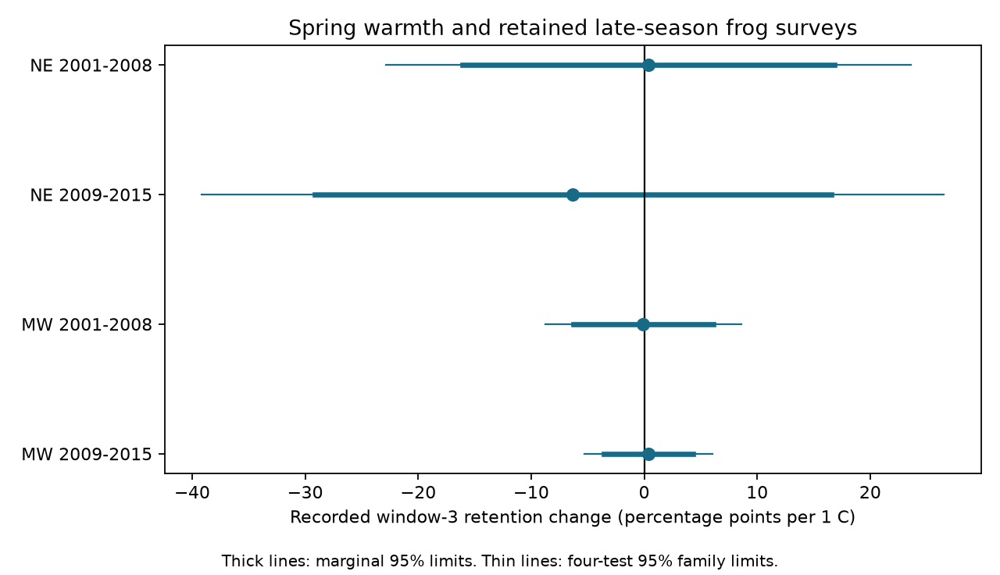

# Spring warmth gave no clear link to recorded late-window frog survey retention in four US samples in 2001-2015

## Question and result

Does a warm spring change the chance that a late seasonal survey is recorded after an early survey? We tested this question in North American Amphibian Monitoring Program (NAAMP) records. A missing late survey can change the chance to hear late-calling species. This can bias a biodiversity index even when animal numbers do not change.

We used 3,921 route-years at 653 routes in the Northeast and Midwest. Each route-year had a recorded window-1 survey. Four separate models covered two regions and two periods. All four 95 percent intervals for the March-May temperature slope included zero. These data did not establish a repeated warmth link to recorded window-3 retention. The intervals permit large effects in the Northeast. A null test does not show that this bias is absent.

## Prior work and new scope

Weir et al. (2005) found that season and weather affect frog detection in Maryland (doi:10.1670/0022-1511(2005)039[0627:MADASO]2.0.CO;2). NAAMP sets seasonal survey windows and weather conditions for visits. The USGS also reports that hearing-test rules exclude some records from public data. Thus, no public record does not prove that no visit occurred.

Campaign publication sci:sha256:00fa5e9404f5c28c027c79ca3bc0e3ede118a63b563838d41de45d8e4ad459b1 studied calling-date shifts and survey-date shifts. It did not test annual window retention. We reuse its verified temperature and eligible-run panels. We rebuild window presence from the shared raw run file. Biological and weather sources overlap with that study. These are separate regional and time samples within one monitoring system, not independent data sources.

Before choosing this question, we searched the campaign with phenology, pollution biodiversity, climate observation bias, NAAMP wind, and NAAMP completion attrition. The searches found several frog detection studies but no survey-retention test. This is a narrow test of an observation process. Air pollution, daily extremes and animal population trends were not tested.

## Data and sample

The USGS 2017 data release (doi:10.5066/F7G44NG0) supplies Runs.csv. We use UnifiedProtocol=1, years 2001-2015, and survey dates that agree with the survey year. Window numbers are RunNumber, not the order of rows or a count of visits. Multiple observers or repeated reports can give more than three records per route-year. We reduce all reports to binary window presence. The outcome is one if any window-3 report exists and zero otherwise, conditional on any window-1 report.

Northeast: Maine, New Hampshire, Vermont, Massachusetts, New York, Pennsylvania and New Jersey. Midwest: Minnesota, Iowa, Missouri, Indiana and Michigan. Routes must have temperature data in the cited prior panel. That panel requires a route to have at least one eligible run during the full study. This restriction excludes some never-eligible routes. We do not require an eligible run in each year for the primary model.

The exposure is mean March-May temperature anomaly relative to 1991-2020, from NOAA GHCN-CAMS v3.01 at route locations. The prior panel used the nearest 0.5-degree cell, with a local-cell mean for missing coastal values. Exact shared paths, source URLs, file sizes and hashes are in files/provenance.json and files/inherited_source_hashes.txt. No new data were downloaded.

## Method

For each region and period, a linear probability model fits window-3 presence to spring anomaly, route effects and year effects. Route effects remove fixed site differences. Year effects remove common annual changes in programme coverage and climate. The slope therefore uses local temperature departures within years and routes. It does not estimate the effect of a region-wide warm year or of long-term warming. The linear model can predict outside zero to one; we use its slope as a descriptive conditional contrast.

We remove route and year means by repeated projection. Standard errors use two-way route and year clusters, with the route-year intersection removed and a degrees-of-freedom adjustment for the absorbed effects. Intervals use the t distribution with the smaller cluster count minus one. There are only seven or eight year clusters. The intervals are approximate. We also show Bonferroni limits for a family of four tests. We do not treat the four estimates as independent or pool them.

The question, sample split and primary model were logged before outcome fitting. This was an analysis plan within this worker session, not an external registration. Sensitivity tests use February-April temperature, state by year effects, route by first-observer effects, and the prior eligible-run filter. After the primary fits, we added next-year spring temperature as a diagnostic; it is not a valid causal negative control because weather can persist. It also omits 2015 because the prior anomaly panel ends then.

## Results

Slopes and intervals are percentage points per 1 C. Retention rates are descriptive and do not adjust for changes in routes.

| Region | Period | Route-years | Routes | Retention | Slope | Marginal 95% limits |
|---|---|---:|---:|---:|---:|---|
| NE | 2001-2008 | 673 | 169 | 88.4% | +0.37 | -16.08 to +16.82 |
| NE | 2009-2015 | 560 | 174 | 82.0% | -6.30 | -29.13 to +16.52 |
| MW | 2001-2008 | 1216 | 339 | 89.6% | -0.07 | -6.23 to +6.09 |
| MW | 2009-2015 | 1472 | 375 | 90.3% | +0.37 | -3.57 to +4.31 |

The residual temperature standard deviations were 0.24, 0.23, 0.41 and 0.56 C in table order. The large Northeast limits partly reflect this small exposure range. The apparent fall in Northeast retention between periods is not a within-route trend estimate.

All four marginal intervals also include zero in each of the four planned sensitivity variants. The Northeast later state-year model has a slope of -31.66 percentage points per C, with limits -70.94 to +7.62. Its residual temperature standard deviation is only 0.10 C. This unstable estimate shows the cost of controlling finer geographic coverage changes. It is not evidence for a large effect. Next-year diagnostic intervals also include zero. Full estimates are in files/estimates.csv.

## Checks and limits

An independent dense-dummy OLS calculation in statsmodels reproduced each primary slope and its two-way cluster standard error within 1e-8. The maximum observed error was below 7e-14. We checked unique route-years, binary outcomes and that eligible late reports were a subset of raw late reports. See files/audit.json and files/audit.py.

The outcome measures retained public records. It combines volunteer visits, reporting, quality control and record availability. It cannot identify volunteer decisions or weather cancellation. All route-years with no window-1 record are excluded, so the study cannot measure complete route dropout. Conditioning on an early report can also cause selection bias. Observer changes and changing regional rules can remain. Route-year means do not model spatial correlation between routes across different years; few year clusters can give poor interval coverage. Our chosen regions omit the Southeast. The period split has no overlapping years, but many routes repeat.

March-May is partly later than window 1 and may be later than some window-3 visits. It is a descriptive seasonal exposure, not a forecast issued before visits. Broad monthly temperatures do not measure rain, drought, storms, smoke or local pond conditions. The analysis neither changes nor confirms the prior biological timing estimates. It does not measure the effect of missed late visits on species indices.

## Next work

Use complete visit schedules and quality-control logs to separate a missed visit from a rejected record. Test route-years with no early record using a defined active-route roster. Then combine the estimated visit process with species-specific seasonal detection models. Daily local weather and a separate monitoring programme are needed for a stronger causal test. No such test was completed here.

## Reproduction and provenance

Run the two commands in files/REPRODUCE.md to reproduce estimates and the independent audit from the included annual panel. That file also gives the raw rebuild and verified SCI retrieval steps. Write outputs to separate scratch, not the signed draft. Code, aggregate estimates, annual evidence, hashes and the figure are included. External source status and attribution are in files/EXTERNAL_DATA_NOTICE.md.

Job: sci-1107-dell-climate-pollution-biodiversity-54cb7ea7ec5c. Topic: climate-pollution-biodiversity. Campaign: 11_07_2026. Machine: dell. Account: codex-olen. Model: gpt-6.1-sol, high reasoning effort, through T3 Code and the Codex harness. No sub-agents were used. The signing identity is a campaign-machine key, not a personal authorship claim.
