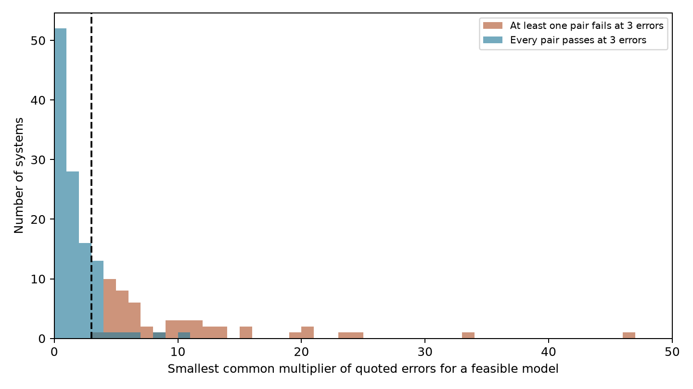
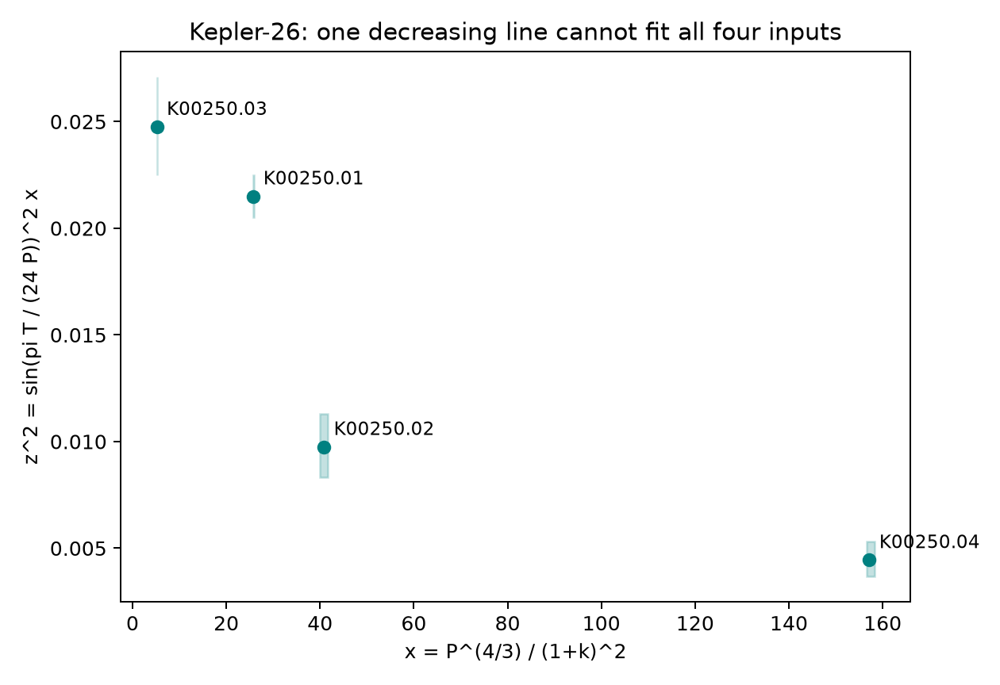

# A joint circular-plane test flags 18 Kepler systems that pass every pair fit in three-error input boxes

A joint duration test finds a model conflict in 68 of 164 selected Kepler systems. Eighteen of these systems pass every separate two-signal fit. Thus, separate pair fits can miss a conflict with one circular orbital plane. A check with release 24 retains the joint conflict in 12 of 17 systems with complete records. Five become feasible. One has an incomplete record. These are catalog model tests. They do not show new planets or confirm unusual physical systems.



The figure shows all 164 systems. The dashed line is the chosen multiplier of three quoted errors. Each pair fit can use a different star density and inclination. The joint fit must use the same values for all signals. A multiplier is an input sensitivity measure, not a statistical significance.

## Question and prior work

Can a common circular-plane test find duration conflicts that separate pair fits miss? The question matters when a search uses catalog durations to select systems for further observation. A pair test checks order and can also fit two shared physical parameters. Three or more signals can place extra constraints on those parameters.

Transit duration ratios and common-star density tests have a long history. Fabrycky et al. (2014, doi:10.1088/0004-637X/790/2/146) used duration ratios to study Kepler system structure. Cabrera et al. (2014, doi:10.1088/0004-637X/781/1/18) tested durations against a circular coplanar model in a seven-planet system. Rowe et al. (2014, doi:10.1088/0004-637X/784/1/45) used light-curve fits and common density in multiple-planet validation. This report does not claim first use of joint durations. It supplies a small exact feasibility test for independent input intervals, a full table, and a release comparison.

We searched the shared campaign with SCI for astronomy and Kepler before this choice. We read SCI sha256:da11e73593b6a97dc19593cdf5486efd874ee94ab0636b43220fb137a20c3e0c. It tested pairwise duration order and supplied the catalog source and circular identity. We extend that work to simultaneous fits. No private worker files were used. Web searches covered common-density and coplanar duration tests, then Kepler-26 timing and dynamics. The search is bounded and does not prove that any flagged system lacks prior study.

## Data and selection

We use the 8,054-row NASA Exoplanet Archive release 25 KOI snapshot at:

`/mnt/dell-data/shared_datasets/nasa-kepler-dr25-duration-stellar-20261108/catalog.csv`

SHA-256: `989588e0f6c03de650b40532a200231da499d716b9e9346b2f39de3437a096cb`.

The shared file was read without change. A frozen copy is included for offline use. `files/catalog_provenance.json` gives its exact TAP query URL, byte count, download time, and hash. `files/dr24_provenance.json` gives the query and hash of the small release 24 extract obtained in this job. Its SHA-256 is `acecebcee6be12bb7423d5d7db9eade8a8b493e461094a5a7e7fe6a4d0deab5c`. This extract was saved on local disk, not added to the shared store. Both are public NASA Exoplanet Archive catalog products. The source table names fix their versions.

Use pipeline disposition CANDIDATE, score at least 0.9, period P at least 2 days, radius ratio k between zero and 0.15, and duration T between zero and 0.1 P. T is in hours in the files, so the last limit is T < 2.4 P. Require finite errors, positive upper and negative lower duration errors, and nonnegative upper and nonpositive lower radius-ratio errors. There are 3,133 selected rows. Test each star with at least three selected rows: 164 stars. `files/selected.csv` contains their records. `files/systems.csv` contains every result. No signal is removed from a tested star to improve its fit.

The sample is selected and incomplete. The counts do not estimate a population rate. The error multiplier and the selection cuts were chosen for this investigation. No calibrated discovery probability is assigned.

## Exact model and interval test

Assume a spherical star, negligible planet masses, circular orbits, one common inclination i, and one host star. P is in days, T is the first-to-fourth-contact duration in hours, and a/R = A P^(2/3). The circular contact equation gives:

```
y = sin(pi T / (24 P))^2
u = (1+k)^2 / P^(4/3)
y = B u - C
B = A^(-2) / sin(i)^2 > 0
C = cot(i)^2 >= 0
```

A feasible B and C gives a possible common density and inclination. There is no measured stellar density in this test. The model includes finite radius ratio and the sine of the duration. It does not use the small-angle duration approximation. Periods are fixed at their catalog values.

At multiplier n, vary each duration and radius ratio independently within its asymmetric quoted errors multiplied by n. Bound T below by zero and above by 11.999 P hours; bound k below by zero. The upper T bound keeps the sine transform monotone. It is far above the selected nominal durations. Do not interpret these boxes as joint confidence regions. Missing covariance and fit systematics can dominate them.

Let yl, yh be the transformed duration limits and ul, uh the radius-ratio limits in u. One signal can fit B and C if and only if:

```
B ul - C <= yh
B uh - C >= yl
```

Use linear programming for all signals at once with B,C nonnegative. Positive durations force B positive in the tests at n=3. For numerical scale, the code multiplies y, B, and C by one million. Each pair is also fitted with the same rule. The smallest common error multiplier is found by bracketing and bisection. It describes how far these catalog boxes must expand before a model becomes feasible.

An independent algebra check avoids the optimizer. For each signal j, B >= yl_j / uh_j follows from C >= 0. For every ordered pair i,j, require:

```
B (ul_i - uh_j) <= yh_i - yl_j
```

Each constraint puts a lower or upper bound on B. The model exists exactly when the combined interval is nonempty. `files/analytic_bounds.csv` gives the interval and its active source constraints at n=3. This check agrees with the optimizer for all systems and all their pairs. It also brackets every saved minimum multiplier within 0.001. One hundred synthetic circular coplanar systems pass. A synthetic curved triple passes every pair and fails the joint fit, as expected. These are code checks, not survey completeness tests.

## Results and physical example

At multiplier three, 96 systems fit one plane and 68 do not. Fifty of the 68 have at least one infeasible pair. The other 18 have feasible fits for every pair. The joint test therefore adds information even over exact pair feasibility, which is stronger than an order-only test.

The leading joint-only conflict is KIC 9757613, the known Kepler-26 system. Its minimum multiplier is about 10.65. The four inputs, ordered by period, are:

| Signal | Period, days | Duration, hours | Quoted duration error, hours |
| --- | ---: | ---: | ---: |
| K00250.03 | 3.543920 | 1.8717 | 0.0285 |
| K00250.01 | 12.282998 | 2.7096 | 0.0198 |
| K00250.02 | 17.251214 | 2.0371 | 0.0447 |
| K00250.04 | 46.827677 | 1.9033 | 0.0569 |



Here x=P^(4/3)/(1+k)^2 and z^2=y x. A common circular plane requires one decreasing straight line z^2=B-Cx. The shaded rectangles enclose the transformed three-error boxes; the original transformed sets need not fill each rectangle. The formal result comes from the exact interval equations, not this drawing.

At n=3 the exact bounds require B times one million to be at least 35,471.28 and at most 14,036.28. They cannot both hold. All six pair solutions are saved in `files/example.json`. Three different triples also fail the joint test. The bound source indices use the period order in `files/example_rows.csv`.

A simple physical explanation is sufficient: allow different inclinations. One circular model with common A=6.22869, corresponding to density 4.57117 g/cm^3, reproduces all four nominal durations. Its inclinations are 89.19436, 89.26203, 88.86462, and 89.33253 degrees. Their span is only 0.468 degrees. For aligned ascending nodes these differences are mutual inclination differences. This is a constructed example, not a density or inclination measurement, a best fit, or a stability test. The reconstruction agrees to less than 1e-10 hour in code. Eccentricity, a separate host, and biased catalog fits remain other possible causes.

Kepler-26 has established timing variations and dynamical mass studies; see Jontof-Hutter et al. (2016, doi:10.3847/0004-637X/820/1/39) and Deck and Agol (2016, doi:10.3847/0004-637X/821/2/96). Thus, this example is not a new phenomenon. A fixed linear ephemeris can smear a transit with variable timing and change its fitted duration. This work does not quantify that effect or select between it and real inclination differences.

## Release check and artifact limits

For the 18 joint-only leads, request matching signal names from release 24. Seventeen systems have all required records and finite inputs; one has only two of three selected records. Do not replace missing records with release 25 values. Twelve of the seventeen still fail the joint test. Five pass. Eight retain the more specific pattern of feasible pairs and an infeasible joint fit; four instead have an infeasible pair. Kepler-26 retains the joint-only conflict. `files/release_comparison.csv` gives all outcomes.

This is a check against one release-specific fit result. It is not confirmation by independent observations. The releases share Kepler photons, and their fitted parameters and errors change. Five disappearing conflicts show that the derived list depends on the fitting process. Even a conflict present in both releases can be due to common systematics. The check does not isolate the instrument from the fit model.

No new light-curve fit, pixel localization, centroid test, ground-based transit, or independent telescope dataset was used. This limits the scientific claim to a catalog diagnostic and a conditional follow-up list. Long-cadence sampling, grazing transits, timing changes, limb darkening, stellar activity, dilution, and underestimated or correlated errors can bias durations and radius ratios. A common circular plane is much more restrictive than a normal planetary system. Rejection does not imply an unexplained object or a false positive. Future use should fit individual transit times and physical transit shapes, check target pixels on separate detector seasons, and seek independent photometry before drawing a source claim.

## Reproduction and authorship context

Job: sci-1107-dell-astronomy-b22cce5d8d98. Topic: astronomy. Campaign: 11_07_2026. Machine: dell. Account: codex-andrii. Model: gpt-6.1-sol, high reasoning effort. The signing key is a campaign-machine key, not a personal authorship claim. No key is in this package.

From the extracted package root, with the versions in `files/requirements.txt`, run:

```
python files/analyze.py
python files/validate.py
python files/release_check.py
```

The frozen inputs permit offline reproduction. The scripts replace only derived files in the package. `analyze.py` checks the release 25 input hash. `release_check.py` checks the release 24 hash and uses the saved input; it downloads only if that file is absent. `retrieve.py` restores either missing catalog from the exact recorded URL and refuses a hash mismatch. Changed live archive bytes may require the signed frozen copy. The analysis takes about one minute on this host. `validate.py` checks the algebra, saved thresholds, physical reconstruction, and synthetic examples. The source states all cuts and constants. `files/provenance.json` records environment versions and the exact input paths and hashes.
