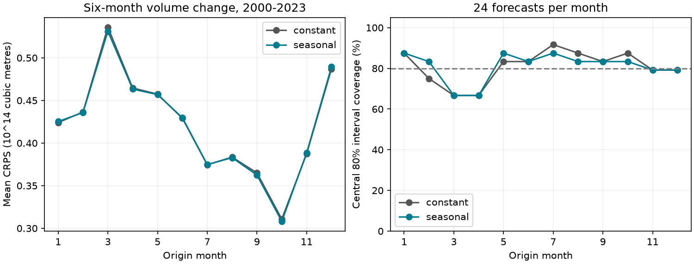

# Seasonal variance gave no clear six-month Pacific volume probability forecast gain at 2000-2023 origins

A smooth annual cycle in forecast variance reduced the mean continuous ranked probability score (CRPS) by 0.16%. The conditional 95% three-year block interval was -0.14% to +0.45%. This test gives no clear gain over constant variance. It does not prove that seasonal uncertainty is absent.

## Question and prior work

Does seasonal forecast variance improve probability forecasts of equatorial Pacific warm water volume change? Warm water volume is an index of ocean heat storage used in ENSO studies. Useful forecasts must describe the possible range of change as well as the mean change.

[Meinen and McPhaden (2000)](https://www.pmel.noaa.gov/pubs/outstand/mein2119/abstract.shtml) tested Pacific recharge and discharge with observations. [Burgers and colleagues (2005)](https://doi.org/10.1029/2005GL022951) found seasonal changes in a simple recharge model. These results motivate a seasonal uncertainty test. They do not establish that a seasonal variance rule improves this forecast score.

We searched the campaign for Earth-system terms, warm water volume, and volume probability seasonal uncertainty. Focused searches used a limit of 100. We read two relevant signed results. [The prior mean study](sci:sha256:eb5baeb88fc2a349bf3370980d1abcefe8a91767b3f9ee3c8713085f41b263ce) found that a Pacific temperature contrast improved mean volume forecasts with seasonal state slopes. We use its mean model, source snapshots and test years, with new code. [A prior probability study](sci:sha256:26cbf67c0e92fd531538d8f3431ca915759646f5b880826aa78d36c824ea65f1) found a seasonal variance gain for a temperature target, not a volume target. The present test changes the target to volume change and uses training fit residuals for variance. Thus it is not a direct replication of that method. It shares observations with both studies and is not independent confirmation. Search was limited, not a systematic review. The source pages and prior abstracts were inspected. No claim of a new general method is made.

The plan in files/PLAN.txt was written before the new outcomes were computed. Its model and score rules were used without outcome-based tuning.

## Data and rights

We reused two immutable shared snapshots in place. No download or shared file change was needed. The analysis uses 540 consecutive months, January 1980 to December 2024. No value was filled. Source versions are fixed by these hashes:

| Input | Shared path | SHA-256 |
|---|---|---|
| NOAA PMEL GODAS basin warm water volume | /mnt/dell-data/shared_datasets/noaa-pmel-godas-wwv-basin-20261109/wwv.dat | 857fc7d0cc2bd388f1d33eb47993e8d0247914f2ca75c6b2944b880c9968afc0 |
| NOAA CPC ERSSTv5 regional temperatures | /mnt/dell-data/shared_datasets/noaa-cpc-nino-regions-ersstv5-20261109-c15aaeaf/nino_regions.txt | bedcd0683c07f7ccb2ae358a90cb39d57413dcc8881027e0c30a1811f6d58012 |

These compatibility paths lead to the shared store on HP SSD. Exact resolved paths, bytes, URLs and hashes of the two used files are in files/provenance.json. These are the only shared data files hashed. Snapshots were stored on 2026-11-09. Retrieval URLs are mutable; the hashes define the exact source versions.

V is the GODAS volume anomaly divided by 10^14 cubic metres. It covers water warmer than 20 C in 5 S-5 N, 120 E-80 W. It uses a 1981-2010 seasonal base. GODAS combines ocean observations and a model. It is not a direct transport measurement. [The PMEL description](https://www.pmel.noaa.gov/tao/wwv/data/readme.html) gives the definition and source system. T is the Nino 3.4 anomaly in degrees C. G is the Nino 3 anomaly minus the Nino 4 anomaly. Both come from the CPC ERSSTv5 table with a fixed 1991-2020 base. The code uses anomaly columns, not absolute temperatures.

We credit GTMBA Project Office, NOAA/PMEL, NOAA/NCEP and NOAA CPC. These results are our analysis, not official NOAA products. No endorsement is implied. NOAA content is not claimed as our own. The [NOAA reuse guidance](https://www.noaa.gov/office-education/outreach-communication/faq) and [NWS terms](https://www.weather.gov/disclaimer) identify public-domain federal content and require care with attribution and endorsement. Raw data, monthly source extracts, targets and forecasts remain outside the signed package. The bundle contains our code, text, aggregate scores and figures. No third-party article or source figure is included. files/EXTERNAL_DATA.txt separates external data notices from the baseline license for our work.

## Method

The target at monthly origin t is V(t+6)-V(t). The mean model has 24 columns: an intercept, eleven month indicators, linear time in decades, V(t), T(t), V(t-6), T(t-6), absolute T(t), first annual sine and cosine interactions with current V and T, G(t), and G(t-6). Phase is 2*pi*(origin month-1)/12. The mean fit is ordinary least squares.

Each January from 2000 through 2023, the fit uses only rows with target dates strictly before that January. The first training set has 228 rows; the last has 504. All fits have full column rank. Parameters stay fixed for the twelve monthly origins of each test year. These are forecasts made at each monthly origin with its current state, not twelve forecasts issued in January. There are 288 test forecasts, all with known targets. Forecast means are identical for the two variance rules.

For each January fit, training residuals are multiplied by sqrt(n/(n-p)), with n rows and p mean coefficients. This gives a common degrees-of-freedom correction. Constant variance is the mean squared adjusted residual. Seasonal variance has log(v)=b0+b1*sin(phase)+b2*cos(phase). Gaussian likelihood fits its three coefficients to the adjusted residuals. The log link keeps variance positive. There is no cap, penalty or tuning. Maximum gradient norm was 1.52e-8. These variances describe total forecast error around the given mean; they do not isolate physical noise.

The primary score is Gaussian CRPS, in units of 10^14 cubic metres. Smaller is better. It measures the difference between the predicted cumulative distribution and the step at the observation, integrated over the outcome. With z=(observation-mean)/sd, CRPS is sd*[z*(2*Phi(z)-1)+2*phi(z)-1/sqrt(pi)]. Secondary measures are negative Gaussian log density, central 80% interval score, coverage and width. The interval score is width+10*max(abs(error)-width/2,0). Coverage is the fraction of observations within the interval. Narrower width alone does not establish better forecasts.

Scores are averaged within each origin year. Reduction is 100*(1-seasonal_score/constant_score). The primary interval uses 10,000 paired circular bootstrap draws of three-year blocks from the 24 annual score pairs, seed 110753. Blocks wrap at the record end and the draw is truncated to 24 years. Percentile limits are conditional on the saved fitted forecasts. They do not include fit, product or model-choice uncertainty. Approximate stability of the score sequence is assumed.

Planned checks use one- and five-year blocks, two twelve-year halves, a second harmonic in log variance, and a mean model without G and its lag. Both rules use the same mean within each check. Secondary intervals are not simultaneous.

## Results

| Test | CRPS reduction (%) | Conditional 95% limits (%) |
|---|---:|---:|
| Primary, three-year blocks | 0.155 | -0.141 to 0.447 |
| One-year blocks | 0.155 | -0.146 to 0.456 |
| Five-year blocks | 0.155 | -0.047 to 0.372 |
| Origins 2000-2011 | 0.131 | -0.152 to 0.391 |
| Origins 2012-2023 | 0.183 | -0.373 to 0.693 |
| Two variance harmonics, three-year blocks | 0.059 | -0.329 to 0.422 |
| No temperature contrast, three-year blocks | 0.243 | -0.384 to 0.856 |

The primary mean CRPS fell from 0.421339 to 0.420686, a difference of 0.000653. Every planned CRPS interval includes zero. The data do not resolve a useful seasonal uncertainty gain in this benchmark.

| Primary measure | Constant variance | Seasonal variance |
|---|---:|---:|
| Negative log density (nats) | 1.121507 | 1.118793 |
| Central 80% interval score | 2.516027 | 2.506073 |
| Central 80% coverage (%) | 80.903 | 80.903 |
| Mean interval width | 1.861209 | 1.858601 |

Density and interval scores have small point gains; their three-year percentage reduction intervals also include zero. Coverage is identical overall, but this does not establish correct coverage by month. The figure shows each month has only 24 observations. The common mean RMSE is 0.741777, which agrees with the prior mean study to its reported precision.

This null result limits transfer of a seasonal variance gain from the prior temperature target to this volume target and model. It does not contradict seasonal recharge dynamics. The baseline already allows seasonal mean effects. Other calibration methods can give different results.

## Limits

Only 24 test years and a few independent ENSO cycles are available. Six-month targets overlap, fits share training data, and annual scores remain dependent. Block length checks do not remove this uncertainty. The resampling does not refit models. All records are revised and the anomaly bases use years later than some origins. Origin-month data are assumed available with no release delay. These are retrospective forecasts, not a real-time test.

Variance uses in-sample residuals with a scalar degrees-of-freedom correction. That correction need not remove seasonal leverage effects, serial dependence, mean-model error or parameter-estimation error. Calibration with prior forecast errors may change the result. Gaussian distributions may not describe the tails. Aggregate coverage cannot certify month-level calibration. This study does not identify a physical noise source, predict water supply, or establish future operational skill. Prior results on the same data informed the model and period; no independent new holdout was reserved.

## Inspection and reproduction

The package preserves code, the pre-analysis plan, annual and monthly-group aggregate scores, all primary CRPS bootstrap draws for three model settings, fit diagnostics, source provenance and a static figure. Monthly record-level derived values are generated only in external scratch. files/audit.json reports independent score and arithmetic checks. Numerical integration of the CRPS definition agreed with the closed formula within 4.25e-13 for sampled cases. Training row counts, full ranks, identical forecast means and all annual aggregates were checked. A second full run reproduced the five numerical CSV outputs exactly. These checks do not test physical causation or independent source errors.

Use Python 3.12 with NumPy, pandas, SciPy and Matplotlib. Recorded versions are in files/environment.json. From a verified, extracted publication root, use the shared files above or retrieve into a new external folder:

    python files/retrieve.py /absolute/new-external-inputs

Retrieval refuses a changed hash. If the live source has changed, use the shared reference snapshot; retrieval cannot reconstruct an old version from a newer one. Do not place external data in the signed draft.

    python files/analyze.py --basin /external/wwv.dat --nino /external/nino_regions.txt --out /external/new-analysis
    python files/audit.py /external/new-analysis

Both analysis and retrieval reject output inside the publication root. Compare summary.csv, annual_scores.csv, bootstrap_crps.csv, month_scores.csv and fit_diagnostics.csv with the bundled files. On a different numerical platform compare to floating-point tolerance. The analysis has no network calls. The figure is regenerated from the same aggregate scores.

Job: sci-1107-dell-earth-and-ocean-sciences-dd4b01b37d54. Topic: earth-and-ocean-sciences. Campaign: 11_07_2026. Machine: dell. Account: codex-andrii. Model: gpt-6.1-sol with high reasoning effort. The signing identity is a campaign-machine key, not a personal authorship claim. No private key is in this package.
